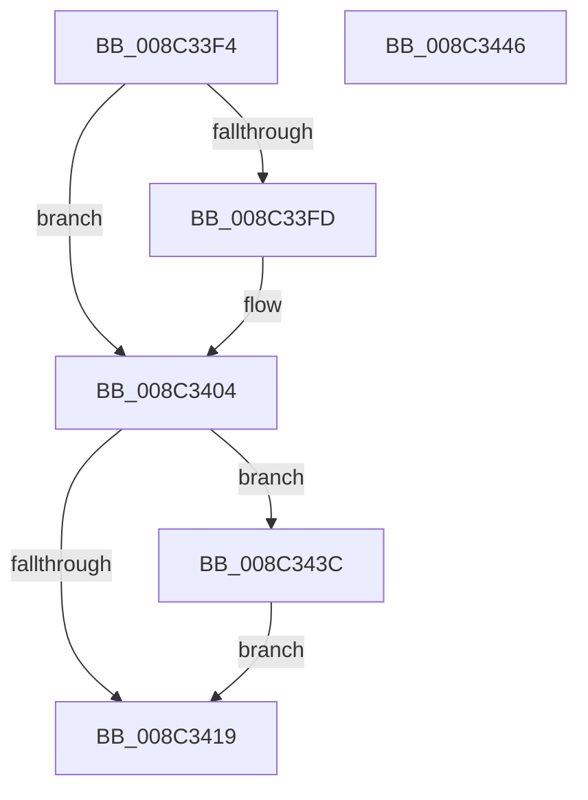

# sub_008C33F4

- RVA: `0x008C33F4`–`0x008C3464` (길이 `112` bytes)
- VA: `0x00000001408C33F4`
- 실행 섹션: `PAGE`
- PDB 이름 있음: `아니요`; PDB Function 태그: `아니요`
- unwind 정보 RVA: `0x00083804`
- 디코드: `28`개 명령, `112/112` bytes 표시
- 미해석 바이트: `0` (있으면 어셈블리에 `.byte`로 보존)

> 이 문서는 커널 이미지의 기계어와 PDB 기호를 분석해 생성했습니다. 4번과 5번은 함수 원형과 자료형을 바이너리 사용 방식에서 추정한 C 해석이며 원본 소스 복구 결과는 아닙니다.

## 1. Dependencies

- 직접 호출 지점: **5**; 고유 호출 대상: **5**
- 직접 호출자로 확인된 함수: **0**
- RIP 상대 이미지 참조: **0**

### Outgoing calls
- `0x008C341C` → [KeAbPostRelease](../../text/2E/KeAbPostRelease_function_002E1600.md) (function, `0x002E1600`)
- `0x008C342A` → [KeLeaveCriticalRegionThread](../../text/25/KeLeaveCriticalRegionThread_function_0025EFF0.md) (function, `0x0025EFF0`)
- `0x008C3432` → [EtwpFreeGuidEntry](EtwpFreeGuidEntry_function_008C42E4.md) (function, `0x008C42E4`)
- `0x008C343F` → [ExfTryToWakePushLock](../../text/26/ExfTryToWakePushLock_function_00265DD0.md) (function, `0x00265DD0`)
- `0x008C345E` → [KeBugCheckEx](../../text/4F/KeBugCheckEx_function_004FD660.md) (function, `0x004FD660`)

### Direct callers
- 이 함수 시작 RVA로 연결되는 직접 call은 확인되지 않았습니다. 간접 호출은 완전히 역산할 수 없습니다.

### Static image references
- 디코드된 RIP-relative 메모리 참조가 없습니다.

## 2. Other-region calls and transfers

- 다른 실행 섹션으로 향하는 call: **4**
  - `0x008C341C` → [KeAbPostRelease](../../text/2E/KeAbPostRelease_function_002E1600.md) (`PAGE` → `.text`)
  - `0x008C342A` → [KeLeaveCriticalRegionThread](../../text/25/KeLeaveCriticalRegionThread_function_0025EFF0.md) (`PAGE` → `.text`)
  - `0x008C343F` → [ExfTryToWakePushLock](../../text/26/ExfTryToWakePushLock_function_00265DD0.md) (`PAGE` → `.text`)
  - `0x008C345E` → [KeBugCheckEx](../../text/4F/KeBugCheckEx_function_004FD660.md) (`PAGE` → `.text`)
- call이 아닌 외부 분기/꼬리 이동: **1**
  - `0x008C3437` → [EtwpUnreferenceGuidEntry + 0x36](EtwpUnreferenceGuidEntry_function_008C3320.md) (`tail-transfer`)

## 3. Assembly (complete function range)

```asm
008C33F4  48 8B 46 08                     mov rax, qword ptr [rsi + 8]
008C33F8  48 39 30                        cmp qword ptr [rax], rsi
008C33FB  74 07                           je 0x1408c3404
008C33FD  B9 03 00 00 00                  mov ecx, 3
008C3402  CD 29                           int 0x29
008C3404  48 89 08                        mov qword ptr [rax], rcx
008C3407  48 89 41 08                     mov qword ptr [rcx + 8], rax
008C340B  F0 48 0F C1 5D 00               lock xadd qword ptr [rbp], rbx
008C3411  80 E3 06                        and bl, 6
008C3414  80 FB 02                        cmp bl, 2
008C3417  74 23                           je 0x1408c343c
008C3419  48 8B CD                        mov rcx, rbp
008C341C  E8 DF E1 A1 FF                  call 0x1402e1600
008C3421  65 48 8B 0C 25 88 01 00 00      mov rcx, qword ptr gs:[0x188]
008C342A  E8 C1 BB 99 FF                  call 0x14025eff0
008C342F  48 8B CE                        mov rcx, rsi
008C3432  E8 AD 0E 00 00                  call 0x1408c42e4
008C3437  E9 1A FF FF FF                  jmp 0x1408c3356
008C343C  48 8B CD                        mov rcx, rbp
008C343F  E8 8C 29 9A FF                  call 0x140265dd0
008C3444  EB D3                           jmp 0x1408c3419
008C3446  45 33 C9                        xor r9d, r9d
008C3449  48 C7 44 24 20 00 00 00 00      mov qword ptr [rsp + 0x20], 0
008C3452  4C 8B C6                        mov r8, rsi
008C3455  B9 1D 01 00 00                  mov ecx, 0x11d
008C345A  41 8D 51 09                     lea edx, [r9 + 9]
008C345E  E8 FD A1 C3 FF                  call 0x1404fd660
008C3463  CC                              int3
```

## 4. C-style interpretation (structured pseudocode)

```c
__int64 __fastcall sub_008C33F4(__int64 a1, __int64 a2, __int64 a3, int a4)
{
    __int64 result;
    __int64 v_rbx;
    unsigned __int64 v_stack_p20;

    if ((*(unsigned __int64 *)(*(unsigned __int64 *)(v_rsi + 8))) != v_rsi) {
        a1 = 3;
    }
    *(unsigned __int64 *)(*(unsigned __int64 *)(v_rsi + 8)) = a1;
    *(unsigned __int64 *)(a1 + 8) = *(unsigned __int64 *)(v_rsi + 8);
    v_rbx = (unsigned __int8)((v_rbx) & (6));
    if (((unsigned __int8)(v_rbx)) == 2) goto loc_008C343C;
loc_008C3419:
    result = KeAbPostRelease(v_rbp, a2, a3, a4);
    result = KeLeaveCriticalRegionThread(*(unsigned __int64 *)(gs_base + (0 + 392)), a2, a3, a4);
    result = EtwpFreeGuidEntry(v_rsi, a2, a3, a4);
loc_008C343C:
    result = ExfTryToWakePushLock(v_rbp, a2, a3, a4);
    goto loc_008C3419;
}
```

## 5. (Beta) C Style

```c
int64_t sub_008C33F4(int64_t Arg1, int64_t Arg2, int64_t Arg3, int32_t Arg4)
{
    int64_t result;
    int64_t local_rbx;
    uint64_t v_stack_p20;

    if ((*(uint64_t *)(*(uint64_t *)(local_rsi + 0x8))) != local_rsi) {
        Arg1 = 3;
    }
    *(uint64_t *)(*(uint64_t *)(local_rsi + 0x8)) = Arg1;
    *(uint64_t *)(Arg1 + 0x8) = *(uint64_t *)(local_rsi + 0x8);
    local_rbx = (uint8_t)((local_rbx) & (6));
    if (((uint8_t)(local_rbx)) == 2) goto loc_008C343C;
loc_008C3419:
    result = KeAbPostRelease(local_rbp, Arg2, Arg3, Arg4);
    result = KeLeaveCriticalRegionThread(*(uint64_t *)(gs_base + (0 + 0x188)), Arg2, Arg3, Arg4);
    result = EtwpFreeGuidEntry(local_rsi, Arg2, Arg3, Arg4);
loc_008C343C:
    result = ExfTryToWakePushLock(local_rbp, Arg2, Arg3, Arg4);
    goto loc_008C3419;
}
```

## 6. Execution-region graph

[열기: 2D/3D 그래프와 함수 탐색 컨트롤 패널](../../../control-panel.html?section=page&rva=0x008C33F4&view=graph)

- 2D 그래프는 위에서 아래로 흐르고, 3D 그래프는 빈 공간을 드래그해 회전합니다. Shift+드래그는 이동, 휠은 확대·축소, 함수 노드 선택은 대상 보고서 이동입니다.

### Static fallback


