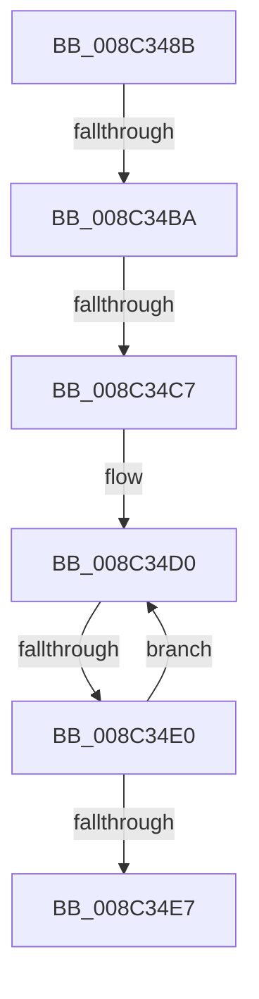

# sub_008C348B

- RVA: `0x008C348B`–`0x008C3500` (길이 `117` bytes)
- VA: `0x00000001408C348B`
- 실행 섹션: `PAGE`
- PDB 이름 있음: `아니요`; PDB Function 태그: `아니요`
- unwind 정보 RVA: `0x00083820`
- 디코드: `28`개 명령, `117/117` bytes 표시
- 미해석 바이트: `0` (있으면 어셈블리에 `.byte`로 보존)

> 이 문서는 커널 이미지의 기계어와 PDB 기호를 분석해 생성했습니다. 4번과 5번은 함수 원형과 자료형을 바이너리 사용 방식에서 추정한 C 해석이며 원본 소스 복구 결과는 아닙니다.

## 1. Dependencies

- 직접 호출 지점: **0**; 고유 호출 대상: **0**
- 직접 호출자로 확인된 함수: **0**
- RIP 상대 이미지 참조: **0**

### Outgoing calls
- 직접 디코드된 call 명령이 없습니다.

### Direct callers
- 이 함수 시작 RVA로 연결되는 직접 call은 확인되지 않았습니다. 간접 호출은 완전히 역산할 수 없습니다.

### Static image references
- 디코드된 RIP-relative 메모리 참조가 없습니다.

## 2. Other-region calls and transfers

- 다른 실행 섹션으로 향하는 call: **0**
- call이 아닌 외부 분기/꼬리 이동: **3**
  - `0x008C34B4` → [sub_008C350B + 0x48](Unknown_function_008C350B.md) (`tail-transfer`)
  - `0x008C34C1` → [sub_008C350B + 0x153](Unknown_function_008C350B.md) (`tail-transfer`)
  - `0x008C34DE` → [sub_008C350B](Unknown_function_008C350B.md) (`tail-transfer`)

## 3. Assembly (complete function range)

```asm
008C348B  48 89 5C 24 50                  mov qword ptr [rsp + 0x50], rbx
008C3490  48 89 74 24 58                  mov qword ptr [rsp + 0x58], rsi
008C3495  48 89 7C 24 60                  mov qword ptr [rsp + 0x60], rdi
008C349A  4C 89 64 24 28                  mov qword ptr [rsp + 0x28], r12
008C349F  4C 8B 64 24 70                  mov r12, qword ptr [rsp + 0x70]
008C34A4  4C 89 6C 24 20                  mov qword ptr [rsp + 0x20], r13
008C34A9  45 33 ED                        xor r13d, r13d
008C34AC  66 45 89 2C 24                  mov word ptr [r12], r13w
008C34B1  45 84 C0                        test r8b, r8b
008C34B4  0F 85 99 00 00 00               jne 0x1408c3553
008C34BA  48 8B 71 20                     mov rsi, qword ptr [rcx + 0x20]
008C34BE  40 84 ED                        test bpl, bpl
008C34C1  0F 85 97 01 00 00               jne 0x1408c365e
008C34C7  41 8B DD                        mov ebx, r13d
008C34CA  66 0F 1F 44 00 00               nop word ptr [rax + rax]
008C34D0  8B FB                           mov edi, ebx
008C34D2  48 8D 47 04                     lea rax, [rdi + 4]
008C34D6  48 C1 E0 05                     shl rax, 5
008C34DA  44 39 2C 30                     cmp dword ptr [rax + rsi], r13d
008C34DE  75 2B                           jne 0x1408c350b
008C34E0  FF C3                           inc ebx
008C34E2  83 FB 10                        cmp ebx, 0x10
008C34E5  72 E9                           jb 0x1408c34d0
008C34E7  4C 8B 64 24 28                  mov r12, qword ptr [rsp + 0x28]
008C34EC  48 8B 7C 24 60                  mov rdi, qword ptr [rsp + 0x60]
008C34F1  48 8B 74 24 58                  mov rsi, qword ptr [rsp + 0x58]
008C34F6  48 8B 5C 24 50                  mov rbx, qword ptr [rsp + 0x50]
008C34FB  4C 8B 6C 24 20                  mov r13, qword ptr [rsp + 0x20]
```

## 4. C-style interpretation (structured pseudocode)

```c
__int64 __fastcall sub_008C348B(__int64 a1, __int64 a2, unsigned __int8 a3, __int64 a4, __int64 a5, __int64 a6, __int64 a7, __int64 a8, __int64 a9, __int64 a10, __int64 a11, __int64 a12, __int64 a13, __int64 a14)
{
    __int64 result;
    __int64 v_r13;
    __int64 v_rbx;
    unsigned __int64 v_stack_p20;
    unsigned __int64 v_stack_p28;
    unsigned __int64 v_stack_p50;
    unsigned __int64 v_stack_p58;
    unsigned __int64 v_stack_p60;

    v_stack_p50 = v_rbx;
    v_stack_p58 = v_rsi;
    v_stack_p60 = v_rdi;
    v_stack_p28 = v_r12;
    v_stack_p20 = v_r13;
    v_r13 = 0;
    *(unsigned __int16 *)(a14) = 0;
loc_008C34D0:
    result = (0 + 4) << (5);
    v_rbx = (unsigned int)((0) + 1);
    if (((unsigned int)(v_rbx)) < 16) goto loc_008C34D0;
    return result;
}
```

## 5. (Beta) C Style

```c
int64_t sub_008C348B(void *Arg1, int64_t Arg2, uint8_t Arg3, int64_t Arg4, int64_t Arg5, uint64_t Arg6, uint64_t Arg7, uint64_t Arg8, uint64_t Arg9, int64_t Arg10, int64_t Arg11, int64_t Arg12, uint64_t Arg13, void *Arg14)
{
    uint8_t *arg1 = (uint8_t *)Arg1;
    uint8_t *arg14 = (uint8_t *)Arg14;

    int64_t result;
    int64_t local_r13;
    int64_t local_rbx;
    uint64_t v_stack_p20;
    uint64_t v_stack_p28;
    uint64_t v_stack_p50;
    uint64_t v_stack_p58;
    uint64_t v_stack_p60;

    v_stack_p50 = local_rbx;
    v_stack_p58 = local_rsi;
    v_stack_p60 = local_rdi;
    v_stack_p28 = local_r12;
    v_stack_p20 = local_r13;
    local_r13 = 0;
    *(uint16_t *)(arg14) = 0;
loc_008C34D0:
    result = (0 + 4) << (5);
    local_rbx = (uint32_t)((0) + 1);
    if (((uint32_t)(local_rbx)) < 16) goto loc_008C34D0;
    return result;
}
```

### 관측된 메모리 오프셋

구조체 형식이 확인되지 않은 접근은 인자 기준의 오프셋으로만 기록했습니다.

| 기준 인자 | 오프셋 표현 | 폭 (bit) | 접근 |
|---|---:|---:|---|
| `Arg1` | `+ 0x20` | `64` | `R` |
| `Arg14` | `+ 0x0` | `16` | `W` |

## 6. Execution-region graph

[열기: 2D/3D 그래프와 함수 탐색 컨트롤 패널](../../../control-panel.html?section=page&rva=0x008C348B&view=graph)

- 2D 그래프는 위에서 아래로 흐르고, 3D 그래프는 빈 공간을 드래그해 회전합니다. Shift+드래그는 이동, 휠은 확대·축소, 함수 노드 선택은 대상 보고서 이동입니다.

### Static fallback


