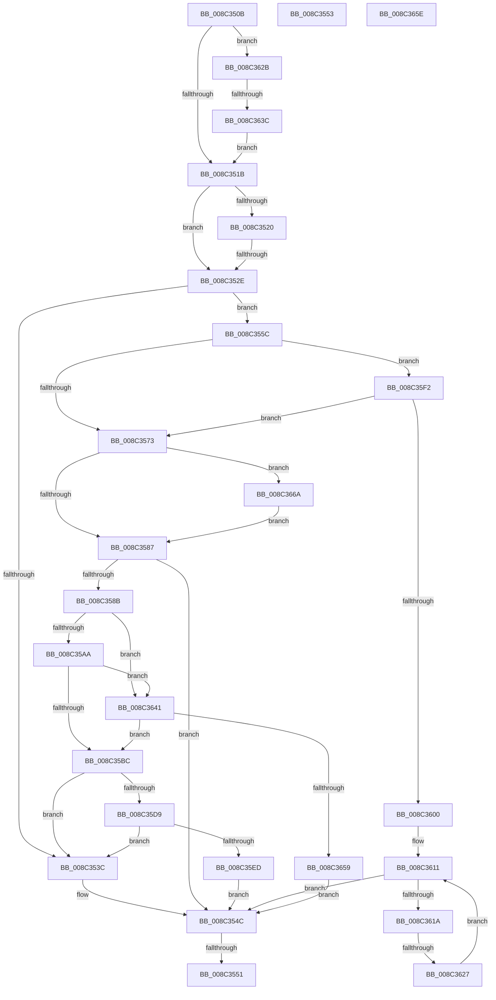

# sub_008C350B

- RVA: `0x008C350B`–`0x008C3683` (길이 `376` bytes)
- VA: `0x00000001408C350B`
- 실행 섹션: `PAGE`
- PDB 이름 있음: `아니요`; PDB Function 태그: `아니요`
- unwind 정보 RVA: `0x00083858`
- 디코드: `87`개 명령, `376/376` bytes 표시
- 미해석 바이트: `0` (있으면 어셈블리에 `.byte`로 보존)

> 이 문서는 커널 이미지의 기계어와 PDB 기호를 분석해 생성했습니다. 4번과 5번은 함수 원형과 자료형을 바이너리 사용 방식에서 추정한 C 해석이며 원본 소스 복구 결과는 아닙니다.

## 1. Dependencies

- 직접 호출 지점: **3**; 고유 호출 대상: **3**
- 직접 호출자로 확인된 함수: **0**
- RIP 상대 이미지 참조: **0**

### Outgoing calls
- `0x008C35E0` → [EtwpApplyContainerFilter](../A9/EtwpApplyContainerFilter_function_00A95454.md) (function, `0x00A95454`)
- `0x008C364C` → [EtwpApplyPackageIdFilter](../A9/EtwpApplyPackageIdFilter_function_00A961F4.md) (function, `0x00A961F4`)
- `0x008C3676` → [EtwpApplyExeFilter](../A9/EtwpApplyExeFilter_function_00A95D8C.md) (function, `0x00A95D8C`)

### Direct callers
- 이 함수 시작 RVA로 연결되는 직접 call은 확인되지 않았습니다. 간접 호출은 완전히 역산할 수 없습니다.

### Static image references
- 디코드된 RIP-relative 메모리 참조가 없습니다.

## 2. Other-region calls and transfers

- 다른 실행 섹션으로 향하는 call: **0**
- call이 아닌 외부 분기/꼬리 이동: **7**
  - `0x008C352C` → [sub_008C348B + 0x55](Unknown_function_008C348B.md) (`tail-transfer`)
  - `0x008C354F` → [sub_008C348B + 0x55](Unknown_function_008C348B.md) (`tail-transfer`)
  - `0x008C3551` → [sub_008C348B + 0x5C](Unknown_function_008C348B.md) (`tail-transfer`)
  - `0x008C3557` → [sub_008C348B + 0x33](Unknown_function_008C348B.md) (`tail-transfer`)
  - `0x008C3621` → [sub_00B1AFD2](../B1/Unknown_function_00B1AFD2.md) (`tail-transfer`)
  - `0x008C3636` → [sub_008C348B + 0x55](Unknown_function_008C348B.md) (`tail-transfer`)
  - `0x008C3665` → [sub_008C348B + 0x3C](Unknown_function_008C348B.md) (`tail-transfer`)

## 3. Assembly (complete function range)

```asm
008C350B  48 8B CF                        mov rcx, rdi
008C350E  48 C1 E1 05                     shl rcx, 5
008C3512  40 84 ED                        test bpl, bpl
008C3515  0F 85 10 01 00 00               jne 0x1408c362b
008C351B  45 84 F6                        test r14b, r14b
008C351E  74 0E                           je 0x1408c352e
008C3520  0F B7 46 58                     movzx eax, word ptr [rsi + 0x58]
008C3524  66 39 84 31 86 00 00 00         cmp word ptr [rcx + rsi + 0x86], ax
008C352C  75 B2                           jne 0x1408c34e0
008C352E  48 8B 8E 80 02 00 00            mov rcx, qword ptr [rsi + 0x280]
008C3535  B2 01                           mov dl, 1
008C3537  48 85 C9                        test rcx, rcx
008C353A  75 20                           jne 0x1408c355c
008C353C  41 0F B7 0C 24                  movzx ecx, word ptr [r12]
008C3541  0F B6 C3                        movzx eax, bl
008C3544  0F AB C1                        bts ecx, eax
008C3547  66 41 89 0C 24                  mov word ptr [r12], cx
008C354C  45 84 F6                        test r14b, r14b
008C354F  74 8F                           je 0x1408c34e0
008C3551  EB 94                           jmp 0x1408c34e7
008C3553  48 8B 71 28                     mov rsi, qword ptr [rcx + 0x28]
008C3557  E9 62 FF FF FF                  jmp 0x1408c34be
008C355C  4C 6B CF 68                     imul r9, rdi, 0x68
008C3560  45 8B 04 09                     mov r8d, dword ptr [r9 + rcx]
008C3564  41 8B C0                        mov eax, r8d
008C3567  25 04 00 00 80                  and eax, 0x80000004
008C356C  3D 04 00 00 80                  cmp eax, 0x80000004
008C3571  74 7F                           je 0x1408c35f2
008C3573  41 81 E0 08 00 00 80            and r8d, 0x80000008
008C357A  41 81 F8 08 00 00 80            cmp r8d, 0x80000008
008C3581  0F 84 E3 00 00 00               je 0x1408c366a
008C3587  84 D2                           test dl, dl
008C3589  74 C1                           je 0x1408c354c
008C358B  48 6B D7 68                     imul rdx, rdi, 0x68
008C358F  48 03 96 80 02 00 00            add rdx, qword ptr [rsi + 0x280]
008C3596  8B 0A                           mov ecx, dword ptr [rdx]
008C3598  8B C1                           mov eax, ecx
008C359A  25 10 00 00 80                  and eax, 0x80000010
008C359F  3D 10 00 00 80                  cmp eax, 0x80000010
008C35A4  0F 84 97 00 00 00               je 0x1408c3641
008C35AA  81 E1 20 00 00 80               and ecx, 0x80000020
008C35B0  81 F9 20 00 00 80               cmp ecx, 0x80000020
008C35B6  0F 84 85 00 00 00               je 0x1408c3641
008C35BC  48 6B D7 68                     imul rdx, rdi, 0x68
008C35C0  48 03 96 80 02 00 00            add rdx, qword ptr [rsi + 0x280]
008C35C7  8B 02                           mov eax, dword ptr [rdx]
008C35C9  25 00 80 00 80                  and eax, 0x80008000
008C35CE  3D 00 80 00 80                  cmp eax, 0x80008000
008C35D3  0F 85 63 FF FF FF               jne 0x1408c353c
008C35D9  48 8B 52 28                     mov rdx, qword ptr [rdx + 0x28]
008C35DD  49 8B CF                        mov rcx, r15
008C35E0  E8 6F 1E 1D 00                  call 0x140a95454
008C35E5  84 C0                           test al, al
008C35E7  0F 85 4F FF FF FF               jne 0x1408c353c
008C35ED  E9 5A FF FF FF                  jmp 0x1408c354c
008C35F2  4D 8B 54 09 08                  mov r10, qword ptr [r9 + rcx + 8]
008C35F7  4D 85 D2                        test r10, r10
008C35FA  0F 84 73 FF FF FF               je 0x1408c3573
008C3600  49 8B 47 50                     mov rax, qword ptr [r15 + 0x50]
008C3604  41 8B D5                        mov edx, r13d
008C3607  45 8B 0A                        mov r9d, dword ptr [r10]
008C360A  44 8B 98 D0 01 00 00            mov r11d, dword ptr [rax + 0x1d0]
008C3611  41 3B D1                        cmp edx, r9d
008C3614  0F 83 32 FF FF FF               jae 0x1408c354c
008C361A  8B C2                           mov eax, edx
008C361C  45 39 5C 82 04                  cmp dword ptr [r10 + rax*4 + 4], r11d
008C3621  0F 84 AB 79 25 00               je 0x140b1afd2
008C3627  FF C2                           inc edx
008C3629  EB E6                           jmp 0x1408c3611
008C362B  F7 84 31 88 00 00 00 00 04 00 00  test dword ptr [rcx + rsi + 0x88], 0x400
008C3636  0F 84 A4 FE FF FF               je 0x1408c34e0
008C363C  E9 DA FE FF FF                  jmp 0x1408c351b
008C3641  4C 8B 42 20                     mov r8, qword ptr [rdx + 0x20]
008C3645  49 8B CF                        mov rcx, r15
008C3648  48 8B 52 18                     mov rdx, qword ptr [rdx + 0x18]
008C364C  E8 A3 2B 1D 00                  call 0x140a961f4
008C3651  84 C0                           test al, al
008C3653  0F 85 63 FF FF FF               jne 0x1408c35bc
008C3659  E9 EE FE FF FF                  jmp 0x1408c354c
008C365E  48 8B B6 90 02 00 00            mov rsi, qword ptr [rsi + 0x290]
008C3665  E9 5D FE FF FF                  jmp 0x1408c34c7
008C366A  48 6B D7 68                     imul rdx, rdi, 0x68
008C366E  48 8B 54 0A 10                  mov rdx, qword ptr [rdx + rcx + 0x10]
008C3673  49 8B CF                        mov rcx, r15
008C3676  E8 11 27 1D 00                  call 0x140a95d8c
008C367B  0F B6 D0                        movzx edx, al
008C367E  E9 04 FF FF FF                  jmp 0x1408c3587
```

## 4. C-style interpretation (structured pseudocode)

```c
__int64 __fastcall sub_008C350B(void)
{
    __int64 result;

    a1 = (v_rdi) << (5);
    if ((unsigned __int8)(v_rbp) != 0) goto loc_008C362B;
loc_008C351B:
    if ((unsigned __int8)(v_r14) == 0) goto loc_008C352E;
loc_008C352E:
    if (*(unsigned __int64 *)(v_rsi + 640) != 0) goto loc_008C355C;
loc_008C353C:
    *(unsigned __int16 *)(v_r12) = (unsigned __int16)(*(unsigned __int16 *)(v_r12));
loc_008C354C:
loc_008C355C:
    a4 = (a4) * (v_rdi);
    result = (unsigned int)(((unsigned int)((unsigned int)((unsigned int)(*(unsigned int *)(a4 + *(unsigned __int16 *)(v_r12) * 1))))) & (0x80000004ULL));
    if (((unsigned int)(result)) == 0x80000004ULL) goto loc_008C35F2;
loc_008C3573:
    a3 = (unsigned int)(((unsigned int)(*(unsigned int *)(a4 + *(unsigned __int16 *)(v_r12) * 1))) & (0x80000008ULL));
    if (((unsigned int)(a3)) == 0x80000008ULL) goto loc_008C366A;
loc_008C3587:
    if (1 == 0) goto loc_008C354C;
    a2 = (1) * (v_rdi);
    a2 = (a2) + (*(unsigned __int64 *)(v_rsi + 640));
    result = (unsigned int)(((unsigned int)((unsigned int)((unsigned int)(*(unsigned int *)(a2))))) & (0x80000010ULL));
    if (((unsigned int)(result)) == 0x80000010ULL) goto loc_008C3641;
    a1 = (unsigned int)(((unsigned int)(*(unsigned int *)(a2))) & (0x80000020ULL));
    if (((unsigned int)(a1)) == 0x80000020ULL) goto loc_008C3641;
loc_008C35BC:
    a2 = (a2) * (v_rdi);
    a2 = (a2) + (*(unsigned __int64 *)(v_rsi + 640));
    result = (unsigned int)(((unsigned int)(*(unsigned int *)(a2))) & (0x80008000ULL));
    if (((unsigned int)(result)) != 0x80008000ULL) goto loc_008C353C;
    result = EtwpApplyContainerFilter(v_r15, *(unsigned __int64 *)(a2 + 40), a3, a4);
    if ((unsigned __int8)(result) != 0) goto loc_008C353C;
    goto loc_008C354C;
loc_008C35F2:
    if (*(unsigned __int64 *)(a4 + v_r15 * 1 + 8) == 0) goto loc_008C3573;
loc_008C3611:
    if (((unsigned int)((unsigned int)((unsigned int)(v_r13)))) >= ((unsigned int)((unsigned int)(*(unsigned int *)(*(unsigned __int64 *)(a4 + v_r15 * 1 + 8)))))) goto loc_008C354C;
    a2 = (unsigned int)(((unsigned int)((unsigned int)(v_r13))) + 1);
    goto loc_008C3611;
loc_008C362B:
    goto loc_008C351B;
loc_008C3641:
    result = EtwpApplyPackageIdFilter(v_r15, *(unsigned __int64 *)(a2 + 24), *(unsigned __int64 *)(a2 + 32), (unsigned int)(*(unsigned int *)(*(unsigned __int64 *)(a4 + v_r15 * 1 + 8))));
    if ((unsigned __int8)(result) != 0) goto loc_008C35BC;
    goto loc_008C354C;
loc_008C366A:
    a2 = (*(unsigned __int64 *)(a2 + 24)) * (v_rdi);
    result = EtwpApplyExeFilter(v_r15, *(unsigned __int64 *)(a2 + v_r15 * 1 + 16), *(unsigned __int64 *)(a2 + 32), (unsigned int)(*(unsigned int *)(*(unsigned __int64 *)(a4 + v_r15 * 1 + 8))));
    goto loc_008C3587;
}
```

## 5. (Beta) C Style

```c
void sub_008C350B(void)
{
    int64_t result;

    a1 = (local_rdi) << (5);
    if ((uint8_t)(local_rbp) != 0) goto loc_008C362B;
loc_008C351B:
    if ((uint8_t)(local_r14) == 0) goto loc_008C352E;
loc_008C352E:
    if (*(uint64_t *)(local_rsi + 0x280) != 0) goto loc_008C355C;
loc_008C353C:
    *(uint16_t *)(local_r12) = (uint16_t)(*(uint16_t *)(local_r12));
loc_008C354C:
loc_008C355C:
    a4 = (a4) * (local_rdi);
    result = (uint32_t)(((uint32_t)((uint32_t)((uint32_t)(*(uint32_t *)(a4 + *(uint16_t *)(local_r12) * 1))))) & (0x80000004ULL));
    if (((uint32_t)(result)) == 0x80000004ULL) goto loc_008C35F2;
loc_008C3573:
    a3 = (uint32_t)(((uint32_t)(*(uint32_t *)(a4 + *(uint16_t *)(local_r12) * 1))) & (0x80000008ULL));
    if (((uint32_t)(a3)) == 0x80000008ULL) goto loc_008C366A;
loc_008C3587:
    if (1 == 0) goto loc_008C354C;
    a2 = (1) * (local_rdi);
    a2 = (a2) + (*(uint64_t *)(local_rsi + 0x280));
    result = (uint32_t)(((uint32_t)((uint32_t)((uint32_t)(*(uint32_t *)(a2))))) & (0x80000010ULL));
    if (((uint32_t)(result)) == 0x80000010ULL) goto loc_008C3641;
    a1 = (uint32_t)(((uint32_t)(*(uint32_t *)(a2))) & (0x80000020ULL));
    if (((uint32_t)(a1)) == 0x80000020ULL) goto loc_008C3641;
loc_008C35BC:
    a2 = (a2) * (local_rdi);
    a2 = (a2) + (*(uint64_t *)(local_rsi + 0x280));
    result = (uint32_t)(((uint32_t)(*(uint32_t *)(a2))) & (0x80008000ULL));
    if (((uint32_t)(result)) != 0x80008000ULL) goto loc_008C353C;
    result = EtwpApplyContainerFilter(local_r15, *(uint64_t *)(a2 + 0x28), a3, a4);
    if ((uint8_t)(result) != 0) goto loc_008C353C;
    goto loc_008C354C;
loc_008C35F2:
    if (*(uint64_t *)(a4 + local_r15 * 1 + 0x8) == 0) goto loc_008C3573;
loc_008C3611:
    if (((uint32_t)((uint32_t)((uint32_t)(local_r13)))) >= ((uint32_t)((uint32_t)(*(uint32_t *)(*(uint64_t *)(a4 + local_r15 * 1 + 0x8)))))) goto loc_008C354C;
    a2 = (uint32_t)(((uint32_t)((uint32_t)(local_r13))) + 1);
    goto loc_008C3611;
loc_008C362B:
    goto loc_008C351B;
loc_008C3641:
    result = EtwpApplyPackageIdFilter(local_r15, *(uint64_t *)(a2 + 0x18), *(uint64_t *)(a2 + 0x20), (uint32_t)(*(uint32_t *)(*(uint64_t *)(a4 + local_r15 * 1 + 0x8))));
    if ((uint8_t)(result) != 0) goto loc_008C35BC;
    goto loc_008C354C;
loc_008C366A:
    a2 = (*(uint64_t *)(a2 + 0x18)) * (local_rdi);
    result = EtwpApplyExeFilter(local_r15, *(uint64_t *)(a2 + local_r15 * 1 + 0x10), *(uint64_t *)(a2 + 0x20), (uint32_t)(*(uint32_t *)(*(uint64_t *)(a4 + local_r15 * 1 + 0x8))));
    goto loc_008C3587;
}
```

## 6. Execution-region graph

[열기: 2D/3D 그래프와 함수 탐색 컨트롤 패널](../../../control-panel.html?section=page&rva=0x008C350B&view=graph)

- 2D 그래프는 위에서 아래로 흐르고, 3D 그래프는 빈 공간을 드래그해 회전합니다. Shift+드래그는 이동, 휠은 확대·축소, 함수 노드 선택은 대상 보고서 이동입니다.

### Static fallback


