# sub_008C3C89

- RVA: `0x008C3C89`–`0x008C3F6A` (길이 `737` bytes)
- VA: `0x00000001408C3C89`
- 실행 섹션: `PAGE`
- PDB 이름 있음: `아니요`; PDB Function 태그: `아니요`
- unwind 정보 RVA: `0x00083914`
- 디코드: `177`개 명령, `737/737` bytes 표시
- 미해석 바이트: `0` (있으면 어셈블리에 `.byte`로 보존)

> 이 문서는 커널 이미지의 기계어와 PDB 기호를 분석해 생성했습니다. 4번과 5번은 함수 원형과 자료형을 바이너리 사용 방식에서 추정한 C 해석이며 원본 소스 복구 결과는 아닙니다.

## 1. Dependencies

- 직접 호출 지점: **10**; 고유 호출 대상: **9**
- 직접 호출자로 확인된 함수: **0**
- RIP 상대 이미지 참조: **1**

### Outgoing calls
- `0x008C3CD6` → [ExpInterlockedPopEntrySList](../../text/6B/ExpInterlockedPopEntrySList_function_006BA570.md) (function, `0x006BA570`)
- `0x008C3CF3` → [ExpInterlockedPopEntrySList](../../text/6B/ExpInterlockedPopEntrySList_function_006BA570.md) (function, `0x006BA570`)
- `0x008C3D11` → [guard_dispatch_icall](../../text/6B/guard_dispatch_icall_function_006BAAD0.md) (function, `0x006BAAD0`)
- `0x008C3D47` → [ObpCaptureObjectCreateInformation](../89/ObpCaptureObjectCreateInformation_function_0089B930.md) (function, `0x0089B930`)
- `0x008C3DA4` → [ObpAllocateObject](../89/ObpAllocateObject_function_00899FF0.md) (function, `0x00899FF0`)
- `0x008C3DBF` → [ObpFreeObjectNameBuffer](ObpFreeObjectNameBuffer_function_008C4250.md) (function, `0x008C4250`)
- `0x008C3DD5` → [ExFreePoolWithTag](../../poolcode/B8/ExFreePoolWithTag_function_00B82870.md) (function, `0x00B82870`)
- `0x008C3E01` → [ExpInterlockedPushEntrySList](../../text/6B/ExpInterlockedPushEntrySList_function_006BA5B0.md) (function, `0x006BA5B0`)
- `0x008C3E1A` → [memset](../../text/6C/memset_function_006C6C40.md) (function, `0x006C6C40`)
- `0x008C3E3C` → [PsGetCurrentProcessId](../../text/43/PsGetCurrentProcessId_function_00433560.md) (function, `0x00433560`)

### Direct callers
- 이 함수 시작 RVA로 연결되는 직접 call은 확인되지 않았습니다. 간접 호출은 완전히 역산할 수 없습니다.

### Static image references
- `0x008C3CAE` → RVA `0x00FC6AC0` (`ALMOSTRO`; read)

## 2. Other-region calls and transfers

- 다른 실행 섹션으로 향하는 call: **7**
  - `0x008C3CD6` → [ExpInterlockedPopEntrySList](../../text/6B/ExpInterlockedPopEntrySList_function_006BA570.md) (`PAGE` → `.text`)
  - `0x008C3CF3` → [ExpInterlockedPopEntrySList](../../text/6B/ExpInterlockedPopEntrySList_function_006BA570.md) (`PAGE` → `.text`)
  - `0x008C3D11` → [guard_dispatch_icall](../../text/6B/guard_dispatch_icall_function_006BAAD0.md) (`PAGE` → `.text`)
  - `0x008C3DD5` → [ExFreePoolWithTag](../../poolcode/B8/ExFreePoolWithTag_function_00B82870.md) (`PAGE` → `POOLCODE`)
  - `0x008C3E01` → [ExpInterlockedPushEntrySList](../../text/6B/ExpInterlockedPushEntrySList_function_006BA5B0.md) (`PAGE` → `.text`)
  - `0x008C3E1A` → [memset](../../text/6C/memset_function_006C6C40.md) (`PAGE` → `.text`)
  - `0x008C3E3C` → [PsGetCurrentProcessId](../../text/43/PsGetCurrentProcessId_function_00433560.md) (`PAGE` → `.text`)
- call이 아닌 외부 분기/꼬리 이동: **15**
  - `0x008C3C9C` → [sub_008C405D](Unknown_function_008C405D.md) (`tail-transfer`)
  - `0x008C3D26` → [sub_008C405D + 0x164](Unknown_function_008C405D.md) (`tail-transfer`)
  - `0x008C3D50` → [sub_008C3F6B + 0x6B](Unknown_function_008C3F6B.md) (`tail-transfer`)
  - `0x008C3D5C` → [sub_008C405D + 0x17E](Unknown_function_008C405D.md) (`tail-transfer`)
  - `0x008C3D65` → [sub_008C3F6B + 0x2F](Unknown_function_008C3F6B.md) (`tail-transfer`)
  - `0x008C3DAD` → [sub_008C3F6B + 0xC0](Unknown_function_008C3F6B.md) (`tail-transfer`)
  - `0x008C3DF8` → [sub_008C405D + 0x2B](Unknown_function_008C405D.md) (`tail-transfer`)
  - `0x008C3E0B` → [sub_008C3F6B + 0x96](Unknown_function_008C3F6B.md) (`tail-transfer`)
  - `0x008C3E5E` → [sub_008C405D + 0xA7](Unknown_function_008C405D.md) (`tail-transfer`)
  - `0x008C3E75` → [sub_008C3F6B + 0x51](Unknown_function_008C3F6B.md) (`tail-transfer`)
  - `0x008C3E91` → [sub_008C3F6B + 0x25](Unknown_function_008C3F6B.md) (`tail-transfer`)
  - `0x008C3ECE` → [sub_008C3F6B](Unknown_function_008C3F6B.md) (`tail-transfer`)
  - `0x008C3F2F` → [sub_008C405D + 0x1BA](Unknown_function_008C405D.md) (`tail-transfer`)
  - `0x008C3F38` → [sub_008C405D + 0x146](Unknown_function_008C405D.md) (`tail-transfer`)
  - `0x008C3F41` → [sub_008C405D + 0x1CE](Unknown_function_008C405D.md) (`tail-transfer`)

## 3. Assembly (complete function range)

```asm
008C3C89  48 89 B4 24 C8 00 00 00         mov qword ptr [rsp + 0xc8], rsi
008C3C91  4C 89 AC 24 80 00 00 00         mov qword ptr [rsp + 0x80], r13
008C3C99  4D 85 C9                        test r9, r9
008C3C9C  0F 85 BB 03 00 00               jne 0x1408c405d
008C3CA2  65 48 8B 2C 25 20 00 00 00      mov rbp, qword ptr gs:[0x20]
008C3CAB  0F 57 C0                        xorps xmm0, xmm0
008C3CAE  4C 8B 2D 0B 2E 70 00            mov r13, qword ptr [rip + 0x702e0b]
008C3CB5  66 89 4C 24 40                  mov word ptr [rsp + 0x40], cx
008C3CBA  48 89 4C 24 50                  mov qword ptr [rsp + 0x50], rcx
008C3CBF  48 8B B5 40 08 00 00            mov rsi, qword ptr [rbp + 0x840]
008C3CC6  48 8B CE                        mov rcx, rsi
008C3CC9  C6 44 24 40 01                  mov byte ptr [rsp + 0x40], 1
008C3CCE  0F 11 44 24 68                  movups xmmword ptr [rsp + 0x68], xmm0
008C3CD3  FF 46 14                        inc dword ptr [rsi + 0x14]
008C3CD6  E8 95 68 DF FF                  call 0x1406ba570
008C3CDB  48 8B F8                        mov rdi, rax
008C3CDE  48 85 C0                        test rax, rax
008C3CE1  75 3B                           jne 0x1408c3d1e
008C3CE3  FF 46 18                        inc dword ptr [rsi + 0x18]
008C3CE6  48 8B B5 48 08 00 00            mov rsi, qword ptr [rbp + 0x848]
008C3CED  48 8B CE                        mov rcx, rsi
008C3CF0  FF 46 14                        inc dword ptr [rsi + 0x14]
008C3CF3  E8 78 68 DF FF                  call 0x1406ba570
008C3CF8  48 8B F8                        mov rdi, rax
008C3CFB  48 85 C0                        test rax, rax
008C3CFE  75 1E                           jne 0x1408c3d1e
008C3D00  8B 56 2C                        mov edx, dword ptr [rsi + 0x2c]
008C3D03  48 8B 46 30                     mov rax, qword ptr [rsi + 0x30]
008C3D07  44 8B 46 28                     mov r8d, dword ptr [rsi + 0x28]
008C3D0B  8B 4E 24                        mov ecx, dword ptr [rsi + 0x24]
008C3D0E  FF 46 18                        inc dword ptr [rsi + 0x18]
008C3D11  E8 BA 6D DF FF                  call 0x1406baad0
008C3D16  48 8B F8                        mov rdi, rax
008C3D19  48 85 C0                        test rax, rax
008C3D1C  74 05                           je 0x1408c3d23
008C3D1E  8B 45 24                        mov eax, dword ptr [rbp + 0x24]
008C3D21  89 07                           mov dword ptr [rdi], eax
008C3D23  48 85 FF                        test rdi, rdi
008C3D26  0F 84 95 04 00 00               je 0x1408c41c1
008C3D2C  33 ED                           xor ebp, ebp
008C3D2E  4C 8D 4C 24 68                  lea r9, [rsp + 0x68]
008C3D33  89 6C 24 28                     mov dword ptr [rsp + 0x28], ebp
008C3D37  45 33 C0                        xor r8d, r8d
008C3D3A  41 0F B6 D7                     movzx edx, r15b
008C3D3E  48 89 7C 24 20                  mov qword ptr [rsp + 0x20], rdi
008C3D43  41 0F B6 CF                     movzx ecx, r15b
008C3D47  E8 E4 7B FD FF                  call 0x14089b930
008C3D4C  8B F0                           mov esi, eax
008C3D4E  85 C0                           test eax, eax
008C3D50  0F 88 80 02 00 00               js 0x1408c3fd6
008C3D56  8B 0F                           mov ecx, dword ptr [rdi]
008C3D58  41 85 4D 48                     test dword ptr [r13 + 0x48], ecx
008C3D5C  0F 85 79 04 00 00               jne 0x1408c41db
008C3D62  F6 C1 10                        test cl, 0x10
008C3D65  0F 85 2F 02 00 00               jne 0x1408c3f9a
008C3D6B  41 8B 45 68                     mov eax, dword ptr [r13 + 0x68]
008C3D6F  4C 8D 4C 24 68                  lea r9, [rsp + 0x68]
008C3D74  41 8B 4D 6C                     mov ecx, dword ptr [r13 + 0x6c]
008C3D78  4D 8B C5                        mov r8, r13
008C3D7B  89 47 14                        mov dword ptr [rdi + 0x14], eax
008C3D7E  41 0F B6 D7                     movzx edx, r15b
008C3D82  48 8D 44 24 40                  lea rax, [rsp + 0x40]
008C3D87  89 4F 18                        mov dword ptr [rdi + 0x18], ecx
008C3D8A  48 89 44 24 30                  mov qword ptr [rsp + 0x30], rax
008C3D8F  48 8B CF                        mov rcx, rdi
008C3D92  48 8D 44 24 50                  lea rax, [rsp + 0x50]
008C3D97  48 89 44 24 28                  mov qword ptr [rsp + 0x28], rax
008C3D9C  C7 44 24 20 70 00 00 00         mov dword ptr [rsp + 0x20], 0x70
008C3DA4  E8 47 62 FD FF                  call 0x140899ff0
008C3DA9  8B F0                           mov esi, eax
008C3DAB  85 C0                           test eax, eax
008C3DAD  0F 89 78 02 00 00               jns 0x1408c402b
008C3DB3  48 39 5C 24 70                  cmp qword ptr [rsp + 0x70], rbx
008C3DB8  74 0A                           je 0x1408c3dc4
008C3DBA  48 8D 4C 24 68                  lea rcx, [rsp + 0x68]
008C3DBF  E8 8C 04 00 00                  call 0x1408c4250
008C3DC4  48 8B 4F 20                     mov rcx, qword ptr [rdi + 0x20]
008C3DC8  48 85 C9                        test rcx, rcx
008C3DCB  74 11                           je 0x1408c3dde
008C3DCD  80 7F 10 01                     cmp byte ptr [rdi + 0x10], 1
008C3DD1  77 07                           ja 0x1408c3dda
008C3DD3  33 D2                           xor edx, edx
008C3DD5  E8 96 EA 2B 00                  call 0x140b82870
008C3DDA  48 89 6F 20                     mov qword ptr [rdi + 0x20], rbp
008C3DDE  65 48 8B 14 25 20 00 00 00      mov rdx, qword ptr gs:[0x20]
008C3DE7  48 8B 8A 40 08 00 00            mov rcx, qword ptr [rdx + 0x840]
008C3DEE  FF 41 1C                        inc dword ptr [rcx + 0x1c]
008C3DF1  0F B7 41 10                     movzx eax, word ptr [rcx + 0x10]
008C3DF5  66 39 01                        cmp word ptr [rcx], ax
008C3DF8  0F 83 8A 02 00 00               jae 0x1408c4088
008C3DFE  48 8B D7                        mov rdx, rdi
008C3E01  E8 AA 67 DF FF                  call 0x1406ba5b0
008C3E06  45 33 D2                        xor r10d, r10d
008C3E09  85 F6                           test esi, esi
008C3E0B  0F 88 F0 01 00 00               js 0x1408c4001
008C3E11  33 D2                           xor edx, edx
008C3E13  48 8B CB                        mov rcx, rbx
008C3E16  44 8D 42 70                     lea r8d, [rdx + 0x70]
008C3E1A  E8 21 2E E0 FF                  call 0x1406c6c40
008C3E1F  4C 8B BC 24 D0 00 00 00         mov r15, qword ptr [rsp + 0xd0]
008C3E27  48 8B AC 24 C0 00 00 00         mov rbp, qword ptr [rsp + 0xc0]
008C3E2F  41 0F B7 47 14                  movzx eax, word ptr [r15 + 0x14]
008C3E34  66 89 43 32                     mov word ptr [rbx + 0x32], ax
008C3E38  48 89 6B 08                     mov qword ptr [rbx + 8], rbp
008C3E3C  E8 1F F7 B6 FF                  call 0x140433560
008C3E41  45 33 D2                        xor r10d, r10d
008C3E44  48 89 43 18                     mov qword ptr [rbx + 0x18], rax
008C3E48  66 44 89 53 04                  mov word ptr [rbx + 4], r10w
008C3E4D  C7 43 60 FF FF FF FF            mov dword ptr [rbx + 0x60], 0xffffffff
008C3E54  F7 85 B8 00 00 00 00 00 40 00   test dword ptr [rbp + 0xb8], 0x400000
008C3E5E  0F 85 A0 02 00 00               jne 0x1408c4104
008C3E64  C7 03 32 30 79 6B               mov dword ptr [rbx], 0x6b793032
008C3E6A  48 8B B4 24 D8 00 00 00         mov rsi, qword ptr [rsp + 0xd8]
008C3E72  48 85 F6                        test rsi, rsi
008C3E75  0F 85 41 01 00 00               jne 0x1408c3fbc
008C3E7B  4C 8B 6C 24 48                  mov r13, qword ptr [rsp + 0x48]
008C3E80  48 8D 43 48                     lea rax, [rbx + 0x48]
008C3E84  48 89 40 08                     mov qword ptr [rax + 8], rax
008C3E88  48 89 00                        mov qword ptr [rax], rax
008C3E8B  41 8B 47 18                     mov eax, dword ptr [r15 + 0x18]
008C3E8F  A8 10                           test al, 0x10
008C3E91  0F 85 F9 00 00 00               jne 0x1408c3f90
008C3E97  41 F6 C4 02                     test r12b, 2
008C3E9B  74 65                           je 0x1408c3f02
008C3E9D  F7 85 B8 00 00 00 00 00 40 00   test dword ptr [rbp + 0xb8], 0x400000
008C3EA7  75 59                           jne 0x1408c3f02
008C3EA9  45 84 F6                        test r14b, r14b
008C3EAC  48 8D 7B 20                     lea rdi, [rbx + 0x20]
008C3EB0  41 BE 01 00 00 00               mov r14d, 1
008C3EB6  45 8B CA                        mov r9d, r10d
008C3EB9  74 06                           je 0x1408c3ec1
008C3EBB  41 B9 02 00 00 00               mov r9d, 2
008C3EC1  48 89 7F 08                     mov qword ptr [rdi + 8], rdi
008C3EC5  41 8B CA                        mov ecx, r10d
008C3EC8  48 89 3F                        mov qword ptr [rdi], rdi
008C3ECB  83 F9 04                        cmp ecx, 4
008C3ECE  0F 83 97 00 00 00               jae 0x1408c3f6b
008C3ED4  48 8B 43 08                     mov rax, qword ptr [rbx + 8]
008C3ED8  8B D1                           mov edx, ecx
008C3EDA  4C 8D 04 D0                     lea r8, [rax + rdx*8]
008C3EDE  33 C0                           xor eax, eax
008C3EE0  F0 49 0F B1 98 88 00 00 00      lock cmpxchg qword ptr [r8 + 0x88], rbx
008C3EE9  74 12                           je 0x1408c3efd
008C3EEB  FF C1                           inc ecx
008C3EED  EB DC                           jmp 0x1408c3ecb
008C3EEF  48 89 07                        mov qword ptr [rdi], rax
008C3EF2  48 89 4F 08                     mov qword ptr [rdi + 8], rcx
008C3EF6  48 89 39                        mov qword ptr [rcx], rdi
008C3EF9  48 89 78 08                     mov qword ptr [rax + 8], rdi
008C3EFD  66 83 4B 30 40                  or word ptr [rbx + 0x30], 0x40
008C3F02  48 8B 84 24 F0 00 00 00         mov rax, qword ptr [rsp + 0xf0]
008C3F0A  40 32 FF                        xor dil, dil
008C3F0D  8B 95 B8 00 00 00               mov edx, dword ptr [rbp + 0xb8]
008C3F13  41 8B F2                        mov esi, r10d
008C3F16  C1 EA 16                        shr edx, 0x16
008C3F19  80 E2 01                        and dl, 1
008C3F1C  48 89 18                        mov qword ptr [rax], rbx
008C3F1F  49 8B DA                        mov rbx, r10
008C3F22  48 8B 84 24 F8 00 00 00         mov rax, qword ptr [rsp + 0xf8]
008C3F2A  88 10                           mov byte ptr [rax], dl
008C3F2C  4D 85 ED                        test r13, r13
008C3F2F  0F 85 E2 02 00 00               jne 0x1408c4217
008C3F35  40 84 FF                        test dil, dil
008C3F38  0F 85 65 02 00 00               jne 0x1408c41a3
008C3F3E  48 85 DB                        test rbx, rbx
008C3F41  0F 85 E4 02 00 00               jne 0x1408c422b
008C3F47  4C 8B AC 24 80 00 00 00         mov r13, qword ptr [rsp + 0x80]
008C3F4F  8B C6                           mov eax, esi
008C3F51  48 8B B4 24 C8 00 00 00         mov rsi, qword ptr [rsp + 0xc8]
008C3F59  48 81 C4 88 00 00 00            add rsp, 0x88
008C3F60  41 5F                           pop r15
008C3F62  41 5E                           pop r14
008C3F64  41 5C                           pop r12
008C3F66  5F                              pop rdi
008C3F67  5D                              pop rbp
008C3F68  5B                              pop rbx
008C3F69  C3                              ret
```

## 4. C-style interpretation (structured pseudocode)

```c
__int64 __fastcall sub_008C3C89(__int64 a1, __int64 a2, __int64 a3, __int64 a4, __int64 a5, __int64 a6, __int64 a7, __int64 a8, __int64 a9, __int64 a10, __int64 a11, __int64 a12, __int64 a13, __int64 a14, __int64 a15, __int64 a16, __int64 a17, __int64 a18, __int64 a19, __int64 a20, __int64 a21, __int64 a22, __int64 a23, __int64 a24, __int64 a25, __int64 a26, __int64 a27, __int64 a28, __int64 a29, __int64 a30, __int64 a31)
{
    __int64 result;
    __int64 v_r10;
    __int64 v_rbp;
    __int64 v_rdi;
    __int64 v_rsp;
    unsigned __int64 v_stack_p20;
    unsigned int v_stack_p28;
    unsigned __int64 v_stack_p30;
    unsigned __int16 v_stack_p40;
    unsigned __int64 v_stack_p50;
    unsigned __int64 v_stack_p80;
    unsigned __int64 v_stack_pC8;

    v_stack_pC8 = v_rsi;
    v_stack_p80 = v_r13;
    v_stack_p40 = (unsigned __int16)(a1);
    v_stack_p50 = a1;
    v_stack_p40 = 1;
    a13 = v_xmm0;
    result = ExpInterlockedPopEntrySList(*(unsigned __int64 *)(*(unsigned __int64 *)(gs_base + (0 + 32)) + 2112), a2, a3, a4);
    if (result != 0) goto loc_008C3D1E;
    result = ExpInterlockedPopEntrySList(*(unsigned __int64 *)(*(unsigned __int64 *)(gs_base + (0 + 32)) + 2120), a2, a3, a4);
    if (result != 0) goto loc_008C3D1E;
    result = guard_dispatch_icall((unsigned int)(*(unsigned int *)(*(unsigned __int64 *)(*(unsigned __int64 *)(gs_base + (0 + 32)) + 2120) + 36)), (unsigned int)(*(unsigned int *)(*(unsigned __int64 *)(*(unsigned __int64 *)(gs_base + (0 + 32)) + 2120) + 44)), (unsigned int)(*(unsigned int *)(*(unsigned __int64 *)(*(unsigned __int64 *)(gs_base + (0 + 32)) + 2120) + 40)), a4);
    if (result != 0) {
        result = *(unsigned int *)(*(unsigned __int64 *)(gs_base + (0 + 32)) + 36);
        *(unsigned int *)(result) = (unsigned int)(result);
    }
    v_rbp = 0;
    v_stack_p28 = 0;
    a3 = 0;
    v_stack_p20 = result;
    result = ObpCaptureObjectCreateInformation((unsigned __int8)(v_r15), (unsigned __int8)(v_r15), a3, a13);
    *(unsigned int *)(result + 20) = (unsigned int)((unsigned int)(*(unsigned int *)(*(unsigned __int64 *)(v_rip + 7351819) + 104)));
    *(unsigned int *)(result + 24) = (unsigned int)((unsigned int)(*(unsigned int *)(*(unsigned __int64 *)(v_rip + 7351819) + 108)));
    v_stack_p30 = a8;
    v_stack_p28 = a10;
    v_stack_p20 = 112;
    result = ObpAllocateObject(result, (unsigned __int8)(v_r15), *(unsigned __int64 *)(v_rip + 7351819), a13);
    if (a14 != v_rbx) {
        a1 = a13;
        result = ObpFreeObjectNameBuffer(a1, (unsigned __int8)(v_r15), *(unsigned __int64 *)(v_rip + 7351819), a13);
    }
    if (*(unsigned __int64 *)(result + 32) == 0) goto loc_008C3DDE;
    if ((*(unsigned __int8 *)(result + 16)) <= 1) {
        a2 = 0;
        result = ExFreePoolWithTag(*(unsigned __int64 *)(result + 32), a2, *(unsigned __int64 *)(v_rip + 7351819), a13);
    }
    *(unsigned __int64 *)(result + 32) = 0;
loc_008C3DDE:
    result = ExpInterlockedPushEntrySList(*(unsigned __int64 *)(*(unsigned __int64 *)(gs_base + (0 + 32)) + 2112), result, *(unsigned __int64 *)(v_rip + 7351819), a13);
    v_r10 = 0;
    a2 = 0;
    result = memset(v_rbx, a2, a2 + 112, a13);
    *(unsigned __int16 *)(v_rbx + 50) = (unsigned __int16)(*(unsigned __int16 *)(a26 + 20));
    *(unsigned __int64 *)(v_rbx + 8) = a24;
    result = PsGetCurrentProcessId(v_rbx, a2, a2 + 112, a13);
    v_r10 = 0;
    *(unsigned __int64 *)(v_rbx + 24) = result;
    *(unsigned __int16 *)(v_rbx + 4) = 0;
    *(unsigned int *)(v_rbx + 96) = 0xFFFFFFFFULL;
    *(unsigned int *)(v_rbx) = 0x6B793032ULL;
    *(unsigned __int64 *)(v_rbx + 72 + 8) = v_rbx + 72;
    *(unsigned __int64 *)(v_rbx + 72) = v_rbx + 72;
    if ((((unsigned __int8)(v_r12)) & (2)) == 0) goto loc_008C3F02;
    if (((*(unsigned int *)(a24 + 184)) & (0x400000ULL)) != 0) goto loc_008C3F02;
    if ((unsigned __int8)(v_r14) != 0) {
        a4 = 2;
    }
    *(unsigned __int64 *)(v_rbx + 32 + 8) = v_rbx + 32;
    *(unsigned __int64 *)(v_rbx + 32) = v_rbx + 32;
loc_008C3ECB:
    result = 0;
    if (condition_is_equal) goto loc_008C3EFD;
    a1 = (unsigned int)((0) + 1);
    goto loc_008C3ECB;
loc_008C3EFD:
loc_008C3F02:
    v_rdi = 0;
    a2 = (unsigned int)(((unsigned int)(*(unsigned int *)(a24 + 184))) >> (22));
    a2 = (unsigned __int8)((a2) & (1));
    *(unsigned __int64 *)(a30) = v_rbx;
    *(unsigned __int8 *)(a31) = (unsigned __int8)(a2);
    v_rsp = (v_rsp) + (136);
    return 0;
}
```

## 5. (Beta) C Style

```c
int64_t sub_008C3C89(int64_t Arg1, int64_t Arg2, int64_t Arg3, int64_t Arg4, uint64_t Arg5, uint64_t Arg6, uint64_t Arg7, int64_t Arg8, int64_t Arg9, int64_t Arg10, uint64_t Arg11, uint64_t Arg12, int64_t Arg13, int64_t Arg14, uint64_t Arg15, int64_t Arg16, uint64_t Arg17, uint64_t Arg18, uint64_t Arg19, uint64_t Arg20, uint64_t Arg21, uint64_t Arg22, uint64_t Arg23, void *Arg24, int64_t Arg25, void *Arg26, int64_t Arg27, uint64_t Arg28, uint64_t Arg29, void *Arg30, void *Arg31)
{
    uint8_t *arg24 = (uint8_t *)Arg24;
    uint8_t *arg26 = (uint8_t *)Arg26;
    uint8_t *arg30 = (uint8_t *)Arg30;
    uint8_t *arg31 = (uint8_t *)Arg31;

    int64_t result;
    int64_t local_r10;
    int64_t local_rbp;
    int64_t local_rdi;
    int64_t local_rsp;
    uint64_t v_stack_p20;
    uint32_t v_stack_p28;
    uint64_t v_stack_p30;
    uint16_t v_stack_p40;
    uint64_t v_stack_p50;
    uint64_t v_stack_p80;
    uint64_t v_stack_pC8;

    v_stack_pC8 = local_rsi;
    v_stack_p80 = local_r13;
    v_stack_p40 = (uint16_t)(Arg1);
    v_stack_p50 = Arg1;
    v_stack_p40 = 1;
    Arg13 = v_xmm0;
    result = ExpInterlockedPopEntrySList(*(uint64_t *)(*(uint64_t *)(gs_base + (0 + 0x20)) + 0x840), Arg2, Arg3, Arg4);
    if (result != 0) goto loc_008C3D1E;
    result = ExpInterlockedPopEntrySList(*(uint64_t *)(*(uint64_t *)(gs_base + (0 + 0x20)) + 0x848), Arg2, Arg3, Arg4);
    if (result != 0) goto loc_008C3D1E;
    result = guard_dispatch_icall((uint32_t)(*(uint32_t *)(*(uint64_t *)(*(uint64_t *)(gs_base + (0 + 0x20)) + 0x848) + 0x24)), (uint32_t)(*(uint32_t *)(*(uint64_t *)(*(uint64_t *)(gs_base + (0 + 0x20)) + 0x848) + 0x2C)), (uint32_t)(*(uint32_t *)(*(uint64_t *)(*(uint64_t *)(gs_base + (0 + 0x20)) + 0x848) + 0x28)), Arg4);
    if (result != 0) {
        result = *(uint32_t *)(*(uint64_t *)(gs_base + (0 + 0x20)) + 0x24);
        *(uint32_t *)(result) = (uint32_t)(result);
    }
    local_rbp = 0;
    v_stack_p28 = 0;
    Arg3 = 0;
    v_stack_p20 = result;
    result = ObpCaptureObjectCreateInformation((uint8_t)(local_r15), (uint8_t)(local_r15), Arg3, Arg13);
    *(uint32_t *)(result + 0x14) = (uint32_t)((uint32_t)(*(uint32_t *)(*(uint64_t *)(v_rip + 0x702E0B) + 0x68)));
    *(uint32_t *)(result + 0x18) = (uint32_t)((uint32_t)(*(uint32_t *)(*(uint64_t *)(v_rip + 0x702E0B) + 0x6C)));
    v_stack_p30 = Arg8;
    v_stack_p28 = Arg10;
    v_stack_p20 = 112;
    result = ObpAllocateObject(result, (uint8_t)(local_r15), *(uint64_t *)(v_rip + 0x702E0B), Arg13);
    if (Arg14 != local_rbx) {
        Arg1 = Arg13;
        result = ObpFreeObjectNameBuffer(Arg1, (uint8_t)(local_r15), *(uint64_t *)(v_rip + 0x702E0B), Arg13);
    }
    if (*(uint64_t *)(result + 0x20) == 0) goto loc_008C3DDE;
    if ((*(uint8_t *)(result + 0x10)) <= 1) {
        Arg2 = 0;
        result = ExFreePoolWithTag(*(uint64_t *)(result + 0x20), Arg2, *(uint64_t *)(v_rip + 0x702E0B), Arg13);
    }
    *(uint64_t *)(result + 0x20) = 0;
loc_008C3DDE:
    result = ExpInterlockedPushEntrySList(*(uint64_t *)(*(uint64_t *)(gs_base + (0 + 0x20)) + 0x840), result, *(uint64_t *)(v_rip + 0x702E0B), Arg13);
    local_r10 = 0;
    Arg2 = 0;
    result = memset(local_rbx, Arg2, Arg2 + 112, Arg13);
    *(uint16_t *)(local_rbx + 0x32) = (uint16_t)(*(uint16_t *)(arg26 + 0x14));
    *(void **)(local_rbx + 0x8) = Arg24;
    result = PsGetCurrentProcessId(local_rbx, Arg2, Arg2 + 112, Arg13);
    local_r10 = 0;
    *(uint64_t *)(local_rbx + 0x18) = result;
    *(uint16_t *)(local_rbx + 0x4) = 0;
    *(uint32_t *)(local_rbx + 0x60) = 0xFFFFFFFFULL;
    *(uint32_t *)(local_rbx) = 0x6B793032ULL;
    *(uint64_t *)(local_rbx + 0x48 + 0x8) = local_rbx + 72;
    *(uint64_t *)(local_rbx + 0x48) = local_rbx + 72;
    if ((((uint8_t)(local_r12)) & (2)) == 0) goto loc_008C3F02;
    if (((*(uint32_t *)(arg24 + 0xB8)) & (0x400000ULL)) != 0) goto loc_008C3F02;
    if ((uint8_t)(local_r14) != 0) {
        Arg4 = 2;
    }
    *(uint64_t *)(local_rbx + 0x20 + 0x8) = local_rbx + 32;
    *(uint64_t *)(local_rbx + 0x20) = local_rbx + 32;
loc_008C3ECB:
    result = 0;
    if (condition_is_equal) goto loc_008C3EFD;
    Arg1 = (uint32_t)((0) + 1);
    goto loc_008C3ECB;
loc_008C3EFD:
loc_008C3F02:
    local_rdi = 0;
    Arg2 = (uint32_t)(((uint32_t)(*(uint32_t *)(arg24 + 0xB8))) >> (22));
    Arg2 = (uint8_t)((Arg2) & (1));
    *(uint64_t *)(arg30) = local_rbx;
    *(uint8_t *)(arg31) = (uint8_t)(Arg2);
    local_rsp = (local_rsp) + (136);
    return 0;
}
```

### 관측된 메모리 오프셋

구조체 형식이 확인되지 않은 접근은 인자 기준의 오프셋으로만 기록했습니다.

| 기준 인자 | 오프셋 표현 | 폭 (bit) | 접근 |
|---|---:|---:|---|
| `Arg24` | `+ 0xB8` | `32` | `R` |
| `Arg26` | `+ 0x14` | `16` | `R` |
| `Arg26` | `+ 0x18` | `32` | `R` |
| `Arg30` | `+ 0x0` | `64` | `W` |
| `Arg31` | `+ 0x0` | `8` | `W` |

## 6. Execution-region graph

[열기: 2D/3D 그래프와 함수 탐색 컨트롤 패널](../../../control-panel.html?section=page&rva=0x008C3C89&view=graph)

- 2D 그래프는 위에서 아래로 흐르고, 3D 그래프는 빈 공간을 드래그해 회전합니다. Shift+드래그는 이동, 휠은 확대·축소, 함수 노드 선택은 대상 보고서 이동입니다.

### Static fallback

```mermaid
flowchart TD
  bb_008C3C89[BB_008C3C89]
  bb_008C3CA2[BB_008C3CA2]
  bb_008C3CE3[BB_008C3CE3]
  bb_008C3D00[BB_008C3D00]
  bb_008C3D1E[BB_008C3D1E]
  bb_008C3D23[BB_008C3D23]
  bb_008C3D2C[BB_008C3D2C]
  bb_008C3D56[BB_008C3D56]
  bb_008C3D62[BB_008C3D62]
  bb_008C3D6B[BB_008C3D6B]
  bb_008C3DB3[BB_008C3DB3]
  bb_008C3DBA[BB_008C3DBA]
  bb_008C3DC4[BB_008C3DC4]
  bb_008C3DCD[BB_008C3DCD]
  bb_008C3DD3[BB_008C3DD3]
  bb_008C3DDA[BB_008C3DDA]
  bb_008C3DDE[BB_008C3DDE]
  bb_008C3DFE[BB_008C3DFE]
  bb_008C3E11[BB_008C3E11]
  bb_008C3E64[BB_008C3E64]
  bb_008C3E7B[BB_008C3E7B]
  bb_008C3E97[BB_008C3E97]
  bb_008C3E9D[BB_008C3E9D]
  bb_008C3EA9[BB_008C3EA9]
  bb_008C3EBB[BB_008C3EBB]
  bb_008C3EC1[BB_008C3EC1]
  bb_008C3ECB[BB_008C3ECB]
  bb_008C3ED4[BB_008C3ED4]
  bb_008C3EEB[BB_008C3EEB]
  bb_008C3EEF[BB_008C3EEF]
  bb_008C3EFD[BB_008C3EFD]
  bb_008C3F02[BB_008C3F02]
  bb_008C3F35[BB_008C3F35]
  bb_008C3F3E[BB_008C3F3E]
  bb_008C3F47[BB_008C3F47]
  bb_008C3C89 -->|fallthrough| bb_008C3CA2
  bb_008C3CA2 -->|branch| bb_008C3D1E
  bb_008C3CA2 -->|fallthrough| bb_008C3CE3
  bb_008C3CE3 -->|branch| bb_008C3D1E
  bb_008C3CE3 -->|fallthrough| bb_008C3D00
  bb_008C3D00 -->|branch| bb_008C3D23
  bb_008C3D00 -->|fallthrough| bb_008C3D1E
  bb_008C3D1E -->|flow| bb_008C3D23
  bb_008C3D23 -->|fallthrough| bb_008C3D2C
  bb_008C3D2C -->|fallthrough| bb_008C3D56
  bb_008C3D56 -->|fallthrough| bb_008C3D62
  bb_008C3D62 -->|fallthrough| bb_008C3D6B
  bb_008C3D6B -->|fallthrough| bb_008C3DB3
  bb_008C3DB3 -->|branch| bb_008C3DC4
  bb_008C3DB3 -->|fallthrough| bb_008C3DBA
  bb_008C3DBA -->|flow| bb_008C3DC4
  bb_008C3DC4 -->|branch| bb_008C3DDE
  bb_008C3DC4 -->|fallthrough| bb_008C3DCD
  bb_008C3DCD -->|branch| bb_008C3DDA
  bb_008C3DCD -->|fallthrough| bb_008C3DD3
  bb_008C3DD3 -->|flow| bb_008C3DDA
  bb_008C3DDA -->|flow| bb_008C3DDE
  bb_008C3DDE -->|fallthrough| bb_008C3DFE
  bb_008C3DFE -->|fallthrough| bb_008C3E11
  bb_008C3E11 -->|fallthrough| bb_008C3E64
  bb_008C3E64 -->|fallthrough| bb_008C3E7B
  bb_008C3E7B -->|fallthrough| bb_008C3E97
  bb_008C3E97 -->|branch| bb_008C3F02
  bb_008C3E97 -->|fallthrough| bb_008C3E9D
  bb_008C3E9D -->|branch| bb_008C3F02
  bb_008C3E9D -->|fallthrough| bb_008C3EA9
  bb_008C3EA9 -->|branch| bb_008C3EC1
  bb_008C3EA9 -->|fallthrough| bb_008C3EBB
  bb_008C3EBB -->|flow| bb_008C3EC1
  bb_008C3EC1 -->|flow| bb_008C3ECB
  bb_008C3ECB -->|fallthrough| bb_008C3ED4
  bb_008C3ED4 -->|branch| bb_008C3EFD
  bb_008C3ED4 -->|fallthrough| bb_008C3EEB
  bb_008C3EEB -->|branch| bb_008C3ECB
  bb_008C3EEF -->|flow| bb_008C3EFD
  bb_008C3EFD -->|flow| bb_008C3F02
  bb_008C3F02 -->|fallthrough| bb_008C3F35
  bb_008C3F35 -->|fallthrough| bb_008C3F3E
  bb_008C3F3E -->|fallthrough| bb_008C3F47
```


