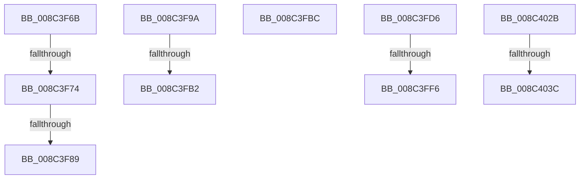

# sub_008C3F6B

- RVA: `0x008C3F6B`–`0x008C4045` (길이 `218` bytes)
- VA: `0x00000001408C3F6B`
- 실행 섹션: `PAGE`
- PDB 이름 있음: `아니요`; PDB Function 태그: `아니요`
- unwind 정보 RVA: `0x00083940`
- 디코드: `46`개 명령, `218/218` bytes 표시
- 미해석 바이트: `0` (있으면 어셈블리에 `.byte`로 보존)

> 이 문서는 커널 이미지의 기계어와 PDB 기호를 분석해 생성했습니다. 4번과 5번은 함수 원형과 자료형을 바이너리 사용 방식에서 추정한 C 해석이며 원본 소스 복구 결과는 아닙니다.

## 1. Dependencies

- 직접 호출 지점: **3**; 고유 호출 대상: **3**
- 직접 호출자로 확인된 함수: **0**
- RIP 상대 이미지 참조: **2**

### Outgoing calls
- `0x008C3FA5` → [SeSinglePrivilegeCheck](../87/SeSinglePrivilegeCheck_function_00871E20.md) (function, `0x00871E20`)
- `0x008C3FF9` → [ExpInterlockedPushEntrySList](../../text/6B/ExpInterlockedPushEntrySList_function_006BA5B0.md) (function, `0x006BA5B0`)
- `0x008C4011` → [CmpRecordParseFailure](../85/CmpRecordParseFailure_function_00851280.md) (function, `0x00851280`)

### Direct callers
- 이 함수 시작 RVA로 연결되는 직접 call은 확인되지 않았습니다. 간접 호출은 완전히 역산할 수 없습니다.

### Static image references
- `0x008C3F9A` → RVA `0x00FD9BD0` (`PAGEDATA`; read)
- `0x008C402B` → RVA `0x00FC5010` (`ALMOSTRO`; read)

## 2. Other-region calls and transfers

- 다른 실행 섹션으로 향하는 call: **1**
  - `0x008C3FF9` → [ExpInterlockedPushEntrySList](../../text/6B/ExpInterlockedPushEntrySList_function_006BA5B0.md) (`PAGE` → `.text`)
- call이 아닌 외부 분기/꼬리 이동: **10**
  - `0x008C3F6E` → [sub_008C405D + 0xB6](Unknown_function_008C405D.md) (`tail-transfer`)
  - `0x008C3F83` → [sub_008C3C89 + 0x266](Unknown_function_008C3C89.md) (`tail-transfer`)
  - `0x008C3F95` → [sub_008C3C89 + 0x20E](Unknown_function_008C3C89.md) (`tail-transfer`)
  - `0x008C3FAC` → [sub_008C3C89 + 0xE2](Unknown_function_008C3C89.md) (`tail-transfer`)
  - `0x008C3FB7` → [sub_008C3C89 + 0x12A](Unknown_function_008C3C89.md) (`tail-transfer`)
  - `0x008C3FD1` → [sub_008C3C89 + 0x1F7](Unknown_function_008C3C89.md) (`tail-transfer`)
  - `0x008C3FF0` → [sub_008C405D + 0x69](Unknown_function_008C405D.md) (`tail-transfer`)
  - `0x008C4026` → [sub_008C3C89 + 0x2A3](Unknown_function_008C3C89.md) (`tail-transfer`)
  - `0x008C4036` → [sub_008C405D + 0x195](Unknown_function_008C405D.md) (`tail-transfer`)
  - `0x008C4040` → [sub_008C3C89 + 0x188](Unknown_function_008C3C89.md) (`tail-transfer`)

## 3. Assembly (complete function range)

```asm
008C3F6B  45 85 C9                        test r9d, r9d
008C3F6E  0F 84 9F 01 00 00               je 0x1408c4113
008C3F74  48 8B 43 08                     mov rax, qword ptr [rbx + 8]
008C3F78  48 83 C0 78                     add rax, 0x78
008C3F7C  48 8B 48 08                     mov rcx, qword ptr [rax + 8]
008C3F80  48 39 01                        cmp qword ptr [rcx], rax
008C3F83  0F 84 66 FF FF FF               je 0x1408c3eef
008C3F89  B9 03 00 00 00                  mov ecx, 3
008C3F8E  CD 29                           int 0x29
008C3F90  66 83 4B 30 10                  or word ptr [rbx + 0x30], 0x10
008C3F95  E9 FD FE FF FF                  jmp 0x1408c3e97
008C3F9A  48 8B 0D 2F 5C 71 00            mov rcx, qword ptr [rip + 0x715c2f]
008C3FA1  41 0F B6 D7                     movzx edx, r15b
008C3FA5  E8 76 DE FA FF                  call 0x140871e20
008C3FAA  84 C0                           test al, al
008C3FAC  0F 85 B9 FD FF FF               jne 0x1408c3d6b
008C3FB2  BE 61 00 00 C0                  mov esi, 0xc0000061
008C3FB7  E9 F7 FD FF FF                  jmp 0x1408c3db3
008C3FBC  48 8B 44 24 48                  mov rax, qword ptr [rsp + 0x48]
008C3FC1  4D 8B EA                        mov r13, r10
008C3FC4  48 89 43 38                     mov qword ptr [rbx + 0x38], rax
008C3FC8  48 8B 44 24 58                  mov rax, qword ptr [rsp + 0x58]
008C3FCD  48 89 43 40                     mov qword ptr [rbx + 0x40], rax
008C3FD1  E9 AA FE FF FF                  jmp 0x1408c3e80
008C3FD6  65 48 8B 14 25 20 00 00 00      mov rdx, qword ptr gs:[0x20]
008C3FDF  48 8B 8A 40 08 00 00            mov rcx, qword ptr [rdx + 0x840]
008C3FE6  FF 41 1C                        inc dword ptr [rcx + 0x1c]
008C3FE9  0F B7 41 10                     movzx eax, word ptr [rcx + 0x10]
008C3FED  66 39 01                        cmp word ptr [rcx], ax
008C3FF0  0F 83 D0 00 00 00               jae 0x1408c40c6
008C3FF6  48 8B D7                        mov rdx, rdi
008C3FF9  E8 B2 65 DF FF                  call 0x1406ba5b0
008C3FFE  45 33 D2                        xor r10d, r10d
008C4001  48 8B 8C 24 D0 00 00 00         mov rcx, qword ptr [rsp + 0xd0]
008C4009  44 8B C6                        mov r8d, esi
008C400C  BA 00 04 02 00                  mov edx, 0x20400
008C4011  E8 6A D2 F8 FF                  call 0x140851280
008C4016  48 8B AC 24 C0 00 00 00         mov rbp, qword ptr [rsp + 0xc0]
008C401E  40 B7 01                        mov dil, 1
008C4021  4C 8B 6C 24 48                  mov r13, qword ptr [rsp + 0x48]
008C4026  E9 01 FF FF FF                  jmp 0x1408c3f2c
008C402B  39 2D DF 0F 70 00               cmp dword ptr [rip + 0x700fdf], ebp
008C4031  48 8B 5C 24 50                  mov rbx, qword ptr [rsp + 0x50]
008C4036  0F 85 B6 01 00 00               jne 0x1408c41f2
008C403C  48 83 C3 30                     add rbx, 0x30
008C4040  E9 CC FD FF FF                  jmp 0x1408c3e11
```

## 4. C-style interpretation (structured pseudocode)

```c
__int64 __fastcall sub_008C3F6B(__int64 a1, __int64 a2, __int64 a3, int a4)
{
    __int64 result;
    unsigned __int64 v_stack_p48;
    unsigned __int64 v_stack_p50;
    unsigned __int64 v_stack_p58;
    unsigned __int64 v_stack_pC0;
    unsigned __int64 v_stack_pD0;

    result = (*(unsigned __int64 *)(v_rbx + 8)) + (120);
}
```

## 5. (Beta) C Style

```c
int64_t sub_008C3F6B(int64_t Arg1, int64_t Arg2, int64_t Arg3, int32_t Arg4)
{
    int64_t result;
    uint64_t v_stack_p48;
    uint64_t v_stack_p50;
    uint64_t v_stack_p58;
    uint64_t v_stack_pC0;
    uint64_t v_stack_pD0;

    result = (*(uint64_t *)(local_rbx + 0x8)) + (120);
}
```

## 6. Execution-region graph

[열기: 2D/3D 그래프와 함수 탐색 컨트롤 패널](../../../control-panel.html?section=page&rva=0x008C3F6B&view=graph)

- 2D 그래프는 위에서 아래로 흐르고, 3D 그래프는 빈 공간을 드래그해 회전합니다. Shift+드래그는 이동, 휠은 확대·축소, 함수 노드 선택은 대상 보고서 이동입니다.

### Static fallback


