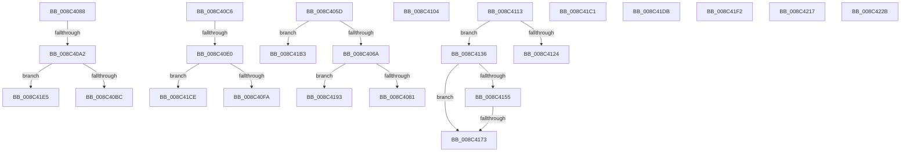

# sub_008C405D

- RVA: `0x008C405D`–`0x008C423C` (길이 `479` bytes)
- VA: `0x00000001408C405D`
- 실행 섹션: `PAGE`
- PDB 이름 있음: `아니요`; PDB Function 태그: `아니요`
- unwind 정보 RVA: `0x00083968`
- 디코드: `110`개 명령, `479/479` bytes 표시
- 미해석 바이트: `0` (있으면 어셈블리에 `.byte`로 보존)

> 이 문서는 커널 이미지의 기계어와 PDB 기호를 분석해 생성했습니다. 4번과 5번은 함수 원형과 자료형을 바이너리 사용 방식에서 추정한 C 해석이며 원본 소스 복구 결과는 아닙니다.

## 1. Dependencies

- 직접 호출 지점: **15**; 고유 호출 대상: **11**
- 직접 호출자로 확인된 함수: **0**
- RIP 상대 이미지 참조: **1**

### Outgoing calls
- `0x008C4072` → [CmpTransReferenceTransaction](../87/CmpTransReferenceTransaction_function_00873434.md) (function, `0x00873434`)
- `0x008C40BC` → [ExFreePool](../../poolcode/B8/ExFreePool_function_00B82850.md) (function, `0x00B82850`)
- `0x008C40FA` → [ExFreePool](../../poolcode/B8/ExFreePool_function_00B82850.md) (function, `0x00B82850`)
- `0x008C413A` → [CmpUnlockKcb](../../pagecmrc/BC/CmpUnlockKcb_function_00BC92C0.md) (function, `0x00BC92C0`)
- `0x008C4143` → [CmpLockKcbExclusive](../86/CmpLockKcbExclusive_function_00861EB0.md) (function, `0x00861EB0`)
- `0x008C4160` → [CmpIsKeyStackDeleted](../84/CmpIsKeyStackDeleted_function_008426E0.md) (function, `0x008426E0`)
- `0x008C4183` → [CmpRecordParseFailure](../85/CmpRecordParseFailure_function_00851280.md) (function, `0x00851280`)
- `0x008C419E` → [CmpRecordParseFailure](../85/CmpRecordParseFailure_function_00851280.md) (function, `0x00851280`)
- `0x008C41A6` → [CmpDereferenceKeyControlBlockUnsafe](../99/CmpDereferenceKeyControlBlockUnsafe_function_0099F960.md) (function, `0x0099F960`)
- `0x008C41D1` → [guard_dispatch_icall](../../text/6B/guard_dispatch_icall_function_006BAAD0.md) (function, `0x006BAAD0`)
- `0x008C41E8` → [guard_dispatch_icall](../../text/6B/guard_dispatch_icall_function_006BAAD0.md) (function, `0x006BAAD0`)
- `0x008C41F5` → [ObpRegisterObject](../AC/ObpRegisterObject_function_00ACF3EC.md) (function, `0x00ACF3EC`)
- `0x008C420D` → [ObpPushStackInfo](../../text/21/ObpPushStackInfo_function_002109E4.md) (function, `0x002109E4`)
- `0x008C421E` → [ObfDereferenceObject](../../text/2F/ObfDereferenceObject_function_002F9350.md) (function, `0x002F9350`)
- `0x008C4232` → [ObfDereferenceObject](../../text/2F/ObfDereferenceObject_function_002F9350.md) (function, `0x002F9350`)

### Direct callers
- 이 함수 시작 RVA로 연결되는 직접 call은 확인되지 않았습니다. 간접 호출은 완전히 역산할 수 없습니다.

### Static image references
- `0x008C40A5` → RVA `0x00B82850` (`ExFreePool`; read)

## 2. Other-region calls and transfers

- 다른 실행 섹션으로 향하는 call: **8**
  - `0x008C40BC` → [ExFreePool](../../poolcode/B8/ExFreePool_function_00B82850.md) (`PAGE` → `POOLCODE`)
  - `0x008C40FA` → [ExFreePool](../../poolcode/B8/ExFreePool_function_00B82850.md) (`PAGE` → `POOLCODE`)
  - `0x008C413A` → [CmpUnlockKcb](../../pagecmrc/BC/CmpUnlockKcb_function_00BC92C0.md) (`PAGE` → `PAGECMRC`)
  - `0x008C41D1` → [guard_dispatch_icall](../../text/6B/guard_dispatch_icall_function_006BAAD0.md) (`PAGE` → `.text`)
  - `0x008C41E8` → [guard_dispatch_icall](../../text/6B/guard_dispatch_icall_function_006BAAD0.md) (`PAGE` → `.text`)
  - `0x008C420D` → [ObpPushStackInfo](../../text/21/ObpPushStackInfo_function_002109E4.md) (`PAGE` → `.text`)
  - `0x008C421E` → [ObfDereferenceObject](../../text/2F/ObfDereferenceObject_function_002F9350.md) (`PAGE` → `.text`)
  - `0x008C4232` → [ObfDereferenceObject](../../text/2F/ObfDereferenceObject_function_002F9350.md) (`PAGE` → `.text`)
- call이 아닌 외부 분기/꼬리 이동: **18**
  - `0x008C4083` → [sub_008C3C89 + 0x19](Unknown_function_008C3C89.md) (`tail-transfer`)
  - `0x008C409C` → [sub_008C3C89 + 0x175](Unknown_function_008C3C89.md) (`tail-transfer`)
  - `0x008C40C1` → [sub_008C3C89 + 0x17D](Unknown_function_008C3C89.md) (`tail-transfer`)
  - `0x008C40DA` → [sub_008C3F6B + 0x8B](Unknown_function_008C3F6B.md) (`tail-transfer`)
  - `0x008C40FF` → [sub_008C3F6B + 0x93](Unknown_function_008C3F6B.md) (`tail-transfer`)
  - `0x008C410E` → [sub_008C3C89 + 0x1E1](Unknown_function_008C3C89.md) (`tail-transfer`)
  - `0x008C4131` → [sub_008C3C89 + 0x232](Unknown_function_008C3C89.md) (`tail-transfer`)
  - `0x008C416D` → [sub_008C3C89 + 0x232](Unknown_function_008C3C89.md) (`tail-transfer`)
  - `0x008C418E` → [sub_008C3C89 + 0x2A3](Unknown_function_008C3C89.md) (`tail-transfer`)
  - `0x008C41AE` → [sub_008C3C89 + 0x2B5](Unknown_function_008C3C89.md) (`tail-transfer`)
  - `0x008C41BC` → [sub_008C3C89 + 0x19](Unknown_function_008C3C89.md) (`tail-transfer`)
  - `0x008C41C9` → [sub_008C3F6B + 0x96](Unknown_function_008C3F6B.md) (`tail-transfer`)
  - `0x008C41D6` → [sub_008C3F6B + 0x93](Unknown_function_008C3F6B.md) (`tail-transfer`)
  - `0x008C41E0` → [sub_008C3C89 + 0x12A](Unknown_function_008C3C89.md) (`tail-transfer`)
  - `0x008C41ED` → [sub_008C3C89 + 0x17D](Unknown_function_008C3C89.md) (`tail-transfer`)
  - `0x008C4212` → [sub_008C3F6B + 0xD1](Unknown_function_008C3F6B.md) (`tail-transfer`)
  - `0x008C4226` → [sub_008C3C89 + 0x2AC](Unknown_function_008C3C89.md) (`tail-transfer`)
  - `0x008C4237` → [sub_008C3C89 + 0x2BE](Unknown_function_008C3C89.md) (`tail-transfer`)

## 3. Assembly (complete function range)

```asm
008C405D  49 8B 41 38                     mov rax, qword ptr [r9 + 0x38]
008C4061  48 85 C0                        test rax, rax
008C4064  0F 84 49 01 00 00               je 0x1408c41b3
008C406A  48 8B C8                        mov rcx, rax
008C406D  48 89 44 24 48                  mov qword ptr [rsp + 0x48], rax
008C4072  E8 BD F3 FA FF                  call 0x140873434
008C4077  8B F0                           mov esi, eax
008C4079  85 C0                           test eax, eax
008C407B  0F 88 12 01 00 00               js 0x1408c4193
008C4081  33 C9                           xor ecx, ecx
008C4083  E9 1A FC FF FF                  jmp 0x1408c3ca2
008C4088  FF 41 20                        inc dword ptr [rcx + 0x20]
008C408B  48 8B 8A 48 08 00 00            mov rcx, qword ptr [rdx + 0x848]
008C4092  FF 41 1C                        inc dword ptr [rcx + 0x1c]
008C4095  0F B7 41 10                     movzx eax, word ptr [rcx + 0x10]
008C4099  66 39 01                        cmp word ptr [rcx], ax
008C409C  0F 82 5C FD FF FF               jb 0x1408c3dfe
008C40A2  FF 41 20                        inc dword ptr [rcx + 0x20]
008C40A5  48 8D 05 A4 E7 2B 00            lea rax, [rip + 0x2be7a4]
008C40AC  48 8B 51 38                     mov rdx, qword ptr [rcx + 0x38]
008C40B0  48 8B CF                        mov rcx, rdi
008C40B3  48 3B D0                        cmp rdx, rax
008C40B6  0F 85 29 01 00 00               jne 0x1408c41e5
008C40BC  E8 8F E7 2B 00                  call 0x140b82850
008C40C1  E9 40 FD FF FF                  jmp 0x1408c3e06
008C40C6  FF 41 20                        inc dword ptr [rcx + 0x20]
008C40C9  48 8B 8A 48 08 00 00            mov rcx, qword ptr [rdx + 0x848]
008C40D0  FF 41 1C                        inc dword ptr [rcx + 0x1c]
008C40D3  0F B7 41 10                     movzx eax, word ptr [rcx + 0x10]
008C40D7  66 39 01                        cmp word ptr [rcx], ax
008C40DA  0F 82 16 FF FF FF               jb 0x1408c3ff6
008C40E0  FF 41 20                        inc dword ptr [rcx + 0x20]
008C40E3  48 8D 05 66 E7 2B 00            lea rax, [rip + 0x2be766]
008C40EA  48 8B 51 38                     mov rdx, qword ptr [rcx + 0x38]
008C40EE  48 8B CF                        mov rcx, rdi
008C40F1  48 3B D0                        cmp rdx, rax
008C40F4  0F 85 D4 00 00 00               jne 0x1408c41ce
008C40FA  E8 51 E7 2B 00                  call 0x140b82850
008C40FF  E9 FA FE FF FF                  jmp 0x1408c3ffe
008C4104  48 63 45 60                     movsxd rax, dword ptr [rbp + 0x60]
008C4108  89 03                           mov dword ptr [rbx], eax
008C410A  49 89 47 38                     mov qword ptr [r15 + 0x38], rax
008C410E  E9 57 FD FF FF                  jmp 0x1408c3e6a
008C4113  48 8B 4B 08                     mov rcx, qword ptr [rbx + 8]
008C4117  B8 11 00 00 00                  mov eax, 0x11
008C411C  F0 4C 0F B1 71 30               lock cmpxchg qword ptr [rcx + 0x30], r14
008C4122  75 12                           jne 0x1408c4136
008C4124  65 48 8B 04 25 88 01 00 00      mov rax, qword ptr gs:[0x188]
008C412D  48 89 41 38                     mov qword ptr [rcx + 0x38], rax
008C4131  E9 85 FD FF FF                  jmp 0x1408c3ebb
008C4136  48 8B 4B 08                     mov rcx, qword ptr [rbx + 8]
008C413A  E8 81 51 30 00                  call 0x140bc92c0
008C413F  48 8B 4B 08                     mov rcx, qword ptr [rbx + 8]
008C4143  E8 68 DD F9 FF                  call 0x140861eb0
008C4148  48 8B 43 08                     mov rax, qword ptr [rbx + 8]
008C414C  F7 40 08 00 00 02 00            test dword ptr [rax + 8], 0x20000
008C4153  75 1E                           jne 0x1408c4173
008C4155  48 8B 8C 24 E8 00 00 00         mov rcx, qword ptr [rsp + 0xe8]
008C415D  48 8B D6                        mov rdx, rsi
008C4160  E8 7B E5 F7 FF                  call 0x1408426e0
008C4165  41 BA 00 00 00 00               mov r10d, 0
008C416B  84 C0                           test al, al
008C416D  0F 84 48 FD FF FF               je 0x1408c3ebb
008C4173  BE 7C 01 00 C0                  mov esi, 0xc000017c
008C4178  BA 00 05 02 00                  mov edx, 0x20500
008C417D  44 8B C6                        mov r8d, esi
008C4180  49 8B CF                        mov rcx, r15
008C4183  E8 F8 D0 F8 FF                  call 0x140851280
008C4188  45 33 D2                        xor r10d, r10d
008C418B  40 B7 01                        mov dil, 1
008C418E  E9 99 FD FF FF                  jmp 0x1408c3f2c
008C4193  44 8B C0                        mov r8d, eax
008C4196  BA 00 03 02 00                  mov edx, 0x20300
008C419B  48 8B CF                        mov rcx, rdi
008C419E  E8 DD D0 F8 FF                  call 0x140851280
008C41A3  48 8B CD                        mov rcx, rbp
008C41A6  E8 B5 B7 0D 00                  call 0x14099f960
008C41AB  45 33 D2                        xor r10d, r10d
008C41AE  E9 8B FD FF FF                  jmp 0x1408c3f3e
008C41B3  49 8D 41 58                     lea rax, [r9 + 0x58]
008C41B7  48 89 44 24 58                  mov qword ptr [rsp + 0x58], rax
008C41BC  E9 E1 FA FF FF                  jmp 0x1408c3ca2
008C41C1  BE 9A 00 00 C0                  mov esi, 0xc000009a
008C41C6  45 33 D2                        xor r10d, r10d
008C41C9  E9 33 FE FF FF                  jmp 0x1408c4001
008C41CE  48 8B C2                        mov rax, rdx
008C41D1  E8 FA 68 DF FF                  call 0x1406baad0
008C41D6  E9 23 FE FF FF                  jmp 0x1408c3ffe
008C41DB  BE 0D 00 00 C0                  mov esi, 0xc000000d
008C41E0  E9 CE FB FF FF                  jmp 0x1408c3db3
008C41E5  48 8B C2                        mov rax, rdx
008C41E8  E8 E3 68 DF FF                  call 0x1406baad0
008C41ED  E9 14 FC FF FF                  jmp 0x1408c3e06
008C41F2  48 8B CB                        mov rcx, rbx
008C41F5  E8 F2 B1 20 00                  call 0x140acf3ec
008C41FA  41 B8 01 00 00 00               mov r8d, 1
008C4200  41 B9 44 66 6C 74               mov r9d, 0x746c6644
008C4206  41 0F B6 D0                     movzx edx, r8b
008C420A  48 8B CB                        mov rcx, rbx
008C420D  E8 D2 C7 94 FF                  call 0x1402109e4
008C4212  E9 25 FE FF FF                  jmp 0x1408c403c
008C4217  49 83 E5 FE                     and r13, 0xfffffffffffffffe
008C421B  49 8B CD                        mov rcx, r13
008C421E  E8 2D 51 A3 FF                  call 0x1402f9350
008C4223  45 33 D2                        xor r10d, r10d
008C4226  E9 0A FD FF FF                  jmp 0x1408c3f35
008C422B  48 8B CB                        mov rcx, rbx
008C422E  4C 89 53 08                     mov qword ptr [rbx + 8], r10
008C4232  E8 19 51 A3 FF                  call 0x1402f9350
008C4237  E9 0B FD FF FF                  jmp 0x1408c3f47
```

## 4. C-style interpretation (structured pseudocode)

```c
__int64 __fastcall sub_008C405D(__int64 a1, __int64 a2, __int64 a3, __int64 a4)
{
    __int64 result;
    __int64 v_r10;
    unsigned __int64 v_stack_p48;
    unsigned __int64 v_stack_p58;
    unsigned __int64 v_stack_pE8;

    if (*(unsigned __int64 *)(a4 + 56) == 0) goto loc_008C41B3;
    v_stack_p48 = *(unsigned __int64 *)(a4 + 56);
    result = CmpTransReferenceTransaction(*(unsigned __int64 *)(a4 + 56), a2, a3, a4);
    if (sign_flag) goto loc_008C4193;
    a1 = 0;
loc_008C4193:
    result = CmpRecordParseFailure(v_rdi, (unsigned int)(0x20300ULL), (unsigned int)((unsigned int)(result)), a4);
    result = CmpDereferenceKeyControlBlockUnsafe(v_rbp, (unsigned int)(0x20300ULL), (unsigned int)((unsigned int)(result)), a4);
    v_r10 = 0;
loc_008C41B3:
    v_stack_p58 = a4 + 88;
}
```

## 5. (Beta) C Style

```c
int64_t sub_008C405D(int64_t Arg1, int64_t Arg2, int64_t Arg3, void *Arg4)
{
    uint8_t *arg4 = (uint8_t *)Arg4;

    int64_t result;
    int64_t local_r10;
    uint64_t v_stack_p48;
    uint64_t v_stack_p58;
    uint64_t v_stack_pE8;

    if (*(uint64_t *)(arg4 + 0x38) == 0) goto loc_008C41B3;
    v_stack_p48 = *(uint64_t *)(arg4 + 0x38);
    result = CmpTransReferenceTransaction(*(uint64_t *)(arg4 + 0x38), Arg2, Arg3, Arg4);
    if (sign_flag) goto loc_008C4193;
    Arg1 = 0;
loc_008C4193:
    result = CmpRecordParseFailure(local_rdi, (uint32_t)(0x20300ULL), (uint32_t)((uint32_t)(result)), Arg4);
    result = CmpDereferenceKeyControlBlockUnsafe(local_rbp, (uint32_t)(0x20300ULL), (uint32_t)((uint32_t)(result)), Arg4);
    local_r10 = 0;
loc_008C41B3:
    v_stack_p58 = Arg4 + 88;
}
```

### 관측된 메모리 오프셋

구조체 형식이 확인되지 않은 접근은 인자 기준의 오프셋으로만 기록했습니다.

| 기준 인자 | 오프셋 표현 | 폭 (bit) | 접근 |
|---|---:|---:|---|
| `Arg4` | `+ 0x38` | `64` | `R` |
| `Arg4` | `+ 0x58` | `64` | `R` |

## 6. Execution-region graph

[열기: 2D/3D 그래프와 함수 탐색 컨트롤 패널](../../../control-panel.html?section=page&rva=0x008C405D&view=graph)

- 2D 그래프는 위에서 아래로 흐르고, 3D 그래프는 빈 공간을 드래그해 회전합니다. Shift+드래그는 이동, 휠은 확대·축소, 함수 노드 선택은 대상 보고서 이동입니다.

### Static fallback


