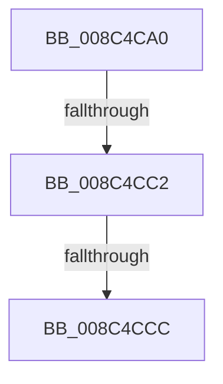

# sub_008C4CA0

- RVA: `0x008C4CA0`–`0x008C4CFA` (길이 `90` bytes)
- VA: `0x00000001408C4CA0`
- 실행 섹션: `PAGE`
- PDB 이름 있음: `아니요`; PDB Function 태그: `아니요`
- unwind 정보 RVA: `0x00083A84`
- 디코드: `22`개 명령, `90/90` bytes 표시
- 미해석 바이트: `0` (있으면 어셈블리에 `.byte`로 보존)

> 이 문서는 커널 이미지의 기계어와 PDB 기호를 분석해 생성했습니다. 4번과 5번은 함수 원형과 자료형을 바이너리 사용 방식에서 추정한 C 해석이며 원본 소스 복구 결과는 아닙니다.

## 1. Dependencies

- 직접 호출 지점: **1**; 고유 호출 대상: **1**
- 직접 호출자로 확인된 함수: **0**
- RIP 상대 이미지 참조: **1**

### Outgoing calls
- `0x008C4CD9` → [PsReferencePrimaryTokenWithTag](../../text/20/PsReferencePrimaryTokenWithTag_function_0020FF80.md) (function, `0x0020FF80`)

### Direct callers
- 이 함수 시작 RVA로 연결되는 직접 call은 확인되지 않았습니다. 간접 호출은 완전히 역산할 수 없습니다.

### Static image references
- `0x008C4CF1` → RVA `0x00FD8010` (`PAGEDATA`; read)

## 2. Other-region calls and transfers

- 다른 실행 섹션으로 향하는 call: **1**
  - `0x008C4CD9` → [PsReferencePrimaryTokenWithTag](../../text/20/PsReferencePrimaryTokenWithTag_function_0020FF80.md) (`PAGE` → `.text`)
- call이 아닌 외부 분기/꼬리 이동: **3**
  - `0x008C4CBC` → [sub_008C4D5A](Unknown_function_008C4D5A.md) (`tail-transfer`)
  - `0x008C4CCA` → [sub_008C4D01](Unknown_function_008C4D01.md) (`tail-transfer`)
  - `0x008C4CF8` → [sub_008C4D65](Unknown_function_008C4D65.md) (`tail-transfer`)

## 3. Assembly (complete function range)

```asm
008C4CA0  48 89 5C 24 30                  mov qword ptr [rsp + 0x30], rbx
008C4CA5  48 8B D9                        mov rbx, rcx
008C4CA8  48 89 6C 24 38                  mov qword ptr [rsp + 0x38], rbp
008C4CAD  48 89 74 24 40                  mov qword ptr [rsp + 0x40], rsi
008C4CB2  48 8B F2                        mov rsi, rdx
008C4CB5  49 89 40 18                     mov qword ptr [r8 + 0x18], rax
008C4CB9  48 85 C9                        test rcx, rcx
008C4CBC  0F 84 98 00 00 00               je 0x1408c4d5a
008C4CC2  8B 81 A0 05 00 00               mov eax, dword ptr [rcx + 0x5a0]
008C4CC8  A8 08                           test al, 8
008C4CCA  75 35                           jne 0x1408c4d01
008C4CCC  33 ED                           xor ebp, ebp
008C4CCE  BA 53 65 53 75                  mov edx, 0x75536553
008C4CD3  48 89 2F                        mov qword ptr [rdi], rbp
008C4CD6  48 8B CE                        mov rcx, rsi
008C4CD9  E8 A2 B2 94 FF                  call 0x14020ff80
008C4CDE  48 8B 74 24 40                  mov rsi, qword ptr [rsp + 0x40]
008C4CE3  48 8B 6C 24 38                  mov rbp, qword ptr [rsp + 0x38]
008C4CE8  48 8B 5C 24 30                  mov rbx, qword ptr [rsp + 0x30]
008C4CED  48 89 47 10                     mov qword ptr [rdi + 0x10], rax
008C4CF1  83 3D 18 33 71 00 00            cmp dword ptr [rip + 0x713318], 0
008C4CF8  75 6B                           jne 0x1408c4d65
```

## 4. C-style interpretation (structured pseudocode)

```c
__int64 __fastcall sub_008C4CA0(__int64 a1, __int64 a2, __int64 a3, __int64 a4, __int64 a5, __int64 a6, __int64 a7, __int64 a8)
{
    __int64 result;
    __int64 v_rbp;
    unsigned __int64 v_stack_p30;
    unsigned __int64 v_stack_p38;
    unsigned __int64 v_stack_p40;

    v_stack_p30 = v_rbx;
    v_stack_p38 = v_rbp;
    v_stack_p40 = v_rsi;
    *(unsigned __int64 *)(a3 + 24) = result;
    v_rbp = 0;
    *(unsigned __int64 *)(v_rdi) = 0;
    result = PsReferencePrimaryTokenWithTag(a2, (unsigned int)(0x75536553ULL), a3, a4);
    *(unsigned __int64 *)(v_rdi + 16) = result;
}
```

## 5. (Beta) C Style

```c
int64_t sub_008C4CA0(int64_t Arg1, int64_t Arg2, void *Arg3, int64_t Arg4, uint64_t Arg5, int64_t Arg6, int64_t Arg7, int64_t Arg8)
{
    uint8_t *arg3 = (uint8_t *)Arg3;

    int64_t result;
    int64_t local_rbp;
    uint64_t v_stack_p30;
    uint64_t v_stack_p38;
    uint64_t v_stack_p40;

    v_stack_p30 = local_rbx;
    v_stack_p38 = local_rbp;
    v_stack_p40 = local_rsi;
    *(uint64_t *)(arg3 + 0x18) = result;
    local_rbp = 0;
    *(uint64_t *)(local_rdi) = 0;
    result = PsReferencePrimaryTokenWithTag(Arg2, (uint32_t)(0x75536553ULL), Arg3, Arg4);
    *(uint64_t *)(local_rdi + 0x10) = result;
}
```

### 관측된 메모리 오프셋

구조체 형식이 확인되지 않은 접근은 인자 기준의 오프셋으로만 기록했습니다.

| 기준 인자 | 오프셋 표현 | 폭 (bit) | 접근 |
|---|---:|---:|---|
| `Arg3` | `+ 0x18` | `64` | `W` |

## 6. Execution-region graph

[열기: 2D/3D 그래프와 함수 탐색 컨트롤 패널](../../../control-panel.html?section=page&rva=0x008C4CA0&view=graph)

- 2D 그래프는 위에서 아래로 흐르고, 3D 그래프는 빈 공간을 드래그해 회전합니다. Shift+드래그는 이동, 휠은 확대·축소, 함수 노드 선택은 대상 보고서 이동입니다.

### Static fallback


