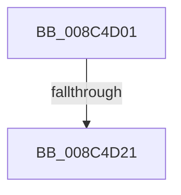

# sub_008C4D01

- RVA: `0x008C4D01`–`0x008C4D5A` (길이 `89` bytes)
- VA: `0x00000001408C4D01`
- 실행 섹션: `PAGE`
- PDB 이름 있음: `아니요`; PDB Function 태그: `아니요`
- unwind 정보 RVA: `0x00083AB4`
- 디코드: `20`개 명령, `89/89` bytes 표시
- 미해석 바이트: `0` (있으면 어셈블리에 `.byte`로 보존)

> 이 문서는 커널 이미지의 기계어와 PDB 기호를 분석해 생성했습니다. 4번과 5번은 함수 원형과 자료형을 바이너리 사용 방식에서 추정한 C 해석이며 원본 소스 복구 결과는 아닙니다.

## 1. Dependencies

- 직접 호출 지점: **3**; 고유 호출 대상: **3**
- 직접 호출자로 확인된 함수: **0**
- RIP 상대 이미지 참조: **0**

### Outgoing calls
- `0x008C4D12` → [PspLockThreadSecurityShared](../../text/3C/PspLockThreadSecurityShared_function_003C4720.md) (function, `0x003C4720`)
- `0x008C4D34` → [ObfReferenceObjectWithTag](../../text/21/ObfReferenceObjectWithTag_function_00210710.md) (function, `0x00210710`)
- `0x008C4D4B` → [PspUnlockThreadSecurityShared](../../text/3C/PspUnlockThreadSecurityShared_function_003C2E40.md) (function, `0x003C2E40`)

### Direct callers
- 이 함수 시작 RVA로 연결되는 직접 call은 확인되지 않았습니다. 간접 호출은 완전히 역산할 수 없습니다.

### Static image references
- 디코드된 RIP-relative 메모리 참조가 없습니다.

## 2. Other-region calls and transfers

- 다른 실행 섹션으로 향하는 call: **3**
  - `0x008C4D12` → [PspLockThreadSecurityShared](../../text/3C/PspLockThreadSecurityShared_function_003C4720.md) (`PAGE` → `.text`)
  - `0x008C4D34` → [ObfReferenceObjectWithTag](../../text/21/ObfReferenceObjectWithTag_function_00210710.md) (`PAGE` → `.text`)
  - `0x008C4D4B` → [PspUnlockThreadSecurityShared](../../text/3C/PspUnlockThreadSecurityShared_function_003C2E40.md) (`PAGE` → `.text`)
- call이 아닌 외부 분기/꼬리 이동: **2**
  - `0x008C4D1F` → [sub_008C4D61](Unknown_function_008C4D61.md) (`tail-transfer`)
  - `0x008C4D55` → [sub_008C4CA0 + 0x2E](Unknown_function_008C4CA0.md) (`tail-transfer`)

## 3. Assembly (complete function range)

```asm
008C4D01  4C 89 74 24 48                  mov qword ptr [rsp + 0x48], r14
008C4D06  65 4C 8B 34 25 88 01 00 00      mov r14, qword ptr gs:[0x188]
008C4D0F  49 8B D6                        mov rdx, r14
008C4D12  E8 09 FA AF FF                  call 0x1403c4720
008C4D17  8B 83 A0 05 00 00               mov eax, dword ptr [rbx + 0x5a0]
008C4D1D  A8 08                           test al, 8
008C4D1F  74 40                           je 0x1408c4d61
008C4D21  48 8B AB 38 05 00 00            mov rbp, qword ptr [rbx + 0x538]
008C4D28  BA 53 65 53 75                  mov edx, 0x75536553
008C4D2D  48 83 E5 F8                     and rbp, 0xfffffffffffffff8
008C4D31  48 8B CD                        mov rcx, rbp
008C4D34  E8 D7 B9 94 FF                  call 0x140210710
008C4D39  8B 83 38 05 00 00               mov eax, dword ptr [rbx + 0x538]
008C4D3F  83 E0 03                        and eax, 3
008C4D42  89 47 08                        mov dword ptr [rdi + 8], eax
008C4D45  49 8B D6                        mov rdx, r14
008C4D48  48 8B CB                        mov rcx, rbx
008C4D4B  E8 F0 E0 AF FF                  call 0x1403c2e40
008C4D50  4C 8B 74 24 48                  mov r14, qword ptr [rsp + 0x48]
008C4D55  E9 74 FF FF FF                  jmp 0x1408c4cce
```

## 4. C-style interpretation (structured pseudocode)

```c
__int64 __fastcall sub_008C4D01(__int64 a1, __int64 a2, __int64 a3, __int64 a4, __int64 a5, __int64 a6, __int64 a7, __int64 a8, __int64 a9)
{
    __int64 result;
    __int64 v_rbp;
    unsigned __int64 v_stack_p48;

    v_stack_p48 = v_r14;
    result = PspLockThreadSecurityShared(a1, *(unsigned __int64 *)(gs_base + (0 + 392)), a3, a4);
    v_rbp = (*(unsigned __int64 *)(v_rbx + 1336)) & (-8);
    result = ObfReferenceObjectWithTag(v_rbp, (unsigned int)(0x75536553ULL), a3, a4);
    result = (unsigned int)(((unsigned int)(*(unsigned int *)(v_rbx + 1336))) & (3));
    *(unsigned int *)(v_rdi + 8) = (unsigned int)(result);
    result = PspUnlockThreadSecurityShared(v_rbx, *(unsigned __int64 *)(gs_base + (0 + 392)), a3, a4);
}
```

## 5. (Beta) C Style

```c
int64_t sub_008C4D01(int64_t Arg1, int64_t Arg2, int64_t Arg3, int64_t Arg4, uint64_t Arg5, uint64_t Arg6, uint64_t Arg7, uint64_t Arg8, int64_t Arg9)
{
    int64_t result;
    int64_t local_rbp;
    uint64_t v_stack_p48;

    v_stack_p48 = local_r14;
    result = PspLockThreadSecurityShared(Arg1, *(uint64_t *)(gs_base + (0 + 0x188)), Arg3, Arg4);
    local_rbp = (*(uint64_t *)(local_rbx + 0x538)) & (-8);
    result = ObfReferenceObjectWithTag(local_rbp, (uint32_t)(0x75536553ULL), Arg3, Arg4);
    result = (uint32_t)(((uint32_t)(*(uint32_t *)(local_rbx + 0x538))) & (3));
    *(uint32_t *)(local_rdi + 0x8) = (uint32_t)(result);
    result = PspUnlockThreadSecurityShared(local_rbx, *(uint64_t *)(gs_base + (0 + 0x188)), Arg3, Arg4);
}
```

## 6. Execution-region graph

[열기: 2D/3D 그래프와 함수 탐색 컨트롤 패널](../../../control-panel.html?section=page&rva=0x008C4D01&view=graph)

- 2D 그래프는 위에서 아래로 흐르고, 3D 그래프는 빈 공간을 드래그해 회전합니다. Shift+드래그는 이동, 휠은 확대·축소, 함수 노드 선택은 대상 보고서 이동입니다.

### Static fallback


