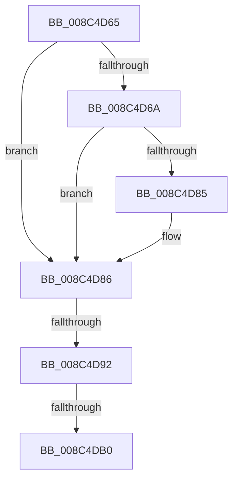

# sub_008C4D65

- RVA: `0x008C4D65`–`0x008C4DB6` (길이 `81` bytes)
- VA: `0x00000001408C4D65`
- 실행 섹션: `PAGE`
- PDB 이름 있음: `아니요`; PDB Function 태그: `아니요`
- unwind 정보 RVA: `0x00083B04`
- 디코드: `18`개 명령, `81/81` bytes 표시
- 미해석 바이트: `0` (있으면 어셈블리에 `.byte`로 보존)

> 이 문서는 커널 이미지의 기계어와 PDB 기호를 분석해 생성했습니다. 4번과 5번은 함수 원형과 자료형을 바이너리 사용 방식에서 추정한 C 해석이며 원본 소스 복구 결과는 아닙니다.

## 1. Dependencies

- 직접 호출 지점: **0**; 고유 호출 대상: **0**
- 직접 호출자로 확인된 함수: **0**
- RIP 상대 이미지 참조: **1**

### Outgoing calls
- 직접 디코드된 call 명령이 없습니다.

### Direct callers
- 이 함수 시작 RVA로 연결되는 직접 call은 확인되지 않았습니다. 간접 호출은 완전히 역산할 수 없습니다.

### Static image references
- `0x008C4D78` → RVA `0x00E67B90` (`.data`; read)

## 2. Other-region calls and transfers

- 다른 실행 섹션으로 향하는 call: **0**
- call이 아닌 외부 분기/꼬리 이동: **3**
  - `0x008C4D8C` → [sub_008C4CFA](Unknown_function_008C4CFA.md) (`tail-transfer`)
  - `0x008C4DAA` → [sub_008C4CFA](Unknown_function_008C4CFA.md) (`tail-transfer`)
  - `0x008C4DB1` → [sub_008C4CFA](Unknown_function_008C4CFA.md) (`tail-transfer`)

## 3. Assembly (complete function range)

```asm
008C4D65  48 85 C0                        test rax, rax
008C4D68  74 1C                           je 0x1408c4d86
008C4D6A  48 8B 80 78 04 00 00            mov rax, qword ptr [rax + 0x478]
008C4D71  F0 FF 80 1C 01 00 00            lock inc dword ptr [rax + 0x11c]
008C4D78  48 8B 05 11 2E 5A 00            mov rax, qword ptr [rip + 0x5a2e11]
008C4D7F  48 39 47 10                     cmp qword ptr [rdi + 0x10], rax
008C4D83  75 01                           jne 0x1408c4d86
008C4D85  CC                              int3
008C4D86  48 8B 07                        mov rax, qword ptr [rdi]
008C4D89  48 85 C0                        test rax, rax
008C4D8C  0F 84 68 FF FF FF               je 0x1408c4cfa
008C4D92  48 8B 80 78 04 00 00            mov rax, qword ptr [rax + 0x478]
008C4D99  F0 FF 80 1C 01 00 00            lock inc dword ptr [rax + 0x11c]
008C4DA0  48 8B 05 E9 2D 5A 00            mov rax, qword ptr [rip + 0x5a2de9]
008C4DA7  48 39 07                        cmp qword ptr [rdi], rax
008C4DAA  0F 85 4A FF FF FF               jne 0x1408c4cfa
008C4DB0  CC                              int3
008C4DB1  E9 44 FF FF FF                  jmp 0x1408c4cfa
```

## 4. C-style interpretation (structured pseudocode)

```c
__int64 __fastcall sub_008C4D65(void)
{
    if (result == 0) goto loc_008C4D86;
    if ((*(unsigned __int64 *)(v_rdi + 16)) == (*(unsigned __int64 *)(v_rip + 5910033))) {
    }
}
```

## 5. (Beta) C Style

```c
void sub_008C4D65(void)
{
    if (result == 0) goto loc_008C4D86;
    if ((*(uint64_t *)(local_rdi + 0x10)) == (*(uint64_t *)(v_rip + 0x5A2E11))) {
    }
}
```

## 6. Execution-region graph

[열기: 2D/3D 그래프와 함수 탐색 컨트롤 패널](../../../control-panel.html?section=page&rva=0x008C4D65&view=graph)

- 2D 그래프는 위에서 아래로 흐르고, 3D 그래프는 빈 공간을 드래그해 회전합니다. Shift+드래그는 이동, 휠은 확대·축소, 함수 노드 선택은 대상 보고서 이동입니다.

### Static fallback


