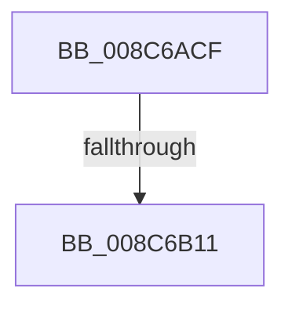

# sub_008C6ACF

- RVA: `0x008C6ACF`–`0x008C6B47` (길이 `120` bytes)
- VA: `0x00000001408C6ACF`
- 실행 섹션: `PAGE`
- PDB 이름 있음: `아니요`; PDB Function 태그: `아니요`
- unwind 정보 RVA: `0x00083C18`
- 디코드: `25`개 명령, `120/120` bytes 표시
- 미해석 바이트: `0` (있으면 어셈블리에 `.byte`로 보존)

> 이 문서는 커널 이미지의 기계어와 PDB 기호를 분석해 생성했습니다. 4번과 5번은 함수 원형과 자료형을 바이너리 사용 방식에서 추정한 C 해석이며 원본 소스 복구 결과는 아닙니다.

## 1. Dependencies

- 직접 호출 지점: **1**; 고유 호출 대상: **1**
- 직접 호출자로 확인된 함수: **0**
- RIP 상대 이미지 참조: **1**

### Outgoing calls
- `0x008C6B20` → [PsReferencePrimaryTokenWithTag](../../text/20/PsReferencePrimaryTokenWithTag_function_0020FF80.md) (function, `0x0020FF80`)

### Direct callers
- 이 함수 시작 RVA로 연결되는 직접 call은 확인되지 않았습니다. 간접 호출은 완전히 역산할 수 없습니다.

### Static image references
- `0x008C6B25` → RVA `0x00FD8010` (`PAGEDATA`; read)

## 2. Other-region calls and transfers

- 다른 실행 섹션으로 향하는 call: **1**
  - `0x008C6B20` → [PsReferencePrimaryTokenWithTag](../../text/20/PsReferencePrimaryTokenWithTag_function_0020FF80.md) (`PAGE` → `.text`)
- call이 아닌 외부 분기/꼬리 이동: **2**
  - `0x008C6B0F` → [sub_008C6B6D](Unknown_function_008C6B6D.md) (`tail-transfer`)
  - `0x008C6B41` → [sub_008C6BD4](Unknown_function_008C6BD4.md) (`tail-transfer`)

## 3. Assembly (complete function range)

```asm
008C6ACF  48 89 58 08                     mov qword ptr [rax + 8], rbx
008C6AD3  0F 57 C0                        xorps xmm0, xmm0
008C6AD6  65 48 8B 1C 25 88 01 00 00      mov rbx, qword ptr gs:[0x188]
008C6ADF  49 8B E9                        mov rbp, r9
008C6AE2  48 89 70 10                     mov qword ptr [rax + 0x10], rsi
008C6AE6  45 8B F0                        mov r14d, r8d
008C6AE9  F3 0F 7F 40 C0                  movdqu xmmword ptr [rax - 0x40], xmm0
008C6AEE  4C 8B FA                        mov r15, rdx
008C6AF1  4C 8B E1                        mov r12, rcx
008C6AF4  48 8B B3 B8 00 00 00            mov rsi, qword ptr [rbx + 0xb8]
008C6AFB  48 8B 86 D0 01 00 00            mov rax, qword ptr [rsi + 0x1d0]
008C6B02  48 89 44 24 48                  mov qword ptr [rsp + 0x48], rax
008C6B07  8B 83 A0 05 00 00               mov eax, dword ptr [rbx + 0x5a0]
008C6B0D  A8 08                           test al, 8
008C6B0F  75 5C                           jne 0x1408c6b6d
008C6B11  33 FF                           xor edi, edi
008C6B13  BA 53 65 53 75                  mov edx, 0x75536553
008C6B18  48 89 7C 24 30                  mov qword ptr [rsp + 0x30], rdi
008C6B1D  48 8B CE                        mov rcx, rsi
008C6B20  E8 5B 94 94 FF                  call 0x14020ff80
008C6B25  83 3D E4 14 71 00 00            cmp dword ptr [rip + 0x7114e4], 0
008C6B2C  48 8B B4 24 88 00 00 00         mov rsi, qword ptr [rsp + 0x88]
008C6B34  48 8B 9C 24 80 00 00 00         mov rbx, qword ptr [rsp + 0x80]
008C6B3C  48 89 44 24 40                  mov qword ptr [rsp + 0x40], rax
008C6B41  0F 85 8D 00 00 00               jne 0x1408c6bd4
```

## 4. C-style interpretation (structured pseudocode)

```c
__int64 __fastcall sub_008C6ACF(__int64 a1, __int64 a2, int a3, __int64 a4, __int64 a5, __int64 a6, __int64 a7, __int64 a8, __int64 a9, __int64 a10, __int64 a11, __int64 a12, __int64 a13, __int64 a14, __int64 a15, __int64 a16, __int64 a17)
{
    __int64 result;
    __int64 v_rdi;
    unsigned __int64 v_stack_p30;
    unsigned __int64 v_stack_p40;
    unsigned __int64 v_stack_p48;

    *(unsigned __int64 *)(result + 8) = v_rbx;
    *(unsigned __int64 *)(result + 16) = v_rsi;
    *(unsigned __int64 *)(result - 64) = v_xmm0;
    v_stack_p48 = *(unsigned __int64 *)(*(unsigned __int64 *)(*(unsigned __int64 *)(gs_base + (0 + 392)) + 184) + 464);
    v_rdi = 0;
    v_stack_p30 = 0;
    result = PsReferencePrimaryTokenWithTag(*(unsigned __int64 *)(*(unsigned __int64 *)(gs_base + (0 + 392)) + 184), (unsigned int)(0x75536553ULL), a3, a4);
    v_stack_p40 = result;
}
```

## 5. (Beta) C Style

```c
int64_t sub_008C6ACF(int64_t Arg1, int64_t Arg2, int32_t Arg3, int64_t Arg4, uint64_t Arg5, uint64_t Arg6, uint64_t Arg7, uint64_t Arg8, uint64_t Arg9, uint64_t Arg10, uint64_t Arg11, uint64_t Arg12, uint64_t Arg13, uint64_t Arg14, uint64_t Arg15, int64_t Arg16, int64_t Arg17)
{
    int64_t result;
    int64_t local_rdi;
    uint64_t v_stack_p30;
    uint64_t v_stack_p40;
    uint64_t v_stack_p48;

    *(uint64_t *)(result + 0x8) = local_rbx;
    *(uint64_t *)(result + 0x10) = local_rsi;
    *(uint64_t *)(result - 0x40) = v_xmm0;
    v_stack_p48 = *(uint64_t *)(*(uint64_t *)(*(uint64_t *)(gs_base + (0 + 0x188)) + 0xB8) + 0x1D0);
    local_rdi = 0;
    v_stack_p30 = 0;
    result = PsReferencePrimaryTokenWithTag(*(uint64_t *)(*(uint64_t *)(gs_base + (0 + 0x188)) + 0xB8), (uint32_t)(0x75536553ULL), Arg3, Arg4);
    v_stack_p40 = result;
}
```

## 6. Execution-region graph

[열기: 2D/3D 그래프와 함수 탐색 컨트롤 패널](../../../control-panel.html?section=page&rva=0x008C6ACF&view=graph)

- 2D 그래프는 위에서 아래로 흐르고, 3D 그래프는 빈 공간을 드래그해 회전합니다. Shift+드래그는 이동, 휠은 확대·축소, 함수 노드 선택은 대상 보고서 이동입니다.

### Static fallback


