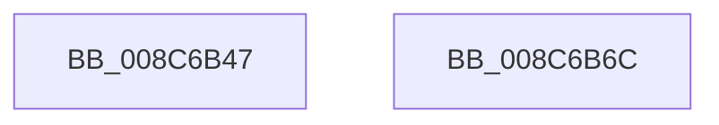

# sub_008C6B47

- RVA: `0x008C6B47`–`0x008C6B6D` (길이 `38` bytes)
- VA: `0x00000001408C6B47`
- 실행 섹션: `PAGE`
- PDB 이름 있음: `아니요`; PDB Function 태그: `아니요`
- unwind 정보 RVA: `0x00083C30`
- 디코드: `14`개 명령, `38/38` bytes 표시
- 미해석 바이트: `0` (있으면 어셈블리에 `.byte`로 보존)

> 이 문서는 커널 이미지의 기계어와 PDB 기호를 분석해 생성했습니다. 4번과 5번은 함수 원형과 자료형을 바이너리 사용 방식에서 추정한 C 해석이며 원본 소스 복구 결과는 아닙니다.

## 1. Dependencies

- 직접 호출 지점: **1**; 고유 호출 대상: **1**
- 직접 호출자로 확인된 함수: **0**
- RIP 상대 이미지 참조: **0**

### Outgoing calls
- `0x008C6B5A` → [SepCreateAccessStateFromSubjectContext](../../text/3E/SepCreateAccessStateFromSubjectContext_function_003EBF40.md) (function, `0x003EBF40`)

### Direct callers
- 이 함수 시작 RVA로 연결되는 직접 call은 확인되지 않았습니다. 간접 호출은 완전히 역산할 수 없습니다.

### Static image references
- 디코드된 RIP-relative 메모리 참조가 없습니다.

## 2. Other-region calls and transfers

- 다른 실행 섹션으로 향하는 call: **1**
  - `0x008C6B5A` → [SepCreateAccessStateFromSubjectContext](../../text/3E/SepCreateAccessStateFromSubjectContext_function_003EBF40.md) (`PAGE` → `.text`)
- 별도 외부 분기/꼬리 이동을 확인하지 못했습니다.

## 3. Assembly (complete function range)

```asm
008C6B47  45 8B CE                        mov r9d, r14d
008C6B4A  48 89 6C 24 20                  mov qword ptr [rsp + 0x20], rbp
008C6B4F  4D 8B C7                        mov r8, r15
008C6B52  48 8D 4C 24 30                  lea rcx, [rsp + 0x30]
008C6B57  49 8B D4                        mov rdx, r12
008C6B5A  E8 E1 53 B2 FF                  call 0x1403ebf40
008C6B5F  48 83 C4 50                     add rsp, 0x50
008C6B63  41 5F                           pop r15
008C6B65  41 5E                           pop r14
008C6B67  41 5C                           pop r12
008C6B69  5F                              pop rdi
008C6B6A  5D                              pop rbp
008C6B6B  C3                              ret
008C6B6C  CC                              int3
```

## 4. C-style interpretation (structured pseudocode)

```c
__int64 __fastcall sub_008C6B47(__int64 a1, __int64 a2, __int64 a3, __int64 a4, __int64 a5, __int64 a6)
{
    __int64 result;
    __int64 v_rsp;
    unsigned __int64 v_stack_p20;

    v_stack_p20 = v_rbp;
    result = SepCreateAccessStateFromSubjectContext(a6, v_r12, v_r15, (unsigned int)((unsigned int)(v_r14)));
    v_rsp = (v_rsp) + (80);
    return result;
}
```

## 5. (Beta) C Style

```c
int64_t sub_008C6B47(int64_t Arg1, int64_t Arg2, int64_t Arg3, int64_t Arg4, uint64_t Arg5, int64_t Arg6)
{
    int64_t result;
    int64_t local_rsp;
    uint64_t v_stack_p20;

    v_stack_p20 = local_rbp;
    result = SepCreateAccessStateFromSubjectContext(Arg6, local_r12, local_r15, (uint32_t)((uint32_t)(local_r14)));
    local_rsp = (local_rsp) + (80);
    return result;
}
```

## 6. Execution-region graph

[열기: 2D/3D 그래프와 함수 탐색 컨트롤 패널](../../../control-panel.html?section=page&rva=0x008C6B47&view=graph)

- 2D 그래프는 위에서 아래로 흐르고, 3D 그래프는 빈 공간을 드래그해 회전합니다. Shift+드래그는 이동, 휠은 확대·축소, 함수 노드 선택은 대상 보고서 이동입니다.

### Static fallback


