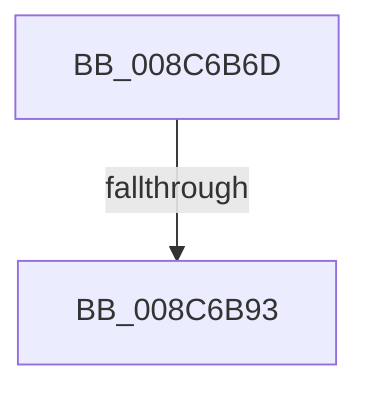

# sub_008C6B6D

- RVA: `0x008C6B6D`–`0x008C6BD0` (길이 `99` bytes)
- VA: `0x00000001408C6B6D`
- 실행 섹션: `PAGE`
- PDB 이름 있음: `아니요`; PDB Function 태그: `아니요`
- unwind 정보 RVA: `0x00083C44`
- 디코드: `21`개 명령, `99/99` bytes 표시
- 미해석 바이트: `0` (있으면 어셈블리에 `.byte`로 보존)

> 이 문서는 커널 이미지의 기계어와 PDB 기호를 분석해 생성했습니다. 4번과 5번은 함수 원형과 자료형을 바이너리 사용 방식에서 추정한 C 해석이며 원본 소스 복구 결과는 아닙니다.

## 1. Dependencies

- 직접 호출 지점: **3**; 고유 호출 대상: **3**
- 직접 호출자로 확인된 함수: **0**
- RIP 상대 이미지 참조: **0**

### Outgoing calls
- `0x008C6B84` → [PspLockThreadSecurityShared](../../text/3C/PspLockThreadSecurityShared_function_003C4720.md) (function, `0x003C4720`)
- `0x008C6BA6` → [ObfReferenceObjectWithTag](../../text/21/ObfReferenceObjectWithTag_function_00210710.md) (function, `0x00210710`)
- `0x008C6BBE` → [PspUnlockThreadSecurityShared](../../text/3C/PspUnlockThreadSecurityShared_function_003C2E40.md) (function, `0x003C2E40`)

### Direct callers
- 이 함수 시작 RVA로 연결되는 직접 call은 확인되지 않았습니다. 간접 호출은 완전히 역산할 수 없습니다.

### Static image references
- 디코드된 RIP-relative 메모리 참조가 없습니다.

## 2. Other-region calls and transfers

- 다른 실행 섹션으로 향하는 call: **3**
  - `0x008C6B84` → [PspLockThreadSecurityShared](../../text/3C/PspLockThreadSecurityShared_function_003C4720.md) (`PAGE` → `.text`)
  - `0x008C6BA6` → [ObfReferenceObjectWithTag](../../text/21/ObfReferenceObjectWithTag_function_00210710.md) (`PAGE` → `.text`)
  - `0x008C6BBE` → [PspUnlockThreadSecurityShared](../../text/3C/PspUnlockThreadSecurityShared_function_003C2E40.md) (`PAGE` → `.text`)
- call이 아닌 외부 분기/꼬리 이동: **2**
  - `0x008C6B91` → [sub_008C6BD0](Unknown_function_008C6BD0.md) (`tail-transfer`)
  - `0x008C6BCB` → [sub_008C6ACF + 0x44](Unknown_function_008C6ACF.md) (`tail-transfer`)

## 3. Assembly (complete function range)

```asm
008C6B6D  4C 89 AC 24 90 00 00 00         mov qword ptr [rsp + 0x90], r13
008C6B75  48 8B CB                        mov rcx, rbx
008C6B78  65 4C 8B 2C 25 88 01 00 00      mov r13, qword ptr gs:[0x188]
008C6B81  49 8B D5                        mov rdx, r13
008C6B84  E8 97 DB AF FF                  call 0x1403c4720
008C6B89  8B 83 A0 05 00 00               mov eax, dword ptr [rbx + 0x5a0]
008C6B8F  A8 08                           test al, 8
008C6B91  74 3D                           je 0x1408c6bd0
008C6B93  48 8B BB 38 05 00 00            mov rdi, qword ptr [rbx + 0x538]
008C6B9A  BA 53 65 53 75                  mov edx, 0x75536553
008C6B9F  48 83 E7 F8                     and rdi, 0xfffffffffffffff8
008C6BA3  48 8B CF                        mov rcx, rdi
008C6BA6  E8 65 9B 94 FF                  call 0x140210710
008C6BAB  8B 83 38 05 00 00               mov eax, dword ptr [rbx + 0x538]
008C6BB1  83 E0 03                        and eax, 3
008C6BB4  89 44 24 38                     mov dword ptr [rsp + 0x38], eax
008C6BB8  49 8B D5                        mov rdx, r13
008C6BBB  48 8B CB                        mov rcx, rbx
008C6BBE  E8 7D C2 AF FF                  call 0x1403c2e40
008C6BC3  4C 8B AC 24 90 00 00 00         mov r13, qword ptr [rsp + 0x90]
008C6BCB  E9 43 FF FF FF                  jmp 0x1408c6b13
```

## 4. C-style interpretation (structured pseudocode)

```c
__int64 __fastcall sub_008C6B6D(__int64 a1, __int64 a2, __int64 a3, __int64 a4, __int64 a5, __int64 a6, __int64 a7, __int64 a8, __int64 a9, __int64 a10, __int64 a11, __int64 a12, __int64 a13, __int64 a14, __int64 a15, __int64 a16, __int64 a17, __int64 a18)
{
    __int64 result;
    __int64 v_rdi;
    unsigned int v_stack_p38;
    unsigned __int64 v_stack_p90;

    v_stack_p90 = v_r13;
    result = PspLockThreadSecurityShared(v_rbx, *(unsigned __int64 *)(gs_base + (0 + 392)), a3, a4);
    v_rdi = (*(unsigned __int64 *)(v_rbx + 1336)) & (-8);
    result = ObfReferenceObjectWithTag(v_rdi, (unsigned int)(0x75536553ULL), a3, a4);
    result = (unsigned int)(((unsigned int)(*(unsigned int *)(v_rbx + 1336))) & (3));
    v_stack_p38 = (unsigned int)(result);
    result = PspUnlockThreadSecurityShared(v_rbx, *(unsigned __int64 *)(gs_base + (0 + 392)), a3, a4);
}
```

## 5. (Beta) C Style

```c
int64_t sub_008C6B6D(int64_t Arg1, int64_t Arg2, int64_t Arg3, int64_t Arg4, uint64_t Arg5, uint64_t Arg6, uint64_t Arg7, uint64_t Arg8, uint64_t Arg9, uint64_t Arg10, uint64_t Arg11, uint64_t Arg12, uint64_t Arg13, uint64_t Arg14, uint64_t Arg15, uint64_t Arg16, uint64_t Arg17, int64_t Arg18)
{
    int64_t result;
    int64_t local_rdi;
    uint32_t v_stack_p38;
    uint64_t v_stack_p90;

    v_stack_p90 = local_r13;
    result = PspLockThreadSecurityShared(local_rbx, *(uint64_t *)(gs_base + (0 + 0x188)), Arg3, Arg4);
    local_rdi = (*(uint64_t *)(local_rbx + 0x538)) & (-8);
    result = ObfReferenceObjectWithTag(local_rdi, (uint32_t)(0x75536553ULL), Arg3, Arg4);
    result = (uint32_t)(((uint32_t)(*(uint32_t *)(local_rbx + 0x538))) & (3));
    v_stack_p38 = (uint32_t)(result);
    result = PspUnlockThreadSecurityShared(local_rbx, *(uint64_t *)(gs_base + (0 + 0x188)), Arg3, Arg4);
}
```

## 6. Execution-region graph

[열기: 2D/3D 그래프와 함수 탐색 컨트롤 패널](../../../control-panel.html?section=page&rva=0x008C6B6D&view=graph)

- 2D 그래프는 위에서 아래로 흐르고, 3D 그래프는 빈 공간을 드래그해 회전합니다. Shift+드래그는 이동, 휠은 확대·축소, 함수 노드 선택은 대상 보고서 이동입니다.

### Static fallback


