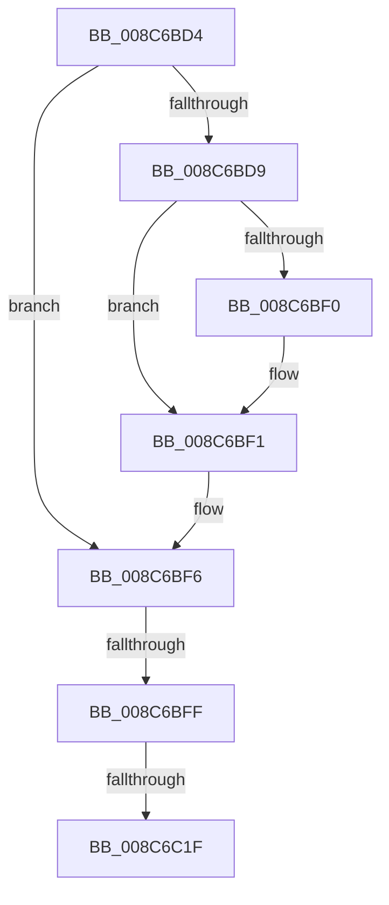

# sub_008C6BD4

- RVA: `0x008C6BD4`–`0x008C6C25` (길이 `81` bytes)
- VA: `0x00000001408C6BD4`
- 실행 섹션: `PAGE`
- PDB 이름 있음: `아니요`; PDB Function 태그: `아니요`
- unwind 정보 RVA: `0x00083C7C`
- 디코드: `17`개 명령, `81/81` bytes 표시
- 미해석 바이트: `0` (있으면 어셈블리에 `.byte`로 보존)

> 이 문서는 커널 이미지의 기계어와 PDB 기호를 분석해 생성했습니다. 4번과 5번은 함수 원형과 자료형을 바이너리 사용 방식에서 추정한 C 해석이며 원본 소스 복구 결과는 아닙니다.

## 1. Dependencies

- 직접 호출 지점: **0**; 고유 호출 대상: **0**
- 직접 호출자로 확인된 함수: **0**
- RIP 상대 이미지 참조: **1**

### Outgoing calls
- 직접 디코드된 call 명령이 없습니다.

### Direct callers
- 이 함수 시작 RVA로 연결되는 직접 call은 확인되지 않았습니다. 간접 호출은 완전히 역산할 수 없습니다.

### Static image references
- `0x008C6BE7` → RVA `0x00E67B90` (`.data`; read)

## 2. Other-region calls and transfers

- 다른 실행 섹션으로 향하는 call: **0**
- call이 아닌 외부 분기/꼬리 이동: **3**
  - `0x008C6BF9` → [sub_008C6B47](Unknown_function_008C6B47.md) (`tail-transfer`)
  - `0x008C6C19` → [sub_008C6B47](Unknown_function_008C6B47.md) (`tail-transfer`)
  - `0x008C6C20` → [sub_008C6B47](Unknown_function_008C6B47.md) (`tail-transfer`)

## 3. Assembly (complete function range)

```asm
008C6BD4  48 85 C0                        test rax, rax
008C6BD7  74 1D                           je 0x1408c6bf6
008C6BD9  48 8B 88 78 04 00 00            mov rcx, qword ptr [rax + 0x478]
008C6BE0  F0 FF 81 1C 01 00 00            lock inc dword ptr [rcx + 0x11c]
008C6BE7  48 3B 05 A2 0F 5A 00            cmp rax, qword ptr [rip + 0x5a0fa2]
008C6BEE  75 01                           jne 0x1408c6bf1
008C6BF0  CC                              int3
008C6BF1  48 8B 7C 24 30                  mov rdi, qword ptr [rsp + 0x30]
008C6BF6  48 85 FF                        test rdi, rdi
008C6BF9  0F 84 48 FF FF FF               je 0x1408c6b47
008C6BFF  48 8B 87 78 04 00 00            mov rax, qword ptr [rdi + 0x478]
008C6C06  F0 FF 80 1C 01 00 00            lock inc dword ptr [rax + 0x11c]
008C6C0D  48 8B 05 7C 0F 5A 00            mov rax, qword ptr [rip + 0x5a0f7c]
008C6C14  48 39 44 24 30                  cmp qword ptr [rsp + 0x30], rax
008C6C19  0F 85 28 FF FF FF               jne 0x1408c6b47
008C6C1F  CC                              int3
008C6C20  E9 22 FF FF FF                  jmp 0x1408c6b47
```

## 4. C-style interpretation (structured pseudocode)

```c
__int64 __fastcall sub_008C6BD4(__int64 a1, __int64 a2, __int64 a3, __int64 a4, __int64 a5, __int64 a6)
{
    if (result == 0) goto loc_008C6BF6;
    if (result == (*(unsigned __int64 *)(v_rip + 5902242))) {
    }
loc_008C6BF6:
}
```

## 5. (Beta) C Style

```c
int64_t sub_008C6BD4(int64_t Arg1, int64_t Arg2, int64_t Arg3, int64_t Arg4, uint64_t Arg5, int64_t Arg6)
{
    if (result == 0) goto loc_008C6BF6;
    if (result == (*(uint64_t *)(v_rip + 0x5A0FA2))) {
    }
loc_008C6BF6:
}
```

## 6. Execution-region graph

[열기: 2D/3D 그래프와 함수 탐색 컨트롤 패널](../../../control-panel.html?section=page&rva=0x008C6BD4&view=graph)

- 2D 그래프는 위에서 아래로 흐르고, 3D 그래프는 빈 공간을 드래그해 회전합니다. Shift+드래그는 이동, 휠은 확대·축소, 함수 노드 선택은 대상 보고서 이동입니다.

### Static fallback


