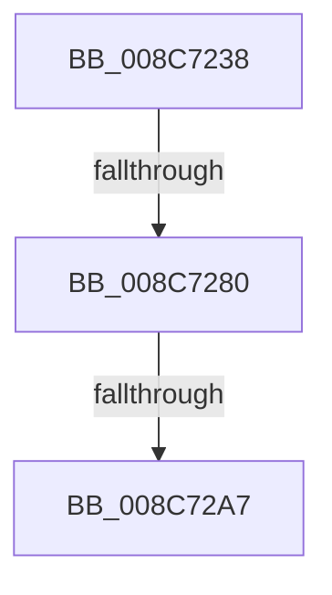

# sub_008C7238

- RVA: `0x008C7238`–`0x008C72B7` (길이 `127` bytes)
- VA: `0x00000001408C7238`
- 실행 섹션: `PAGE`
- PDB 이름 있음: `아니요`; PDB Function 태그: `아니요`
- unwind 정보 RVA: `0x00083D24`
- 디코드: `30`개 명령, `127/127` bytes 표시
- 미해석 바이트: `0` (있으면 어셈블리에 `.byte`로 보존)

> 이 문서는 커널 이미지의 기계어와 PDB 기호를 분석해 생성했습니다. 4번과 5번은 함수 원형과 자료형을 바이너리 사용 방식에서 추정한 C 해석이며 원본 소스 복구 결과는 아닙니다.

## 1. Dependencies

- 직접 호출 지점: **1**; 고유 호출 대상: **1**
- 직접 호출자로 확인된 함수: **0**
- RIP 상대 이미지 참조: **1**

### Outgoing calls
- `0x008C7288` → [CmLockHive](../85/CmLockHive_function_008512B4.md) (function, `0x008512B4`)

### Direct callers
- 이 함수 시작 RVA로 연결되는 직접 call은 확인되지 않았습니다. 간접 호출은 완전히 역산할 수 없습니다.

### Static image references
- `0x008C729A` → RVA `0x00FC6D20` (`ALMOSTRO`; read)

## 2. Other-region calls and transfers

- 다른 실행 섹션으로 향하는 call: **0**
- call이 아닌 외부 분기/꼬리 이동: **3**
  - `0x008C727A` → [sub_008C7477 + 0x11](Unknown_function_008C7477.md) (`tail-transfer`)
  - `0x008C72A1` → [sub_008C7477](Unknown_function_008C7477.md) (`tail-transfer`)
  - `0x008C72B1` → [sub_008C7372](Unknown_function_008C7372.md) (`tail-transfer`)

## 3. Assembly (complete function range)

```asm
008C7238  49 89 6B 08                     mov qword ptr [r11 + 8], rbp
008C723C  49 8D 43 C8                     lea rax, [r11 - 0x38]
008C7240  49 89 73 10                     mov qword ptr [r11 + 0x10], rsi
008C7244  49 8B E8                        mov rbp, r8
008C7247  49 89 7B 18                     mov qword ptr [r11 + 0x18], rdi
008C724B  41 8B F1                        mov esi, r9d
008C724E  4D 89 6B E8                     mov qword ptr [r11 - 0x18], r13
008C7252  4C 8B E9                        mov r13, rcx
008C7255  49 89 43 D0                     mov qword ptr [r11 - 0x30], rax
008C7259  49 8D 43 C8                     lea rax, [r11 - 0x38]
008C725D  4D 89 73 E0                     mov qword ptr [r11 - 0x20], r14
008C7261  4C 8B F2                        mov r14, rdx
008C7264  49 89 43 C8                     mov qword ptr [r11 - 0x38], rax
008C7268  48 0F BF 41 02                  movsx rax, word ptr [rcx + 2]
008C726D  48 8B F8                        mov rdi, rax
008C7270  4D 89 7B D8                     mov qword ptr [r11 - 0x28], r15
008C7274  0F AE E8                        lfence
008C7277  83 F8 02                        cmp eax, 2
008C727A  0F 8D 08 02 00 00               jge 0x1408c7488
008C7280  48 8B 7C C1 08                  mov rdi, qword ptr [rcx + rax*8 + 8]
008C7285  49 8B CE                        mov rcx, r14
008C7288  E8 27 A0 F8 FF                  call 0x1408512b4
008C728D  45 0F 20 C7                     mov r15, cr8
008C7291  B8 01 00 00 00                  mov eax, 1
008C7296  44 0F 22 C0                     mov cr8, rax
008C729A  83 3D 7F FA 6F 00 00            cmp dword ptr [rip + 0x6ffa7f], 0
008C72A1  0F 85 D0 01 00 00               jne 0x1408c7477
008C72A7  49 8B 9E 38 06 00 00            mov rbx, qword ptr [r14 + 0x638]
008C72AE  48 85 DB                        test rbx, rbx
008C72B1  0F 84 BB 00 00 00               je 0x1408c7372
```

## 4. C-style interpretation (structured pseudocode)

```c
__int64 __fastcall sub_008C7238(__int64 a1, __int64 a2, __int64 a3, int a4)
{
    __int64 result;

    *(unsigned __int64 *)(v_r11 + 8) = v_rbp;
    *(unsigned __int64 *)(v_r11 + 16) = v_rsi;
    *(unsigned __int64 *)(v_r11 + 24) = v_rdi;
    *(unsigned __int64 *)(v_r11 - 24) = v_r13;
    *(unsigned __int64 *)(v_r11 - 48) = v_r11 - 56;
    *(unsigned __int64 *)(v_r11 - 32) = v_r14;
    *(unsigned __int64 *)(v_r11 - 56) = v_r11 - 56;
    *(unsigned __int64 *)(v_r11 - 40) = v_r15;
    result = CmLockHive(a2, a2, a3, a4);
}
```

## 5. (Beta) C Style

```c
int64_t sub_008C7238(void *Arg1, void *Arg2, int64_t Arg3, int32_t Arg4)
{
    uint8_t *arg1 = (uint8_t *)Arg1;
    uint8_t *arg2 = (uint8_t *)Arg2;

    int64_t result;

    *(uint64_t *)(local_r11 + 0x8) = local_rbp;
    *(uint64_t *)(local_r11 + 0x10) = local_rsi;
    *(uint64_t *)(local_r11 + 0x18) = local_rdi;
    *(uint64_t *)(local_r11 - 0x18) = local_r13;
    *(uint64_t *)(local_r11 - 0x30) = local_r11 - 56;
    *(uint64_t *)(local_r11 - 0x20) = local_r14;
    *(uint64_t *)(local_r11 - 0x38) = local_r11 - 56;
    *(uint64_t *)(local_r11 - 0x28) = local_r15;
    result = CmLockHive(Arg2, Arg2, Arg3, Arg4);
}
```

### 관측된 메모리 오프셋

구조체 형식이 확인되지 않은 접근은 인자 기준의 오프셋으로만 기록했습니다.

| 기준 인자 | 오프셋 표현 | 폭 (bit) | 접근 |
|---|---:|---:|---|
| `Arg1` | `+ 0x2` | `16` | `R` |
| `Arg1` | `+ 0x8 + rax*8` | `64` | `R` |
| `Arg2` | `+ 0x638` | `64` | `R` |

## 6. Execution-region graph

[열기: 2D/3D 그래프와 함수 탐색 컨트롤 패널](../../../control-panel.html?section=page&rva=0x008C7238&view=graph)

- 2D 그래프는 위에서 아래로 흐르고, 3D 그래프는 빈 공간을 드래그해 회전합니다. Shift+드래그는 이동, 휠은 확대·축소, 함수 노드 선택은 대상 보고서 이동입니다.

### Static fallback


