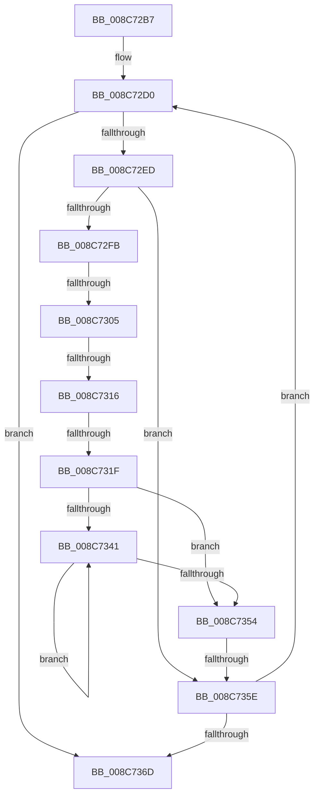

# sub_008C72B7

- RVA: `0x008C72B7`–`0x008C7372` (길이 `187` bytes)
- VA: `0x00000001408C72B7`
- 실행 섹션: `PAGE`
- PDB 이름 있음: `아니요`; PDB Function 태그: `아니요`
- unwind 정보 RVA: `0x00083D4C`
- 디코드: `47`개 명령, `187/187` bytes 표시
- 미해석 바이트: `0` (있으면 어셈블리에 `.byte`로 보존)

> 이 문서는 커널 이미지의 기계어와 PDB 기호를 분석해 생성했습니다. 4번과 5번은 함수 원형과 자료형을 바이너리 사용 방식에서 추정한 C 해석이며 원본 소스 복구 결과는 아닙니다.

## 1. Dependencies

- 직접 호출 지점: **0**; 고유 호출 대상: **0**
- 직접 호출자로 확인된 함수: **0**
- RIP 상대 이미지 참조: **0**

### Outgoing calls
- 직접 디코드된 call 명령이 없습니다.

### Direct callers
- 이 함수 시작 RVA로 연결되는 직접 call은 확인되지 않았습니다. 간접 호출은 완전히 역산할 수 없습니다.

### Static image references
- 디코드된 RIP-relative 메모리 참조가 없습니다.

## 2. Other-region calls and transfers

- 다른 실행 섹션으로 향하는 call: **0**
- call이 아닌 외부 분기/꼬리 이동: **4**
  - `0x008C72FF` → [sub_008C73D5](Unknown_function_008C73D5.md) (`tail-transfer`)
  - `0x008C7310` → [sub_008C73D5 + 0xA](Unknown_function_008C73D5.md) (`tail-transfer`)
  - `0x008C7319` → [sub_008C7465](Unknown_function_008C7465.md) (`tail-transfer`)
  - `0x008C7358` → [sub_008C73D5 + 0x19](Unknown_function_008C73D5.md) (`tail-transfer`)

## 3. Assembly (complete function range)

```asm
008C72B7  4C 89 64 24 68                  mov qword ptr [rsp + 0x68], r12
008C72BC  4C 8B A4 24 A0 00 00 00         mov r12, qword ptr [rsp + 0xa0]
008C72C4  0F 1F 40 00                     nop dword ptr [rax]
008C72C8  0F 1F 84 00 00 00 00 00         nop dword ptr [rax + rax]
008C72D0  48 8B 53 20                     mov rdx, qword ptr [rbx + 0x20]
008C72D4  8B 47 08                        mov eax, dword ptr [rdi + 8]
008C72D7  25 00 00 E0 7F                  and eax, 0x7fe00000
008C72DC  8B 4A 08                        mov ecx, dword ptr [rdx + 8]
008C72DF  81 E1 00 00 E0 7F               and ecx, 0x7fe00000
008C72E5  3B C8                           cmp ecx, eax
008C72E7  0F 87 80 00 00 00               ja 0x1408c736d
008C72ED  8B 4B 30                        mov ecx, dword ptr [rbx + 0x30]
008C72F0  8B C1                           mov eax, ecx
008C72F2  23 C6                           and eax, esi
008C72F4  A9 FF FF FF 3F                  test eax, 0x3fffffff
008C72F9  74 63                           je 0x1408c735e
008C72FB  0F BA E1 1E                     bt ecx, 0x1e
008C72FF  0F 83 D0 00 00 00               jae 0x1408c73d5
008C7305  48 8B 4B 28                     mov rcx, qword ptr [rbx + 0x28]
008C7309  48 8B 49 38                     mov rcx, qword ptr [rcx + 0x38]
008C730D  48 85 ED                        test rbp, rbp
008C7310  0F 85 C9 00 00 00               jne 0x1408c73df
008C7316  48 85 C9                        test rcx, rcx
008C7319  0F 85 46 01 00 00               jne 0x1408c7465
008C731F  48 8B 43 20                     mov rax, qword ptr [rbx + 0x20]
008C7323  48 8B CF                        mov rcx, rdi
008C7326  8B 50 08                        mov edx, dword ptr [rax + 8]
008C7329  8B 47 08                        mov eax, dword ptr [rdi + 8]
008C732C  C1 E8 15                        shr eax, 0x15
008C732F  C1 EA 15                        shr edx, 0x15
008C7332  25 FF 03 00 00                  and eax, 0x3ff
008C7337  81 E2 FF 03 00 00               and edx, 0x3ff
008C733D  3B C2                           cmp eax, edx
008C733F  76 13                           jbe 0x1408c7354
008C7341  48 8B 49 48                     mov rcx, qword ptr [rcx + 0x48]
008C7345  8B 41 08                        mov eax, dword ptr [rcx + 8]
008C7348  C1 E8 15                        shr eax, 0x15
008C734B  25 FF 03 00 00                  and eax, 0x3ff
008C7350  3B C2                           cmp eax, edx
008C7352  77 ED                           ja 0x1408c7341
008C7354  48 3B 4B 20                     cmp rcx, qword ptr [rbx + 0x20]
008C7358  0F 84 90 00 00 00               je 0x1408c73ee
008C735E  48 8B 03                        mov rax, qword ptr [rbx]
008C7361  48 8B D8                        mov rbx, rax
008C7364  48 85 C0                        test rax, rax
008C7367  0F 85 63 FF FF FF               jne 0x1408c72d0
008C736D  4C 8B 64 24 68                  mov r12, qword ptr [rsp + 0x68]
```

## 4. C-style interpretation (structured pseudocode)

```c
__int64 __fastcall sub_008C72B7(__int64 a1, __int64 a2, __int64 a3, __int64 a4, __int64 a5, __int64 a6, __int64 a7, __int64 a8, __int64 a9, __int64 a10, __int64 a11, __int64 a12, __int64 a13, __int64 a14, __int64 a15, __int64 a16, __int64 a17, __int64 a18, __int64 a19, __int64 a20)
{
    __int64 result;
    unsigned __int64 v_stack_p68;

    v_stack_p68 = v_r12;
loc_008C72D0:
    result = (unsigned int)(((unsigned int)(*(unsigned int *)(v_rdi + 8))) & (0x7FE00000ULL));
    a1 = (unsigned int)(((unsigned int)(*(unsigned int *)(*(unsigned __int64 *)(v_rbx + 32) + 8))) & (0x7FE00000ULL));
    if (((unsigned int)(a1)) > ((unsigned int)(result))) goto loc_008C736D;
    result = (unsigned int)(((unsigned int)((unsigned int)((unsigned int)(*(unsigned int *)(v_rbx + 48))))) & ((unsigned int)(v_rsi)));
    if ((((unsigned int)(result)) & (0x3FFFFFFFULL)) == 0) goto loc_008C735E;
    result = (unsigned int)(((unsigned int)(*(unsigned int *)(v_rdi + 8))) >> (21));
    a2 = (unsigned int)(((unsigned int)(*(unsigned int *)(*(unsigned __int64 *)(v_rbx + 32) + 8))) >> (21));
    result = (unsigned int)((result) & (0x3FFULL));
    a2 = (unsigned int)((a2) & (0x3FFULL));
    if (((unsigned int)(result)) <= ((unsigned int)(a2))) goto loc_008C7354;
loc_008C7341:
    result = (unsigned int)(((unsigned int)(*(unsigned int *)(*(unsigned __int64 *)(v_rdi + 72) + 8))) >> (21));
    result = (unsigned int)((result) & (0x3FFULL));
    if (((unsigned int)(result)) > ((unsigned int)(a2))) goto loc_008C7341;
loc_008C7354:
loc_008C735E:
    if (*(unsigned __int64 *)(v_rbx) != 0) goto loc_008C72D0;
loc_008C736D:
    return *(unsigned __int64 *)(v_rbx);
}
```

## 5. (Beta) C Style

```c
int64_t sub_008C72B7(int64_t Arg1, int64_t Arg2, int64_t Arg3, int64_t Arg4, uint64_t Arg5, uint64_t Arg6, uint64_t Arg7, uint64_t Arg8, uint64_t Arg9, uint64_t Arg10, uint64_t Arg11, uint64_t Arg12, int64_t Arg13, uint64_t Arg14, uint64_t Arg15, uint64_t Arg16, uint64_t Arg17, uint64_t Arg18, uint64_t Arg19, int64_t Arg20)
{
    int64_t result;
    uint64_t v_stack_p68;

    v_stack_p68 = local_r12;
loc_008C72D0:
    result = (uint32_t)(((uint32_t)(*(uint32_t *)(local_rdi + 0x8))) & (0x7FE00000ULL));
    Arg1 = (uint32_t)(((uint32_t)(*(uint32_t *)(*(uint64_t *)(local_rbx + 0x20) + 0x8))) & (0x7FE00000ULL));
    if (((uint32_t)(Arg1)) > ((uint32_t)(result))) goto loc_008C736D;
    result = (uint32_t)(((uint32_t)((uint32_t)((uint32_t)(*(uint32_t *)(local_rbx + 0x30))))) & ((uint32_t)(local_rsi)));
    if ((((uint32_t)(result)) & (0x3FFFFFFFULL)) == 0) goto loc_008C735E;
    result = (uint32_t)(((uint32_t)(*(uint32_t *)(local_rdi + 0x8))) >> (21));
    Arg2 = (uint32_t)(((uint32_t)(*(uint32_t *)(*(uint64_t *)(local_rbx + 0x20) + 0x8))) >> (21));
    result = (uint32_t)((result) & (0x3FFULL));
    Arg2 = (uint32_t)((Arg2) & (0x3FFULL));
    if (((uint32_t)(result)) <= ((uint32_t)(Arg2))) goto loc_008C7354;
loc_008C7341:
    result = (uint32_t)(((uint32_t)(*(uint32_t *)(*(uint64_t *)(local_rdi + 0x48) + 0x8))) >> (21));
    result = (uint32_t)((result) & (0x3FFULL));
    if (((uint32_t)(result)) > ((uint32_t)(Arg2))) goto loc_008C7341;
loc_008C7354:
loc_008C735E:
    if (*(uint64_t *)(local_rbx) != 0) goto loc_008C72D0;
loc_008C736D:
    return *(uint64_t *)(local_rbx);
}
```

## 6. Execution-region graph

[열기: 2D/3D 그래프와 함수 탐색 컨트롤 패널](../../../control-panel.html?section=page&rva=0x008C72B7&view=graph)

- 2D 그래프는 위에서 아래로 흐르고, 3D 그래프는 빈 공간을 드래그해 회전합니다. Shift+드래그는 이동, 휠은 확대·축소, 함수 노드 선택은 대상 보고서 이동입니다.

### Static fallback


