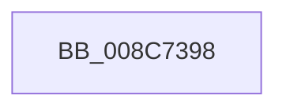

# sub_008C7398

- RVA: `0x008C7398`–`0x008C73BF` (길이 `39` bytes)
- VA: `0x00000001408C7398`
- 실행 섹션: `PAGE`
- PDB 이름 있음: `아니요`; PDB Function 태그: `아니요`
- unwind 정보 RVA: `0x00083D70`
- 디코드: `9`개 명령, `39/39` bytes 표시
- 미해석 바이트: `0` (있으면 어셈블리에 `.byte`로 보존)

> 이 문서는 커널 이미지의 기계어와 PDB 기호를 분석해 생성했습니다. 4번과 5번은 함수 원형과 자료형을 바이너리 사용 방식에서 추정한 C 해석이며 원본 소스 복구 결과는 아닙니다.

## 1. Dependencies

- 직접 호출 지점: **2**; 고유 호출 대상: **2**
- 직접 호출자로 확인된 함수: **0**
- RIP 상대 이미지 참조: **0**

### Outgoing calls
- `0x008C73A0` → [KiLowerIrqlProcessIrqlFlags](../../text/4F/KiLowerIrqlProcessIrqlFlags_function_004F5698.md) (function, `0x004F5698`)
- `0x008C73B0` → [CmUnlockHive](../85/CmUnlockHive_function_00851D6C.md) (function, `0x00851D6C`)

### Direct callers
- 이 함수 시작 RVA로 연결되는 직접 call은 확인되지 않았습니다. 간접 호출은 완전히 역산할 수 없습니다.

### Static image references
- 디코드된 RIP-relative 메모리 참조가 없습니다.

## 2. Other-region calls and transfers

- 다른 실행 섹션으로 향하는 call: **1**
  - `0x008C73A0` → [KiLowerIrqlProcessIrqlFlags](../../text/4F/KiLowerIrqlProcessIrqlFlags_function_004F5698.md) (`PAGE` → `.text`)
- 별도 외부 분기/꼬리 이동을 확인하지 못했습니다.

## 3. Assembly (complete function range)

```asm
008C7398  44 0F 20 C1                     mov rcx, cr8
008C739C  41 0F B6 D7                     movzx edx, r15b
008C73A0  E8 F3 E2 C2 FF                  call 0x1404f5698
008C73A5  41 0F B6 C7                     movzx eax, r15b
008C73A9  44 0F 22 C0                     mov cr8, rax
008C73AD  49 8B CE                        mov rcx, r14
008C73B0  E8 B7 A9 F8 FF                  call 0x140851d6c
008C73B5  4C 8B 7C 24 50                  mov r15, qword ptr [rsp + 0x50]
008C73BA  4C 8B 74 24 58                  mov r14, qword ptr [rsp + 0x58]
```

## 4. C-style interpretation (structured pseudocode)

```c
__int64 __fastcall sub_008C7398(__int64 a1, __int64 a2, __int64 a3, __int64 a4, __int64 a5, __int64 a6, __int64 a7, __int64 a8, __int64 a9, __int64 a10, __int64 a11)
{
    __int64 result;

    result = KiLowerIrqlProcessIrqlFlags(v_cr8, (unsigned __int8)(v_r15), a3, a4);
    result = CmUnlockHive(v_r14, (unsigned __int8)(v_r15), a3, a4);
    return result;
}
```

## 5. (Beta) C Style

```c
int64_t sub_008C7398(int64_t Arg1, int64_t Arg2, int64_t Arg3, int64_t Arg4, uint64_t Arg5, uint64_t Arg6, uint64_t Arg7, uint64_t Arg8, uint64_t Arg9, int64_t Arg10, int64_t Arg11)
{
    int64_t result;

    result = KiLowerIrqlProcessIrqlFlags(v_cr8, (uint8_t)(local_r15), Arg3, Arg4);
    result = CmUnlockHive(local_r14, (uint8_t)(local_r15), Arg3, Arg4);
    return result;
}
```

## 6. Execution-region graph

[열기: 2D/3D 그래프와 함수 탐색 컨트롤 패널](../../../control-panel.html?section=page&rva=0x008C7398&view=graph)

- 2D 그래프는 위에서 아래로 흐르고, 3D 그래프는 빈 공간을 드래그해 회전합니다. Shift+드래그는 이동, 휠은 확대·축소, 함수 노드 선택은 대상 보고서 이동입니다.

### Static fallback


