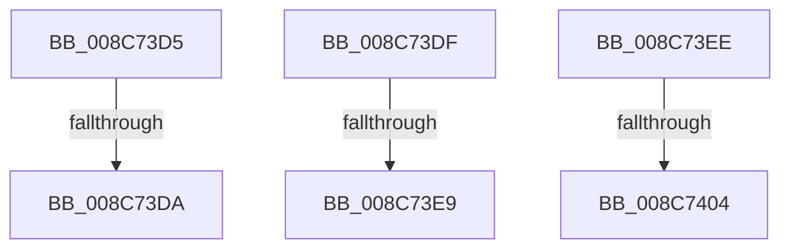

# sub_008C73D5

- RVA: `0x008C73D5`–`0x008C742B` (길이 `86` bytes)
- VA: `0x00000001408C73D5`
- 실행 섹션: `PAGE`
- PDB 이름 있음: `아니요`; PDB Function 태그: `아니요`
- unwind 정보 RVA: `0x00083D9C`
- 디코드: `20`개 명령, `86/86` bytes 표시
- 미해석 바이트: `0` (있으면 어셈블리에 `.byte`로 보존)

> 이 문서는 커널 이미지의 기계어와 PDB 기호를 분석해 생성했습니다. 4번과 5번은 함수 원형과 자료형을 바이너리 사용 방식에서 추정한 C 해석이며 원본 소스 복구 결과는 아닙니다.

## 1. Dependencies

- 직접 호출 지점: **2**; 고유 호출 대상: **2**
- 직접 호출자로 확인된 함수: **0**
- RIP 상대 이미지 참조: **0**

### Outgoing calls
- `0x008C73F7` → [CmpNotifyTriggerCheck](CmpNotifyTriggerCheck_function_008C74A4.md) (function, `0x008C74A4`)
- `0x008C7421` → [CmpPostNotify](../86/CmpPostNotify_function_008645D8.md) (function, `0x008645D8`)

### Direct callers
- 이 함수 시작 RVA로 연결되는 직접 call은 확인되지 않았습니다. 간접 호출은 완전히 역산할 수 없습니다.

### Static image references
- 디코드된 RIP-relative 메모리 참조가 없습니다.

## 2. Other-region calls and transfers

- 다른 실행 섹션으로 향하는 call: **0**
- call이 아닌 외부 분기/꼬리 이동: **6**
  - `0x008C73D8` → [sub_008C72B7 + 0xA7](Unknown_function_008C72B7.md) (`tail-transfer`)
  - `0x008C73DA` → [sub_008C72B7 + 0x4E](Unknown_function_008C72B7.md) (`tail-transfer`)
  - `0x008C73E3` → [sub_008C72B7 + 0xA7](Unknown_function_008C72B7.md) (`tail-transfer`)
  - `0x008C73E9` → [sub_008C72B7 + 0x5F](Unknown_function_008C72B7.md) (`tail-transfer`)
  - `0x008C73FE` → [sub_008C72B7 + 0xA7](Unknown_function_008C72B7.md) (`tail-transfer`)
  - `0x008C7426` → [sub_008C72B7 + 0xA7](Unknown_function_008C72B7.md) (`tail-transfer`)

## 3. Assembly (complete function range)

```asm
008C73D5  48 3B D7                        cmp rdx, rdi
008C73D8  75 84                           jne 0x1408c735e
008C73DA  E9 26 FF FF FF                  jmp 0x1408c7305
008C73DF  48 39 4D 38                     cmp qword ptr [rbp + 0x38], rcx
008C73E3  0F 85 75 FF FF FF               jne 0x1408c735e
008C73E9  E9 28 FF FF FF                  jmp 0x1408c7316
008C73EE  4C 8B C5                        mov r8, rbp
008C73F1  49 8B D5                        mov rdx, r13
008C73F4  48 8B CB                        mov rcx, rbx
008C73F7  E8 A8 00 00 00                  call 0x1408c74a4
008C73FC  84 C0                           test al, al
008C73FE  0F 84 5A FF FF FF               je 0x1408c735e
008C7404  48 8D 44 24 40                  lea rax, [rsp + 0x40]
008C7409  4C 89 64 24 30                  mov qword ptr [rsp + 0x30], r12
008C740E  48 89 44 24 28                  mov qword ptr [rsp + 0x28], rax
008C7413  41 B9 0C 01 00 00               mov r9d, 0x10c
008C7419  48 8B CB                        mov rcx, rbx
008C741C  C6 44 24 20 00                  mov byte ptr [rsp + 0x20], 0
008C7421  E8 B2 D1 F9 FF                  call 0x1408645d8
008C7426  E9 33 FF FF FF                  jmp 0x1408c735e
```

## 4. C-style interpretation (structured pseudocode)

```c
__int64 __fastcall sub_008C73D5(__int64 a1, __int64 a2)
{
    unsigned __int8 v_stack_p20;
    unsigned __int64 v_stack_p28;
    unsigned __int64 v_stack_p30;
    unsigned __int64 v_stack_p40;
}
```

## 5. (Beta) C Style

```c
int64_t sub_008C73D5(int64_t Arg1, int64_t Arg2)
{
    uint8_t v_stack_p20;
    uint64_t v_stack_p28;
    uint64_t v_stack_p30;
    uint64_t v_stack_p40;
}
```

## 6. Execution-region graph

[열기: 2D/3D 그래프와 함수 탐색 컨트롤 패널](../../../control-panel.html?section=page&rva=0x008C73D5&view=graph)

- 2D 그래프는 위에서 아래로 흐르고, 3D 그래프는 빈 공간을 드래그해 회전합니다. Shift+드래그는 이동, 휠은 확대·축소, 함수 노드 선택은 대상 보고서 이동입니다.

### Static fallback


