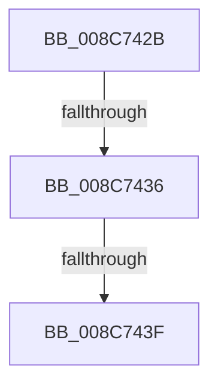

# sub_008C742B

- RVA: `0x008C742B`–`0x008C7465` (길이 `58` bytes)
- VA: `0x00000001408C742B`
- 실행 섹션: `PAGE`
- PDB 이름 있음: `아니요`; PDB Function 태그: `아니요`
- unwind 정보 RVA: `0x00083DC8`
- 디코드: `15`개 명령, `58/58` bytes 표시
- 미해석 바이트: `0` (있으면 어셈블리에 `.byte`로 보존)

> 이 문서는 커널 이미지의 기계어와 PDB 기호를 분석해 생성했습니다. 4번과 5번은 함수 원형과 자료형을 바이너리 사용 방식에서 추정한 C 해석이며 원본 소스 복구 결과는 아닙니다.

## 1. Dependencies

- 직접 호출 지점: **2**; 고유 호출 대상: **2**
- 직접 호출자로 확인된 함수: **0**
- RIP 상대 이미지 참조: **0**

### Outgoing calls
- `0x008C7451` → [ObDereferenceObjectDeferDelete](../../text/3F/ObDereferenceObjectDeferDelete_function_003FCE40.md) (function, `0x003FCE40`)
- `0x008C745B` → [ExFreePoolWithTag](../../poolcode/B8/ExFreePoolWithTag_function_00B82870.md) (function, `0x00B82870`)

### Direct callers
- 이 함수 시작 RVA로 연결되는 직접 call은 확인되지 않았습니다. 간접 호출은 완전히 역산할 수 없습니다.

### Static image references
- 디코드된 RIP-relative 메모리 참조가 없습니다.

## 2. Other-region calls and transfers

- 다른 실행 섹션으로 향하는 call: **2**
  - `0x008C7451` → [ObDereferenceObjectDeferDelete](../../text/3F/ObDereferenceObjectDeferDelete_function_003FCE40.md) (`PAGE` → `.text`)
  - `0x008C745B` → [ExFreePoolWithTag](../../poolcode/B8/ExFreePoolWithTag_function_00B82870.md) (`PAGE` → `POOLCODE`)
- call이 아닌 외부 분기/꼬리 이동: **3**
  - `0x008C7434` → [sub_008C7496](Unknown_function_008C7496.md) (`tail-transfer`)
  - `0x008C743D` → [sub_008C7496](Unknown_function_008C7496.md) (`tail-transfer`)
  - `0x008C7460` → [sub_008C73BF](Unknown_function_008C73BF.md) (`tail-transfer`)

## 3. Assembly (complete function range)

```asm
008C742B  48 8D 44 24 40                  lea rax, [rsp + 0x40]
008C7430  48 39 43 08                     cmp qword ptr [rbx + 8], rax
008C7434  75 60                           jne 0x1408c7496
008C7436  48 8B 03                        mov rax, qword ptr [rbx]
008C7439  48 39 58 08                     cmp qword ptr [rax + 8], rbx
008C743D  75 57                           jne 0x1408c7496
008C743F  48 89 44 24 40                  mov qword ptr [rsp + 0x40], rax
008C7444  48 8D 4C 24 40                  lea rcx, [rsp + 0x40]
008C7449  48 89 48 08                     mov qword ptr [rax + 8], rcx
008C744D  48 8B 4B 10                     mov rcx, qword ptr [rbx + 0x10]
008C7451  E8 EA 59 B3 FF                  call 0x1403fce40
008C7456  33 D2                           xor edx, edx
008C7458  48 8B CB                        mov rcx, rbx
008C745B  E8 10 B4 2B 00                  call 0x140b82870
008C7460  E9 5A FF FF FF                  jmp 0x1408c73bf
```

## 4. C-style interpretation (structured pseudocode)

```c
__int64 __fastcall sub_008C742B(__int64 a1, int a2, __int64 a3, __int64 a4, __int64 a5, __int64 a6, __int64 a7, __int64 a8)
{
    __int64 result;
    unsigned __int64 v_stack_p40;

    v_stack_p40 = *(unsigned __int64 *)(v_rbx);
    *(unsigned __int64 *)(*(unsigned __int64 *)(v_rbx) + 8) = a8;
    result = ObDereferenceObjectDeferDelete(*(unsigned __int64 *)(v_rbx + 16), a2, a3, a4);
    a2 = 0;
    result = ExFreePoolWithTag(v_rbx, a2, a3, a4);
}
```

## 5. (Beta) C Style

```c
int64_t sub_008C742B(int64_t Arg1, int32_t Arg2, int64_t Arg3, int64_t Arg4, uint64_t Arg5, uint64_t Arg6, uint64_t Arg7, int64_t Arg8)
{
    int64_t result;
    uint64_t v_stack_p40;

    v_stack_p40 = *(uint64_t *)(local_rbx);
    *(uint64_t *)(*(uint64_t *)(local_rbx) + 0x8) = Arg8;
    result = ObDereferenceObjectDeferDelete(*(uint64_t *)(local_rbx + 0x10), Arg2, Arg3, Arg4);
    Arg2 = 0;
    result = ExFreePoolWithTag(local_rbx, Arg2, Arg3, Arg4);
}
```

## 6. Execution-region graph

[열기: 2D/3D 그래프와 함수 탐색 컨트롤 패널](../../../control-panel.html?section=page&rva=0x008C742B&view=graph)

- 2D 그래프는 위에서 아래로 흐르고, 3D 그래프는 빈 공간을 드래그해 회전합니다. Shift+드래그는 이동, 휠은 확대·축소, 함수 노드 선택은 대상 보고서 이동입니다.

### Static fallback


