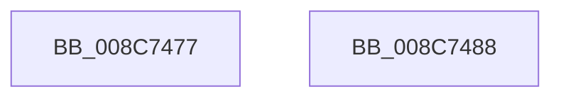

# sub_008C7477

- RVA: `0x008C7477`–`0x008C7496` (길이 `31` bytes)
- VA: `0x00000001408C7477`
- 실행 섹션: `PAGE`
- PDB 이름 있음: `아니요`; PDB Function 태그: `아니요`
- unwind 정보 RVA: `0x00083E04`
- 디코드: `7`개 명령, `31/31` bytes 표시
- 미해석 바이트: `0` (있으면 어셈블리에 `.byte`로 보존)

> 이 문서는 커널 이미지의 기계어와 PDB 기호를 분석해 생성했습니다. 4번과 5번은 함수 원형과 자료형을 바이너리 사용 방식에서 추정한 C 해석이며 원본 소스 복구 결과는 아닙니다.

## 1. Dependencies

- 직접 호출 지점: **1**; 고유 호출 대상: **1**
- 직접 호출자로 확인된 함수: **0**
- RIP 상대 이미지 참조: **0**

### Outgoing calls
- `0x008C747E` → [KiRaiseIrqlProcessIrqlFlags](../../text/4F/KiRaiseIrqlProcessIrqlFlags_function_004F56FC.md) (function, `0x004F56FC`)

### Direct callers
- 이 함수 시작 RVA로 연결되는 직접 call은 확인되지 않았습니다. 간접 호출은 완전히 역산할 수 없습니다.

### Static image references
- 디코드된 RIP-relative 메모리 참조가 없습니다.

## 2. Other-region calls and transfers

- 다른 실행 섹션으로 향하는 call: **1**
  - `0x008C747E` → [KiRaiseIrqlProcessIrqlFlags](../../text/4F/KiRaiseIrqlProcessIrqlFlags_function_004F56FC.md) (`PAGE` → `.text`)
- call이 아닌 외부 분기/꼬리 이동: **2**
  - `0x008C7483` → [sub_008C7238 + 0x6F](Unknown_function_008C7238.md) (`tail-transfer`)
  - `0x008C7491` → [sub_008C7238 + 0x4D](Unknown_function_008C7238.md) (`tail-transfer`)

## 3. Assembly (complete function range)

```asm
008C7477  0F B6 D0                        movzx edx, al
008C747A  41 0F B6 CF                     movzx ecx, r15b
008C747E  E8 79 E2 C2 FF                  call 0x1404f56fc
008C7483  E9 1F FE FF FF                  jmp 0x1408c72a7
008C7488  48 8B 41 18                     mov rax, qword ptr [rcx + 0x18]
008C748C  48 8B 7C F8 F0                  mov rdi, qword ptr [rax + rdi*8 - 0x10]
008C7491  E9 EF FD FF FF                  jmp 0x1408c7285
```

## 4. C-style interpretation (structured pseudocode)

```c
__int64 __fastcall sub_008C7477(void)
{
    __int64 result;

    result = KiRaiseIrqlProcessIrqlFlags((unsigned __int8)(v_r15), (unsigned __int8)(result), a3, a4);
}
```

## 5. (Beta) C Style

```c
void sub_008C7477(void)
{
    int64_t result;

    result = KiRaiseIrqlProcessIrqlFlags((uint8_t)(local_r15), (uint8_t)(result), a3, a4);
}
```

## 6. Execution-region graph

[열기: 2D/3D 그래프와 함수 탐색 컨트롤 패널](../../../control-panel.html?section=page&rva=0x008C7477&view=graph)

- 2D 그래프는 위에서 아래로 흐르고, 3D 그래프는 빈 공간을 드래그해 회전합니다. Shift+드래그는 이동, 휠은 확대·축소, 함수 노드 선택은 대상 보고서 이동입니다.

### Static fallback


