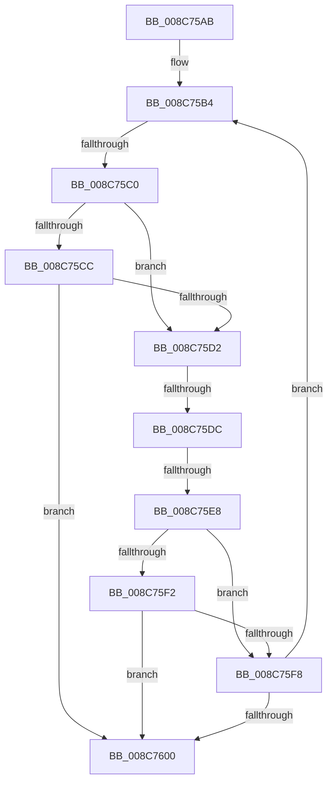

# sub_008C75AB

- RVA: `0x008C75AB`–`0x008C7605` (길이 `90` bytes)
- VA: `0x00000001408C75AB`
- 실행 섹션: `PAGE`
- PDB 이름 있음: `아니요`; PDB Function 태그: `아니요`
- unwind 정보 RVA: `0x00083E78`
- 디코드: `24`개 명령, `90/90` bytes 표시
- 미해석 바이트: `0` (있으면 어셈블리에 `.byte`로 보존)

> 이 문서는 커널 이미지의 기계어와 PDB 기호를 분석해 생성했습니다. 4번과 5번은 함수 원형과 자료형을 바이너리 사용 방식에서 추정한 C 해석이며 원본 소스 복구 결과는 아닙니다.

## 1. Dependencies

- 직접 호출 지점: **0**; 고유 호출 대상: **0**
- 직접 호출자로 확인된 함수: **0**
- RIP 상대 이미지 참조: **0**

### Outgoing calls
- 직접 디코드된 call 명령이 없습니다.

### Direct callers
- 이 함수 시작 RVA로 연결되는 직접 call은 확인되지 않았습니다. 간접 호출은 완전히 역산할 수 없습니다.

### Static image references
- 디코드된 RIP-relative 메모리 참조가 없습니다.

## 2. Other-region calls and transfers

- 다른 실행 섹션으로 향하는 call: **0**
- call이 아닌 외부 분기/꼬리 이동: **3**
  - `0x008C75BA` → [sub_008C76C4](Unknown_function_008C76C4.md) (`tail-transfer`)
  - `0x008C75D6` → [sub_008C7637 + 0x28](Unknown_function_008C7637.md) (`tail-transfer`)
  - `0x008C75E6` → [sub_008C7637](Unknown_function_008C7637.md) (`tail-transfer`)

## 3. Assembly (complete function range)

```asm
008C75AB  4C 89 64 24 40                  mov qword ptr [rsp + 0x40], r12
008C75B0  44 8D 67 FF                     lea r12d, [rdi - 1]
008C75B4  0F B7 F0                        movzx esi, ax
008C75B7  83 FE 02                        cmp esi, 2
008C75BA  0F 83 04 01 00 00               jae 0x1408c76c4
008C75C0  48 8B 5C F5 08                  mov rbx, qword ptr [rbp + rsi*8 + 8]
008C75C5  66 83 7B 42 00                  cmp word ptr [rbx + 0x42], 0
008C75CA  74 06                           je 0x1408c75d2
008C75CC  80 7B 41 01                     cmp byte ptr [rbx + 0x41], 1
008C75D0  74 2E                           je 0x1408c7600
008C75D2  83 7B 28 FF                     cmp dword ptr [rbx + 0x28], -1
008C75D6  0F 84 83 00 00 00               je 0x1408c765f
008C75DC  48 8B 93 F0 00 00 00            mov rdx, qword ptr [rbx + 0xf0]
008C75E3  48 85 D2                        test rdx, rdx
008C75E6  75 4F                           jne 0x1408c7637
008C75E8  66 83 7B 42 00                  cmp word ptr [rbx + 0x42], 0
008C75ED  48 8B FB                        mov rdi, rbx
008C75F0  74 06                           je 0x1408c75f8
008C75F2  80 7B 41 00                     cmp byte ptr [rbx + 0x41], 0
008C75F6  75 08                           jne 0x1408c7600
008C75F8  41 8B C4                        mov eax, r12d
008C75FB  66 03 C6                        add ax, si
008C75FE  79 B4                           jns 0x1408c75b4
008C7600  4C 8B 64 24 40                  mov r12, qword ptr [rsp + 0x40]
```

## 4. C-style interpretation (structured pseudocode)

```c
__int64 __fastcall sub_008C75AB(__int64 a1, __int64 a2, __int64 a3, __int64 a4, __int64 a5, __int64 a6, __int64 a7, __int64 a8)
{
    __int64 result;
    unsigned __int64 v_stack_p40;

    v_stack_p40 = v_r12;
loc_008C75B4:
    if ((*(unsigned __int16 *)(*(unsigned __int64 *)(v_rbp + (unsigned __int16)(result) * 8 + 8) + 66)) == 0) goto loc_008C75D2;
    if ((*(unsigned __int8 *)(*(unsigned __int64 *)(v_rbp + (unsigned __int16)(result) * 8 + 8) + 65)) == 1) goto loc_008C7600;
loc_008C75D2:
    if ((*(unsigned __int16 *)(*(unsigned __int64 *)(v_rbp + (unsigned __int16)(result) * 8 + 8) + 66)) == 0) goto loc_008C75F8;
    if ((*(unsigned __int8 *)(*(unsigned __int64 *)(v_rbp + (unsigned __int16)(result) * 8 + 8) + 65)) != 0) goto loc_008C7600;
loc_008C75F8:
    result = (unsigned __int16)(((unsigned int)((unsigned int)(v_rdi - 1))) + ((unsigned __int16)((unsigned __int16)(result))));
    if (!sign_flag) goto loc_008C75B4;
loc_008C7600:
    return result;
}
```

## 5. (Beta) C Style

```c
int64_t sub_008C75AB(int64_t Arg1, int64_t Arg2, int64_t Arg3, int64_t Arg4, uint64_t Arg5, uint64_t Arg6, uint64_t Arg7, int64_t Arg8)
{
    int64_t result;
    uint64_t v_stack_p40;

    v_stack_p40 = local_r12;
loc_008C75B4:
    if ((*(uint16_t *)(*(uint64_t *)(local_rbp + (uint16_t)(result) * 8 + 0x8) + 0x42)) == 0) goto loc_008C75D2;
    if ((*(uint8_t *)(*(uint64_t *)(local_rbp + (uint16_t)(result) * 8 + 0x8) + 0x41)) == 1) goto loc_008C7600;
loc_008C75D2:
    if ((*(uint16_t *)(*(uint64_t *)(local_rbp + (uint16_t)(result) * 8 + 0x8) + 0x42)) == 0) goto loc_008C75F8;
    if ((*(uint8_t *)(*(uint64_t *)(local_rbp + (uint16_t)(result) * 8 + 0x8) + 0x41)) != 0) goto loc_008C7600;
loc_008C75F8:
    result = (uint16_t)(((uint32_t)((uint32_t)(local_rdi - 1))) + ((uint16_t)((uint16_t)(result))));
    if (!sign_flag) goto loc_008C75B4;
loc_008C7600:
    return result;
}
```

## 6. Execution-region graph

[열기: 2D/3D 그래프와 함수 탐색 컨트롤 패널](../../../control-panel.html?section=page&rva=0x008C75AB&view=graph)

- 2D 그래프는 위에서 아래로 흐르고, 3D 그래프는 빈 공간을 드래그해 회전합니다. Shift+드래그는 이동, 휠은 확대·축소, 함수 노드 선택은 대상 보고서 이동입니다.

### Static fallback


