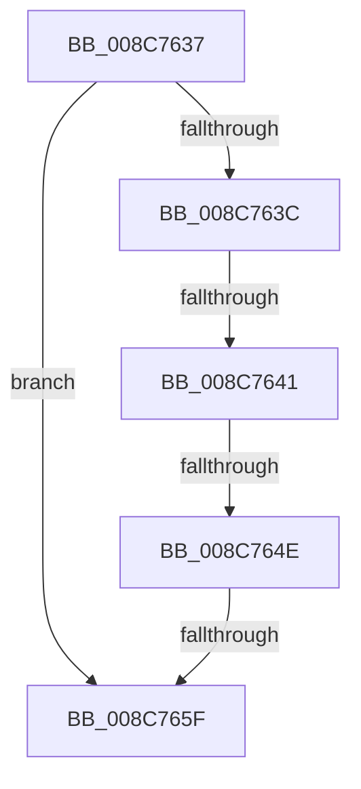

# sub_008C7637

- RVA: `0x008C7637`–`0x008C7665` (길이 `46` bytes)
- VA: `0x00000001408C7637`
- 실행 섹션: `PAGE`
- PDB 이름 있음: `아니요`; PDB Function 태그: `아니요`
- unwind 정보 RVA: `0x00083EB0`
- 디코드: `14`개 명령, `46/46` bytes 표시
- 미해석 바이트: `0` (있으면 어셈블리에 `.byte`로 보존)

> 이 문서는 커널 이미지의 기계어와 PDB 기호를 분석해 생성했습니다. 4번과 5번은 함수 원형과 자료형을 바이너리 사용 방식에서 추정한 C 해석이며 원본 소스 복구 결과는 아닙니다.

## 1. Dependencies

- 직접 호출 지점: **1**; 고유 호출 대상: **1**
- 직접 호출자로 확인된 함수: **0**
- RIP 상대 이미지 참조: **0**

### Outgoing calls
- `0x008C7656` → [CmpTransUowIsEqual](../70/CmpTransUowIsEqual_function_007049CC.md) (function, `0x007049CC`)

### Direct callers
- 이 함수 시작 RVA로 연결되는 직접 call은 확인되지 않았습니다. 간접 호출은 완전히 역산할 수 없습니다.

### Static image references
- 디코드된 RIP-relative 메모리 참조가 없습니다.

## 2. Other-region calls and transfers

- 다른 실행 섹션으로 향하는 call: **0**
- call이 아닌 외부 분기/꼬리 이동: **4**
  - `0x008C763F` → [sub_008C75AB + 0x3D](Unknown_function_008C75AB.md) (`tail-transfer`)
  - `0x008C7648` → [sub_008C76DB](Unknown_function_008C76DB.md) (`tail-transfer`)
  - `0x008C765D` → [sub_008C75AB + 0x3D](Unknown_function_008C75AB.md) (`tail-transfer`)
  - `0x008C7663` → [sub_008C75AB + 0x50](Unknown_function_008C75AB.md) (`tail-transfer`)

## 3. Assembly (complete function range)

```asm
008C7637  4D 85 FF                        test r15, r15
008C763A  74 23                           je 0x1408c765f
008C763C  4C 3B FA                        cmp r15, rdx
008C763F  74 A7                           je 0x1408c75e8
008C7641  49 8B 47 38                     mov rax, qword ptr [r15 + 0x38]
008C7645  48 85 C0                        test rax, rax
008C7648  0F 85 8D 00 00 00               jne 0x1408c76db
008C764E  48 83 C2 58                     add rdx, 0x58
008C7652  49 8D 4F 58                     lea rcx, [r15 + 0x58]
008C7656  E8 71 D3 E3 FF                  call 0x1407049cc
008C765B  84 C0                           test al, al
008C765D  75 89                           jne 0x1408c75e8
008C765F  41 0F B7 C4                     movzx eax, r12w
008C7663  EB 96                           jmp 0x1408c75fb
```

## 4. C-style interpretation (structured pseudocode)

```c
__int64 __fastcall sub_008C7637(__int64 a1, __int64 a2)
{
    __int64 result;

    if (v_r15 == 0) goto loc_008C765F;
    a2 = (a2) + (88);
    result = CmpTransUowIsEqual(v_r15 + 88, a2, a3, a4);
loc_008C765F:
}
```

## 5. (Beta) C Style

```c
int64_t sub_008C7637(int64_t Arg1, int64_t Arg2)
{
    int64_t result;

    if (local_r15 == 0) goto loc_008C765F;
    Arg2 = (Arg2) + (88);
    result = CmpTransUowIsEqual(local_r15 + 88, Arg2, a3, a4);
loc_008C765F:
}
```

## 6. Execution-region graph

[열기: 2D/3D 그래프와 함수 탐색 컨트롤 패널](../../../control-panel.html?section=page&rva=0x008C7637&view=graph)

- 2D 그래프는 위에서 아래로 흐르고, 3D 그래프는 빈 공간을 드래그해 회전합니다. Shift+드래그는 이동, 휠은 확대·축소, 함수 노드 선택은 대상 보고서 이동입니다.

### Static fallback


