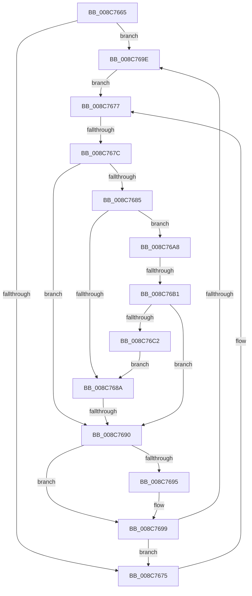

# sub_008C7665

- RVA: `0x008C7665`–`0x008C76C4` (길이 `95` bytes)
- VA: `0x00000001408C7665`
- 실행 섹션: `PAGE`
- PDB 이름 있음: `아니요`; PDB Function 태그: `아니요`
- unwind 정보 RVA: `0x00083EC8`
- 디코드: `31`개 명령, `95/95` bytes 표시
- 미해석 바이트: `0` (있으면 어셈블리에 `.byte`로 보존)

> 이 문서는 커널 이미지의 기계어와 PDB 기호를 분석해 생성했습니다. 4번과 5번은 함수 원형과 자료형을 바이너리 사용 방식에서 추정한 C 해석이며 원본 소스 복구 결과는 아닙니다.

## 1. Dependencies

- 직접 호출 지점: **1**; 고유 호출 대상: **1**
- 직접 호출자로 확인된 함수: **0**
- RIP 상대 이미지 참조: **0**

### Outgoing calls
- `0x008C76B9` → [CmpTransUowIsEqual](../70/CmpTransUowIsEqual_function_007049CC.md) (function, `0x007049CC`)

### Direct callers
- 이 함수 시작 RVA로 연결되는 직접 call은 확인되지 않았습니다. 간접 호출은 완전히 역산할 수 없습니다.

### Static image references
- 디코드된 RIP-relative 메모리 참조가 없습니다.

## 2. Other-region calls and transfers

- 다른 실행 섹션으로 향하는 call: **0**
- call이 아닌 외부 분기/꼬리 이동: **3**
  - `0x008C767A` → [sub_008C7620](Unknown_function_008C7620.md) (`tail-transfer`)
  - `0x008C768E` → [sub_008C76D2](Unknown_function_008C76D2.md) (`tail-transfer`)
  - `0x008C76AF` → [sub_008C76F3](Unknown_function_008C76F3.md) (`tail-transfer`)

## 3. Assembly (complete function range)

```asm
008C7665  48 8D AF D0 00 00 00            lea rbp, [rdi + 0xd0]
008C766C  48 8B 5D 08                     mov rbx, qword ptr [rbp + 8]
008C7670  48 3B EB                        cmp rbp, rbx
008C7673  75 29                           jne 0x1408c769e
008C7675  33 FF                           xor edi, edi
008C7677  48 85 FF                        test rdi, rdi
008C767A  74 A4                           je 0x1408c7620
008C767C  48 8B 4F 38                     mov rcx, qword ptr [rdi + 0x38]
008C7680  48 85 C9                        test rcx, rcx
008C7683  74 0B                           je 0x1408c7690
008C7685  49 3B CF                        cmp rcx, r15
008C7688  75 1E                           jne 0x1408c76a8
008C768A  83 7F 44 09                     cmp dword ptr [rdi + 0x44], 9
008C768E  74 42                           je 0x1408c76d2
008C7690  48 85 DB                        test rbx, rbx
008C7693  75 04                           jne 0x1408c7699
008C7695  48 8B 5D 08                     mov rbx, qword ptr [rbp + 8]
008C7699  48 3B EB                        cmp rbp, rbx
008C769C  74 D7                           je 0x1408c7675
008C769E  48 8D 7B E0                     lea rdi, [rbx - 0x20]
008C76A2  48 8B 5B 08                     mov rbx, qword ptr [rbx + 8]
008C76A6  EB CF                           jmp 0x1408c7677
008C76A8  48 8B 41 38                     mov rax, qword ptr [rcx + 0x38]
008C76AC  48 85 C0                        test rax, rax
008C76AF  75 42                           jne 0x1408c76f3
008C76B1  49 8D 57 58                     lea rdx, [r15 + 0x58]
008C76B5  48 83 C1 58                     add rcx, 0x58
008C76B9  E8 0E D3 E3 FF                  call 0x1407049cc
008C76BE  84 C0                           test al, al
008C76C0  74 CE                           je 0x1408c7690
008C76C2  EB C6                           jmp 0x1408c768a
```

## 4. C-style interpretation (structured pseudocode)

```c
__int64 __fastcall sub_008C7665(void)
{
    __int64 result;
    __int64 v_rbx;
    __int64 v_rdi;

    if ((v_rdi + 208) != (*(unsigned __int64 *)(v_rdi + 208 + 8))) goto loc_008C769E;
loc_008C7675:
    v_rdi = 0;
loc_008C7677:
    if (*(unsigned __int64 *)(v_rdi + 56) == 0) goto loc_008C7690;
    if ((*(unsigned __int64 *)(v_rdi + 56)) != v_r15) goto loc_008C76A8;
loc_008C768A:
loc_008C7690:
    v_rbx = *(unsigned __int64 *)(v_rdi + 208 + 8);
    if (*(unsigned __int64 *)(v_rdi + 208 + 8) == 0) {
        v_rbx = *(unsigned __int64 *)(v_rdi + 208 + 8);
    }
    if ((v_rdi + 208) == v_rbx) goto loc_008C7675;
loc_008C769E:
    goto loc_008C7677;
loc_008C76A8:
    a1 = (*(unsigned __int64 *)(v_rdi + 56)) + (88);
    result = CmpTransUowIsEqual(a1, v_r15 + 88, a3, a4);
    if ((unsigned __int8)(result) == 0) goto loc_008C7690;
    goto loc_008C768A;
}
```

## 5. (Beta) C Style

```c
void sub_008C7665(void)
{
    int64_t result;
    int64_t local_rbx;
    int64_t local_rdi;

    if ((local_rdi + 208) != (*(uint64_t *)(local_rdi + 0xD0 + 0x8))) goto loc_008C769E;
loc_008C7675:
    local_rdi = 0;
loc_008C7677:
    if (*(uint64_t *)(local_rdi + 0x38) == 0) goto loc_008C7690;
    if ((*(uint64_t *)(local_rdi + 0x38)) != local_r15) goto loc_008C76A8;
loc_008C768A:
loc_008C7690:
    local_rbx = *(uint64_t *)(local_rdi + 0xD0 + 0x8);
    if (*(uint64_t *)(local_rdi + 0xD0 + 0x8) == 0) {
        local_rbx = *(uint64_t *)(local_rdi + 0xD0 + 0x8);
    }
    if ((local_rdi + 208) == local_rbx) goto loc_008C7675;
loc_008C769E:
    goto loc_008C7677;
loc_008C76A8:
    a1 = (*(uint64_t *)(local_rdi + 0x38)) + (88);
    result = CmpTransUowIsEqual(a1, local_r15 + 88, a3, a4);
    if ((uint8_t)(result) == 0) goto loc_008C7690;
    goto loc_008C768A;
}
```

## 6. Execution-region graph

[열기: 2D/3D 그래프와 함수 탐색 컨트롤 패널](../../../control-panel.html?section=page&rva=0x008C7665&view=graph)

- 2D 그래프는 위에서 아래로 흐르고, 3D 그래프는 빈 공간을 드래그해 회전합니다. Shift+드래그는 이동, 휠은 확대·축소, 함수 노드 선택은 대상 보고서 이동입니다.

### Static fallback


