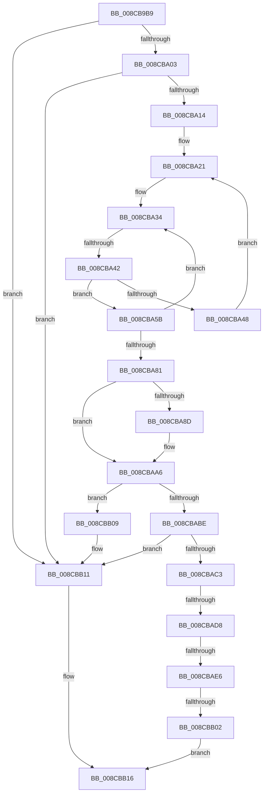

# sub_008CB9B9

- RVA: `0x008CB9B9`–`0x008CBB2B` (길이 `370` bytes)
- VA: `0x00000001408CB9B9`
- 실행 섹션: `PAGE`
- PDB 이름 있음: `아니요`; PDB Function 태그: `아니요`
- unwind 정보 RVA: `0x000844C4`
- 디코드: `91`개 명령, `370/370` bytes 표시
- 미해석 바이트: `0` (있으면 어셈블리에 `.byte`로 보존)

> 이 문서는 커널 이미지의 기계어와 PDB 기호를 분석해 생성했습니다. 4번과 5번은 함수 원형과 자료형을 바이너리 사용 방식에서 추정한 C 해석이며 원본 소스 복구 결과는 아닙니다.

## 1. Dependencies

- 직접 호출 지점: **7**; 고유 호출 대상: **7**
- 직접 호출자로 확인된 함수: **0**
- RIP 상대 이미지 참조: **3**

### Outgoing calls
- `0x008CBA03` → [ExpLookupHandleTableEntry](../86/ExpLookupHandleTableEntry_function_00869DB0.md) (function, `0x00869DB0`)
- `0x008CBA4E` → [ExpBlockOnLockedHandleEntry](../86/ExpBlockOnLockedHandleEntry_function_00868838.md) (function, `0x00868838`)
- `0x008CBAAB` → [ExGetHandlePointer](../../text/43/ExGetHandlePointer_function_00430C90.md) (function, `0x00430C90`)
- `0x008CBAC6` → [IoThreadToProcess](../../text/44/IoThreadToProcess_function_00448540.md) (function, `0x00448540`)
- `0x008CBAE6` → [PsGetCurrentServerSilo](../../text/22/PsGetCurrentServerSilo_function_00225710.md) (function, `0x00225710`)
- `0x008CBAF5` → [PsIsProcessInSilo](../../text/41/PsIsProcessInSilo_function_004185E0.md) (function, `0x004185E0`)
- `0x008CBB0C` → [ObfDereferenceObject](../../text/2F/ObfDereferenceObject_function_002F9350.md) (function, `0x002F9350`)

### Direct callers
- 이 함수 시작 RVA로 연결되는 직접 call은 확인되지 않았습니다. 간접 호출은 완전히 역산할 수 없습니다.

### Static image references
- `0x008CB9C6` → RVA `0x00FD9DD0` (`PAGEDATA`; read)
- `0x008CB9F0` → RVA `0x00FC6CA8` (`ALMOSTRO`; read)
- `0x008CBACB` → RVA `0x00FC6B70` (`ALMOSTRO`; read)

## 2. Other-region calls and transfers

- 다른 실행 섹션으로 향하는 call: **5**
  - `0x008CBAAB` → [ExGetHandlePointer](../../text/43/ExGetHandlePointer_function_00430C90.md) (`PAGE` → `.text`)
  - `0x008CBAC6` → [IoThreadToProcess](../../text/44/IoThreadToProcess_function_00448540.md) (`PAGE` → `.text`)
  - `0x008CBAE6` → [PsGetCurrentServerSilo](../../text/22/PsGetCurrentServerSilo_function_00225710.md) (`PAGE` → `.text`)
  - `0x008CBAF5` → [PsIsProcessInSilo](../../text/41/PsIsProcessInSilo_function_004185E0.md) (`PAGE` → `.text`)
  - `0x008CBB0C` → [ObfDereferenceObject](../../text/2F/ObfDereferenceObject_function_002F9350.md) (`PAGE` → `.text`)
- call이 아닌 외부 분기/꼬리 이동: **5**
  - `0x008CBA3C` → [sub_008CBB8C](Unknown_function_008CBB8C.md) (`tail-transfer`)
  - `0x008CBAD2` → [sub_008CBB8C + 0xAC](Unknown_function_008CBB8C.md) (`tail-transfer`)
  - `0x008CBAE0` → [sub_008CBB8C + 0xF4](Unknown_function_008CBB8C.md) (`tail-transfer`)
  - `0x008CBAFC` → [sub_008CBB8C + 0xAC](Unknown_function_008CBB8C.md) (`tail-transfer`)
  - `0x008CBB29` → [sub_008CBB2B + 0x12](Unknown_function_008CBB2B.md) (`tail-transfer`)

## 3. Assembly (complete function range)

```asm
008CB9B9  48 89 5C 24 68                  mov qword ptr [rsp + 0x68], rbx
008CB9BE  33 ED                           xor ebp, ebp
008CB9C0  48 8B 19                        mov rbx, qword ptr [rcx]
008CB9C3  4C 8B FA                        mov r15, rdx
008CB9C6  48 33 1D 03 E4 70 00            xor rbx, qword ptr [rip + 0x70e403]
008CB9CD  48 89 74 24 70                  mov qword ptr [rsp + 0x70], rsi
008CB9D2  65 48 8B 34 25 88 01 00 00      mov rsi, qword ptr gs:[0x188]
008CB9DB  4C 89 74 24 78                  mov qword ptr [rsp + 0x78], r14
008CB9E0  48 89 5C 24 60                  mov qword ptr [rsp + 0x60], rbx
008CB9E5  48 63 D3                        movsxd rdx, ebx
008CB9E8  66 FF 8E E6 01 00 00            dec word ptr [rsi + 0x1e6]
008CB9EF  90                              nop
008CB9F0  48 8B 0D B1 B2 6F 00            mov rcx, qword ptr [rip + 0x6fb2b1]
008CB9F7  F7 C3 FC 03 00 00               test ebx, 0x3fc
008CB9FD  0F 84 0E 01 00 00               je 0x1408cbb11
008CBA03  E8 A8 E3 F9 FF                  call 0x140869db0
008CBA08  48 8B F8                        mov rdi, rax
008CBA0B  48 85 C0                        test rax, rax
008CBA0E  0F 84 FD 00 00 00               je 0x1408cbb11
008CBA14  4C 8B 35 8D B2 6F 00            mov r14, qword ptr [rip + 0x6fb28d]
008CBA1B  0F 0D 08                        prefetchw byte ptr [rax]
008CBA1E  48 8B 00                        mov rax, qword ptr [rax]
008CBA21  48 8B 4F 08                     mov rcx, qword ptr [rdi + 8]
008CBA25  48 89 44 24 20                  mov qword ptr [rsp + 0x20], rax
008CBA2A  4C 8B 44 24 20                  mov r8, qword ptr [rsp + 0x20]
008CBA2F  48 89 4C 24 28                  mov qword ptr [rsp + 0x28], rcx
008CBA34  90                              nop
008CBA35  49 F7 C0 FE FF 01 00            test r8, 0x1fffe
008CBA3C  0F 84 4A 01 00 00               je 0x1408cbb8c
008CBA42  41 F6 C0 01                     test r8b, 1
008CBA46  75 13                           jne 0x1408cba5b
008CBA48  48 8B D7                        mov rdx, rdi
008CBA4B  49 8B CE                        mov rcx, r14
008CBA4E  E8 E5 CD F9 FF                  call 0x140868838
008CBA53  0F 0D 0F                        prefetchw byte ptr [rdi]
008CBA56  48 8B 07                        mov rax, qword ptr [rdi]
008CBA59  EB C6                           jmp 0x1408cba21
008CBA5B  49 8D 58 FE                     lea rbx, [r8 - 2]
008CBA5F  49 8B C0                        mov rax, r8
008CBA62  48 8B D1                        mov rdx, rcx
008CBA65  F0 48 0F C7 0F                  lock cmpxchg16b xmmword ptr [rdi]
008CBA6A  4C 8B C0                        mov r8, rax
008CBA6D  48 89 44 24 20                  mov qword ptr [rsp + 0x20], rax
008CBA72  0F 94 C0                        sete al
008CBA75  48 89 54 24 28                  mov qword ptr [rsp + 0x28], rdx
008CBA7A  48 8B CA                        mov rcx, rdx
008CBA7D  84 C0                           test al, al
008CBA7F  74 B3                           je 0x1408cba34
008CBA81  49 8B C8                        mov rcx, r8
008CBA84  48 D1 E9                        shr rcx, 1
008CBA87  66 83 F9 10                     cmp cx, 0x10
008CBA8B  75 19                           jne 0x1408cbaa6
008CBA8D  48 8D 41 FF                     lea rax, [rcx - 1]
008CBA91  49 81 E0 01 00 FE FF            and r8, 0xfffffffffffe0001
008CBA98  0F B7 C8                        movzx ecx, ax
008CBA9B  48 03 C9                        add rcx, rcx
008CBA9E  49 0B C8                        or rcx, r8
008CBAA1  48 89 4C 24 20                  mov qword ptr [rsp + 0x20], rcx
008CBAA6  48 8D 4C 24 20                  lea rcx, [rsp + 0x20]
008CBAAB  E8 E0 51 B6 FF                  call 0x140430c90
008CBAB0  48 8B D8                        mov rbx, rax
008CBAB3  0F B6 08                        movzx ecx, byte ptr [rax]
008CBAB6  80 E1 7F                        and cl, 0x7f
008CBAB9  80 F9 06                        cmp cl, 6
008CBABC  75 4B                           jne 0x1408cbb09
008CBABE  48 85 DB                        test rbx, rbx
008CBAC1  74 4E                           je 0x1408cbb11
008CBAC3  48 8B CB                        mov rcx, rbx
008CBAC6  E8 75 CA B7 FF                  call 0x140448540
008CBACB  48 3B 05 9E B0 6F 00            cmp rax, qword ptr [rip + 0x6fb09e]
008CBAD2  0F 84 60 01 00 00               je 0x1408cbc38
008CBAD8  8B 83 A0 05 00 00               mov eax, dword ptr [rbx + 0x5a0]
008CBADE  A8 02                           test al, 2
008CBAE0  0F 84 9A 01 00 00               je 0x1408cbc80
008CBAE6  E8 25 9C 95 FF                  call 0x140225710
008CBAEB  48 8B 8B 20 02 00 00            mov rcx, qword ptr [rbx + 0x220]
008CBAF2  48 8B D0                        mov rdx, rax
008CBAF5  E8 E6 CA B4 FF                  call 0x1404185e0
008CBAFA  84 C0                           test al, al
008CBAFC  0F 84 36 01 00 00               je 0x1408cbc38
008CBB02  48 8B EB                        mov rbp, rbx
008CBB05  33 FF                           xor edi, edi
008CBB07  EB 0D                           jmp 0x1408cbb16
008CBB09  48 8B C8                        mov rcx, rax
008CBB0C  E8 3F D8 A2 FF                  call 0x1402f9350
008CBB11  BF 0B 00 00 C0                  mov edi, 0xc000000b
008CBB16  4C 8B 74 24 78                  mov r14, qword ptr [rsp + 0x78]
008CBB1B  90                              nop
008CBB1C  66 83 86 E6 01 00 00 01         add word ptr [rsi + 0x1e6], 1
008CBB24  48 8B 5C 24 68                  mov rbx, qword ptr [rsp + 0x68]
008CBB29  75 12                           jne 0x1408cbb3d
```

## 4. C-style interpretation (structured pseudocode)

```c
__int64 __fastcall sub_008CB9B9(__int64 a1, __int64 a2, __int64 a3, __int64 a4, __int64 a5, __int64 a6, __int64 a7, __int64 a8, __int64 a9, __int64 a10, __int64 a11, __int64 a12, __int64 a13, __int64 a14, __int64 a15)
{
    __int64 result;
    __int64 v_rbp;
    __int64 v_rbx;
    __int64 v_rdi;
    unsigned __int64 v_stack_p20;
    unsigned __int64 v_stack_p28;
    unsigned __int64 v_stack_p60;
    unsigned __int64 v_stack_p68;
    unsigned __int64 v_stack_p70;
    unsigned __int64 v_stack_p78;

    v_stack_p68 = v_rbx;
    v_rbp = 0;
    v_rbx = (*(unsigned __int64 *)(a1)) ^ (*(unsigned __int64 *)(v_rip + 7398403));
    v_stack_p70 = v_rsi;
    v_stack_p78 = v_r14;
    v_stack_p60 = v_rbx;
    if ((((unsigned int)(v_rbx)) & (0x3FCULL)) == 0) goto loc_008CBB11;
    result = ExpLookupHandleTableEntry(*(unsigned __int64 *)(v_rip + 7320241), (int)((unsigned int)(v_rbx)), a3, a4);
    if (result == 0) goto loc_008CBB11;
loc_008CBA21:
    v_stack_p20 = *(unsigned __int64 *)(result);
    v_stack_p28 = *(unsigned __int64 *)(result + 8);
loc_008CBA34:
    if ((((unsigned __int8)(v_stack_p20)) & (1)) != 0) goto loc_008CBA5B;
    result = ExpBlockOnLockedHandleEntry(*(unsigned __int64 *)(v_rip + 7320205), result, v_stack_p20, a4);
    goto loc_008CBA21;
loc_008CBA5B:
    v_stack_p20 = v_stack_p20;
    result = ((((unsigned __int8)(v_stack_p20)) & (1)) == 0) ? 1 : 0;
    v_stack_p28 = *(unsigned __int64 *)(v_rip + 7320205);
    if ((unsigned __int8)(result) == 0) goto loc_008CBA34;
    a1 = (v_stack_p20) >> (1);
    if (((unsigned __int16)(a1)) == 16) {
        result = a1 - 1;
        a3 = (v_stack_p20) & (0xFFFFFFFFFFFE0001ULL);
        a1 = (unsigned __int16)(result);
        a1 = (a1) + (a1);
        a1 = (a1) | (a3);
        v_stack_p20 = a1;
    }
    result = ExGetHandlePointer(v_stack_p20, *(unsigned __int64 *)(v_rip + 7320205), a3, a4);
    a1 = (unsigned __int8)((*(unsigned __int8 *)(result)) & (127));
    if (((unsigned __int8)(a1)) != 6) goto loc_008CBB09;
    if (result == 0) goto loc_008CBB11;
    result = IoThreadToProcess(result, *(unsigned __int64 *)(v_rip + 7320205), a3, a4);
    result = PsGetCurrentServerSilo(result, *(unsigned __int64 *)(v_rip + 7320205), a3, a4);
    result = PsIsProcessInSilo(*(unsigned __int64 *)(result + 544), result, a3, a4);
    v_rdi = 0;
    goto loc_008CBB16;
loc_008CBB09:
    result = ObfDereferenceObject(result, result, a3, a4);
loc_008CBB11:
loc_008CBB16:
}
```

## 5. (Beta) C Style

```c
int64_t sub_008CB9B9(void *Arg1, int64_t Arg2, int64_t Arg3, int64_t Arg4, uint64_t Arg5, uint64_t Arg6, uint64_t Arg7, uint64_t Arg8, uint64_t Arg9, uint64_t Arg10, uint64_t Arg11, uint64_t Arg12, int64_t Arg13, uint64_t Arg14, int64_t Arg15)
{
    uint8_t *arg1 = (uint8_t *)Arg1;

    int64_t result;
    int64_t local_rbp;
    int64_t local_rbx;
    int64_t local_rdi;
    uint64_t v_stack_p20;
    uint64_t v_stack_p28;
    uint64_t v_stack_p60;
    uint64_t v_stack_p68;
    uint64_t v_stack_p70;
    uint64_t v_stack_p78;

    v_stack_p68 = local_rbx;
    local_rbp = 0;
    local_rbx = (*(uint64_t *)(arg1)) ^ (*(uint64_t *)(v_rip + 0x70E403));
    v_stack_p70 = local_rsi;
    v_stack_p78 = local_r14;
    v_stack_p60 = local_rbx;
    if ((((uint32_t)(local_rbx)) & (0x3FCULL)) == 0) goto loc_008CBB11;
    result = ExpLookupHandleTableEntry(*(uint64_t *)(v_rip + 0x6FB2B1), (int32_t)((uint32_t)(local_rbx)), Arg3, Arg4);
    if (result == 0) goto loc_008CBB11;
loc_008CBA21:
    v_stack_p20 = *(uint64_t *)(result);
    v_stack_p28 = *(uint64_t *)(result + 0x8);
loc_008CBA34:
    if ((((uint8_t)(v_stack_p20)) & (1)) != 0) goto loc_008CBA5B;
    result = ExpBlockOnLockedHandleEntry(*(uint64_t *)(v_rip + 0x6FB28D), result, v_stack_p20, Arg4);
    goto loc_008CBA21;
loc_008CBA5B:
    v_stack_p20 = v_stack_p20;
    result = ((((uint8_t)(v_stack_p20)) & (1)) == 0) ? 1 : 0;
    v_stack_p28 = *(uint64_t *)(v_rip + 0x6FB28D);
    if ((uint8_t)(result) == 0) goto loc_008CBA34;
    Arg1 = (v_stack_p20) >> (1);
    if (((uint16_t)(Arg1)) == 16) {
        result = Arg1 - 1;
        Arg3 = (v_stack_p20) & (0xFFFFFFFFFFFE0001ULL);
        Arg1 = (uint16_t)(result);
        Arg1 = (Arg1) + (Arg1);
        Arg1 = (Arg1) | (Arg3);
        v_stack_p20 = Arg1;
    }
    result = ExGetHandlePointer(v_stack_p20, *(uint64_t *)(v_rip + 0x6FB28D), Arg3, Arg4);
    Arg1 = (uint8_t)((*(uint8_t *)(result)) & (127));
    if (((uint8_t)(Arg1)) != 6) goto loc_008CBB09;
    if (result == 0) goto loc_008CBB11;
    result = IoThreadToProcess(result, *(uint64_t *)(v_rip + 0x6FB28D), Arg3, Arg4);
    result = PsGetCurrentServerSilo(result, *(uint64_t *)(v_rip + 0x6FB28D), Arg3, Arg4);
    result = PsIsProcessInSilo(*(uint64_t *)(result + 0x220), result, Arg3, Arg4);
    local_rdi = 0;
    goto loc_008CBB16;
loc_008CBB09:
    result = ObfDereferenceObject(result, result, Arg3, Arg4);
loc_008CBB11:
loc_008CBB16:
}
```

### 관측된 메모리 오프셋

구조체 형식이 확인되지 않은 접근은 인자 기준의 오프셋으로만 기록했습니다.

| 기준 인자 | 오프셋 표현 | 폭 (bit) | 접근 |
|---|---:|---:|---|
| `Arg1` | `+ 0x0` | `64` | `R` |

## 6. Execution-region graph

[열기: 2D/3D 그래프와 함수 탐색 컨트롤 패널](../../../control-panel.html?section=page&rva=0x008CB9B9&view=graph)

- 2D 그래프는 위에서 아래로 흐르고, 3D 그래프는 빈 공간을 드래그해 회전합니다. Shift+드래그는 이동, 휠은 확대·축소, 함수 노드 선택은 대상 보고서 이동입니다.

### Static fallback


