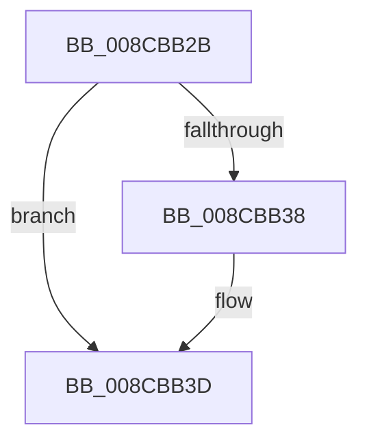

# sub_008CBB2B

- RVA: `0x008CBB2B`–`0x008CBB46` (길이 `27` bytes)
- VA: `0x00000001408CBB2B`
- 실행 섹션: `PAGE`
- PDB 이름 있음: `아니요`; PDB Function 태그: `아니요`
- unwind 정보 RVA: `0x000844E0`
- 디코드: `8`개 명령, `27/27` bytes 표시
- 미해석 바이트: `0` (있으면 어셈블리에 `.byte`로 보존)

> 이 문서는 커널 이미지의 기계어와 PDB 기호를 분석해 생성했습니다. 4번과 5번은 함수 원형과 자료형을 바이너리 사용 방식에서 추정한 C 해석이며 원본 소스 복구 결과는 아닙니다.

## 1. Dependencies

- 직접 호출 지점: **1**; 고유 호출 대상: **1**
- 직접 호출자로 확인된 함수: **0**
- RIP 상대 이미지 참조: **0**

### Outgoing calls
- `0x008CBB38` → [KiCheckForKernelApcDelivery](../../text/2E/KiCheckForKernelApcDelivery_function_002E2C80.md) (function, `0x002E2C80`)

### Direct callers
- 이 함수 시작 RVA로 연결되는 직접 call은 확인되지 않았습니다. 간접 호출은 완전히 역산할 수 없습니다.

### Static image references
- 디코드된 RIP-relative 메모리 참조가 없습니다.

## 2. Other-region calls and transfers

- 다른 실행 섹션으로 향하는 call: **1**
  - `0x008CBB38` → [KiCheckForKernelApcDelivery](../../text/2E/KiCheckForKernelApcDelivery_function_002E2C80.md) (`PAGE` → `.text`)
- call이 아닌 외부 분기/꼬리 이동: **1**
  - `0x008CBB44` → [sub_008CBB46 + 0x19](Unknown_function_008CBB46.md) (`tail-transfer`)

## 3. Assembly (complete function range)

```asm
008CBB2B  48 8D 86 98 00 00 00            lea rax, [rsi + 0x98]
008CBB32  90                              nop
008CBB33  48 39 00                        cmp qword ptr [rax], rax
008CBB36  74 05                           je 0x1408cbb3d
008CBB38  E8 43 71 A1 FF                  call 0x1402e2c80
008CBB3D  48 8B 74 24 70                  mov rsi, qword ptr [rsp + 0x70]
008CBB42  85 FF                           test edi, edi
008CBB44  79 19                           jns 0x1408cbb5f
```

## 4. C-style interpretation (structured pseudocode)

```c
__int64 __fastcall sub_008CBB2B(__int64 a1, __int64 a2, __int64 a3, __int64 a4, __int64 a5, __int64 a6, __int64 a7, __int64 a8, __int64 a9, __int64 a10, __int64 a11, __int64 a12, __int64 a13, __int64 a14)
{
    __int64 result;

    result = v_rsi + 152;
    if ((*(unsigned __int64 *)(v_rsi + 152)) != (v_rsi + 152)) {
        result = KiCheckForKernelApcDelivery(a1, a2, a3, a4);
    }
}
```

## 5. (Beta) C Style

```c
int64_t sub_008CBB2B(int64_t Arg1, int64_t Arg2, int64_t Arg3, int64_t Arg4, uint64_t Arg5, uint64_t Arg6, uint64_t Arg7, uint64_t Arg8, uint64_t Arg9, uint64_t Arg10, uint64_t Arg11, uint64_t Arg12, uint64_t Arg13, int64_t Arg14)
{
    int64_t result;

    result = local_rsi + 152;
    if ((*(uint64_t *)(local_rsi + 0x98)) != (local_rsi + 152)) {
        result = KiCheckForKernelApcDelivery(Arg1, Arg2, Arg3, Arg4);
    }
}
```

## 6. Execution-region graph

[열기: 2D/3D 그래프와 함수 탐색 컨트롤 패널](../../../control-panel.html?section=page&rva=0x008CBB2B&view=graph)

- 2D 그래프는 위에서 아래로 흐르고, 3D 그래프는 빈 공간을 드래그해 회전합니다. Shift+드래그는 이동, 휠은 확대·축소, 함수 노드 선택은 대상 보고서 이동입니다.

### Static fallback


