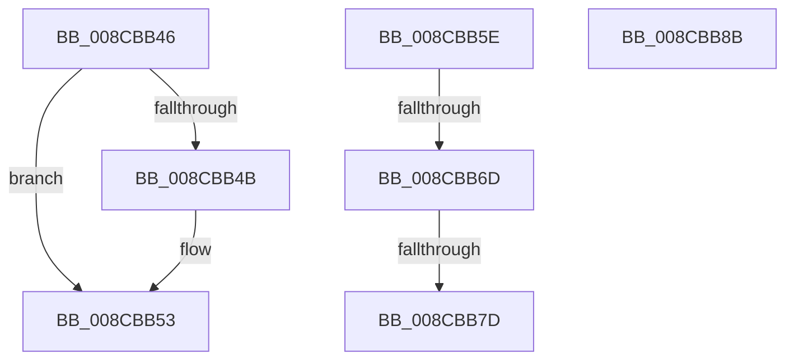

# sub_008CBB46

- RVA: `0x008CBB46`–`0x008CBB8C` (길이 `70` bytes)
- VA: `0x00000001408CBB46`
- 실행 섹션: `PAGE`
- PDB 이름 있음: `아니요`; PDB Function 태그: `아니요`
- unwind 정보 RVA: `0x000844F4`
- 디코드: `25`개 명령, `70/70` bytes 표시
- 미해석 바이트: `0` (있으면 어셈블리에 `.byte`로 보존)

> 이 문서는 커널 이미지의 기계어와 PDB 기호를 분석해 생성했습니다. 4번과 5번은 함수 원형과 자료형을 바이너리 사용 방식에서 추정한 C 해석이며 원본 소스 복구 결과는 아닙니다.

## 1. Dependencies

- 직접 호출 지점: **1**; 고유 호출 대상: **1**
- 직접 호출자로 확인된 함수: **0**
- RIP 상대 이미지 참조: **0**

### Outgoing calls
- `0x008CBB4E` → [ObfDereferenceObject](../../text/2F/ObfDereferenceObject_function_002F9350.md) (function, `0x002F9350`)

### Direct callers
- 이 함수 시작 RVA로 연결되는 직접 call은 확인되지 않았습니다. 간접 호출은 완전히 역산할 수 없습니다.

### Static image references
- 디코드된 RIP-relative 메모리 참조가 없습니다.

## 2. Other-region calls and transfers

- 다른 실행 섹션으로 향하는 call: **1**
  - `0x008CBB4E` → [ObfDereferenceObject](../../text/2F/ObfDereferenceObject_function_002F9350.md) (`PAGE` → `.text`)
- call이 아닌 외부 분기/꼬리 이동: **2**
  - `0x008CBB67` → [sub_008CBC97](Unknown_function_008CBC97.md) (`tail-transfer`)
  - `0x008CBB77` → [sub_008CBC97](Unknown_function_008CBC97.md) (`tail-transfer`)

## 3. Assembly (complete function range)

```asm
008CBB46  48 85 ED                        test rbp, rbp
008CBB49  74 08                           je 0x1408cbb53
008CBB4B  48 8B CD                        mov rcx, rbp
008CBB4E  E8 FD D7 A2 FF                  call 0x1402f9350
008CBB53  8B C7                           mov eax, edi
008CBB55  48 83 C4 40                     add rsp, 0x40
008CBB59  41 5F                           pop r15
008CBB5B  5F                              pop rdi
008CBB5C  5D                              pop rbp
008CBB5D  C3                              ret
008CBB5E  CC                              int3
008CBB5F  8B 85 A0 05 00 00               mov eax, dword ptr [rbp + 0x5a0]
008CBB65  A8 01                           test al, 1
008CBB67  0F 85 2A 01 00 00               jne 0x1408cbc97
008CBB6D  8B 44 24 64                     mov eax, dword ptr [rsp + 0x64]
008CBB71  39 85 C0 04 00 00               cmp dword ptr [rbp + 0x4c0], eax
008CBB77  0F 85 1A 01 00 00               jne 0x1408cbc97
008CBB7D  49 89 2F                        mov qword ptr [r15], rbp
008CBB80  33 C0                           xor eax, eax
008CBB82  48 83 C4 40                     add rsp, 0x40
008CBB86  41 5F                           pop r15
008CBB88  5F                              pop rdi
008CBB89  5D                              pop rbp
008CBB8A  C3                              ret
008CBB8B  CC                              int3
```

## 4. C-style interpretation (structured pseudocode)

```c
__int64 __fastcall sub_008CBB46(void)
{
    __int64 result;
    __int64 v_rsp;
    unsigned int v_stack_pBC;

    if (v_rbp != 0) {
        a1 = v_rbp;
        result = ObfDereferenceObject(a1, a2, a3, a4);
    }
    v_rsp = (v_rsp) + (64);
    return (unsigned int)((unsigned int)(v_rdi));
}
```

## 5. (Beta) C Style

```c
void sub_008CBB46(void)
{
    int64_t result;
    int64_t local_rsp;
    uint32_t v_stack_pBC;

    if (local_rbp != 0) {
        a1 = local_rbp;
        result = ObfDereferenceObject(a1, a2, a3, a4);
    }
    local_rsp = (local_rsp) + (64);
    return (uint32_t)((uint32_t)(local_rdi));
}
```

## 6. Execution-region graph

[열기: 2D/3D 그래프와 함수 탐색 컨트롤 패널](../../../control-panel.html?section=page&rva=0x008CBB46&view=graph)

- 2D 그래프는 위에서 아래로 흐르고, 3D 그래프는 빈 공간을 드래그해 회전합니다. Shift+드래그는 이동, 휠은 확대·축소, 함수 노드 선택은 대상 보고서 이동입니다.

### Static fallback


