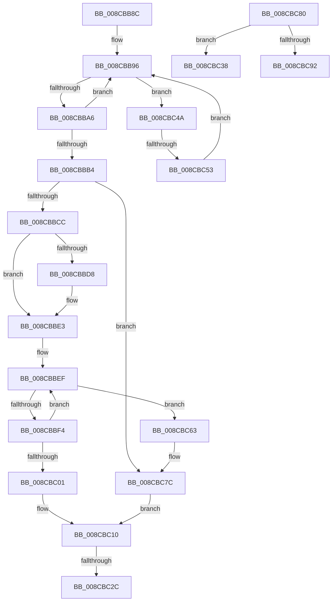

# sub_008CBB8C

- RVA: `0x008CBB8C`–`0x008CBC97` (길이 `267` bytes)
- VA: `0x00000001408CBB8C`
- 실행 섹션: `PAGE`
- PDB 이름 있음: `아니요`; PDB Function 태그: `아니요`
- unwind 정보 RVA: `0x0008450C`
- 디코드: `69`개 명령, `267/267` bytes 표시
- 미해석 바이트: `0` (있으면 어셈블리에 `.byte`로 보존)

> 이 문서는 커널 이미지의 기계어와 PDB 기호를 분석해 생성했습니다. 4번과 5번은 함수 원형과 자료형을 바이너리 사용 방식에서 추정한 C 해석이며 원본 소스 복구 결과는 아닙니다.

## 1. Dependencies

- 직접 호출 지점: **7**; 고유 호출 대상: **7**
- 직접 호출자로 확인된 함수: **0**
- RIP 상대 이미지 참조: **1**

### Outgoing calls
- `0x008CBBB7` → [ExGetHandlePointer](../../text/43/ExGetHandlePointer_function_00430C90.md) (function, `0x00430C90`)
- `0x008CBBDB` → [ExSlowReplenishHandleTableEntry](../../text/44/ExSlowReplenishHandleTableEntry_function_0044BEF0.md) (function, `0x0044BEF0`)
- `0x008CBC0B` → [ObpTraceObjectReferenceIfActive](../../text/21/ObpTraceObjectReferenceIfActive_function_00210780.md) (function, `0x00210780`)
- `0x008CBC2E` → [ExfUnblockPushLock](../../text/2A/ExfUnblockPushLock_function_002A3FE0.md) (function, `0x002A3FE0`)
- `0x008CBC40` → [ObfDereferenceObject](../../text/2F/ObfDereferenceObject_function_002F9350.md) (function, `0x002F9350`)
- `0x008CBC59` → [ExpBlockOnLockedHandleEntry](../86/ExpBlockOnLockedHandleEntry_function_00868838.md) (function, `0x00868838`)
- `0x008CBC83` → [PspLockUnlockThreadSecurityExclusiveUnsafe](../../text/4E/PspLockUnlockThreadSecurityExclusiveUnsafe_function_004E96AC.md) (function, `0x004E96AC`)

### Direct callers
- 이 함수 시작 RVA로 연결되는 직접 call은 확인되지 않았습니다. 간접 호출은 완전히 역산할 수 없습니다.

### Static image references
- `0x008CBB8C` → RVA `0x00FC6CA8` (`ALMOSTRO`; read)

## 2. Other-region calls and transfers

- 다른 실행 섹션으로 향하는 call: **6**
  - `0x008CBBB7` → [ExGetHandlePointer](../../text/43/ExGetHandlePointer_function_00430C90.md) (`PAGE` → `.text`)
  - `0x008CBBDB` → [ExSlowReplenishHandleTableEntry](../../text/44/ExSlowReplenishHandleTableEntry_function_0044BEF0.md) (`PAGE` → `.text`)
  - `0x008CBC0B` → [ObpTraceObjectReferenceIfActive](../../text/21/ObpTraceObjectReferenceIfActive_function_00210780.md) (`PAGE` → `.text`)
  - `0x008CBC2E` → [ExfUnblockPushLock](../../text/2A/ExfUnblockPushLock_function_002A3FE0.md) (`PAGE` → `.text`)
  - `0x008CBC40` → [ObfDereferenceObject](../../text/2F/ObfDereferenceObject_function_002F9350.md) (`PAGE` → `.text`)
  - `0x008CBC83` → [PspLockUnlockThreadSecurityExclusiveUnsafe](../../text/4E/PspLockUnlockThreadSecurityExclusiveUnsafe_function_004E96AC.md) (`PAGE` → `.text`)
- call이 아닌 외부 분기/꼬리 이동: **5**
  - `0x008CBC26` → [sub_008CB9B9 + 0x105](Unknown_function_008CB9B9.md) (`tail-transfer`)
  - `0x008CBC33` → [sub_008CB9B9 + 0x105](Unknown_function_008CB9B9.md) (`tail-transfer`)
  - `0x008CBC45` → [sub_008CB9B9 + 0x15D](Unknown_function_008CB9B9.md) (`tail-transfer`)
  - `0x008CBC4D` → [sub_008CB9B9 + 0x158](Unknown_function_008CB9B9.md) (`tail-transfer`)
  - `0x008CBC92` → [sub_008CB9B9 + 0x12D](Unknown_function_008CB9B9.md) (`tail-transfer`)

## 3. Assembly (complete function range)

```asm
008CBB8C  48 8B 1D 15 B1 6F 00            mov rbx, qword ptr [rip + 0x6fb115]
008CBB93  45 33 F6                        xor r14d, r14d
008CBB96  0F 0D 0F                        prefetchw byte ptr [rdi]
008CBB99  4C 8B 07                        mov r8, qword ptr [rdi]
008CBB9C  41 F6 C0 01                     test r8b, 1
008CBBA0  0F 84 A4 00 00 00               je 0x1408cbc4a
008CBBA6  49 8D 48 FF                     lea rcx, [r8 - 1]
008CBBAA  49 8B C0                        mov rax, r8
008CBBAD  F0 48 0F B1 0F                  lock cmpxchg qword ptr [rdi], rcx
008CBBB2  75 E2                           jne 0x1408cbb96
008CBBB4  48 8B CF                        mov rcx, rdi
008CBBB7  E8 D4 50 B6 FF                  call 0x140430c90
008CBBBC  48 8B D8                        mov rbx, rax
008CBBBF  0F B6 00                        movzx eax, byte ptr [rax]
008CBBC2  24 7F                           and al, 0x7f
008CBBC4  3C 06                           cmp al, 6
008CBBC6  0F 85 B0 00 00 00               jne 0x1408cbc7c
008CBBCC  8B 83 A0 05 00 00               mov eax, dword ptr [rbx + 0x5a0]
008CBBD2  24 03                           and al, 3
008CBBD4  3C 02                           cmp al, 2
008CBBD6  75 0B                           jne 0x1408cbbe3
008CBBD8  48 8B CF                        mov rcx, rdi
008CBBDB  E8 10 03 B8 FF                  call 0x14044bef0
008CBBE0  44 8B F0                        mov r14d, eax
008CBBE3  41 8D 56 01                     lea edx, [r14 + 1]
008CBBE7  0F 0D 4B D0                     prefetchw byte ptr [rbx - 0x30]
008CBBEB  48 8B 43 D0                     mov rax, qword ptr [rbx - 0x30]
008CBBEF  48 85 C0                        test rax, rax
008CBBF2  74 6F                           je 0x1408cbc63
008CBBF4  8B CA                           mov ecx, edx
008CBBF6  48 03 C8                        add rcx, rax
008CBBF9  F0 48 0F B1 4B D0               lock cmpxchg qword ptr [rbx - 0x30], rcx
008CBBFF  75 EE                           jne 0x1408cbbef
008CBC01  41 B8 44 66 6C 74               mov r8d, 0x746c6644
008CBC07  48 8D 4B D0                     lea rcx, [rbx - 0x30]
008CBC0B  E8 70 4B 94 FF                  call 0x140210780
008CBC10  48 8B 0D 91 B0 6F 00            mov rcx, qword ptr [rip + 0x6fb091]
008CBC17  F0 48 FF 07                     lock inc qword ptr [rdi]
008CBC1B  48 83 C1 30                     add rcx, 0x30
008CBC1F  F0 09 2C 24                     lock or dword ptr [rsp], ebp
008CBC23  48 39 29                        cmp qword ptr [rcx], rbp
008CBC26  0F 84 92 FE FF FF               je 0x1408cbabe
008CBC2C  33 D2                           xor edx, edx
008CBC2E  E8 AD 83 9D FF                  call 0x1402a3fe0
008CBC33  E9 86 FE FF FF                  jmp 0x1408cbabe
008CBC38  BF 0B 00 00 C0                  mov edi, 0xc000000b
008CBC3D  48 8B CB                        mov rcx, rbx
008CBC40  E8 0B D7 A2 FF                  call 0x1402f9350
008CBC45  E9 CC FE FF FF                  jmp 0x1408cbb16
008CBC4A  4D 85 C0                        test r8, r8
008CBC4D  0F 84 BE FE FF FF               je 0x1408cbb11
008CBC53  48 8B D7                        mov rdx, rdi
008CBC56  48 8B CB                        mov rcx, rbx
008CBC59  E8 DA CB F9 FF                  call 0x140868838
008CBC5E  E9 33 FF FF FF                  jmp 0x1408cbb96
008CBC63  48 8B 07                        mov rax, qword ptr [rdi]
008CBC66  0F 57 C0                        xorps xmm0, xmm0
008CBC69  48 25 01 00 FE FF               and rax, 0xfffffffffffe0001
008CBC6F  0F 11 44 24 30                  movups xmmword ptr [rsp + 0x30], xmm0
008CBC74  48 89 44 24 30                  mov qword ptr [rsp + 0x30], rax
008CBC79  48 89 07                        mov qword ptr [rdi], rax
008CBC7C  33 DB                           xor ebx, ebx
008CBC7E  EB 90                           jmp 0x1408cbc10
008CBC80  48 8B CB                        mov rcx, rbx
008CBC83  E8 24 DA C1 FF                  call 0x1404e96ac
008CBC88  8B 83 A0 05 00 00               mov eax, dword ptr [rbx + 0x5a0]
008CBC8E  A8 02                           test al, 2
008CBC90  74 A6                           je 0x1408cbc38
008CBC92  E9 4F FE FF FF                  jmp 0x1408cbae6
```

## 4. C-style interpretation (structured pseudocode)

```c
__int64 __fastcall sub_008CBB8C(__int64 a1, __int64 a2, __int64 a3, __int64 a4, __int64 a5, __int64 a6)
{
    __int64 result;
    __int64 v_r14;
    __int64 v_rbx;
    unsigned int v_stack_p0;
    unsigned __int64 v_stack_p30;

    v_r14 = 0;
loc_008CBB96:
    if ((((unsigned __int8)(*(unsigned __int64 *)(v_rdi))) & (1)) == 0) goto loc_008CBC4A;
    if ((((unsigned __int8)(*(unsigned __int64 *)(v_rdi))) & (1)) != 0) goto loc_008CBB96;
    result = ExGetHandlePointer(v_rdi, a2, *(unsigned __int64 *)(v_rdi), a4);
    result = (unsigned __int8)((*(unsigned __int8 *)(result)) & (127));
    if (((unsigned __int8)(result)) != 6) goto loc_008CBC7C;
    result = (unsigned __int8)(((unsigned int)(*(unsigned int *)(result + 1440))) & (3));
    if (((unsigned __int8)(result)) == 2) {
        a1 = v_rdi;
        result = ExSlowReplenishHandleTableEntry(a1, a2, *(unsigned __int64 *)(v_rdi), a4);
        v_r14 = (unsigned int)(result);
    }
loc_008CBBEF:
    if (*(unsigned __int64 *)(result - 48) == 0) goto loc_008CBC63;
    a1 = ((unsigned int)((unsigned int)(v_r14 + 1))) + (*(unsigned __int64 *)(result - 48));
    if (condition_is_not_equal) goto loc_008CBBEF;
    result = ObpTraceObjectReferenceIfActive(result - 48, v_r14 + 1, (unsigned int)(0x746C6644ULL), a4);
loc_008CBC10:
    a1 = (*(unsigned __int64 *)(v_rip + 7319697)) + (48);
    a2 = 0;
    result = ExfUnblockPushLock(a1, a2, (unsigned int)(0x746C6644ULL), a4);
loc_008CBC4A:
    result = ExpBlockOnLockedHandleEntry(result, v_rdi, (unsigned int)(0x746C6644ULL), a4);
    goto loc_008CBB96;
loc_008CBC63:
    result = (*(unsigned __int64 *)(v_rdi)) & (0xFFFFFFFFFFFE0001ULL);
    a6 = v_xmm0;
    v_stack_p30 = result;
    *(unsigned __int64 *)(v_rdi) = result;
loc_008CBC7C:
    v_rbx = 0;
    goto loc_008CBC10;
}
```

## 5. (Beta) C Style

```c
int64_t sub_008CBB8C(int64_t Arg1, int64_t Arg2, int64_t Arg3, int64_t Arg4, uint64_t Arg5, int64_t Arg6)
{
    int64_t result;
    int64_t local_r14;
    int64_t local_rbx;
    uint32_t v_stack_p0;
    uint64_t v_stack_p30;

    local_r14 = 0;
loc_008CBB96:
    if ((((uint8_t)(*(uint64_t *)(local_rdi))) & (1)) == 0) goto loc_008CBC4A;
    if ((((uint8_t)(*(uint64_t *)(local_rdi))) & (1)) != 0) goto loc_008CBB96;
    result = ExGetHandlePointer(local_rdi, Arg2, *(uint64_t *)(local_rdi), Arg4);
    result = (uint8_t)((*(uint8_t *)(result)) & (127));
    if (((uint8_t)(result)) != 6) goto loc_008CBC7C;
    result = (uint8_t)(((uint32_t)(*(uint32_t *)(result + 0x5A0))) & (3));
    if (((uint8_t)(result)) == 2) {
        Arg1 = local_rdi;
        result = ExSlowReplenishHandleTableEntry(Arg1, Arg2, *(uint64_t *)(local_rdi), Arg4);
        local_r14 = (uint32_t)(result);
    }
loc_008CBBEF:
    if (*(uint64_t *)(result - 0x30) == 0) goto loc_008CBC63;
    Arg1 = ((uint32_t)((uint32_t)(local_r14 + 1))) + (*(uint64_t *)(result - 0x30));
    if (condition_is_not_equal) goto loc_008CBBEF;
    result = ObpTraceObjectReferenceIfActive(result - 48, local_r14 + 1, (uint32_t)(0x746C6644ULL), Arg4);
loc_008CBC10:
    Arg1 = (*(uint64_t *)(v_rip + 0x6FB091)) + (48);
    Arg2 = 0;
    result = ExfUnblockPushLock(Arg1, Arg2, (uint32_t)(0x746C6644ULL), Arg4);
loc_008CBC4A:
    result = ExpBlockOnLockedHandleEntry(result, local_rdi, (uint32_t)(0x746C6644ULL), Arg4);
    goto loc_008CBB96;
loc_008CBC63:
    result = (*(uint64_t *)(local_rdi)) & (0xFFFFFFFFFFFE0001ULL);
    Arg6 = v_xmm0;
    v_stack_p30 = result;
    *(uint64_t *)(local_rdi) = result;
loc_008CBC7C:
    local_rbx = 0;
    goto loc_008CBC10;
}
```

## 6. Execution-region graph

[열기: 2D/3D 그래프와 함수 탐색 컨트롤 패널](../../../control-panel.html?section=page&rva=0x008CBB8C&view=graph)

- 2D 그래프는 위에서 아래로 흐르고, 3D 그래프는 빈 공간을 드래그해 회전합니다. Shift+드래그는 이동, 휠은 확대·축소, 함수 노드 선택은 대상 보고서 이동입니다.

### Static fallback


