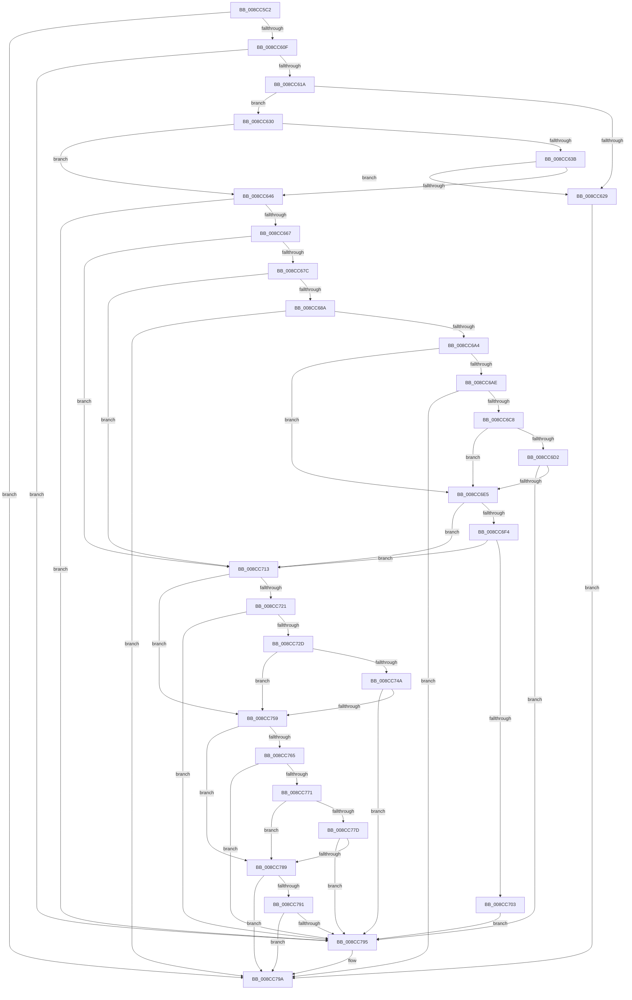

# sub_008CC5C2

- RVA: `0x008CC5C2`–`0x008CC7D4` (길이 `530` bytes)
- VA: `0x00000001408CC5C2`
- 실행 섹션: `PAGE`
- PDB 이름 있음: `아니요`; PDB Function 태그: `아니요`
- unwind 정보 RVA: `0x0008459C`
- 디코드: `128`개 명령, `530/530` bytes 표시
- 미해석 바이트: `0` (있으면 어셈블리에 `.byte`로 보존)

> 이 문서는 커널 이미지의 기계어와 PDB 기호를 분석해 생성했습니다. 4번과 5번은 함수 원형과 자료형을 바이너리 사용 방식에서 추정한 C 해석이며 원본 소스 복구 결과는 아닙니다.

## 1. Dependencies

- 직접 호출 지점: **20**; 고유 호출 대상: **13**
- 직접 호출자로 확인된 함수: **0**
- RIP 상대 이미지 참조: **0**

### Outgoing calls
- `0x008CC5D2` → [SepAcquireOrderedReadLocks](../../text/21/SepAcquireOrderedReadLocks_function_00213BA0.md) (function, `0x00213BA0`)
- `0x008CC5DF` → [SepCopyTokenIntegrity](../../text/41/SepCopyTokenIntegrity_function_00419D10.md) (function, `0x00419D10`)
- `0x008CC5EC` → [SepCopyTokenIntegrity](../../text/41/SepCopyTokenIntegrity_function_00419D10.md) (function, `0x00419D10`)
- `0x008CC600` → [RtlSidDominates](../../text/3F/RtlSidDominates_function_003FBD50.md) (function, `0x003FBD50`)
- `0x008CC620` → [SepIsImpersonationAllowedDueToCapability](../A2/SepIsImpersonationAllowedDueToCapability_function_00A206CC.md) (function, `0x00A206CC`)
- `0x008CC65A` → [RtlEqualSid](../../text/40/RtlEqualSid_function_00400AD0.md) (function, `0x00400AD0`)
- `0x008CC66F` → [RtlQueryElevationFlags](../A6/RtlQueryElevationFlags_function_00A60CB0.md) (function, `0x00A60CB0`)
- `0x008CC695` → [SeTokenIsElevated](../A2/SeTokenIsElevated_function_00A220FC.md) (function, `0x00A220FC`)
- `0x008CC6B9` → [SeTokenIsElevated](../A2/SeTokenIsElevated_function_00A220FC.md) (function, `0x00A220FC`)
- `0x008CC709` → [SepLogUnmatchedSessionFlagImpersonationAttempt](../../text/4D/SepLogUnmatchedSessionFlagImpersonationAttempt_function_004D8574.md) (function, `0x004D8574`)
- `0x008CC741` → [RtlEqualSid](../../text/40/RtlEqualSid_function_00400AD0.md) (function, `0x00400AD0`)
- `0x008CC750` → [RtlIsParentOfChildAppContainer](../70/RtlIsParentOfChildAppContainer_function_007047CC.md) (function, `0x007047CC`)
- `0x008CC75C` → [SeTokenIsRestricted](../../text/43/SeTokenIsRestricted_function_00438CE0.md) (function, `0x00438CE0`)
- `0x008CC768` → [SeTokenIsRestricted](../../text/43/SeTokenIsRestricted_function_00438CE0.md) (function, `0x00438CE0`)
- `0x008CC774` → [SeTokenIsWriteRestricted](../../text/46/SeTokenIsWriteRestricted_function_00463380.md) (function, `0x00463380`)
- `0x008CC780` → [SeTokenIsWriteRestricted](../../text/46/SeTokenIsWriteRestricted_function_00463380.md) (function, `0x00463380`)
- `0x008CC79E` → [ExReleaseResourceLite](../../text/25/ExReleaseResourceLite_function_0025FA10.md) (function, `0x0025FA10`)
- `0x008CC7AC` → [KiLeaveCriticalRegionUnsafe](../../text/25/KiLeaveCriticalRegionUnsafe_function_0025F010.md) (function, `0x0025F010`)
- `0x008CC7B5` → [ExReleaseResourceLite](../../text/25/ExReleaseResourceLite_function_0025FA10.md) (function, `0x0025FA10`)
- `0x008CC7C3` → [KiLeaveCriticalRegionUnsafe](../../text/25/KiLeaveCriticalRegionUnsafe_function_0025F010.md) (function, `0x0025F010`)

### Direct callers
- 이 함수 시작 RVA로 연결되는 직접 call은 확인되지 않았습니다. 간접 호출은 완전히 역산할 수 없습니다.

### Static image references
- 디코드된 RIP-relative 메모리 참조가 없습니다.

## 2. Other-region calls and transfers

- 다른 실행 섹션으로 향하는 call: **15**
  - `0x008CC5D2` → [SepAcquireOrderedReadLocks](../../text/21/SepAcquireOrderedReadLocks_function_00213BA0.md) (`PAGE` → `.text`)
  - `0x008CC5DF` → [SepCopyTokenIntegrity](../../text/41/SepCopyTokenIntegrity_function_00419D10.md) (`PAGE` → `.text`)
  - `0x008CC5EC` → [SepCopyTokenIntegrity](../../text/41/SepCopyTokenIntegrity_function_00419D10.md) (`PAGE` → `.text`)
  - `0x008CC600` → [RtlSidDominates](../../text/3F/RtlSidDominates_function_003FBD50.md) (`PAGE` → `.text`)
  - `0x008CC65A` → [RtlEqualSid](../../text/40/RtlEqualSid_function_00400AD0.md) (`PAGE` → `.text`)
  - `0x008CC709` → [SepLogUnmatchedSessionFlagImpersonationAttempt](../../text/4D/SepLogUnmatchedSessionFlagImpersonationAttempt_function_004D8574.md) (`PAGE` → `.text`)
  - `0x008CC741` → [RtlEqualSid](../../text/40/RtlEqualSid_function_00400AD0.md) (`PAGE` → `.text`)
  - `0x008CC75C` → [SeTokenIsRestricted](../../text/43/SeTokenIsRestricted_function_00438CE0.md) (`PAGE` → `.text`)
  - `0x008CC768` → [SeTokenIsRestricted](../../text/43/SeTokenIsRestricted_function_00438CE0.md) (`PAGE` → `.text`)
  - `0x008CC774` → [SeTokenIsWriteRestricted](../../text/46/SeTokenIsWriteRestricted_function_00463380.md) (`PAGE` → `.text`)
  - `0x008CC780` → [SeTokenIsWriteRestricted](../../text/46/SeTokenIsWriteRestricted_function_00463380.md) (`PAGE` → `.text`)
  - `0x008CC79E` → [ExReleaseResourceLite](../../text/25/ExReleaseResourceLite_function_0025FA10.md) (`PAGE` → `.text`)
  - `0x008CC7AC` → [KiLeaveCriticalRegionUnsafe](../../text/25/KiLeaveCriticalRegionUnsafe_function_0025F010.md) (`PAGE` → `.text`)
  - `0x008CC7B5` → [ExReleaseResourceLite](../../text/25/ExReleaseResourceLite_function_0025FA10.md) (`PAGE` → `.text`)
  - `0x008CC7C3` → [KiLeaveCriticalRegionUnsafe](../../text/25/KiLeaveCriticalRegionUnsafe_function_0025F010.md) (`PAGE` → `.text`)
- 별도 외부 분기/꼬리 이동을 확인하지 못했습니다.

## 3. Assembly (complete function range)

```asm
008CC5C2  48 89 6C 24 48                  mov qword ptr [rsp + 0x48], rbp
008CC5C7  48 8B D6                        mov rdx, rsi
008CC5CA  48 8B CF                        mov rcx, rdi
008CC5CD  4C 89 74 24 40                  mov qword ptr [rsp + 0x40], r14
008CC5D2  E8 C9 75 94 FF                  call 0x140213ba0
008CC5D7  48 8D 54 24 30                  lea rdx, [rsp + 0x30]
008CC5DC  48 8B CF                        mov rcx, rdi
008CC5DF  E8 2C D7 B4 FF                  call 0x140419d10
008CC5E4  48 8B CE                        mov rcx, rsi
008CC5E7  48 8D 54 24 20                  lea rdx, [rsp + 0x20]
008CC5EC  E8 1F D7 B4 FF                  call 0x140419d10
008CC5F1  48 8B 4C 24 30                  mov rcx, qword ptr [rsp + 0x30]
008CC5F6  4C 8D 44 24 78                  lea r8, [rsp + 0x78]
008CC5FB  48 8B 54 24 20                  mov rdx, qword ptr [rsp + 0x20]
008CC600  E8 4B F7 B2 FF                  call 0x1403fbd50
008CC605  8B D8                           mov ebx, eax
008CC607  85 C0                           test eax, eax
008CC609  0F 88 8B 01 00 00               js 0x1408cc79a
008CC60F  80 7C 24 78 00                  cmp byte ptr [rsp + 0x78], 0
008CC614  0F 84 7B 01 00 00               je 0x1408cc795
008CC61A  48 8B D6                        mov rdx, rsi
008CC61D  48 8B CF                        mov rcx, rdi
008CC620  E8 A7 40 15 00                  call 0x140a206cc
008CC625  84 C0                           test al, al
008CC627  74 07                           je 0x1408cc630
008CC629  33 DB                           xor ebx, ebx
008CC62B  E9 6A 01 00 00                  jmp 0x1408cc79a
008CC630  8B 86 E0 00 00 00               mov eax, dword ptr [rsi + 0xe0]
008CC636  39 47 18                        cmp dword ptr [rdi + 0x18], eax
008CC639  75 0B                           jne 0x1408cc646
008CC63B  8B 86 E4 00 00 00               mov eax, dword ptr [rsi + 0xe4]
008CC641  39 47 1C                        cmp dword ptr [rdi + 0x1c], eax
008CC644  74 E3                           je 0x1408cc629
008CC646  48 8B 96 98 00 00 00            mov rdx, qword ptr [rsi + 0x98]
008CC64D  48 8B 8F 98 00 00 00            mov rcx, qword ptr [rdi + 0x98]
008CC654  48 8B 12                        mov rdx, qword ptr [rdx]
008CC657  48 8B 09                        mov rcx, qword ptr [rcx]
008CC65A  E8 71 44 B3 FF                  call 0x140400ad0
008CC65F  84 C0                           test al, al
008CC661  0F 84 2E 01 00 00               je 0x1408cc795
008CC667  48 8D 8C 24 88 00 00 00         lea rcx, [rsp + 0x88]
008CC66F  E8 3C 46 19 00                  call 0x140a60cb0
008CC674  85 C0                           test eax, eax
008CC676  0F 88 97 00 00 00               js 0x1408cc713
008CC67C  F6 84 24 88 00 00 00 01         test byte ptr [rsp + 0x88], 1
008CC684  0F 84 89 00 00 00               je 0x1408cc713
008CC68A  48 8D 94 24 80 00 00 00         lea rdx, [rsp + 0x80]
008CC692  48 8B CE                        mov rcx, rsi
008CC695  E8 62 5A 15 00                  call 0x140a220fc
008CC69A  8B D8                           mov ebx, eax
008CC69C  85 C0                           test eax, eax
008CC69E  0F 88 F6 00 00 00               js 0x1408cc79a
008CC6A4  80 BC 24 80 00 00 00 00         cmp byte ptr [rsp + 0x80], 0
008CC6AC  74 37                           je 0x1408cc6e5
008CC6AE  48 8D 94 24 80 00 00 00         lea rdx, [rsp + 0x80]
008CC6B6  48 8B CF                        mov rcx, rdi
008CC6B9  E8 3E 5A 15 00                  call 0x140a220fc
008CC6BE  8B D8                           mov ebx, eax
008CC6C0  85 C0                           test eax, eax
008CC6C2  0F 88 D2 00 00 00               js 0x1408cc79a
008CC6C8  80 BC 24 80 00 00 00 00         cmp byte ptr [rsp + 0x80], 0
008CC6D0  75 13                           jne 0x1408cc6e5
008CC6D2  48 8B 87 D8 00 00 00            mov rax, qword ptr [rdi + 0xd8]
008CC6D9  8B 48 28                        mov ecx, dword ptr [rax + 0x28]
008CC6DC  F6 C1 04                        test cl, 4
008CC6DF  0F 85 B0 00 00 00               jne 0x1408cc795
008CC6E5  48 8B 87 D8 00 00 00            mov rax, qword ptr [rdi + 0xd8]
008CC6EC  8B 48 28                        mov ecx, dword ptr [rax + 0x28]
008CC6EF  F6 C1 04                        test cl, 4
008CC6F2  74 1F                           je 0x1408cc713
008CC6F4  48 8B 86 D8 00 00 00            mov rax, qword ptr [rsi + 0xd8]
008CC6FB  8B 48 28                        mov ecx, dword ptr [rax + 0x28]
008CC6FE  F6 C1 04                        test cl, 4
008CC701  75 10                           jne 0x1408cc713
008CC703  48 8B D6                        mov rdx, rsi
008CC706  48 8B CF                        mov rcx, rdi
008CC709  E8 66 BE C0 FF                  call 0x1404d8574
008CC70E  E9 82 00 00 00                  jmp 0x1408cc795
008CC713  33 DB                           xor ebx, ebx
008CC715  F7 87 C8 00 00 00 00 40 00 00   test dword ptr [rdi + 0xc8], 0x4000
008CC71F  74 38                           je 0x1408cc759
008CC721  F7 86 C8 00 00 00 00 40 00 00   test dword ptr [rsi + 0xc8], 0x4000
008CC72B  74 68                           je 0x1408cc795
008CC72D  48 8B AE 10 03 00 00            mov rbp, qword ptr [rsi + 0x310]
008CC734  4C 8B B7 10 03 00 00            mov r14, qword ptr [rdi + 0x310]
008CC73B  48 8B D5                        mov rdx, rbp
008CC73E  49 8B CE                        mov rcx, r14
008CC741  E8 8A 43 B3 FF                  call 0x140400ad0
008CC746  84 C0                           test al, al
008CC748  75 0F                           jne 0x1408cc759
008CC74A  48 8B D5                        mov rdx, rbp
008CC74D  49 8B CE                        mov rcx, r14
008CC750  E8 77 80 E3 FF                  call 0x1407047cc
008CC755  84 C0                           test al, al
008CC757  74 3C                           je 0x1408cc795
008CC759  48 8B CF                        mov rcx, rdi
008CC75C  E8 7F C5 B6 FF                  call 0x140438ce0
008CC761  84 C0                           test al, al
008CC763  74 24                           je 0x1408cc789
008CC765  48 8B CE                        mov rcx, rsi
008CC768  E8 73 C5 B6 FF                  call 0x140438ce0
008CC76D  84 C0                           test al, al
008CC76F  74 24                           je 0x1408cc795
008CC771  48 8B CF                        mov rcx, rdi
008CC774  E8 07 6C B9 FF                  call 0x140463380
008CC779  84 C0                           test al, al
008CC77B  75 0C                           jne 0x1408cc789
008CC77D  48 8B CE                        mov rcx, rsi
008CC780  E8 FB 6B B9 FF                  call 0x140463380
008CC785  84 C0                           test al, al
008CC787  75 0C                           jne 0x1408cc795
008CC789  8B 46 78                        mov eax, dword ptr [rsi + 0x78]
008CC78C  39 47 78                        cmp dword ptr [rdi + 0x78], eax
008CC78F  74 09                           je 0x1408cc79a
008CC791  85 C0                           test eax, eax
008CC793  75 05                           jne 0x1408cc79a
008CC795  BB 61 00 00 C0                  mov ebx, 0xc0000061
008CC79A  48 8B 4F 30                     mov rcx, qword ptr [rdi + 0x30]
008CC79E  E8 6D 32 99 FF                  call 0x14025fa10
008CC7A3  65 48 8B 0C 25 88 01 00 00      mov rcx, qword ptr gs:[0x188]
008CC7AC  E8 5F 28 99 FF                  call 0x14025f010
008CC7B1  48 8B 4E 30                     mov rcx, qword ptr [rsi + 0x30]
008CC7B5  E8 56 32 99 FF                  call 0x14025fa10
008CC7BA  65 48 8B 0C 25 88 01 00 00      mov rcx, qword ptr gs:[0x188]
008CC7C3  E8 48 28 99 FF                  call 0x14025f010
008CC7C8  4C 8B 74 24 40                  mov r14, qword ptr [rsp + 0x40]
008CC7CD  8B C3                           mov eax, ebx
008CC7CF  48 8B 6C 24 48                  mov rbp, qword ptr [rsp + 0x48]
```

## 4. C-style interpretation (structured pseudocode)

```c
__int64 __fastcall sub_008CC5C2(__int64 a1, __int64 a2, __int64 a3, __int64 a4, __int64 a5, __int64 a6, __int64 a7, __int64 a8, __int64 a9, __int64 a10, __int64 a11, __int64 a12, __int64 a13, __int64 a14, unsigned __int8 a15, unsigned __int8 a16, unsigned __int8 a17)
{
    __int64 result;
    __int64 v_rbx;
    unsigned __int64 v_stack_p20;
    unsigned __int64 v_stack_p40;
    unsigned __int64 v_stack_p48;

    v_stack_p48 = v_rbp;
    v_stack_p40 = v_r14;
    result = SepAcquireOrderedReadLocks(v_rdi, v_rsi, a3, a4);
    result = SepCopyTokenIntegrity(v_rdi, a6, a3, a4);
    result = SepCopyTokenIntegrity(v_rsi, v_stack_p20, a3, a4);
    result = RtlSidDominates(a6, v_stack_p20, a15, a4);
    if (sign_flag) goto loc_008CC79A;
    if (a15 == 0) goto loc_008CC795;
    result = SepIsImpersonationAllowedDueToCapability(v_rdi, v_rsi, a15, a4);
    if ((unsigned __int8)(result) == 0) goto loc_008CC630;
loc_008CC629:
    v_rbx = 0;
    goto loc_008CC79A;
loc_008CC630:
    if ((*(unsigned int *)(v_rdi + 24)) != ((unsigned int)((unsigned int)(*(unsigned int *)(v_rsi + 224))))) goto loc_008CC646;
    if ((*(unsigned int *)(v_rdi + 28)) == ((unsigned int)((unsigned int)(*(unsigned int *)(v_rsi + 228))))) goto loc_008CC629;
loc_008CC646:
    result = RtlEqualSid(*(unsigned __int64 *)(*(unsigned __int64 *)(v_rdi + 152)), *(unsigned __int64 *)(*(unsigned __int64 *)(v_rsi + 152)), a15, a4);
    if ((unsigned __int8)(result) == 0) goto loc_008CC795;
    result = RtlQueryElevationFlags(a17, *(unsigned __int64 *)(*(unsigned __int64 *)(v_rsi + 152)), a15, a4);
    if (sign_flag) goto loc_008CC713;
    if (((a17) & (1)) == 0) goto loc_008CC713;
    result = SeTokenIsElevated(v_rsi, a16, a15, a4);
    if (sign_flag) goto loc_008CC79A;
    if (a16 == 0) goto loc_008CC6E5;
    result = SeTokenIsElevated(v_rdi, a16, a15, a4);
    if (sign_flag) goto loc_008CC79A;
    if (a16 != 0) goto loc_008CC6E5;
    if ((((unsigned __int8)((unsigned int)(*(unsigned int *)(*(unsigned __int64 *)(v_rdi + 216) + 40)))) & (4)) != 0) goto loc_008CC795;
loc_008CC6E5:
    if ((((unsigned __int8)((unsigned int)(*(unsigned int *)(*(unsigned __int64 *)(v_rdi + 216) + 40)))) & (4)) == 0) goto loc_008CC713;
    if ((((unsigned __int8)((unsigned int)(*(unsigned int *)(*(unsigned __int64 *)(v_rsi + 216) + 40)))) & (4)) != 0) goto loc_008CC713;
    result = SepLogUnmatchedSessionFlagImpersonationAttempt(v_rdi, v_rsi, a15, a4);
    goto loc_008CC795;
loc_008CC713:
    v_rbx = 0;
    if (((*(unsigned int *)(v_rdi + 200)) & (0x4000ULL)) == 0) goto loc_008CC759;
    if (((*(unsigned int *)(v_rsi + 200)) & (0x4000ULL)) == 0) goto loc_008CC795;
    result = RtlEqualSid(*(unsigned __int64 *)(v_rdi + 784), *(unsigned __int64 *)(v_rsi + 784), a15, a4);
    if ((unsigned __int8)(result) != 0) goto loc_008CC759;
    result = RtlIsParentOfChildAppContainer(*(unsigned __int64 *)(v_rdi + 784), *(unsigned __int64 *)(v_rsi + 784), a15, a4);
    if ((unsigned __int8)(result) == 0) goto loc_008CC795;
loc_008CC759:
    result = SeTokenIsRestricted(v_rdi, *(unsigned __int64 *)(v_rsi + 784), a15, a4);
    if ((unsigned __int8)(result) == 0) goto loc_008CC789;
    result = SeTokenIsRestricted(v_rsi, *(unsigned __int64 *)(v_rsi + 784), a15, a4);
    if ((unsigned __int8)(result) == 0) goto loc_008CC795;
    result = SeTokenIsWriteRestricted(v_rdi, *(unsigned __int64 *)(v_rsi + 784), a15, a4);
    if ((unsigned __int8)(result) != 0) goto loc_008CC789;
    result = SeTokenIsWriteRestricted(v_rsi, *(unsigned __int64 *)(v_rsi + 784), a15, a4);
    if ((unsigned __int8)(result) != 0) goto loc_008CC795;
loc_008CC789:
    if ((*(unsigned int *)(v_rdi + 120)) == ((unsigned int)((unsigned int)(*(unsigned int *)(v_rsi + 120))))) goto loc_008CC79A;
    if ((unsigned int)((unsigned int)(*(unsigned int *)(v_rsi + 120))) == 0) {
        v_rbx = 0xC0000061ULL;
    }
    result = ExReleaseResourceLite(*(unsigned __int64 *)(v_rdi + 48), *(unsigned __int64 *)(v_rsi + 784), a15, a4);
    result = KiLeaveCriticalRegionUnsafe(*(unsigned __int64 *)(gs_base + (0 + 392)), *(unsigned __int64 *)(v_rsi + 784), a15, a4);
    result = ExReleaseResourceLite(*(unsigned __int64 *)(v_rsi + 48), *(unsigned __int64 *)(v_rsi + 784), a15, a4);
    result = KiLeaveCriticalRegionUnsafe(*(unsigned __int64 *)(gs_base + (0 + 392)), *(unsigned __int64 *)(v_rsi + 784), a15, a4);
    return (unsigned int)((unsigned int)(v_rbx));
}
```

## 5. (Beta) C Style

```c
int64_t sub_008CC5C2(int64_t Arg1, int64_t Arg2, int64_t Arg3, int64_t Arg4, uint64_t Arg5, int64_t Arg6, uint64_t Arg7, int64_t Arg8, int64_t Arg9, uint64_t Arg10, uint64_t Arg11, uint64_t Arg12, uint64_t Arg13, uint64_t Arg14, uint8_t Arg15, uint8_t Arg16, uint8_t Arg17)
{
    int64_t result;
    int64_t local_rbx;
    uint64_t v_stack_p20;
    uint64_t v_stack_p40;
    uint64_t v_stack_p48;

    v_stack_p48 = local_rbp;
    v_stack_p40 = local_r14;
    result = SepAcquireOrderedReadLocks(local_rdi, local_rsi, Arg3, Arg4);
    result = SepCopyTokenIntegrity(local_rdi, Arg6, Arg3, Arg4);
    result = SepCopyTokenIntegrity(local_rsi, v_stack_p20, Arg3, Arg4);
    result = RtlSidDominates(Arg6, v_stack_p20, Arg15, Arg4);
    if (sign_flag) goto loc_008CC79A;
    if (Arg15 == 0) goto loc_008CC795;
    result = SepIsImpersonationAllowedDueToCapability(local_rdi, local_rsi, Arg15, Arg4);
    if ((uint8_t)(result) == 0) goto loc_008CC630;
loc_008CC629:
    local_rbx = 0;
    goto loc_008CC79A;
loc_008CC630:
    if ((*(uint32_t *)(local_rdi + 0x18)) != ((uint32_t)((uint32_t)(*(uint32_t *)(local_rsi + 0xE0))))) goto loc_008CC646;
    if ((*(uint32_t *)(local_rdi + 0x1C)) == ((uint32_t)((uint32_t)(*(uint32_t *)(local_rsi + 0xE4))))) goto loc_008CC629;
loc_008CC646:
    result = RtlEqualSid(*(uint64_t *)(*(uint64_t *)(local_rdi + 0x98)), *(uint64_t *)(*(uint64_t *)(local_rsi + 0x98)), Arg15, Arg4);
    if ((uint8_t)(result) == 0) goto loc_008CC795;
    result = RtlQueryElevationFlags(Arg17, *(uint64_t *)(*(uint64_t *)(local_rsi + 0x98)), Arg15, Arg4);
    if (sign_flag) goto loc_008CC713;
    if (((Arg17) & (1)) == 0) goto loc_008CC713;
    result = SeTokenIsElevated(local_rsi, Arg16, Arg15, Arg4);
    if (sign_flag) goto loc_008CC79A;
    if (Arg16 == 0) goto loc_008CC6E5;
    result = SeTokenIsElevated(local_rdi, Arg16, Arg15, Arg4);
    if (sign_flag) goto loc_008CC79A;
    if (Arg16 != 0) goto loc_008CC6E5;
    if ((((uint8_t)((uint32_t)(*(uint32_t *)(*(uint64_t *)(local_rdi + 0xD8) + 0x28)))) & (4)) != 0) goto loc_008CC795;
loc_008CC6E5:
    if ((((uint8_t)((uint32_t)(*(uint32_t *)(*(uint64_t *)(local_rdi + 0xD8) + 0x28)))) & (4)) == 0) goto loc_008CC713;
    if ((((uint8_t)((uint32_t)(*(uint32_t *)(*(uint64_t *)(local_rsi + 0xD8) + 0x28)))) & (4)) != 0) goto loc_008CC713;
    result = SepLogUnmatchedSessionFlagImpersonationAttempt(local_rdi, local_rsi, Arg15, Arg4);
    goto loc_008CC795;
loc_008CC713:
    local_rbx = 0;
    if (((*(uint32_t *)(local_rdi + 0xC8)) & (0x4000ULL)) == 0) goto loc_008CC759;
    if (((*(uint32_t *)(local_rsi + 0xC8)) & (0x4000ULL)) == 0) goto loc_008CC795;
    result = RtlEqualSid(*(uint64_t *)(local_rdi + 0x310), *(uint64_t *)(local_rsi + 0x310), Arg15, Arg4);
    if ((uint8_t)(result) != 0) goto loc_008CC759;
    result = RtlIsParentOfChildAppContainer(*(uint64_t *)(local_rdi + 0x310), *(uint64_t *)(local_rsi + 0x310), Arg15, Arg4);
    if ((uint8_t)(result) == 0) goto loc_008CC795;
loc_008CC759:
    result = SeTokenIsRestricted(local_rdi, *(uint64_t *)(local_rsi + 0x310), Arg15, Arg4);
    if ((uint8_t)(result) == 0) goto loc_008CC789;
    result = SeTokenIsRestricted(local_rsi, *(uint64_t *)(local_rsi + 0x310), Arg15, Arg4);
    if ((uint8_t)(result) == 0) goto loc_008CC795;
    result = SeTokenIsWriteRestricted(local_rdi, *(uint64_t *)(local_rsi + 0x310), Arg15, Arg4);
    if ((uint8_t)(result) != 0) goto loc_008CC789;
    result = SeTokenIsWriteRestricted(local_rsi, *(uint64_t *)(local_rsi + 0x310), Arg15, Arg4);
    if ((uint8_t)(result) != 0) goto loc_008CC795;
loc_008CC789:
    if ((*(uint32_t *)(local_rdi + 0x78)) == ((uint32_t)((uint32_t)(*(uint32_t *)(local_rsi + 0x78))))) goto loc_008CC79A;
    if ((uint32_t)((uint32_t)(*(uint32_t *)(local_rsi + 0x78))) == 0) {
        local_rbx = 0xC0000061ULL;
    }
    result = ExReleaseResourceLite(*(uint64_t *)(local_rdi + 0x30), *(uint64_t *)(local_rsi + 0x310), Arg15, Arg4);
    result = KiLeaveCriticalRegionUnsafe(*(uint64_t *)(gs_base + (0 + 0x188)), *(uint64_t *)(local_rsi + 0x310), Arg15, Arg4);
    result = ExReleaseResourceLite(*(uint64_t *)(local_rsi + 0x30), *(uint64_t *)(local_rsi + 0x310), Arg15, Arg4);
    result = KiLeaveCriticalRegionUnsafe(*(uint64_t *)(gs_base + (0 + 0x188)), *(uint64_t *)(local_rsi + 0x310), Arg15, Arg4);
    return (uint32_t)((uint32_t)(local_rbx));
}
```

## 6. Execution-region graph

[열기: 2D/3D 그래프와 함수 탐색 컨트롤 패널](../../../control-panel.html?section=page&rva=0x008CC5C2&view=graph)

- 2D 그래프는 위에서 아래로 흐르고, 3D 그래프는 빈 공간을 드래그해 회전합니다. Shift+드래그는 이동, 휠은 확대·축소, 함수 노드 선택은 대상 보고서 이동입니다.

### Static fallback


