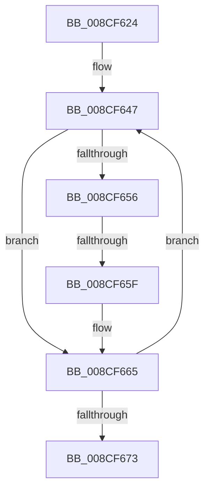

# sub_008CF624

- RVA: `0x008CF624`–`0x008CF681` (길이 `93` bytes)
- VA: `0x00000001408CF624`
- 실행 섹션: `PAGE`
- PDB 이름 있음: `아니요`; PDB Function 태그: `아니요`
- unwind 정보 RVA: `0x00084930`
- 디코드: `27`개 명령, `93/93` bytes 표시
- 미해석 바이트: `0` (있으면 어셈블리에 `.byte`로 보존)

> 이 문서는 커널 이미지의 기계어와 PDB 기호를 분석해 생성했습니다. 4번과 5번은 함수 원형과 자료형을 바이너리 사용 방식에서 추정한 C 해석이며 원본 소스 복구 결과는 아닙니다.

## 1. Dependencies

- 직접 호출 지점: **0**; 고유 호출 대상: **0**
- 직접 호출자로 확인된 함수: **0**
- RIP 상대 이미지 참조: **0**

### Outgoing calls
- 직접 디코드된 call 명령이 없습니다.

### Direct callers
- 이 함수 시작 RVA로 연결되는 직접 call은 확인되지 않았습니다. 간접 호출은 완전히 역산할 수 없습니다.

### Static image references
- 디코드된 RIP-relative 메모리 참조가 없습니다.

## 2. Other-region calls and transfers

- 다른 실행 섹션으로 향하는 call: **0**
- call이 아닌 외부 분기/꼬리 이동: **1**
  - `0x008CF65D` → [sub_008CF6A4](Unknown_function_008CF6A4.md) (`tail-transfer`)

## 3. Assembly (complete function range)

```asm
008CF624  48 89 5C 24 10                  mov qword ptr [rsp + 0x10], rbx
008CF629  41 8D 43 01                     lea eax, [r11 + 1]
008CF62D  48 89 74 24 18                  mov qword ptr [rsp + 0x18], rsi
008CF632  45 8B CB                        mov r9d, r11d
008CF635  41 8B F0                        mov esi, r8d
008CF638  48 89 3C 24                     mov qword ptr [rsp], rdi
008CF63C  0F AF 72 04                     imul esi, dword ptr [rdx + 4]
008CF640  41 8B DB                        mov ebx, r11d
008CF643  48 8B 79 28                     mov rdi, qword ptr [rcx + 0x28]
008CF647  42 8D 14 0E                     lea edx, [rsi + r9]
008CF64B  48 0F A3 17                     bt qword ptr [rdi], rdx
008CF64F  0F 92 C1                        setb cl
008CF652  84 C9                           test cl, cl
008CF654  74 0F                           je 0x1408cf665
008CF656  49 8B 4A 30                     mov rcx, qword ptr [r10 + 0x30]
008CF65A  48 85 C9                        test rcx, rcx
008CF65D  74 45                           je 0x1408cf6a4
008CF65F  8B 14 0B                        mov edx, dword ptr [rbx + rcx]
008CF662  44 0B DA                        or r11d, edx
008CF665  41 FF C1                        inc r9d
008CF668  D1 C0                           rol eax, 1
008CF66A  48 83 C3 04                     add rbx, 4
008CF66E  45 3B C8                        cmp r9d, r8d
008CF671  72 D4                           jb 0x1408cf647
008CF673  48 8B 3C 24                     mov rdi, qword ptr [rsp]
008CF677  48 8B 74 24 18                  mov rsi, qword ptr [rsp + 0x18]
008CF67C  48 8B 5C 24 10                  mov rbx, qword ptr [rsp + 0x10]
```

## 4. C-style interpretation (structured pseudocode)

```c
__int64 __fastcall sub_008CF624(__int64 a1, __int64 a2, int a3)
{
    __int64 v_r11;
    __int64 v_rbx;
    __int64 v_rsi;
    unsigned __int64 v_stack_p0;
    unsigned __int64 v_stack_p10;
    unsigned __int64 v_stack_p18;

    v_stack_p10 = v_rbx;
    v_stack_p18 = v_rsi;
    v_stack_p0 = v_rdi;
    v_rsi = (unsigned int)(((unsigned int)(a3)) * (*(unsigned int *)(a2 + 4)));
loc_008CF647:
    a1 = (condition_is_below) ? 1 : 0;
    if ((unsigned __int8)(a1) == 0) goto loc_008CF665;
    v_r11 = (unsigned int)((v_r11) | ((unsigned int)((unsigned int)(*(unsigned int *)((unsigned int)((unsigned int)(v_r11)) + *(unsigned __int64 *)(v_r10 + 48) * 1)))));
loc_008CF665:
    a4 = (unsigned int)(((unsigned int)((unsigned int)(v_r11))) + 1);
    v_rbx = ((unsigned int)((unsigned int)(v_r11))) + (4);
    if (((unsigned int)(a4)) < a3) goto loc_008CF647;
    return v_r11 + 1;
}
```

## 5. (Beta) C Style

```c
int64_t sub_008CF624(void *Arg1, void *Arg2, void *Arg3)
{
    uint8_t *arg1 = (uint8_t *)Arg1;
    uint8_t *arg2 = (uint8_t *)Arg2;
    uint8_t *arg3 = (uint8_t *)Arg3;

    int64_t local_r11;
    int64_t local_rbx;
    int64_t local_rsi;
    uint64_t v_stack_p0;
    uint64_t v_stack_p10;
    uint64_t v_stack_p18;

    v_stack_p10 = local_rbx;
    v_stack_p18 = local_rsi;
    v_stack_p0 = local_rdi;
    local_rsi = (uint32_t)(((uint32_t)(Arg3)) * (*(uint32_t *)(arg2 + 0x4)));
loc_008CF647:
    Arg1 = (condition_is_below) ? 1 : 0;
    if ((uint8_t)(Arg1) == 0) goto loc_008CF665;
    local_r11 = (uint32_t)((local_r11) | ((uint32_t)((uint32_t)(*(uint32_t *)((uint32_t)((uint32_t)(local_r11)) + *(uint64_t *)(local_r10 + 0x30) * 1)))));
loc_008CF665:
    a4 = (uint32_t)(((uint32_t)((uint32_t)(local_r11))) + 1);
    local_rbx = ((uint32_t)((uint32_t)(local_r11))) + (4);
    if (((uint32_t)(a4)) < Arg3) goto loc_008CF647;
    return local_r11 + 1;
}
```

### 관측된 메모리 오프셋

구조체 형식이 확인되지 않은 접근은 인자 기준의 오프셋으로만 기록했습니다.

| 기준 인자 | 오프셋 표현 | 폭 (bit) | 접근 |
|---|---:|---:|---|
| `Arg1` | `+ 0x28` | `64` | `R` |
| `Arg2` | `+ 0x4` | `32` | `R` |
| `Arg3` | `+ 0x0 + r9*1` | `32` | `R` |

## 6. Execution-region graph

[열기: 2D/3D 그래프와 함수 탐색 컨트롤 패널](../../../control-panel.html?section=page&rva=0x008CF624&view=graph)

- 2D 그래프는 위에서 아래로 흐르고, 3D 그래프는 빈 공간을 드래그해 회전합니다. Shift+드래그는 이동, 휠은 확대·축소, 함수 노드 선택은 대상 보고서 이동입니다.

### Static fallback


