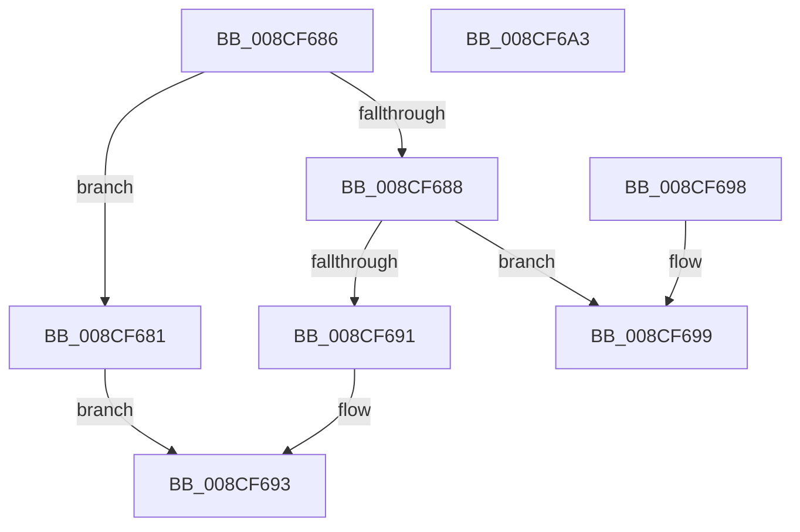

# sub_008CF681

- RVA: `0x008CF681`–`0x008CF6A4` (길이 `35` bytes)
- VA: `0x00000001408CF681`
- 실행 섹션: `PAGE`
- PDB 이름 있음: `아니요`; PDB Function 태그: `아니요`
- unwind 정보 RVA: `0x0008494C`
- 디코드: `14`개 명령, `35/35` bytes 표시
- 미해석 바이트: `0` (있으면 어셈블리에 `.byte`로 보존)

> 이 문서는 커널 이미지의 기계어와 PDB 기호를 분석해 생성했습니다. 4번과 5번은 함수 원형과 자료형을 바이너리 사용 방식에서 추정한 C 해석이며 원본 소스 복구 결과는 아닙니다.

## 1. Dependencies

- 직접 호출 지점: **0**; 고유 호출 대상: **0**
- 직접 호출자로 확인된 함수: **0**
- RIP 상대 이미지 참조: **0**

### Outgoing calls
- 직접 디코드된 call 명령이 없습니다.

### Direct callers
- 이 함수 시작 RVA로 연결되는 직접 call은 확인되지 않았습니다. 간접 호출은 완전히 역산할 수 없습니다.

### Static image references
- 디코드된 RIP-relative 메모리 참조가 없습니다.

## 2. Other-region calls and transfers

- 다른 실행 섹션으로 향하는 call: **0**
- 별도 외부 분기/꼬리 이동을 확인하지 못했습니다.

## 3. Assembly (complete function range)

```asm
008CF681  41 8B C3                        mov eax, r11d
008CF684  EB 0D                           jmp 0x1408cf693
008CF686  75 F9                           jne 0x1408cf681
008CF688  48 8B 41 30                     mov rax, qword ptr [rcx + 0x30]
008CF68C  48 85 C0                        test rax, rax
008CF68F  74 08                           je 0x1408cf699
008CF691  8B 00                           mov eax, dword ptr [rax]
008CF693  48 83 C4 08                     add rsp, 8
008CF697  C3                              ret
008CF698  CC                              int3
008CF699  B8 01 00 00 00                  mov eax, 1
008CF69E  48 83 C4 08                     add rsp, 8
008CF6A2  C3                              ret
008CF6A3  CC                              int3
```

## 4. C-style interpretation (structured pseudocode)

```c
__int64 __fastcall sub_008CF681(__int64 a1)
{
    __int64 v_rsp;

    goto loc_008CF693;
loc_008CF693:
    v_rsp = (v_rsp) + (8);
    return (unsigned int)((unsigned int)(v_r11));
}
```

## 5. (Beta) C Style

```c
int64_t sub_008CF681(int64_t Arg1)
{
    int64_t local_rsp;

    goto loc_008CF693;
loc_008CF693:
    local_rsp = (local_rsp) + (8);
    return (uint32_t)((uint32_t)(local_r11));
}
```

## 6. Execution-region graph

[열기: 2D/3D 그래프와 함수 탐색 컨트롤 패널](../../../control-panel.html?section=page&rva=0x008CF681&view=graph)

- 2D 그래프는 위에서 아래로 흐르고, 3D 그래프는 빈 공간을 드래그해 회전합니다. Shift+드래그는 이동, 휠은 확대·축소, 함수 노드 선택은 대상 보고서 이동입니다.

### Static fallback


