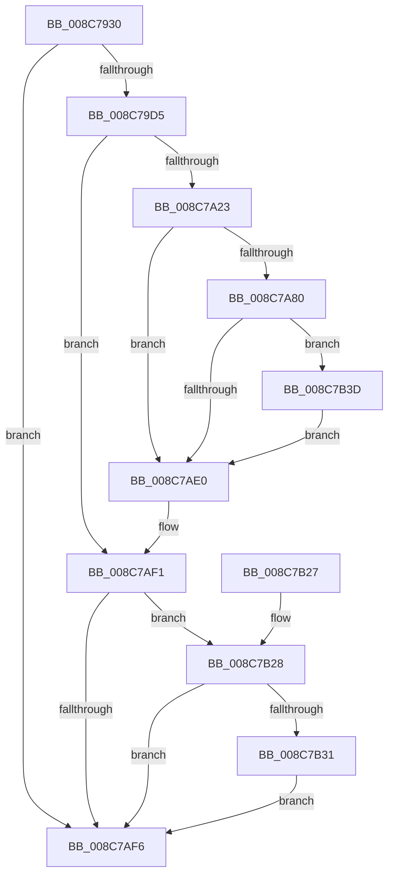

# WmipCreateGuidObject

- RVA: `0x008C7930`–`0x008C7B44` (길이 `532` bytes)
- VA: `0x00000001408C7930`
- 실행 섹션: `PAGE`
- PDB 이름 있음: `예`; PDB Function 태그: `아니요`
- unwind 정보 RVA: `0x00083F54`
- 디코드: `138`개 명령, `532/532` bytes 표시
- 미해석 바이트: `0` (있으면 어셈블리에 `.byte`로 보존)

> 이 문서는 커널 이미지의 기계어와 PDB 기호를 분석해 생성했습니다. 4번과 5번은 함수 원형과 자료형을 바이너리 사용 방식에서 추정한 C 해석이며 원본 소스 복구 결과는 아닙니다.

## 1. Dependencies

- 직접 호출 지점: **12**; 고유 호출 대상: **10**
- 직접 호출자로 확인된 함수: **1**
- RIP 상대 이미지 참조: **6**

### Outgoing calls
- `0x008C798A` → [memset](../../text/6C/memset_function_006C6C40.md) (function, `0x006C6C40`)
- `0x008C799B` → [memset](../../text/6C/memset_function_006C6C40.md) (function, `0x006C6C40`)
- `0x008C79B7` → [RtlInitUnicodeString](../../text/42/RtlInitUnicodeString_function_0042A780.md) (function, `0x0042A780`)
- `0x008C79C6` → [WmipGetGuidSecurityDescriptor](WmipGetGuidSecurityDescriptor_function_008C7B4C.md) (function, `0x008C7B4C`)
- `0x008C7A14` → [SeCreateAccessState](SeCreateAccessState_function_008C6AC0.md) (function, `0x008C6AC0`)
- `0x008C7A75` → [ObCreateObjectEx](../89/ObCreateObjectEx_function_0089B1E0.md) (function, `0x0089B1E0`)
- `0x008C7A8D` → [memset](../../text/6C/memset_function_006C6C40.md) (function, `0x006C6C40`)
- `0x008C7A9A` → [KeInitializeEvent](../../text/40/KeInitializeEvent_function_0040DD10.md) (function, `0x0040DD10`)
- `0x008C7AD5` → [ObInsertObjectEx](../8B/ObInsertObjectEx_function_008B97A0.md) (function, `0x008B97A0`)
- `0x008C7AEC` → [SeDeleteAccessState](SeDeleteAccessState_function_008C5F70.md) (function, `0x008C5F70`)
- `0x008C7B02` → [_security_check_cookie](../../text/6A/_security_check_cookie_function_006AC640.md) (function, `0x006AC640`)
- `0x008C7B36` → [ExFreePoolWithTag](../../poolcode/B8/ExFreePoolWithTag_function_00B82870.md) (function, `0x00B82870`)

### Direct callers
- [WmipOpenGuidObject](../9E/WmipOpenGuidObject_function_009E02EC.md) at `0x009E036B`

### Static image references
- `0x008C7953` → RVA `0x00E0A740` (`.data`; read)
- `0x008C79D8` → RVA `0x00B4B540` (`WmipGenericMapping`; read)
- `0x008C7A2E` → RVA `0x00FDA588` (`PAGEDATA`; read)
- `0x008C7A35` → RVA `0x00FC6D70` (`ALMOSTRO`; read)
- `0x008C7A41` → RVA `0x00FDA598` (`PAGEDATA`; read)
- `0x008C7B28` → RVA `0x00FC6D68` (`ALMOSTRO`; read)

## 2. Other-region calls and transfers

- 다른 실행 섹션으로 향하는 call: **7**
  - `0x008C798A` → [memset](../../text/6C/memset_function_006C6C40.md) (`PAGE` → `.text`)
  - `0x008C799B` → [memset](../../text/6C/memset_function_006C6C40.md) (`PAGE` → `.text`)
  - `0x008C79B7` → [RtlInitUnicodeString](../../text/42/RtlInitUnicodeString_function_0042A780.md) (`PAGE` → `.text`)
  - `0x008C7A8D` → [memset](../../text/6C/memset_function_006C6C40.md) (`PAGE` → `.text`)
  - `0x008C7A9A` → [KeInitializeEvent](../../text/40/KeInitializeEvent_function_0040DD10.md) (`PAGE` → `.text`)
  - `0x008C7B02` → [_security_check_cookie](../../text/6A/_security_check_cookie_function_006AC640.md) (`PAGE` → `.text`)
  - `0x008C7B36` → [ExFreePoolWithTag](../../poolcode/B8/ExFreePoolWithTag_function_00B82870.md) (`PAGE` → `POOLCODE`)
- 별도 외부 분기/꼬리 이동을 확인하지 못했습니다.

## 3. Assembly (complete function range)

```asm
008C7930  48 8B C4                        mov rax, rsp
008C7933  55                              push rbp
008C7934  53                              push rbx
008C7935  56                              push rsi
008C7936  57                              push rdi
008C7937  41 54                           push r12
008C7939  41 56                           push r14
008C793B  41 57                           push r15
008C793D  48 8D A8 78 FE FF FF            lea rbp, [rax - 0x188]
008C7944  48 81 EC 50 02 00 00            sub rsp, 0x250
008C794B  0F 29 70 B8                     movaps xmmword ptr [rax - 0x48], xmm6
008C794F  0F 29 78 A8                     movaps xmmword ptr [rax - 0x58], xmm7
008C7953  48 8B 05 E6 2D 54 00            mov rax, qword ptr [rip + 0x542de6]
008C795A  48 33 C4                        xor rax, rsp
008C795D  48 89 85 20 01 00 00            mov qword ptr [rbp + 0x120], rax
008C7964  48 83 64 24 50 00               and qword ptr [rsp + 0x50], 0
008C796A  4D 8B E0                        mov r12, r8
008C796D  44 8B F2                        mov r14d, edx
008C7970  48 8B F9                        mov rdi, rcx
008C7973  0F 57 C0                        xorps xmm0, xmm0
008C7976  48 8D 4D A0                     lea rcx, [rbp - 0x60]
008C797A  33 D2                           xor edx, edx
008C797C  41 B8 A0 00 00 00               mov r8d, 0xa0
008C7982  0F 11 44 24 60                  movups xmmword ptr [rsp + 0x60], xmm0
008C7987  4D 8B F9                        mov r15, r9
008C798A  E8 B1 F2 DF FF                  call 0x1406c6c40
008C798F  33 D2                           xor edx, edx
008C7991  48 8D 4D 40                     lea rcx, [rbp + 0x40]
008C7995  41 B8 E0 00 00 00               mov r8d, 0xe0
008C799B  E8 A0 F2 DF FF                  call 0x1406c6c40
008C79A0  48 8B 47 10                     mov rax, qword ptr [rdi + 0x10]
008C79A4  48 8D 4C 24 60                  lea rcx, [rsp + 0x60]
008C79A9  48 83 64 24 58 00               and qword ptr [rsp + 0x58], 0
008C79AF  48 8B 50 08                     mov rdx, qword ptr [rax + 8]
008C79B3  48 83 C2 12                     add rdx, 0x12
008C79B7  E8 C4 2D B6 FF                  call 0x14042a780
008C79BC  48 8D 54 24 50                  lea rdx, [rsp + 0x50]
008C79C1  48 8D 4C 24 60                  lea rcx, [rsp + 0x60]
008C79C6  E8 81 01 00 00                  call 0x1408c7b4c
008C79CB  8B D8                           mov ebx, eax
008C79CD  85 C0                           test eax, eax
008C79CF  0F 88 21 01 00 00               js 0x1408c7af6
008C79D5  0F 10 07                        movups xmm0, xmmword ptr [rdi]
008C79D8  4C 8D 0D 61 3B 28 00            lea r9, [rip + 0x283b61]
008C79DF  45 8B C6                        mov r8d, r14d
008C79E2  0F 10 4F 10                     movups xmm1, xmmword ptr [rdi + 0x10]
008C79E6  48 8D 55 40                     lea rdx, [rbp + 0x40]
008C79EA  0F 11 44 24 70                  movups xmmword ptr [rsp + 0x70], xmm0
008C79EF  48 8D 4D A0                     lea rcx, [rbp - 0x60]
008C79F3  0F 10 47 20                     movups xmm0, xmmword ptr [rdi + 0x20]
008C79F7  48 8B 7C 24 50                  mov rdi, qword ptr [rsp + 0x50]
008C79FC  0F 11 4D 80                     movups xmmword ptr [rbp - 0x80], xmm1
008C7A00  48 83 65 80 00                  and qword ptr [rbp - 0x80], 0
008C7A05  0F 11 45 90                     movups xmmword ptr [rbp - 0x70], xmm0
008C7A09  48 89 7D 90                     mov qword ptr [rbp - 0x70], rdi
008C7A0D  C7 45 88 80 02 00 00            mov dword ptr [rbp - 0x78], 0x280
008C7A14  E8 A7 F0 FF FF                  call 0x1408c6ac0
008C7A19  8B D8                           mov ebx, eax
008C7A1B  85 C0                           test eax, eax
008C7A1D  0F 88 CE 00 00 00               js 0x1408c7af1
008C7A23  48 83 64 24 48 00               and qword ptr [rsp + 0x48], 0
008C7A29  48 8D 44 24 58                  lea rax, [rsp + 0x58]
008C7A2E  0F 10 05 53 2B 71 00            movups xmm0, xmmword ptr [rip + 0x712b53]
008C7A35  48 8B 15 34 F3 6F 00            mov rdx, qword ptr [rip + 0x6ff334]
008C7A3C  BE A8 00 00 00                  mov esi, 0xa8
008C7A41  0F 10 0D 50 2B 71 00            movups xmm1, xmmword ptr [rip + 0x712b50]
008C7A48  4C 8D 44 24 70                  lea r8, [rsp + 0x70]
008C7A4D  48 89 44 24 40                  mov qword ptr [rsp + 0x40], rax
008C7A52  0F 28 75 C0                     movaps xmm6, xmmword ptr [rbp - 0x40]
008C7A56  45 33 C9                        xor r9d, r9d
008C7A59  83 64 24 38 00                  and dword ptr [rsp + 0x38], 0
008C7A5E  33 C9                           xor ecx, ecx
008C7A60  0F 28 7D D0                     movaps xmm7, xmmword ptr [rbp - 0x30]
008C7A64  83 64 24 30 00                  and dword ptr [rsp + 0x30], 0
008C7A69  89 74 24 28                     mov dword ptr [rsp + 0x28], esi
008C7A6D  0F 29 45 C0                     movaps xmmword ptr [rbp - 0x40], xmm0
008C7A71  0F 29 4D D0                     movaps xmmword ptr [rbp - 0x30], xmm1
008C7A75  E8 66 37 FD FF                  call 0x14089b1e0
008C7A7A  8B D8                           mov ebx, eax
008C7A7C  85 C0                           test eax, eax
008C7A7E  78 60                           js 0x1408c7ae0
008C7A80  44 8B C6                        mov r8d, esi
008C7A83  33 D2                           xor edx, edx
008C7A85  48 8B 74 24 58                  mov rsi, qword ptr [rsp + 0x58]
008C7A8A  48 8B CE                        mov rcx, rsi
008C7A8D  E8 AE F1 DF FF                  call 0x1406c6c40
008C7A92  45 33 C0                        xor r8d, r8d
008C7A95  33 D2                           xor edx, edx
008C7A97  48 8B CE                        mov rcx, rsi
008C7A9A  E8 71 62 B4 FF                  call 0x14040dd10
008C7A9F  48 83 64 24 30 00               and qword ptr [rsp + 0x30], 0
008C7AA5  48 8D 55 A0                     lea rdx, [rbp - 0x60]
008C7AA9  48 83 64 24 28 00               and qword ptr [rsp + 0x28], 0
008C7AAF  B8 00 10 00 00                  mov eax, 0x1000
008C7AB4  83 64 24 20 00                  and dword ptr [rsp + 0x20], 0
008C7AB9  45 33 C9                        xor r9d, r9d
008C7ABC  89 46 70                        mov dword ptr [rsi + 0x70], eax
008C7ABF  45 8B C6                        mov r8d, r14d
008C7AC2  89 86 90 00 00 00               mov dword ptr [rsi + 0x90], eax
008C7AC8  48 8B CE                        mov rcx, rsi
008C7ACB  41 0F 10 04 24                  movups xmm0, xmmword ptr [r12]
008C7AD0  F3 0F 7F 46 18                  movdqu xmmword ptr [rsi + 0x18], xmm0
008C7AD5  E8 C6 1C FF FF                  call 0x1408b97a0
008C7ADA  8B D8                           mov ebx, eax
008C7ADC  85 C0                           test eax, eax
008C7ADE  79 5D                           jns 0x1408c7b3d
008C7AE0  48 8D 4D A0                     lea rcx, [rbp - 0x60]
008C7AE4  0F 29 75 C0                     movaps xmmword ptr [rbp - 0x40], xmm6
008C7AE8  0F 29 7D D0                     movaps xmmword ptr [rbp - 0x30], xmm7
008C7AEC  E8 7F E4 FF FF                  call 0x1408c5f70
008C7AF1  48 85 FF                        test rdi, rdi
008C7AF4  75 32                           jne 0x1408c7b28
008C7AF6  8B C3                           mov eax, ebx
008C7AF8  48 8B 8D 20 01 00 00            mov rcx, qword ptr [rbp + 0x120]
008C7AFF  48 33 CC                        xor rcx, rsp
008C7B02  E8 39 4B DE FF                  call 0x1406ac640
008C7B07  4C 8D 9C 24 50 02 00 00         lea r11, [rsp + 0x250]
008C7B0F  41 0F 28 73 F0                  movaps xmm6, xmmword ptr [r11 - 0x10]
008C7B14  41 0F 28 7B E0                  movaps xmm7, xmmword ptr [r11 - 0x20]
008C7B19  49 8B E3                        mov rsp, r11
008C7B1C  41 5F                           pop r15
008C7B1E  41 5E                           pop r14
008C7B20  41 5C                           pop r12
008C7B22  5F                              pop rdi
008C7B23  5E                              pop rsi
008C7B24  5B                              pop rbx
008C7B25  5D                              pop rbp
008C7B26  C3                              ret
008C7B27  CC                              int3
008C7B28  48 3B 3D 39 F2 6F 00            cmp rdi, qword ptr [rip + 0x6ff239]
008C7B2F  74 C5                           je 0x1408c7af6
008C7B31  33 D2                           xor edx, edx
008C7B33  48 8B CF                        mov rcx, rdi
008C7B36  E8 35 AD 2B 00                  call 0x140b82870
008C7B3B  EB B9                           jmp 0x1408c7af6
008C7B3D  49 89 37                        mov qword ptr [r15], rsi
008C7B40  33 DB                           xor ebx, ebx
008C7B42  EB 9C                           jmp 0x1408c7ae0
```

## 4. C-style interpretation (structured pseudocode)

```c
__int64 __fastcall WmipCreateGuidObject(__int64 a1, int a2, __int64 a3, __int64 a4)
{
    __int64 result;
    __int64 v_rbx;
    __int64 v_rsp;
    unsigned __int64 v_stack_m218;
    unsigned __int64 v_stack_m228;
    unsigned __int64 v_stack_m230;
    unsigned __int64 v_stack_m238;
    unsigned __int64 v_stack_m240;
    unsigned __int64 v_stack_m248;
    unsigned int v_stack_m250;
    unsigned int v_stack_m258;
    unsigned int v_stack_m260;
    unsigned int v_stack_m268;
    unsigned __int64 v_stack_m38;

    v_rsp = (v_rsp) - (592);
    *(unsigned __int64 *)(v_rsp - 72) = v_xmm6;
    *(unsigned __int64 *)(v_rsp - 88) = v_xmm7;
    result = (*(unsigned __int64 *)(v_rip + 5516774)) ^ (v_rsp);
    *(unsigned __int64 *)(v_rsp - 392 + 288) = result;
    a2 = 0;
    v_stack_m228 = v_xmm0;
    result = memset(v_rsp - 392 - 96, a2, 160, a4);
    a2 = 0;
    result = memset(v_rsp - 392 + 64, a2, 224, a4);
    a2 = (*(unsigned __int64 *)(*(unsigned __int64 *)(a1 + 16) + 8)) + (18);
    result = RtlInitUnicodeString(v_stack_m228, a2, 224, a4);
    result = WmipGetGuidSecurityDescriptor(v_stack_m228, v_stack_m238, 224, a4);
    if (sign_flag) goto loc_008C7AF6;
    v_stack_m218 = v_xmm0;
    *(unsigned __int64 *)(v_rsp - 392 - 128) = v_xmm1;
    *(unsigned __int64 *)(v_rsp - 392 - 112) = v_xmm0;
    *(unsigned __int64 *)(v_rsp - 392 - 112) = v_stack_m238;
    *(unsigned int *)(v_rsp - 392 - 120) = 640;
    result = SeCreateAccessState(v_rsp - 392 - 96, v_rsp - 392 + 64, (unsigned int)((unsigned int)((unsigned int)(a2))), v_rip + 2636641);
    if (sign_flag) goto loc_008C7AF1;
    v_stack_m248 = v_stack_m230;
    a4 = 0;
    a1 = 0;
    v_stack_m260 = 168;
    *(unsigned __int64 *)(v_rsp - 392 - 64) = v_xmm0;
    *(unsigned __int64 *)(v_rsp - 392 - 48) = v_xmm1;
    result = ObCreateObjectEx(a1, *(unsigned __int64 *)(v_rip + 7336756), v_stack_m218, a4);
    if (sign_flag) goto loc_008C7AE0;
    a2 = 0;
    result = memset(v_stack_m230, a2, 168, a4);
    a3 = 0;
    a2 = 0;
    result = KeInitializeEvent(v_stack_m230, a2, a3, a4);
    a4 = 0;
    *(unsigned int *)(v_stack_m230 + 112) = (unsigned int)((unsigned int)(0x1000ULL));
    *(unsigned int *)(v_stack_m230 + 144) = (unsigned int)((unsigned int)(0x1000ULL));
    *(unsigned __int64 *)(v_stack_m230 + 24) = v_xmm0;
    result = ObInsertObjectEx(v_stack_m230, v_rsp - 392 - 96, (unsigned int)((unsigned int)((unsigned int)(a2))), a4);
    if (!sign_flag) goto loc_008C7B3D;
loc_008C7AE0:
    *(unsigned __int64 *)(v_rsp - 392 - 64) = v_xmm6;
    *(unsigned __int64 *)(v_rsp - 392 - 48) = v_xmm7;
    result = SeDeleteAccessState(v_rsp - 392 - 96, v_rsp - 392 - 96, (unsigned int)((unsigned int)((unsigned int)(a2))), a4);
loc_008C7AF1:
    if (v_stack_m238 != 0) goto loc_008C7B28;
loc_008C7AF6:
    a1 = (*(unsigned __int64 *)(v_rsp - 392 + 288)) ^ (v_rsp);
    result = _security_check_cookie(a1, v_rsp - 392 - 96, (unsigned int)((unsigned int)((unsigned int)(a2))), a4);
    return result;
loc_008C7B28:
    if (v_stack_m238 == (*(unsigned __int64 *)(v_rip + 7336505))) goto loc_008C7AF6;
    a2 = 0;
    result = ExFreePoolWithTag(v_stack_m238, a2, (unsigned int)((unsigned int)((unsigned int)(a2))), a4);
    goto loc_008C7AF6;
loc_008C7B3D:
    *(unsigned __int64 *)(a4) = v_stack_m230;
    v_rbx = 0;
    goto loc_008C7AE0;
}
```

## 5. (Beta) C Style

```c
int64_t WmipCreateGuidObject(void *Arg1, int32_t Arg2, void *Arg3, void *Arg4)
{
    uint8_t *arg1 = (uint8_t *)Arg1;
    uint8_t *arg3 = (uint8_t *)Arg3;
    uint8_t *arg4 = (uint8_t *)Arg4;

    int64_t result;
    int64_t local_rbx;
    int64_t local_rsp;
    uint64_t v_stack_m218;
    uint64_t v_stack_m228;
    uint64_t v_stack_m230;
    uint64_t v_stack_m238;
    uint64_t v_stack_m240;
    uint64_t v_stack_m248;
    uint32_t v_stack_m250;
    uint32_t v_stack_m258;
    uint32_t v_stack_m260;
    uint32_t v_stack_m268;
    uint64_t v_stack_m38;

    local_rsp = (local_rsp) - (592);
    *(uint64_t *)(local_rsp - 0x48) = v_xmm6;
    *(uint64_t *)(local_rsp - 0x58) = v_xmm7;
    result = (*(uint64_t *)(v_rip + 0x542DE6)) ^ (local_rsp);
    *(uint64_t *)(local_rsp - 0x188 + 0x120) = result;
    Arg2 = 0;
    v_stack_m228 = v_xmm0;
    result = memset(local_rsp - 392 - 96, Arg2, 160, Arg4);
    Arg2 = 0;
    result = memset(local_rsp - 392 + 64, Arg2, 224, Arg4);
    Arg2 = (*(uint64_t *)(*(uint64_t *)(arg1 + 0x10) + 0x8)) + (18);
    result = RtlInitUnicodeString(v_stack_m228, Arg2, 224, Arg4);
    result = WmipGetGuidSecurityDescriptor(v_stack_m228, v_stack_m238, 224, Arg4);
    if (sign_flag) goto loc_008C7AF6;
    v_stack_m218 = v_xmm0;
    *(uint64_t *)(local_rsp - 0x188 - 0x80) = v_xmm1;
    *(uint64_t *)(local_rsp - 0x188 - 0x70) = v_xmm0;
    *(uint64_t *)(local_rsp - 0x188 - 0x70) = v_stack_m238;
    *(uint32_t *)(local_rsp - 0x188 - 0x78) = 640;
    result = SeCreateAccessState(local_rsp - 392 - 96, local_rsp - 392 + 64, (uint32_t)((uint32_t)((uint32_t)(Arg2))), v_rip + 2636641);
    if (sign_flag) goto loc_008C7AF1;
    v_stack_m248 = v_stack_m230;
    Arg4 = 0;
    Arg1 = 0;
    v_stack_m260 = 168;
    *(uint64_t *)(local_rsp - 0x188 - 0x40) = v_xmm0;
    *(uint64_t *)(local_rsp - 0x188 - 0x30) = v_xmm1;
    result = ObCreateObjectEx(Arg1, *(uint64_t *)(v_rip + 0x6FF334), v_stack_m218, Arg4);
    if (sign_flag) goto loc_008C7AE0;
    Arg2 = 0;
    result = memset(v_stack_m230, Arg2, 168, Arg4);
    Arg3 = 0;
    Arg2 = 0;
    result = KeInitializeEvent(v_stack_m230, Arg2, Arg3, Arg4);
    Arg4 = 0;
    *(uint32_t *)(v_stack_m230 + 0x70) = (uint32_t)((uint32_t)(0x1000ULL));
    *(uint32_t *)(v_stack_m230 + 0x90) = (uint32_t)((uint32_t)(0x1000ULL));
    *(uint64_t *)(v_stack_m230 + 0x18) = v_xmm0;
    result = ObInsertObjectEx(v_stack_m230, local_rsp - 392 - 96, (uint32_t)((uint32_t)((uint32_t)(Arg2))), Arg4);
    if (!sign_flag) goto loc_008C7B3D;
loc_008C7AE0:
    *(uint64_t *)(local_rsp - 0x188 - 0x40) = v_xmm6;
    *(uint64_t *)(local_rsp - 0x188 - 0x30) = v_xmm7;
    result = SeDeleteAccessState(local_rsp - 392 - 96, local_rsp - 392 - 96, (uint32_t)((uint32_t)((uint32_t)(Arg2))), Arg4);
loc_008C7AF1:
    if (v_stack_m238 != 0) goto loc_008C7B28;
loc_008C7AF6:
    Arg1 = (*(uint64_t *)(local_rsp - 0x188 + 0x120)) ^ (local_rsp);
    result = _security_check_cookie(Arg1, local_rsp - 392 - 96, (uint32_t)((uint32_t)((uint32_t)(Arg2))), Arg4);
    return result;
loc_008C7B28:
    if (v_stack_m238 == (*(uint64_t *)(v_rip + 0x6FF239))) goto loc_008C7AF6;
    Arg2 = 0;
    result = ExFreePoolWithTag(v_stack_m238, Arg2, (uint32_t)((uint32_t)((uint32_t)(Arg2))), Arg4);
    goto loc_008C7AF6;
loc_008C7B3D:
    *(uint64_t *)(arg4) = v_stack_m230;
    local_rbx = 0;
    goto loc_008C7AE0;
}
```

### 관측된 메모리 오프셋

구조체 형식이 확인되지 않은 접근은 인자 기준의 오프셋으로만 기록했습니다.

| 기준 인자 | 오프셋 표현 | 폭 (bit) | 접근 |
|---|---:|---:|---|
| `Arg1` | `+ 0x0` | `128` | `R` |
| `Arg1` | `+ 0x10` | `64` | `R` |
| `Arg1` | `+ 0x10` | `128` | `R` |
| `Arg1` | `+ 0x20` | `128` | `R` |
| `Arg3` | `+ 0x0` | `128` | `R` |
| `Arg4` | `+ 0x0` | `64` | `W` |

## 6. Execution-region graph

[열기: 2D/3D 그래프와 함수 탐색 컨트롤 패널](../../../control-panel.html?section=page&rva=0x008C7930&view=graph)

- 2D 그래프는 위에서 아래로 흐르고, 3D 그래프는 빈 공간을 드래그해 회전합니다. Shift+드래그는 이동, 휠은 확대·축소, 함수 노드 선택은 대상 보고서 이동입니다.

### Static fallback


