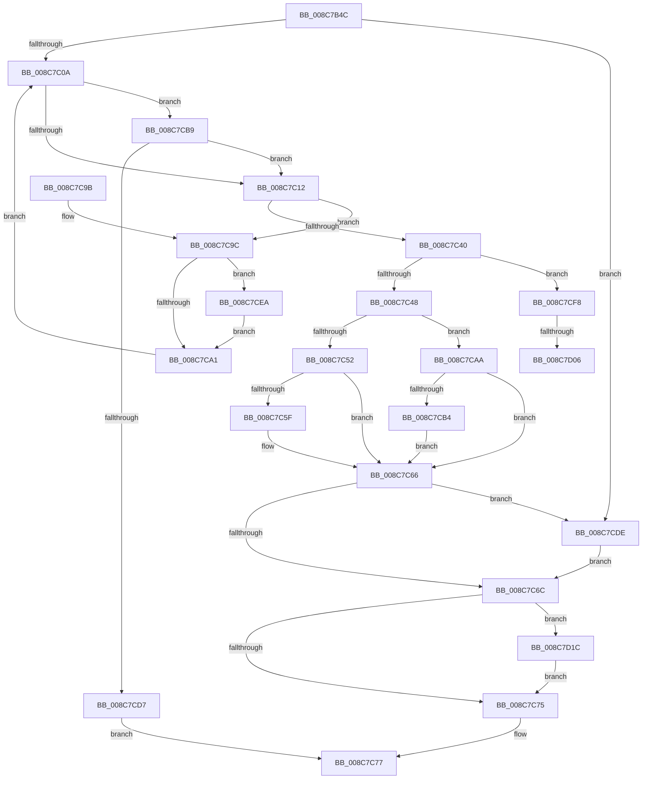

# WmipGetGuidSecurityDescriptor

- RVA: `0x008C7B4C`–`0x008C7D2B` (길이 `479` bytes)
- VA: `0x00000001408C7B4C`
- 실행 섹션: `PAGE`
- PDB 이름 있음: `예`; PDB Function 태그: `예`
- unwind 정보 RVA: `0x00083F80`
- 디코드: `124`개 명령, `479/479` bytes 표시
- 미해석 바이트: `0` (있으면 어셈블리에 `.byte`로 보존)

> 이 문서는 커널 이미지의 기계어와 PDB 기호를 분석해 생성했습니다. 4번과 5번은 함수 원형과 자료형을 바이너리 사용 방식에서 추정한 C 해석이며 원본 소스 복구 결과는 아닙니다.

## 1. Dependencies

- 직접 호출 지점: **9**; 고유 호출 대상: **7**
- 직접 호출자로 확인된 함수: **1**
- RIP 상대 이미지 참조: **6**

### Outgoing calls
- `0x008C7B9B` → [memset](../../text/6C/memset_function_006C6C40.md) (function, `0x006C6C40`)
- `0x008C7BFA` → [RtlpQueryRegistryValues](RtlpQueryRegistryValues_function_008C9050.md) (function, `0x008C9050`)
- `0x008C7C34` → [RtlGetPersistedStateLocation](RtlGetPersistedStateLocation_function_008C8DE0.md) (function, `0x008C8DE0`)
- `0x008C7C61` → [ExFreePoolWithTag](../../poolcode/B8/ExFreePoolWithTag_function_00B82870.md) (function, `0x00B82870`)
- `0x008C7C7E` → [_security_check_cookie](../../text/6A/_security_check_cookie_function_006AC640.md) (function, `0x006AC640`)
- `0x008C7CC6` → [ExAllocatePool2](../../poolcode/B8/ExAllocatePool2_function_00B820F0.md) (function, `0x00B820F0`)
- `0x008C7CEF` → [ExFreePoolWithTag](../../poolcode/B8/ExFreePoolWithTag_function_00B82870.md) (function, `0x00B82870`)
- `0x008C7D0F` → [RtlLengthSecurityDescriptor](../8B/RtlLengthSecurityDescriptor_function_008BC870.md) (function, `0x008BC870`)
- `0x008C7D21` → [ExFreePoolWithTag](../../poolcode/B8/ExFreePoolWithTag_function_00B82870.md) (function, `0x00B82870`)

### Direct callers
- [WmipCreateGuidObject](WmipCreateGuidObject_function_008C7930.md) at `0x008C79C6`

### Static image references
- `0x008C7B66` → RVA `0x00E0A740` (`.data`; read)
- `0x008C7BA3` → RVA `0x008BECE0` (`WmipSDRegistryQueryRoutine`; read)
- `0x008C7BD9` → RVA `0x00B07000` (` ?? ::NNGAKEGL::`string'`; read)
- `0x008C7BEA` → RVA `0x00B07050` (` ?? ::NNGAKEGL::`string'`; read)
- `0x008C7C1F` → RVA `0x00B06FE0` (` ?? ::NNGAKEGL::`string'`; read)
- `0x008C7CDE` → RVA `0x00FC6D68` (`ALMOSTRO`; read)

## 2. Other-region calls and transfers

- 다른 실행 섹션으로 향하는 call: **6**
  - `0x008C7B9B` → [memset](../../text/6C/memset_function_006C6C40.md) (`PAGE` → `.text`)
  - `0x008C7C61` → [ExFreePoolWithTag](../../poolcode/B8/ExFreePoolWithTag_function_00B82870.md) (`PAGE` → `POOLCODE`)
  - `0x008C7C7E` → [_security_check_cookie](../../text/6A/_security_check_cookie_function_006AC640.md) (`PAGE` → `.text`)
  - `0x008C7CC6` → [ExAllocatePool2](../../poolcode/B8/ExAllocatePool2_function_00B820F0.md) (`PAGE` → `POOLCODE`)
  - `0x008C7CEF` → [ExFreePoolWithTag](../../poolcode/B8/ExFreePoolWithTag_function_00B82870.md) (`PAGE` → `POOLCODE`)
  - `0x008C7D21` → [ExFreePoolWithTag](../../poolcode/B8/ExFreePoolWithTag_function_00B82870.md) (`PAGE` → `POOLCODE`)
- call이 아닌 외부 분기/꼬리 이동: **2**
  - `0x008C7D00` → [sub_00B1B086](../B1/Unknown_function_00B1B086.md) (`tail-transfer`)
  - `0x008C7D17` → [sub_00B1B086](../B1/Unknown_function_00B1B086.md) (`tail-transfer`)

## 3. Assembly (complete function range)

```asm
008C7B4C  48 89 5C 24 08                  mov qword ptr [rsp + 8], rbx
008C7B51  48 89 74 24 18                  mov qword ptr [rsp + 0x18], rsi
008C7B56  55                              push rbp
008C7B57  57                              push rdi
008C7B58  41 56                           push r14
008C7B5A  48 8D 6C 24 E0                  lea rbp, [rsp - 0x20]
008C7B5F  48 81 EC 20 01 00 00            sub rsp, 0x120
008C7B66  48 8B 05 D3 2B 54 00            mov rax, qword ptr [rip + 0x542bd3]
008C7B6D  48 33 C4                        xor rax, rsp
008C7B70  48 89 45 10                     mov qword ptr [rbp + 0x10], rax
008C7B74  48 83 64 24 50 00               and qword ptr [rsp + 0x50], 0
008C7B7A  4C 8B F2                        mov r14, rdx
008C7B7D  48 83 64 24 48 00               and qword ptr [rsp + 0x48], 0
008C7B83  48 8B D9                        mov rbx, rcx
008C7B86  33 F6                           xor esi, esi
008C7B88  48 8D 4C 24 60                  lea rcx, [rsp + 0x60]
008C7B8D  33 D2                           xor edx, edx
008C7B8F  89 74 24 40                     mov dword ptr [rsp + 0x40], esi
008C7B93  41 B8 A8 00 00 00               mov r8d, 0xa8
008C7B99  33 FF                           xor edi, edi
008C7B9B  E8 A0 F0 DF FF                  call 0x1406c6c40
008C7BA0  21 75 A0                        and dword ptr [rbp - 0x60], esi
008C7BA3  48 8D 0D 36 71 FF FF            lea rcx, [rip - 0x8eca]
008C7BAA  8D 57 03                        lea edx, [rdi + 3]
008C7BAD  48 89 4C 24 60                  mov qword ptr [rsp + 0x60], rcx
008C7BB2  48 8D 44 24 50                  lea rax, [rsp + 0x50]
008C7BB7  89 55 80                        mov dword ptr [rbp - 0x80], edx
008C7BBA  48 89 44 24 78                  mov qword ptr [rsp + 0x78], rax
008C7BBF  4C 8D 44 24 60                  lea r8, [rsp + 0x60]
008C7BC4  48 8B 43 08                     mov rax, qword ptr [rbx + 8]
008C7BC8  45 33 C9                        xor r9d, r9d
008C7BCB  48 89 44 24 70                  mov qword ptr [rsp + 0x70], rax
008C7BD0  48 8D 44 24 48                  lea rax, [rsp + 0x48]
008C7BD5  48 89 45 B0                     mov qword ptr [rbp - 0x50], rax
008C7BD9  48 8D 05 20 F4 23 00            lea rax, [rip + 0x23f420]
008C7BE0  48 89 4D 98                     mov qword ptr [rbp - 0x68], rcx
008C7BE4  8D 4F 02                        lea ecx, [rdi + 2]
008C7BE7  89 55 B8                        mov dword ptr [rbp - 0x48], edx
008C7BEA  48 8D 15 5F F4 23 00            lea rdx, [rip + 0x23f45f]
008C7BF1  48 89 45 A8                     mov qword ptr [rbp - 0x58], rax
008C7BF5  C6 44 24 28 01                  mov byte ptr [rsp + 0x28], 1
008C7BFA  E8 51 14 00 00                  call 0x1408c9050
008C7BFF  49 21 36                        and qword ptr [r14], rsi
008C7C02  85 C0                           test eax, eax
008C7C04  0F 88 D4 00 00 00               js 0x1408c7cde
008C7C0A  85 F6                           test esi, esi
008C7C0C  0F 85 A7 00 00 00               jne 0x1408c7cb9
008C7C12  48 8D 44 24 40                  lea rax, [rsp + 0x40]
008C7C17  45 33 C9                        xor r9d, r9d
008C7C1A  48 89 44 24 30                  mov qword ptr [rsp + 0x30], rax
008C7C1F  48 8D 0D BA F3 23 00            lea rcx, [rip + 0x23f3ba]
008C7C26  89 74 24 28                     mov dword ptr [rsp + 0x28], esi
008C7C2A  45 33 C0                        xor r8d, r8d
008C7C2D  33 D2                           xor edx, edx
008C7C2F  48 89 7C 24 20                  mov qword ptr [rsp + 0x20], rdi
008C7C34  E8 A7 11 00 00                  call 0x1408c8de0
008C7C39  3D 05 00 00 80                  cmp eax, 0x80000005
008C7C3E  74 5C                           je 0x1408c7c9c
008C7C40  85 C0                           test eax, eax
008C7C42  0F 84 B0 00 00 00               je 0x1408c7cf8
008C7C48  48 8B 44 24 50                  mov rax, qword ptr [rsp + 0x50]
008C7C4D  48 85 C0                        test rax, rax
008C7C50  74 58                           je 0x1408c7caa
008C7C52  48 8B 4C 24 48                  mov rcx, qword ptr [rsp + 0x48]
008C7C57  49 89 06                        mov qword ptr [r14], rax
008C7C5A  48 85 C9                        test rcx, rcx
008C7C5D  74 07                           je 0x1408c7c66
008C7C5F  33 D2                           xor edx, edx
008C7C61  E8 0A AC 2B 00                  call 0x140b82870
008C7C66  49 83 3E 00                     cmp qword ptr [r14], 0
008C7C6A  74 72                           je 0x1408c7cde
008C7C6C  48 85 FF                        test rdi, rdi
008C7C6F  0F 85 A7 00 00 00               jne 0x1408c7d1c
008C7C75  33 C0                           xor eax, eax
008C7C77  48 8B 4D 10                     mov rcx, qword ptr [rbp + 0x10]
008C7C7B  48 33 CC                        xor rcx, rsp
008C7C7E  E8 BD 49 DE FF                  call 0x1406ac640
008C7C83  4C 8D 9C 24 20 01 00 00         lea r11, [rsp + 0x120]
008C7C8B  49 8B 5B 20                     mov rbx, qword ptr [r11 + 0x20]
008C7C8F  49 8B 73 30                     mov rsi, qword ptr [r11 + 0x30]
008C7C93  49 8B E3                        mov rsp, r11
008C7C96  41 5E                           pop r14
008C7C98  5F                              pop rdi
008C7C99  5D                              pop rbp
008C7C9A  C3                              ret
008C7C9B  CC                              int3
008C7C9C  48 85 FF                        test rdi, rdi
008C7C9F  75 49                           jne 0x1408c7cea
008C7CA1  8B 74 24 40                     mov esi, dword ptr [rsp + 0x40]
008C7CA5  E9 60 FF FF FF                  jmp 0x1408c7c0a
008C7CAA  48 8B 44 24 48                  mov rax, qword ptr [rsp + 0x48]
008C7CAF  48 85 C0                        test rax, rax
008C7CB2  74 B2                           je 0x1408c7c66
008C7CB4  49 89 06                        mov qword ptr [r14], rax
008C7CB7  EB AD                           jmp 0x1408c7c66
008C7CB9  8B D6                           mov edx, esi
008C7CBB  B9 00 01 00 00                  mov ecx, 0x100
008C7CC0  41 B8 57 6D 69 70               mov r8d, 0x70696d57
008C7CC6  E8 25 A4 2B 00                  call 0x140b820f0
008C7CCB  48 8B F8                        mov rdi, rax
008C7CCE  48 85 C0                        test rax, rax
008C7CD1  0F 85 3B FF FF FF               jne 0x1408c7c12
008C7CD7  B8 9A 00 00 C0                  mov eax, 0xc000009a
008C7CDC  EB 99                           jmp 0x1408c7c77
008C7CDE  48 8B 05 83 F0 6F 00            mov rax, qword ptr [rip + 0x6ff083]
008C7CE5  49 89 06                        mov qword ptr [r14], rax
008C7CE8  EB 82                           jmp 0x1408c7c6c
008C7CEA  33 D2                           xor edx, edx
008C7CEC  48 8B CF                        mov rcx, rdi
008C7CEF  E8 7C AB 2B 00                  call 0x140b82870
008C7CF4  33 FF                           xor edi, edi
008C7CF6  EB A9                           jmp 0x1408c7ca1
008C7CF8  48 8B 4C 24 50                  mov rcx, qword ptr [rsp + 0x50]
008C7CFD  48 85 C9                        test rcx, rcx
008C7D00  0F 84 80 33 25 00               je 0x140b1b086
008C7D06  48 8D 44 24 50                  lea rax, [rsp + 0x50]
008C7D0B  48 89 45 88                     mov qword ptr [rbp - 0x78], rax
008C7D0F  E8 5C 4B FF FF                  call 0x1408bc870
008C7D14  89 45 90                        mov dword ptr [rbp - 0x70], eax
008C7D17  E9 6A 33 25 00                  jmp 0x140b1b086
008C7D1C  33 D2                           xor edx, edx
008C7D1E  48 8B CF                        mov rcx, rdi
008C7D21  E8 4A AB 2B 00                  call 0x140b82870
008C7D26  E9 4A FF FF FF                  jmp 0x1408c7c75
```

## 4. C-style interpretation (structured pseudocode)

```c
__int64 __fastcall WmipGetGuidSecurityDescriptor(__int64 a1, __int64 a2, __int64 a3, int a4)
{
    __int64 result;
    __int64 v_rdi;
    __int64 v_rsi;
    __int64 v_rsp;
    unsigned __int64 v_stack_m108;
    unsigned __int8 v_stack_m110;
    unsigned __int64 v_stack_m118;
    unsigned __int64 v_stack_m18;
    unsigned __int64 v_stack_m28;
    unsigned __int64 v_stack_m38;
    unsigned int v_stack_m80;
    unsigned __int64 v_stack_m88;
    unsigned __int64 v_stack_m90;
    unsigned int v_stack_m98;
    unsigned __int64 v_stack_mA0;
    unsigned int v_stack_mA8;
    unsigned __int64 v_stack_mB0;
    unsigned int v_stack_mB8;
    unsigned __int64 v_stack_mC0;
    unsigned __int64 v_stack_mC8;
    unsigned __int64 v_stack_mD0;
    unsigned __int64 v_stack_mD8;
    unsigned int v_stack_mE0;
    unsigned __int64 v_stack_mE8;
    unsigned __int64 v_stack_mF0;
    unsigned int v_stack_mF8;
    unsigned __int64 v_stack_p18;
    unsigned __int64 v_stack_p8;

    v_stack_p8 = v_rbx;
    v_stack_p18 = v_rsi;
    v_rsp = (v_rsp) - (288);
    result = (*(unsigned __int64 *)(v_rip + 5516243)) ^ (v_rsp);
    v_stack_m28 = result;
    v_rsi = 0;
    a2 = 0;
    v_stack_mF8 = 0;
    v_rdi = 0;
    result = memset(v_stack_mD8, a2, 168, a4);
    v_stack_mD8 = v_rip - 36554;
    v_stack_mB8 = (unsigned int)(v_rdi + 3);
    v_stack_mC0 = v_stack_mE8;
    a4 = 0;
    v_stack_mC8 = *(unsigned __int64 *)(a1 + 8);
    v_stack_m88 = v_stack_mF0;
    v_stack_mA0 = v_rip - 36554;
    v_stack_m80 = (unsigned int)(v_rdi + 3);
    v_stack_m90 = v_rip + 2356256;
    v_stack_m110 = 1;
    result = RtlpQueryRegistryValues(v_rdi + 2, v_rip + 2356319, v_stack_mD8, a4);
    if (sign_flag) goto loc_008C7CDE;
loc_008C7C0A:
    if (0 != 0) goto loc_008C7CB9;
loc_008C7C12:
    a4 = 0;
    v_stack_m108 = v_stack_mF8;
    v_stack_m110 = 0;
    a3 = 0;
    a2 = 0;
    v_stack_m118 = 0;
    result = RtlGetPersistedStateLocation(v_rip + 2356154, a2, a3, a4);
    if (((unsigned int)(result)) == 0x80000005ULL) goto loc_008C7C9C;
    if ((unsigned int)(result) == 0) goto loc_008C7CF8;
    if (v_stack_mE8 == 0) goto loc_008C7CAA;
    *(unsigned __int64 *)(a2) = v_stack_mE8;
    result = v_stack_mE8;
    if (v_stack_mF0 != 0) {
        a2 = 0;
        result = ExFreePoolWithTag(v_stack_mF0, a2, a3, a4);
    }
    if ((*(unsigned __int64 *)(a2)) == 0) goto loc_008C7CDE;
loc_008C7C6C:
    if (0 != 0) goto loc_008C7D1C;
loc_008C7C75:
    result = 0;
loc_008C7C77:
    a1 = (v_stack_m28) ^ (v_rsp);
    result = _security_check_cookie(a1, a2, a3, a4);
    return result;
loc_008C7C9C:
    if (0 != 0) goto loc_008C7CEA;
loc_008C7CA1:
    goto loc_008C7C0A;
loc_008C7CAA:
    if (v_stack_mD8 == 0) goto loc_008C7C66;
    *(unsigned __int64 *)(a2) = v_stack_mD8;
    goto loc_008C7C66;
loc_008C7CB9:
    result = ExAllocatePool2(256, (unsigned int)((unsigned int)((unsigned int)(v_stack_mE0))), (unsigned int)(0x70696D57ULL), a4);
    if (result != 0) goto loc_008C7C12;
    goto loc_008C7C77;
loc_008C7CDE:
    *(unsigned __int64 *)(a2) = *(unsigned __int64 *)(v_rip + 7336067);
    goto loc_008C7C6C;
loc_008C7CEA:
    a2 = 0;
    result = ExFreePoolWithTag(result, a2, (unsigned int)(0x70696D57ULL), a4);
    v_rdi = 0;
    goto loc_008C7CA1;
loc_008C7CF8:
    v_stack_mB0 = v_stack_mD0;
    result = RtlLengthSecurityDescriptor(v_stack_mD0, a2, (unsigned int)(0x70696D57ULL), a4);
    v_stack_mA8 = (unsigned int)(result);
loc_008C7D1C:
    a2 = 0;
    result = ExFreePoolWithTag(0, a2, (unsigned int)(0x70696D57ULL), a4);
    goto loc_008C7C75;
}
```

## 5. (Beta) C Style

```c
int64_t WmipGetGuidSecurityDescriptor(void *Arg1, void *Arg2, int64_t Arg3, int32_t Arg4)
{
    uint8_t *arg1 = (uint8_t *)Arg1;
    uint8_t *arg2 = (uint8_t *)Arg2;

    int64_t result;
    int64_t local_rdi;
    int64_t local_rsi;
    int64_t local_rsp;
    uint64_t v_stack_m108;
    uint8_t v_stack_m110;
    uint64_t v_stack_m118;
    uint64_t v_stack_m18;
    uint64_t v_stack_m28;
    uint64_t v_stack_m38;
    uint32_t v_stack_m80;
    uint64_t v_stack_m88;
    uint64_t v_stack_m90;
    uint32_t v_stack_m98;
    uint64_t v_stack_mA0;
    uint32_t v_stack_mA8;
    uint64_t v_stack_mB0;
    uint32_t v_stack_mB8;
    uint64_t v_stack_mC0;
    uint64_t v_stack_mC8;
    uint64_t v_stack_mD0;
    uint64_t v_stack_mD8;
    uint32_t v_stack_mE0;
    uint64_t v_stack_mE8;
    uint64_t v_stack_mF0;
    uint32_t v_stack_mF8;
    uint64_t v_stack_p18;
    uint64_t v_stack_p8;

    v_stack_p8 = local_rbx;
    v_stack_p18 = local_rsi;
    local_rsp = (local_rsp) - (288);
    result = (*(uint64_t *)(v_rip + 0x542BD3)) ^ (local_rsp);
    v_stack_m28 = result;
    local_rsi = 0;
    Arg2 = 0;
    v_stack_mF8 = 0;
    local_rdi = 0;
    result = memset(v_stack_mD8, Arg2, 168, Arg4);
    v_stack_mD8 = v_rip - 36554;
    v_stack_mB8 = (uint32_t)(local_rdi + 3);
    v_stack_mC0 = v_stack_mE8;
    Arg4 = 0;
    v_stack_mC8 = *(uint64_t *)(arg1 + 0x8);
    v_stack_m88 = v_stack_mF0;
    v_stack_mA0 = v_rip - 36554;
    v_stack_m80 = (uint32_t)(local_rdi + 3);
    v_stack_m90 = v_rip + 2356256;
    v_stack_m110 = 1;
    result = RtlpQueryRegistryValues(local_rdi + 2, v_rip + 2356319, v_stack_mD8, Arg4);
    if (sign_flag) goto loc_008C7CDE;
loc_008C7C0A:
    if (0 != 0) goto loc_008C7CB9;
loc_008C7C12:
    Arg4 = 0;
    v_stack_m108 = v_stack_mF8;
    v_stack_m110 = 0;
    Arg3 = 0;
    Arg2 = 0;
    v_stack_m118 = 0;
    result = RtlGetPersistedStateLocation(v_rip + 2356154, Arg2, Arg3, Arg4);
    if (((uint32_t)(result)) == 0x80000005ULL) goto loc_008C7C9C;
    if ((uint32_t)(result) == 0) goto loc_008C7CF8;
    if (v_stack_mE8 == 0) goto loc_008C7CAA;
    *(uint64_t *)(arg2) = v_stack_mE8;
    result = v_stack_mE8;
    if (v_stack_mF0 != 0) {
        Arg2 = 0;
        result = ExFreePoolWithTag(v_stack_mF0, Arg2, Arg3, Arg4);
    }
    if ((*(uint64_t *)(arg2)) == 0) goto loc_008C7CDE;
loc_008C7C6C:
    if (0 != 0) goto loc_008C7D1C;
loc_008C7C75:
    result = 0;
loc_008C7C77:
    Arg1 = (v_stack_m28) ^ (local_rsp);
    result = _security_check_cookie(Arg1, Arg2, Arg3, Arg4);
    return result;
loc_008C7C9C:
    if (0 != 0) goto loc_008C7CEA;
loc_008C7CA1:
    goto loc_008C7C0A;
loc_008C7CAA:
    if (v_stack_mD8 == 0) goto loc_008C7C66;
    *(uint64_t *)(arg2) = v_stack_mD8;
    goto loc_008C7C66;
loc_008C7CB9:
    result = ExAllocatePool2(256, (uint32_t)((uint32_t)((uint32_t)(v_stack_mE0))), (uint32_t)(0x70696D57ULL), Arg4);
    if (result != 0) goto loc_008C7C12;
    goto loc_008C7C77;
loc_008C7CDE:
    *(uint64_t *)(arg2) = *(uint64_t *)(v_rip + 0x6FF083);
    goto loc_008C7C6C;
loc_008C7CEA:
    Arg2 = 0;
    result = ExFreePoolWithTag(result, Arg2, (uint32_t)(0x70696D57ULL), Arg4);
    local_rdi = 0;
    goto loc_008C7CA1;
loc_008C7CF8:
    v_stack_mB0 = v_stack_mD0;
    result = RtlLengthSecurityDescriptor(v_stack_mD0, Arg2, (uint32_t)(0x70696D57ULL), Arg4);
    v_stack_mA8 = (uint32_t)(result);
loc_008C7D1C:
    Arg2 = 0;
    result = ExFreePoolWithTag(0, Arg2, (uint32_t)(0x70696D57ULL), Arg4);
    goto loc_008C7C75;
}
```

### 관측된 메모리 오프셋

구조체 형식이 확인되지 않은 접근은 인자 기준의 오프셋으로만 기록했습니다.

| 기준 인자 | 오프셋 표현 | 폭 (bit) | 접근 |
|---|---:|---:|---|
| `Arg1` | `+ 0x8` | `64` | `R` |
| `Arg2` | `+ 0x0` | `64` | `R` |
| `Arg2` | `+ 0x0` | `64` | `R/W` |
| `Arg2` | `+ 0x0` | `64` | `W` |

## 6. Execution-region graph

[열기: 2D/3D 그래프와 함수 탐색 컨트롤 패널](../../../control-panel.html?section=page&rva=0x008C7B4C&view=graph)

- 2D 그래프는 위에서 아래로 흐르고, 3D 그래프는 빈 공간을 드래그해 회전합니다. Shift+드래그는 이동, 휠은 확대·축소, 함수 노드 선택은 대상 보고서 이동입니다.

### Static fallback


