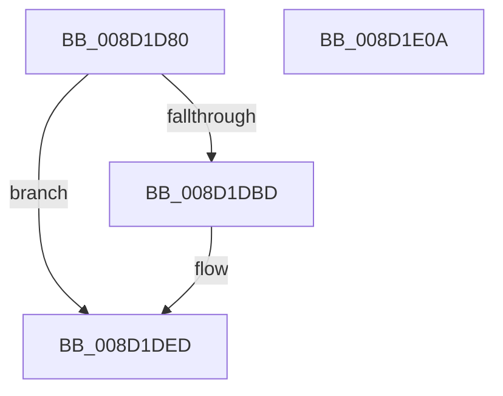

# BCryptCreateHash

- RVA: `0x008D1D80`–`0x008D1E0B` (길이 `139` bytes)
- VA: `0x00000001408D1D80`
- 실행 섹션: `PAGE`
- PDB 이름 있음: `예`; PDB Function 태그: `아니요`
- unwind 정보 RVA: `0x00060130`
- 디코드: `38`개 명령, `139/139` bytes 표시
- 미해석 바이트: `0` (있으면 어셈블리에 `.byte`로 보존)

> 이 문서는 커널 이미지의 기계어와 PDB 기호를 분석해 생성했습니다. 4번과 5번은 함수 원형과 자료형을 바이너리 사용 방식에서 추정한 C 해석이며 원본 소스 복구 결과는 아닙니다.

## 1. Dependencies

- 직접 호출 지점: **3**; 고유 호출 대상: **3**
- 직접 호출자로 확인된 함수: **2**
- RIP 상대 이미지 참조: **1**

### Outgoing calls
- `0x008D1DB1` → [ExGetExtensionTable](../../text/42/ExGetExtensionTable_function_00428814.md) (function, `0x00428814`)
- `0x008D1DDA` → [guard_dispatch_icall](../../text/6B/guard_dispatch_icall_function_006BAAD0.md) (function, `0x006BAAD0`)
- `0x008D1DE8` → [ExReleaseExtensionTable](../../text/45/ExReleaseExtensionTable_function_00456DC0.md) (function, `0x00456DC0`)

### Direct callers
- [sub_008D1E14](Unknown_function_008D1E14.md) at `0x008D1E66`
- [RtlGenerateClass5Guid](../AC/RtlGenerateClass5Guid_function_00AC4510.md) at `0x00AC460D`

### Static image references
- `0x008D1D9F` → RVA `0x00F04E30` (`.data`; read)

## 2. Other-region calls and transfers

- 다른 실행 섹션으로 향하는 call: **3**
  - `0x008D1DB1` → [ExGetExtensionTable](../../text/42/ExGetExtensionTable_function_00428814.md) (`PAGE` → `.text`)
  - `0x008D1DDA` → [guard_dispatch_icall](../../text/6B/guard_dispatch_icall_function_006BAAD0.md) (`PAGE` → `.text`)
  - `0x008D1DE8` → [ExReleaseExtensionTable](../../text/45/ExReleaseExtensionTable_function_00456DC0.md) (`PAGE` → `.text`)
- 별도 외부 분기/꼬리 이동을 확인하지 못했습니다.

## 3. Assembly (complete function range)

```asm
008D1D80  48 8B C4                        mov rax, rsp
008D1D83  48 89 58 08                     mov qword ptr [rax + 8], rbx
008D1D87  48 89 68 10                     mov qword ptr [rax + 0x10], rbp
008D1D8B  48 89 70 18                     mov qword ptr [rax + 0x18], rsi
008D1D8F  48 89 78 20                     mov qword ptr [rax + 0x20], rdi
008D1D93  41 56                           push r14
008D1D95  48 83 EC 40                     sub rsp, 0x40
008D1D99  4C 8B F1                        mov r14, rcx
008D1D9C  41 8B F9                        mov edi, r9d
008D1D9F  48 8B 0D 8A 30 63 00            mov rcx, qword ptr [rip + 0x63308a]
008D1DA6  49 8B F0                        mov rsi, r8
008D1DA9  48 8B EA                        mov rbp, rdx
008D1DAC  BB 02 00 00 C0                  mov ebx, 0xc0000002
008D1DB1  E8 5E 6A B5 FF                  call 0x140428814
008D1DB6  33 C9                           xor ecx, ecx
008D1DB8  48 85 C0                        test rax, rax
008D1DBB  74 30                           je 0x1408d1ded
008D1DBD  48 8B 40 28                     mov rax, qword ptr [rax + 0x28]
008D1DC1  44 8B CF                        mov r9d, edi
008D1DC4  89 4C 24 30                     mov dword ptr [rsp + 0x30], ecx
008D1DC8  4C 8B C6                        mov r8, rsi
008D1DCB  89 4C 24 28                     mov dword ptr [rsp + 0x28], ecx
008D1DCF  48 8B D5                        mov rdx, rbp
008D1DD2  48 89 4C 24 20                  mov qword ptr [rsp + 0x20], rcx
008D1DD7  49 8B CE                        mov rcx, r14
008D1DDA  E8 F1 8C DE FF                  call 0x1406baad0
008D1DDF  48 8B 0D 4A 30 63 00            mov rcx, qword ptr [rip + 0x63304a]
008D1DE6  8B D8                           mov ebx, eax
008D1DE8  E8 D3 4F B8 FF                  call 0x140456dc0
008D1DED  48 8B 6C 24 58                  mov rbp, qword ptr [rsp + 0x58]
008D1DF2  8B C3                           mov eax, ebx
008D1DF4  48 8B 5C 24 50                  mov rbx, qword ptr [rsp + 0x50]
008D1DF9  48 8B 74 24 60                  mov rsi, qword ptr [rsp + 0x60]
008D1DFE  48 8B 7C 24 68                  mov rdi, qword ptr [rsp + 0x68]
008D1E03  48 83 C4 40                     add rsp, 0x40
008D1E07  41 5E                           pop r14
008D1E09  C3                              ret
008D1E0A  CC                              int3
```

## 4. C-style interpretation (structured pseudocode)

```c
__int64 __fastcall BCryptCreateHash(__int64 a1, __int64 a2, __int64 a3, int a4)
{
    __int64 result;
    __int64 v_rbx;
    __int64 v_rsp;
    unsigned int v_stack_m18;
    unsigned int v_stack_m20;
    unsigned __int64 v_stack_m28;
    unsigned __int64 v_stack_p10;
    unsigned __int64 v_stack_p18;
    unsigned __int64 v_stack_p20;
    unsigned __int64 v_stack_p8;

    *(unsigned __int64 *)(v_rsp + 8) = v_rbx;
    *(unsigned __int64 *)(v_rsp + 16) = v_rbp;
    *(unsigned __int64 *)(v_rsp + 24) = v_rsi;
    *(unsigned __int64 *)(v_rsp + 32) = v_rdi;
    v_rsp = (v_rsp) - (64);
    result = ExGetExtensionTable(*(unsigned __int64 *)(v_rip + 6500490), a2, a3, a4);
    a1 = 0;
    v_rbx = (unsigned int)(0xC0000002ULL);
    if (result != 0) {
        result = *(unsigned __int64 *)(result + 40);
        a4 = (unsigned int)((unsigned int)(a4));
        v_stack_m18 = 0;
        a3 = a3;
        v_stack_m20 = 0;
        a2 = a2;
        v_stack_m28 = 0;
        a1 = 0;
        result = guard_dispatch_icall(a1, a2, a3, a4);
        a1 = *(unsigned __int64 *)(v_rip + 6500426);
        v_rbx = (unsigned int)(result);
        result = ExReleaseExtensionTable(a1, a2, a3, a4);
    }
    v_rsp = (v_rsp) + (64);
    return (unsigned int)((unsigned int)(v_rbx));
}
```

## 5. (Beta) C Style

```c
int64_t BCryptCreateHash(int64_t Arg1, int64_t Arg2, int64_t Arg3, int32_t Arg4)
{
    int64_t result;
    int64_t local_rbx;
    int64_t local_rsp;
    uint32_t v_stack_m18;
    uint32_t v_stack_m20;
    uint64_t v_stack_m28;
    uint64_t v_stack_p10;
    uint64_t v_stack_p18;
    uint64_t v_stack_p20;
    uint64_t v_stack_p8;

    *(uint64_t *)(local_rsp + 0x8) = local_rbx;
    *(uint64_t *)(local_rsp + 0x10) = local_rbp;
    *(uint64_t *)(local_rsp + 0x18) = local_rsi;
    *(uint64_t *)(local_rsp + 0x20) = local_rdi;
    local_rsp = (local_rsp) - (64);
    result = ExGetExtensionTable(*(uint64_t *)(v_rip + 0x63308A), Arg2, Arg3, Arg4);
    Arg1 = 0;
    local_rbx = (uint32_t)(0xC0000002ULL);
    if (result != 0) {
        result = *(uint64_t *)(result + 0x28);
        Arg4 = (uint32_t)((uint32_t)(Arg4));
        v_stack_m18 = 0;
        Arg3 = Arg3;
        v_stack_m20 = 0;
        Arg2 = Arg2;
        v_stack_m28 = 0;
        Arg1 = 0;
        result = guard_dispatch_icall(Arg1, Arg2, Arg3, Arg4);
        Arg1 = *(uint64_t *)(v_rip + 0x63304A);
        local_rbx = (uint32_t)(result);
        result = ExReleaseExtensionTable(Arg1, Arg2, Arg3, Arg4);
    }
    local_rsp = (local_rsp) + (64);
    return (uint32_t)((uint32_t)(local_rbx));
}
```

## 6. Execution-region graph

[열기: 2D/3D 그래프와 함수 탐색 컨트롤 패널](../../../control-panel.html?section=page&rva=0x008D1D80&view=graph)

- 2D 그래프는 위에서 아래로 흐르고, 3D 그래프는 빈 공간을 드래그해 회전합니다. Shift+드래그는 이동, 휠은 확대·축소, 함수 노드 선택은 대상 보고서 이동입니다.

### Static fallback


