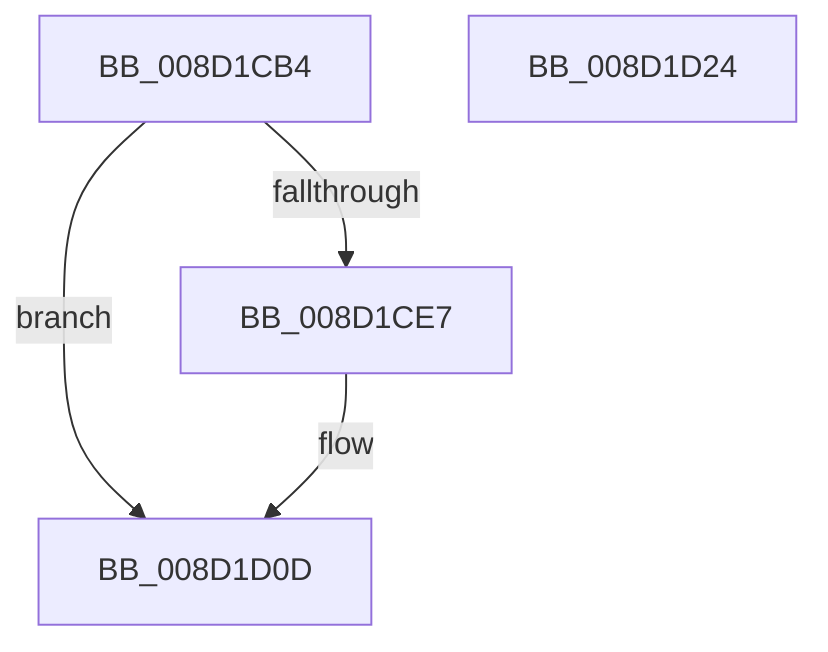

# BCryptHashData

- RVA: `0x008D1CB4`–`0x008D1D25` (길이 `113` bytes)
- VA: `0x00000001408D1CB4`
- 실행 섹션: `PAGE`
- PDB 이름 있음: `예`; PDB Function 태그: `아니요`
- unwind 정보 RVA: `0x00066400`
- 디코드: `30`개 명령, `113/113` bytes 표시
- 미해석 바이트: `0` (있으면 어셈블리에 `.byte`로 보존)

> 이 문서는 커널 이미지의 기계어와 PDB 기호를 분석해 생성했습니다. 4번과 5번은 함수 원형과 자료형을 바이너리 사용 방식에서 추정한 C 해석이며 원본 소스 복구 결과는 아닙니다.

## 1. Dependencies

- 직접 호출 지점: **3**; 고유 호출 대상: **3**
- 직접 호출자로 확인된 함수: **2**
- RIP 상대 이미지 참조: **1**

### Outgoing calls
- `0x008D1CDD` → [ExGetExtensionTable](../../text/42/ExGetExtensionTable_function_00428814.md) (function, `0x00428814`)
- `0x008D1CFA` → [guard_dispatch_icall](../../text/6B/guard_dispatch_icall_function_006BAAD0.md) (function, `0x006BAAD0`)
- `0x008D1D08` → [ExReleaseExtensionTable](../../text/45/ExReleaseExtensionTable_function_00456DC0.md) (function, `0x00456DC0`)

### Direct callers
- [sub_008D1E14](Unknown_function_008D1E14.md) at `0x008D1F0D`
- [RtlGenerateClass5Guid](../AC/RtlGenerateClass5Guid_function_00AC4510.md) at `0x00AC4655`
- [RtlGenerateClass5Guid](../AC/RtlGenerateClass5Guid_function_00AC4510.md) at `0x00AC466A`

### Static image references
- `0x008D1CCE` → RVA `0x00F04E30` (`.data`; read)

## 2. Other-region calls and transfers

- 다른 실행 섹션으로 향하는 call: **3**
  - `0x008D1CDD` → [ExGetExtensionTable](../../text/42/ExGetExtensionTable_function_00428814.md) (`PAGE` → `.text`)
  - `0x008D1CFA` → [guard_dispatch_icall](../../text/6B/guard_dispatch_icall_function_006BAAD0.md) (`PAGE` → `.text`)
  - `0x008D1D08` → [ExReleaseExtensionTable](../../text/45/ExReleaseExtensionTable_function_00456DC0.md) (`PAGE` → `.text`)
- 별도 외부 분기/꼬리 이동을 확인하지 못했습니다.

## 3. Assembly (complete function range)

```asm
008D1CB4  48 89 5C 24 08                  mov qword ptr [rsp + 8], rbx
008D1CB9  48 89 6C 24 10                  mov qword ptr [rsp + 0x10], rbp
008D1CBE  48 89 74 24 18                  mov qword ptr [rsp + 0x18], rsi
008D1CC3  57                              push rdi
008D1CC4  48 83 EC 30                     sub rsp, 0x30
008D1CC8  48 8B E9                        mov rbp, rcx
008D1CCB  41 8B F8                        mov edi, r8d
008D1CCE  48 8B 0D 5B 31 63 00            mov rcx, qword ptr [rip + 0x63315b]
008D1CD5  48 8B F2                        mov rsi, rdx
008D1CD8  BB 02 00 00 C0                  mov ebx, 0xc0000002
008D1CDD  E8 32 6B B5 FF                  call 0x140428814
008D1CE2  48 85 C0                        test rax, rax
008D1CE5  74 26                           je 0x1408d1d0d
008D1CE7  48 8B 80 B0 00 00 00            mov rax, qword ptr [rax + 0xb0]
008D1CEE  45 33 C9                        xor r9d, r9d
008D1CF1  44 8B C7                        mov r8d, edi
008D1CF4  48 8B D6                        mov rdx, rsi
008D1CF7  48 8B CD                        mov rcx, rbp
008D1CFA  E8 D1 8D DE FF                  call 0x1406baad0
008D1CFF  48 8B 0D 2A 31 63 00            mov rcx, qword ptr [rip + 0x63312a]
008D1D06  8B D8                           mov ebx, eax
008D1D08  E8 B3 50 B8 FF                  call 0x140456dc0
008D1D0D  48 8B 6C 24 48                  mov rbp, qword ptr [rsp + 0x48]
008D1D12  8B C3                           mov eax, ebx
008D1D14  48 8B 5C 24 40                  mov rbx, qword ptr [rsp + 0x40]
008D1D19  48 8B 74 24 50                  mov rsi, qword ptr [rsp + 0x50]
008D1D1E  48 83 C4 30                     add rsp, 0x30
008D1D22  5F                              pop rdi
008D1D23  C3                              ret
008D1D24  CC                              int3
```

## 4. C-style interpretation (structured pseudocode)

```c
__int64 __fastcall BCryptHashData(__int64 a1, __int64 a2, int a3, int a4)
{
    __int64 result;
    __int64 v_rbx;
    __int64 v_rsp;
    unsigned __int64 v_stack_p10;
    unsigned __int64 v_stack_p18;
    unsigned __int64 v_stack_p8;

    v_stack_p8 = v_rbx;
    v_stack_p10 = v_rbp;
    v_stack_p18 = v_rsi;
    v_rsp = (v_rsp) - (48);
    result = ExGetExtensionTable(*(unsigned __int64 *)(v_rip + 6500699), a2, a3, a4);
    v_rbx = (unsigned int)(0xC0000002ULL);
    if (result != 0) {
        result = *(unsigned __int64 *)(result + 176);
        a4 = 0;
        a3 = (unsigned int)((unsigned int)(a3));
        a2 = a2;
        a1 = a1;
        result = guard_dispatch_icall(a1, a2, a3, a4);
        a1 = *(unsigned __int64 *)(v_rip + 6500650);
        v_rbx = (unsigned int)(result);
        result = ExReleaseExtensionTable(a1, a2, a3, a4);
    }
    v_rsp = (v_rsp) + (48);
    return (unsigned int)((unsigned int)(v_rbx));
}
```

## 5. (Beta) C Style

```c
int64_t BCryptHashData(int64_t Arg1, int64_t Arg2, int32_t Arg3, int32_t Arg4)
{
    int64_t result;
    int64_t local_rbx;
    int64_t local_rsp;
    uint64_t v_stack_p10;
    uint64_t v_stack_p18;
    uint64_t v_stack_p8;

    v_stack_p8 = local_rbx;
    v_stack_p10 = local_rbp;
    v_stack_p18 = local_rsi;
    local_rsp = (local_rsp) - (48);
    result = ExGetExtensionTable(*(uint64_t *)(v_rip + 0x63315B), Arg2, Arg3, Arg4);
    local_rbx = (uint32_t)(0xC0000002ULL);
    if (result != 0) {
        result = *(uint64_t *)(result + 0xB0);
        Arg4 = 0;
        Arg3 = (uint32_t)((uint32_t)(Arg3));
        Arg2 = Arg2;
        Arg1 = Arg1;
        result = guard_dispatch_icall(Arg1, Arg2, Arg3, Arg4);
        Arg1 = *(uint64_t *)(v_rip + 0x63312A);
        local_rbx = (uint32_t)(result);
        result = ExReleaseExtensionTable(Arg1, Arg2, Arg3, Arg4);
    }
    local_rsp = (local_rsp) + (48);
    return (uint32_t)((uint32_t)(local_rbx));
}
```

## 6. Execution-region graph

[열기: 2D/3D 그래프와 함수 탐색 컨트롤 패널](../../../control-panel.html?section=page&rva=0x008D1CB4&view=graph)

- 2D 그래프는 위에서 아래로 흐르고, 3D 그래프는 빈 공간을 드래그해 회전합니다. Shift+드래그는 이동, 휠은 확대·축소, 함수 노드 선택은 대상 보고서 이동입니다.

### Static fallback


