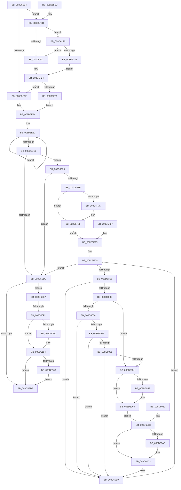

# DbgkCreateThread

- RVA: `0x008D5E34`–`0x008D618B` (길이 `855` bytes)
- VA: `0x00000001408D5E34`
- 실행 섹션: `PAGE`
- PDB 이름 있음: `예`; PDB Function 태그: `예`
- unwind 정보 RVA: `0x000851E8`
- 디코드: `189`개 명령, `855/855` bytes 표시
- 미해석 바이트: `0` (있으면 어셈블리에 `.byte`로 보존)

> 이 문서는 커널 이미지의 기계어와 PDB 기호를 분석해 생성했습니다. 4번과 5번은 함수 원형과 자료형을 바이너리 사용 방식에서 추정한 C 해석이며 원본 소스 복구 결과는 아닙니다.

## 1. Dependencies

- 직접 호출 지점: **18**; 고유 호출 대상: **14**
- 직접 호출자로 확인된 함수: **1**
- RIP 상대 이미지 참조: **1**

### Outgoing calls
- `0x008D5E79` → [memset](../../text/6C/memset_function_006C6C40.md) (function, `0x006C6C40`)
- `0x008D5EE9` → [_security_check_cookie](../../text/6A/_security_check_cookie_function_006AC640.md) (function, `0x006AC640`)
- `0x008D5F36` → [PsIsImageNotifyEnabled](../97/PsIsImageNotifyEnabled_function_0097FDE0.md) (function, `0x0097FDE0`)
- `0x008D5F73` → [RtlImageNtHeader](../../text/44/RtlImageNtHeader_function_00443B60.md) (function, `0x00443B60`)
- `0x008D5FAE` → [PsReferenceProcessFilePointer](PsReferenceProcessFilePointer_function_008D6870.md) (function, `0x008D6870`)
- `0x008D5FC7` → [PsCallImageNotifyRoutines](PsCallImageNotifyRoutines_function_008D6C20.md) (function, `0x008D6C20`)
- `0x008D5FD1` → [ObfDereferenceObject](../../text/2F/ObfDereferenceObject_function_002F9350.md) (function, `0x002F9350`)
- `0x008D5FE7` → [PsQuerySystemDllInfo](PsQuerySystemDllInfo_function_008D20F8.md) (function, `0x008D20F8`)
- `0x008D6024` → [PsWow64GetProcessNtdllType](../8C/PsWow64GetProcessNtdllType_function_008CE464.md) (function, `0x008CE464`)
- `0x008D604E` → [RtlImageNtHeader](../../text/44/RtlImageNtHeader_function_00443B60.md) (function, `0x00443B60`)
- `0x008D6091` → [PspReferenceSystemDll](PspReferenceSystemDll_function_008D6AD8.md) (function, `0x008D6AD8`)
- `0x008D609C` → [MmGetFileObjectForSection](MmGetFileObjectForSection_function_008D68E0.md) (function, `0x008D68E0`)
- `0x008D60B8` → [ObFastDereferenceObject](../../text/3E/ObFastDereferenceObject_function_003ED5F0.md) (function, `0x003ED5F0`)
- `0x008D60D1` → [PsCallImageNotifyRoutines](PsCallImageNotifyRoutines_function_008D6C20.md) (function, `0x008D6C20`)
- `0x008D60DB` → [ObfDereferenceObject](../../text/2F/ObfDereferenceObject_function_002F9350.md) (function, `0x002F9350`)
- `0x008D610A` → [memset](../../text/6C/memset_function_006C6C40.md) (function, `0x006C6C40`)
- `0x008D614F` → [DbgkpSendApiMessage](../A7/DbgkpSendApiMessage_function_00A79458.md) (function, `0x00A79458`)
- `0x008D616C` → [DbgkpPostModuleMessages](../A5/DbgkpPostModuleMessages_function_00A5F86C.md) (function, `0x00A5F86C`)

### Direct callers
- [PspNotifyThreadCreation](PspNotifyThreadCreation_function_008D5D48.md) at `0x008D5D64`

### Static image references
- `0x008D5E50` → RVA `0x00E0A740` (`.data`; read)

## 2. Other-region calls and transfers

- 다른 실행 섹션으로 향하는 call: **8**
  - `0x008D5E79` → [memset](../../text/6C/memset_function_006C6C40.md) (`PAGE` → `.text`)
  - `0x008D5EE9` → [_security_check_cookie](../../text/6A/_security_check_cookie_function_006AC640.md) (`PAGE` → `.text`)
  - `0x008D5F73` → [RtlImageNtHeader](../../text/44/RtlImageNtHeader_function_00443B60.md) (`PAGE` → `.text`)
  - `0x008D5FD1` → [ObfDereferenceObject](../../text/2F/ObfDereferenceObject_function_002F9350.md) (`PAGE` → `.text`)
  - `0x008D604E` → [RtlImageNtHeader](../../text/44/RtlImageNtHeader_function_00443B60.md) (`PAGE` → `.text`)
  - `0x008D60B8` → [ObFastDereferenceObject](../../text/3E/ObFastDereferenceObject_function_003ED5F0.md) (`PAGE` → `.text`)
  - `0x008D60DB` → [ObfDereferenceObject](../../text/2F/ObfDereferenceObject_function_002F9350.md) (`PAGE` → `.text`)
  - `0x008D610A` → [memset](../../text/6C/memset_function_006C6C40.md) (`PAGE` → `.text`)
- call이 아닌 외부 분기/꼬리 이동: **1**
  - `0x008D60EB` → [sub_00B1BA80](../B1/Unknown_function_00B1BA80.md) (`tail-transfer`)

## 3. Assembly (complete function range)

```asm
008D5E34  4C 8B DC                        mov r11, rsp
008D5E37  49 89 73 10                     mov qword ptr [r11 + 0x10], rsi
008D5E3B  49 89 7B 18                     mov qword ptr [r11 + 0x18], rdi
008D5E3F  4D 89 63 20                     mov qword ptr [r11 + 0x20], r12
008D5E43  41 55                           push r13
008D5E45  41 56                           push r14
008D5E47  41 57                           push r15
008D5E49  48 81 EC B0 01 00 00            sub rsp, 0x1b0
008D5E50  48 8B 05 E9 48 53 00            mov rax, qword ptr [rip + 0x5348e9]
008D5E57  48 33 C4                        xor rax, rsp
008D5E5A  48 89 84 24 A0 01 00 00         mov qword ptr [rsp + 0x1a0], rax
008D5E62  4C 8B F1                        mov r14, rcx
008D5E65  48 89 4C 24 40                  mov qword ptr [rsp + 0x40], rcx
008D5E6A  33 D2                           xor edx, edx
008D5E6C  41 B8 10 01 00 00               mov r8d, 0x110
008D5E72  49 8D 8B C8 FE FF FF            lea rcx, [r11 - 0x138]
008D5E79  E8 C2 0D DF FF                  call 0x1406c6c40
008D5E7E  49 8B BE B8 00 00 00            mov rdi, qword ptr [r14 + 0xb8]
008D5E85  48 89 7C 24 38                  mov qword ptr [rsp + 0x38], rdi
008D5E8A  48 8D 87 10 03 00 00            lea rax, [rdi + 0x310]
008D5E91  48 89 84 24 80 00 00 00         mov qword ptr [rsp + 0x80], rax
008D5E99  48 83 38 00                     cmp qword ptr [rax], 0
008D5E9D  75 6E                           jne 0x1408d5f0d
008D5E9F  C6 44 24 20 00                  mov byte ptr [rsp + 0x20], 0
008D5EA4  0F 0D 8F F4 01 00 00            prefetchw byte ptr [rdi + 0x1f4]
008D5EAB  8B 87 F4 01 00 00               mov eax, dword ptr [rdi + 0x1f4]
008D5EB1  8B C8                           mov ecx, eax
008D5EB3  81 C9 01 00 40 00               or ecx, 0x400001
008D5EB9  F0 0F B1 8F F4 01 00 00         lock cmpxchg dword ptr [rdi + 0x1f4], ecx
008D5EC1  75 EE                           jne 0x1408d5eb1
008D5EC3  44 8B E0                        mov r12d, eax
008D5EC6  89 44 24 30                     mov dword ptr [rsp + 0x30], eax
008D5ECA  0F BA E0 16                     bt eax, 0x16
008D5ECE  73 66                           jae 0x1408d5f36
008D5ED0  48 83 BF 08 03 00 00 00         cmp qword ptr [rdi + 0x308], 0
008D5ED8  0F 85 09 02 00 00               jne 0x1408d60e7
008D5EDE  48 8B 8C 24 A0 01 00 00         mov rcx, qword ptr [rsp + 0x1a0]
008D5EE6  48 33 CC                        xor rcx, rsp
008D5EE9  E8 52 67 DD FF                  call 0x1406ac640
008D5EEE  4C 8D 9C 24 B0 01 00 00         lea r11, [rsp + 0x1b0]
008D5EF6  49 8B 73 28                     mov rsi, qword ptr [r11 + 0x28]
008D5EFA  49 8B 7B 30                     mov rdi, qword ptr [r11 + 0x30]
008D5EFE  4D 8B 63 38                     mov r12, qword ptr [r11 + 0x38]
008D5F02  49 8B E3                        mov rsp, r11
008D5F05  41 5F                           pop r15
008D5F07  41 5E                           pop r14
008D5F09  41 5D                           pop r13
008D5F0B  C3                              ret
008D5F0C  CC                              int3
008D5F0D  0F B7 87 EC 06 00 00            movzx eax, word ptr [rdi + 0x6ec]
008D5F14  B9 4C 01 00 00                  mov ecx, 0x14c
008D5F19  66 3B C1                        cmp ax, cx
008D5F1C  0F 85 54 02 00 00               jne 0x1408d6176
008D5F22  B0 01                           mov al, 1
008D5F24  84 C0                           test al, al
008D5F26  C6 44 24 20 01                  mov byte ptr [rsp + 0x20], 1
008D5F2B  0F 84 6E FF FF FF               je 0x1408d5e9f
008D5F31  E9 6E FF FF FF                  jmp 0x1408d5ea4
008D5F36  E8 A5 9E 0A 00                  call 0x14097fde0
008D5F3B  84 C0                           test al, al
008D5F3D  74 91                           je 0x1408d5ed0
008D5F3F  0F 57 C0                        xorps xmm0, xmm0
008D5F42  33 C0                           xor eax, eax
008D5F44  0F 11 44 24 48                  movups xmmword ptr [rsp + 0x48], xmm0
008D5F49  0F 11 44 24 58                  movups xmmword ptr [rsp + 0x58], xmm0
008D5F4E  0F 11 44 24 68                  movups xmmword ptr [rsp + 0x68], xmm0
008D5F53  48 89 44 24 78                  mov qword ptr [rsp + 0x78], rax
008D5F58  48 21 44 24 28                  and qword ptr [rsp + 0x28], rax
008D5F5D  C6 44 24 50 03                  mov byte ptr [rsp + 0x50], 3
008D5F62  48 8B 8F B0 02 00 00            mov rcx, qword ptr [rdi + 0x2b0]
008D5F69  48 89 4C 24 58                  mov qword ptr [rsp + 0x58], rcx
008D5F6E  48 21 44 24 68                  and qword ptr [rsp + 0x68], rax
008D5F73  E8 E8 DB B6 FF                  call 0x140443b60
008D5F78  48 85 C0                        test rax, rax
008D5F7B  74 08                           je 0x1408d5f85
008D5F7D  8B 40 50                        mov eax, dword ptr [rax + 0x50]
008D5F80  48 89 44 24 68                  mov qword ptr [rsp + 0x68], rax
008D5F85  EB 15                           jmp 0x1408d5f9c
008D5F87  48 83 64 24 68 00               and qword ptr [rsp + 0x68], 0
008D5F8D  44 8B 64 24 30                  mov r12d, dword ptr [rsp + 0x30]
008D5F92  48 8B 7C 24 38                  mov rdi, qword ptr [rsp + 0x38]
008D5F97  4C 8B 74 24 40                  mov r14, qword ptr [rsp + 0x40]
008D5F9C  83 64 24 60 00                  and dword ptr [rsp + 0x60], 0
008D5FA1  83 64 24 70 00                  and dword ptr [rsp + 0x70], 0
008D5FA6  48 8D 54 24 28                  lea rdx, [rsp + 0x28]
008D5FAB  48 8B CF                        mov rcx, rdi
008D5FAE  E8 BD 08 00 00                  call 0x1408d6870
008D5FB3  48 8B 8F 50 03 00 00            mov rcx, qword ptr [rdi + 0x350]
008D5FBA  4C 8B 4C 24 28                  mov r9, qword ptr [rsp + 0x28]
008D5FBF  4C 8D 44 24 48                  lea r8, [rsp + 0x48]
008D5FC4  48 8B D7                        mov rdx, rdi
008D5FC7  E8 54 0C 00 00                  call 0x1408d6c20
008D5FCC  48 8B 4C 24 28                  mov rcx, qword ptr [rsp + 0x28]
008D5FD1  E8 7A 33 A2 FF                  call 0x1402f9350
008D5FD6  33 F6                           xor esi, esi
008D5FD8  89 74 24 28                     mov dword ptr [rsp + 0x28], esi
008D5FDC  83 FE 06                        cmp esi, 6
008D5FDF  0F 8D EB FE FF FF               jge 0x1408d5ed0
008D5FE5  8B CE                           mov ecx, esi
008D5FE7  E8 0C C1 FF FF                  call 0x1408d20f8
008D5FEC  4C 8B F8                        mov r15, rax
008D5FEF  48 89 84 24 88 00 00 00         mov qword ptr [rsp + 0x88], rax
008D5FF7  48 85 C0                        test rax, rax
008D5FFA  0F 84 E0 00 00 00               je 0x1408d60e0
008D6000  85 F6                           test esi, esi
008D6002  7E 2D                           jle 0x1408d6031
008D6004  8B 08                           mov ecx, dword ptr [rax]
008D6006  F6 C1 08                        test cl, 8
008D6009  0F 84 D1 00 00 00               je 0x1408d60e0
008D600F  48 8B 8C 24 80 00 00 00         mov rcx, qword ptr [rsp + 0x80]
008D6017  48 83 39 00                     cmp qword ptr [rcx], 0
008D601B  0F 84 BF 00 00 00               je 0x1408d60e0
008D6021  48 8B CF                        mov rcx, rdi
008D6024  E8 3B 84 FF FF                  call 0x1408ce464
008D6029  3B F0                           cmp esi, eax
008D602B  0F 85 AF 00 00 00               jne 0x1408d60e0
008D6031  83 64 24 50 00                  and dword ptr [rsp + 0x50], 0
008D6036  C6 44 24 50 03                  mov byte ptr [rsp + 0x50], 3
008D603B  49 8B 47 18                     mov rax, qword ptr [r15 + 0x18]
008D603F  48 89 44 24 58                  mov qword ptr [rsp + 0x58], rax
008D6044  48 83 64 24 68 00               and qword ptr [rsp + 0x68], 0
008D604A  49 8B 4F 18                     mov rcx, qword ptr [r15 + 0x18]
008D604E  E8 0D DB B6 FF                  call 0x140443b60
008D6053  48 85 C0                        test rax, rax
008D6056  74 08                           je 0x1408d6060
008D6058  8B 40 50                        mov eax, dword ptr [rax + 0x50]
008D605B  48 89 44 24 68                  mov qword ptr [rsp + 0x68], rax
008D6060  EB 21                           jmp 0x1408d6083
008D6062  48 83 64 24 68 00               and qword ptr [rsp + 0x68], 0
008D6068  4C 8B BC 24 88 00 00 00         mov r15, qword ptr [rsp + 0x88]
008D6070  8B 74 24 28                     mov esi, dword ptr [rsp + 0x28]
008D6074  44 8B 64 24 30                  mov r12d, dword ptr [rsp + 0x30]
008D6079  48 8B 7C 24 38                  mov rdi, qword ptr [rsp + 0x38]
008D607E  4C 8B 74 24 40                  mov r14, qword ptr [rsp + 0x40]
008D6083  83 64 24 60 00                  and dword ptr [rsp + 0x60], 0
008D6088  83 64 24 70 00                  and dword ptr [rsp + 0x70], 0
008D608D  49 8B 4F F8                     mov rcx, qword ptr [r15 - 8]
008D6091  E8 42 0A 00 00                  call 0x1408d6ad8
008D6096  4C 8B E8                        mov r13, rax
008D6099  48 8B C8                        mov rcx, rax
008D609C  E8 3F 08 00 00                  call 0x1408d68e0
008D60A1  48 89 44 24 28                  mov qword ptr [rsp + 0x28], rax
008D60A6  4D 85 ED                        test r13, r13
008D60A9  74 17                           je 0x1408d60c2
008D60AB  41 B8 50 73 53 64               mov r8d, 0x64537350
008D60B1  49 8B D5                        mov rdx, r13
008D60B4  49 8B 4F F8                     mov rcx, qword ptr [r15 - 8]
008D60B8  E8 33 75 B1 FF                  call 0x1403ed5f0
008D60BD  48 8B 44 24 28                  mov rax, qword ptr [rsp + 0x28]
008D60C2  49 8D 4F 08                     lea rcx, [r15 + 8]
008D60C6  4C 8B C8                        mov r9, rax
008D60C9  4C 8D 44 24 48                  lea r8, [rsp + 0x48]
008D60CE  48 8B D7                        mov rdx, rdi
008D60D1  E8 4A 0B 00 00                  call 0x1408d6c20
008D60D6  48 8B 4C 24 28                  mov rcx, qword ptr [rsp + 0x28]
008D60DB  E8 70 32 A2 FF                  call 0x1402f9350
008D60E0  FF C6                           inc esi
008D60E2  E9 F1 FE FF FF                  jmp 0x1408d5fd8
008D60E7  41 F6 C4 01                     test r12b, 1
008D60EB  0F 84 8F 59 24 00               je 0x140b1ba80
008D60F1  41 8B 86 A0 05 00 00            mov eax, dword ptr [r14 + 0x5a0]
008D60F8  A8 04                           test al, 4
008D60FA  75 58                           jne 0x1408d6154
008D60FC  33 D2                           xor edx, edx
008D60FE  44 8D 42 40                     lea r8d, [rdx + 0x40]
008D6102  48 8D 8C 24 90 00 00 00         lea rcx, [rsp + 0x90]
008D610A  E8 31 0B DF FF                  call 0x1406c6c40
008D610F  49 8B 86 60 05 00 00            mov rax, qword ptr [r14 + 0x560]
008D6116  48 89 84 24 C8 00 00 00         mov qword ptr [rsp + 0xc8], rax
008D611E  C7 84 24 90 00 00 00 18 00 40 00  mov dword ptr [rsp + 0x90], 0x400018
008D6129  C7 84 24 94 00 00 00 08 00 00 00  mov dword ptr [rsp + 0x94], 8
008D6134  C7 84 24 B8 00 00 00 01 00 00 00  mov dword ptr [rsp + 0xb8], 1
008D613F  4C 8D 84 24 90 00 00 00         lea r8, [rsp + 0x90]
008D6147  BA 01 00 00 00                  mov edx, 1
008D614C  48 8B CF                        mov rcx, rdi
008D614F  E8 04 33 1A 00                  call 0x140a79458
008D6154  41 8B 86 A4 05 00 00            mov eax, dword ptr [r14 + 0x5a4]
008D615B  A8 10                           test al, 0x10
008D615D  0F 84 7B FD FF FF               je 0x1408d5ede
008D6163  45 33 C0                        xor r8d, r8d
008D6166  49 8B D6                        mov rdx, r14
008D6169  48 8B CF                        mov rcx, rdi
008D616C  E8 FB 96 18 00                  call 0x140a5f86c
008D6171  E9 68 FD FF FF                  jmp 0x1408d5ede
008D6176  B9 C4 01 00 00                  mov ecx, 0x1c4
008D617B  66 3B C1                        cmp ax, cx
008D617E  0F 84 9E FD FF FF               je 0x1408d5f22
008D6184  32 C0                           xor al, al
008D6186  E9 99 FD FF FF                  jmp 0x1408d5f24
```

## 4. C-style interpretation (structured pseudocode)

```c
__int64 __fastcall DbgkCreateThread(__int64 a1, int a2)
{
    __int64 result;
    __int64 v_rsi;
    __int64 v_rsp;
    unsigned int v_stack_m11C;
    unsigned __int64 v_stack_m120;
    unsigned __int64 v_stack_m128;
    unsigned __int64 v_stack_m130;
    unsigned __int64 v_stack_m138;
    unsigned int v_stack_m140;
    unsigned __int64 v_stack_m148;
    unsigned int v_stack_m150;
    unsigned __int64 v_stack_m158;
    unsigned __int8 v_stack_m160;
    unsigned __int64 v_stack_m168;
    unsigned __int64 v_stack_m170;
    unsigned __int64 v_stack_m178;
    unsigned __int64 v_stack_m18;
    unsigned int v_stack_m180;
    unsigned __int64 v_stack_m188;
    unsigned __int64 v_stack_m190;
    unsigned int v_stack_m198;
    unsigned __int8 v_stack_m1A8;
    unsigned __int64 v_stack_m28;
    unsigned __int64 v_stack_mE8;
    unsigned int v_stack_mF8;

    *(unsigned __int64 *)(v_rsp + 16) = v_rsi;
    *(unsigned __int64 *)(v_rsp + 24) = v_rdi;
    *(unsigned __int64 *)(v_rsp + 32) = v_r12;
    v_rsp = (v_rsp) - (432);
    result = (*(unsigned __int64 *)(v_rip + 5458153)) ^ (v_rsp);
    v_stack_m28 = result;
    v_stack_m188 = a1;
    a2 = 0;
    result = memset(v_rsp - 312, a2, 272, a4);
    v_stack_m190 = *(unsigned __int64 *)(a1 + 184);
    v_stack_m148 = *(unsigned __int64 *)(a1 + 184) + 784;
    if ((*(unsigned __int64 *)(*(unsigned __int64 *)(a1 + 184) + 784)) != 0) goto loc_008D5F0D;
loc_008D5E9F:
    v_stack_m1A8 = 0;
loc_008D5EA4:
loc_008D5EB1:
    a1 = (unsigned int)(((unsigned int)((unsigned int)((unsigned int)(*(unsigned int *)(*(unsigned __int64 *)(a1 + 184) + 500))))) | (0x400001ULL));
    if (condition_is_not_equal) goto loc_008D5EB1;
    v_stack_m198 = (unsigned int)((unsigned int)(*(unsigned int *)(*(unsigned __int64 *)(a1 + 184) + 500)));
    if (condition_is_above_or_equal) goto loc_008D5F36;
loc_008D5ED0:
    if ((*(unsigned __int64 *)(*(unsigned __int64 *)(a1 + 184) + 776)) != 0) goto loc_008D60E7;
loc_008D5EDE:
    a1 = (v_stack_m28) ^ (v_rsp);
    result = _security_check_cookie(a1, a2, 272, a4);
    return result;
loc_008D5F0D:
    if (((unsigned __int16)(*(unsigned __int16 *)(*(unsigned __int64 *)(v_stack_m18 + 48) + 1772))) != 332) goto loc_008D6176;
loc_008D5F22:
loc_008D5F24:
    v_stack_m190 = 1;
    if (1 == 0) goto loc_008D5E9F;
    goto loc_008D5EA4;
loc_008D5F36:
    result = PsIsImageNotifyEnabled(332, a2, 272, a4);
    if ((unsigned __int8)(result) == 0) goto loc_008D5ED0;
    result = 0;
    v_stack_m168 = v_xmm0;
    v_stack_m158 = v_xmm0;
    v_stack_m148 = v_xmm0;
    v_stack_m138 = 0;
    v_stack_m160 = 3;
    v_stack_m158 = *(unsigned __int64 *)(*(unsigned __int64 *)(v_stack_m18 + 48) + 688);
    result = RtlImageNtHeader(*(unsigned __int64 *)(*(unsigned __int64 *)(v_stack_m18 + 48) + 688), a2, 272, a4);
    if (result != 0) {
        result = *(unsigned int *)(result + 80);
        v_stack_m148 = result;
    }
    goto loc_008D5F9C;
loc_008D5F9C:
    result = PsReferenceProcessFilePointer(*(unsigned __int64 *)(v_stack_m18 + 48), v_stack_m188, 272, a4);
    result = PsCallImageNotifyRoutines(*(unsigned __int64 *)(*(unsigned __int64 *)(v_stack_m18 + 48) + 848), *(unsigned __int64 *)(v_stack_m18 + 48), v_stack_m168, v_stack_m188);
    result = ObfDereferenceObject(v_stack_m188, *(unsigned __int64 *)(v_stack_m18 + 48), v_stack_m168, v_stack_m188);
    v_rsi = 0;
loc_008D5FD8:
    v_stack_m188 = 0;
    if (0 >= 6) goto loc_008D5ED0;
    result = PsQuerySystemDllInfo(0, *(unsigned __int64 *)(v_stack_m18 + 48), v_stack_m168, v_stack_m188);
    v_stack_m128 = result;
    if (result == 0) goto loc_008D60E0;
    if (condition_is_less_or_equal) goto loc_008D6031;
    if ((((unsigned __int8)((unsigned int)(*(unsigned int *)(result)))) & (8)) == 0) goto loc_008D60E0;
    if ((*(unsigned __int64 *)(v_stack_m130)) == 0) goto loc_008D60E0;
    result = PsWow64GetProcessNtdllType(*(unsigned __int64 *)(v_stack_m18 + 48), *(unsigned __int64 *)(v_stack_m18 + 48), v_stack_m168, v_stack_m188);
    if (0 != ((unsigned int)(result))) goto loc_008D60E0;
loc_008D6031:
    v_stack_m160 = 3;
    v_stack_m158 = *(unsigned __int64 *)(result + 24);
    result = RtlImageNtHeader(*(unsigned __int64 *)(result + 24), *(unsigned __int64 *)(v_stack_m18 + 48), v_stack_m168, v_stack_m188);
    if (result != 0) {
        result = *(unsigned int *)(result + 80);
        v_stack_m148 = result;
    }
    goto loc_008D6083;
loc_008D6083:
    result = PspReferenceSystemDll(*(unsigned __int64 *)(result - 8), *(unsigned __int64 *)(v_stack_m18 + 48), v_stack_m168, v_stack_m188);
    result = MmGetFileObjectForSection(result, *(unsigned __int64 *)(v_stack_m18 + 48), v_stack_m168, v_stack_m188);
    v_stack_m188 = result;
    if (result != 0) {
        a3 = 0x64537350ULL;
        a2 = result;
        a1 = *(unsigned __int64 *)(result - 8);
        result = ObFastDereferenceObject(a1, a2, a3, v_stack_m188);
        result = v_stack_m188;
    }
    result = PsCallImageNotifyRoutines(result + 8, *(unsigned __int64 *)(v_stack_m18 + 48), v_stack_m168, result);
    result = ObfDereferenceObject(v_stack_m188, *(unsigned __int64 *)(v_stack_m18 + 48), v_stack_m168, result);
loc_008D60E0:
    v_rsi = (unsigned int)((v_rsi) + 1);
    goto loc_008D5FD8;
loc_008D60E7:
    result = (unsigned int)(*(unsigned int *)(a1 + 1440));
    if ((((unsigned __int8)((unsigned int)(*(unsigned int *)(a1 + 1440)))) & (4)) == 0) {
        a2 = 0;
        a3 = a2 + 64;
        a1 = v_stack_m120;
        result = memset(a1, a2, a3, result);
        result = *(unsigned __int64 *)(a1 + 1376);
        v_stack_mE8 = result;
        v_stack_m120 = 0x400018ULL;
        v_stack_m11C = 8;
        v_stack_mF8 = 1;
        a3 = v_stack_m120;
        a2 = 1;
        a1 = *(unsigned __int64 *)(v_stack_m18 + 48);
        result = DbgkpSendApiMessage(a1, a2, a3, result);
    }
    if ((((unsigned __int8)((unsigned int)(*(unsigned int *)(a1 + 1444)))) & (16)) == 0) goto loc_008D5EDE;
    a3 = 0;
    result = DbgkpPostModuleMessages(*(unsigned __int64 *)(v_stack_m18 + 48), a1, a3, result);
    goto loc_008D5EDE;
loc_008D6176:
    if (((unsigned __int16)(result)) == 452) goto loc_008D5F22;
    result = 0;
    goto loc_008D5F24;
}
```

## 5. (Beta) C Style

```c
int64_t DbgkCreateThread(void *Arg1, int32_t Arg2)
{
    uint8_t *arg1 = (uint8_t *)Arg1;

    int64_t result;
    int64_t local_rsi;
    int64_t local_rsp;
    uint32_t v_stack_m11C;
    uint64_t v_stack_m120;
    uint64_t v_stack_m128;
    uint64_t v_stack_m130;
    uint64_t v_stack_m138;
    uint32_t v_stack_m140;
    uint64_t v_stack_m148;
    uint32_t v_stack_m150;
    uint64_t v_stack_m158;
    uint8_t v_stack_m160;
    uint64_t v_stack_m168;
    uint64_t v_stack_m170;
    uint64_t v_stack_m178;
    uint64_t v_stack_m18;
    uint32_t v_stack_m180;
    uint64_t v_stack_m188;
    uint64_t v_stack_m190;
    uint32_t v_stack_m198;
    uint8_t v_stack_m1A8;
    uint64_t v_stack_m28;
    uint64_t v_stack_mE8;
    uint32_t v_stack_mF8;

    *(uint64_t *)(local_rsp + 0x10) = local_rsi;
    *(uint64_t *)(local_rsp + 0x18) = local_rdi;
    *(uint64_t *)(local_rsp + 0x20) = local_r12;
    local_rsp = (local_rsp) - (432);
    result = (*(uint64_t *)(v_rip + 0x5348E9)) ^ (local_rsp);
    v_stack_m28 = result;
    v_stack_m188 = Arg1;
    Arg2 = 0;
    result = memset(local_rsp - 312, Arg2, 272, a4);
    v_stack_m190 = *(uint64_t *)(arg1 + 0xB8);
    v_stack_m148 = *(uint64_t *)(arg1 + 0xB8) + 784;
    if ((*(uint64_t *)(*(uint64_t *)(arg1 + 0xB8) + 0x310)) != 0) goto loc_008D5F0D;
loc_008D5E9F:
    v_stack_m1A8 = 0;
loc_008D5EA4:
loc_008D5EB1:
    Arg1 = (uint32_t)(((uint32_t)((uint32_t)((uint32_t)(*(uint32_t *)(*(uint64_t *)(arg1 + 0xB8) + 0x1F4))))) | (0x400001ULL));
    if (condition_is_not_equal) goto loc_008D5EB1;
    v_stack_m198 = (uint32_t)((uint32_t)(*(uint32_t *)(*(uint64_t *)(arg1 + 0xB8) + 0x1F4)));
    if (condition_is_above_or_equal) goto loc_008D5F36;
loc_008D5ED0:
    if ((*(uint64_t *)(*(uint64_t *)(arg1 + 0xB8) + 0x308)) != 0) goto loc_008D60E7;
loc_008D5EDE:
    Arg1 = (v_stack_m28) ^ (local_rsp);
    result = _security_check_cookie(Arg1, Arg2, 272, a4);
    return result;
loc_008D5F0D:
    if (((uint16_t)(*(uint16_t *)(*(uint64_t *)(v_stack_m18 + 0x30) + 0x6EC))) != 332) goto loc_008D6176;
loc_008D5F22:
loc_008D5F24:
    v_stack_m190 = 1;
    if (1 == 0) goto loc_008D5E9F;
    goto loc_008D5EA4;
loc_008D5F36:
    result = PsIsImageNotifyEnabled(332, Arg2, 272, a4);
    if ((uint8_t)(result) == 0) goto loc_008D5ED0;
    result = 0;
    v_stack_m168 = v_xmm0;
    v_stack_m158 = v_xmm0;
    v_stack_m148 = v_xmm0;
    v_stack_m138 = 0;
    v_stack_m160 = 3;
    v_stack_m158 = *(uint64_t *)(*(uint64_t *)(v_stack_m18 + 0x30) + 0x2B0);
    result = RtlImageNtHeader(*(uint64_t *)(*(uint64_t *)(v_stack_m18 + 0x30) + 0x2B0), Arg2, 272, a4);
    if (result != 0) {
        result = *(uint32_t *)(result + 0x50);
        v_stack_m148 = result;
    }
    goto loc_008D5F9C;
loc_008D5F9C:
    result = PsReferenceProcessFilePointer(*(uint64_t *)(v_stack_m18 + 0x30), v_stack_m188, 272, a4);
    result = PsCallImageNotifyRoutines(*(uint64_t *)(*(uint64_t *)(v_stack_m18 + 0x30) + 0x350), *(uint64_t *)(v_stack_m18 + 0x30), v_stack_m168, v_stack_m188);
    result = ObfDereferenceObject(v_stack_m188, *(uint64_t *)(v_stack_m18 + 0x30), v_stack_m168, v_stack_m188);
    local_rsi = 0;
loc_008D5FD8:
    v_stack_m188 = 0;
    if (0 >= 6) goto loc_008D5ED0;
    result = PsQuerySystemDllInfo(0, *(uint64_t *)(v_stack_m18 + 0x30), v_stack_m168, v_stack_m188);
    v_stack_m128 = result;
    if (result == 0) goto loc_008D60E0;
    if (condition_is_less_or_equal) goto loc_008D6031;
    if ((((uint8_t)((uint32_t)(*(uint32_t *)(result)))) & (8)) == 0) goto loc_008D60E0;
    if ((*(uint64_t *)(v_stack_m130)) == 0) goto loc_008D60E0;
    result = PsWow64GetProcessNtdllType(*(uint64_t *)(v_stack_m18 + 0x30), *(uint64_t *)(v_stack_m18 + 0x30), v_stack_m168, v_stack_m188);
    if (0 != ((uint32_t)(result))) goto loc_008D60E0;
loc_008D6031:
    v_stack_m160 = 3;
    v_stack_m158 = *(uint64_t *)(result + 0x18);
    result = RtlImageNtHeader(*(uint64_t *)(result + 0x18), *(uint64_t *)(v_stack_m18 + 0x30), v_stack_m168, v_stack_m188);
    if (result != 0) {
        result = *(uint32_t *)(result + 0x50);
        v_stack_m148 = result;
    }
    goto loc_008D6083;
loc_008D6083:
    result = PspReferenceSystemDll(*(uint64_t *)(result - 0x8), *(uint64_t *)(v_stack_m18 + 0x30), v_stack_m168, v_stack_m188);
    result = MmGetFileObjectForSection(result, *(uint64_t *)(v_stack_m18 + 0x30), v_stack_m168, v_stack_m188);
    v_stack_m188 = result;
    if (result != 0) {
        a3 = 0x64537350ULL;
        Arg2 = result;
        Arg1 = *(uint64_t *)(result - 0x8);
        result = ObFastDereferenceObject(Arg1, Arg2, a3, v_stack_m188);
        result = v_stack_m188;
    }
    result = PsCallImageNotifyRoutines(result + 8, *(uint64_t *)(v_stack_m18 + 0x30), v_stack_m168, result);
    result = ObfDereferenceObject(v_stack_m188, *(uint64_t *)(v_stack_m18 + 0x30), v_stack_m168, result);
loc_008D60E0:
    local_rsi = (uint32_t)((local_rsi) + 1);
    goto loc_008D5FD8;
loc_008D60E7:
    result = (uint32_t)(*(uint32_t *)(arg1 + 0x5A0));
    if ((((uint8_t)((uint32_t)(*(uint32_t *)(arg1 + 0x5A0)))) & (4)) == 0) {
        Arg2 = 0;
        a3 = Arg2 + 64;
        Arg1 = v_stack_m120;
        result = memset(Arg1, Arg2, a3, result);
        result = *(uint64_t *)(arg1 + 0x560);
        v_stack_mE8 = result;
        v_stack_m120 = 0x400018ULL;
        v_stack_m11C = 8;
        v_stack_mF8 = 1;
        a3 = v_stack_m120;
        Arg2 = 1;
        Arg1 = *(uint64_t *)(v_stack_m18 + 0x30);
        result = DbgkpSendApiMessage(Arg1, Arg2, a3, result);
    }
    if ((((uint8_t)((uint32_t)(*(uint32_t *)(arg1 + 0x5A4)))) & (16)) == 0) goto loc_008D5EDE;
    a3 = 0;
    result = DbgkpPostModuleMessages(*(uint64_t *)(v_stack_m18 + 0x30), Arg1, a3, result);
    goto loc_008D5EDE;
loc_008D6176:
    if (((uint16_t)(result)) == 452) goto loc_008D5F22;
    result = 0;
    goto loc_008D5F24;
}
```

### 관측된 메모리 오프셋

구조체 형식이 확인되지 않은 접근은 인자 기준의 오프셋으로만 기록했습니다.

| 기준 인자 | 오프셋 표현 | 폭 (bit) | 접근 |
|---|---:|---:|---|
| `Arg1` | `+ 0xB8` | `64` | `R` |
| `Arg1` | `+ 0x560` | `64` | `R` |
| `Arg1` | `+ 0x5A0` | `32` | `R` |
| `Arg1` | `+ 0x5A4` | `32` | `R` |

## 6. Execution-region graph

[열기: 2D/3D 그래프와 함수 탐색 컨트롤 패널](../../../control-panel.html?section=page&rva=0x008D5E34&view=graph)

- 2D 그래프는 위에서 아래로 흐르고, 3D 그래프는 빈 공간을 드래그해 회전합니다. Shift+드래그는 이동, 휠은 확대·축소, 함수 노드 선택은 대상 보고서 이동입니다.

### Static fallback


