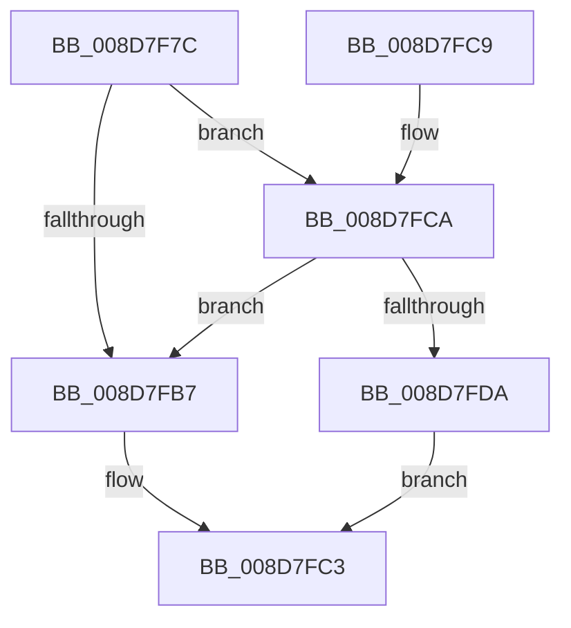

# EtwpCovSampAcquireSamplerRundown

- RVA: `0x008D7F7C`–`0x008D7FE6` (길이 `106` bytes)
- VA: `0x00000001408D7F7C`
- 실행 섹션: `PAGE`
- PDB 이름 있음: `예`; PDB Function 태그: `아니요`
- unwind 정보 RVA: `0x00085560`
- 디코드: `26`개 명령, `106/106` bytes 표시
- 미해석 바이트: `0` (있으면 어셈블리에 `.byte`로 보존)

> 이 문서는 커널 이미지의 기계어와 PDB 기호를 분석해 생성했습니다. 4번과 5번은 함수 원형과 자료형을 바이너리 사용 방식에서 추정한 C 해석이며 원본 소스 복구 결과는 아닙니다.

## 1. Dependencies

- 직접 호출 지점: **2**; 고유 호출 대상: **2**
- 직접 호출자로 확인된 함수: **4**
- RIP 상대 이미지 참조: **2**

### Outgoing calls
- `0x008D7FD1` → [ExfAcquireRundownProtection](../../text/34/ExfAcquireRundownProtection_function_0034C050.md) (function, `0x0034C050`)
- `0x008D7FDA` → [KeLeaveCriticalRegion](../../text/25/KeLeaveCriticalRegion_function_0025D8B0.md) (function, `0x0025D8B0`)

### Direct callers
- [EtwpCovSampImageNotify](EtwpCovSampImageNotify_function_008D70C0.md) at `0x008D70FA`
- [EtwpCovSampSampleBufferProcess](EtwpCovSampSampleBufferProcess_function_008D96EC.md) at `0x008D9712`
- [EtwpCoverageSamplerQuery](../95/EtwpCoverageSamplerQuery_function_0095C4A0.md) at `0x0095C540`
- [EtwpCoverageSamplerUnloadImage](../A2/EtwpCoverageSamplerUnloadImage_function_00A22400.md) at `0x00A2242A`

### Static image references
- `0x008D7F96` → RVA `0x00EFF1E0` (`.data`; read)
- `0x008D7FB7` → RVA `0x00EFF1D8` (`.data`; read)

## 2. Other-region calls and transfers

- 다른 실행 섹션으로 향하는 call: **2**
  - `0x008D7FD1` → [ExfAcquireRundownProtection](../../text/34/ExfAcquireRundownProtection_function_0034C050.md) (`PAGE` → `.text`)
  - `0x008D7FDA` → [KeLeaveCriticalRegion](../../text/25/KeLeaveCriticalRegion_function_0025D8B0.md) (`PAGE` → `.text`)
- 별도 외부 분기/꼬리 이동을 확인하지 못했습니다.

## 3. Assembly (complete function range)

```asm
008D7F7C  40 53                           push rbx
008D7F7E  48 83 EC 20                     sub rsp, 0x20
008D7F82  65 48 8B 04 25 88 01 00 00      mov rax, qword ptr gs:[0x188]
008D7F8B  48 8B D9                        mov rbx, rcx
008D7F8E  66 FF 88 E4 01 00 00            dec word ptr [rax + 0x1e4]
008D7F95  90                              nop
008D7F96  0F 0D 0D 43 72 62 00            prefetchw byte ptr [rip + 0x627243]
008D7F9D  48 8B 05 3C 72 62 00            mov rax, qword ptr [rip + 0x62723c]
008D7FA4  48 83 E0 FE                     and rax, 0xfffffffffffffffe
008D7FA8  48 8D 50 02                     lea rdx, [rax + 2]
008D7FAC  F0 48 0F B1 15 2B 72 62 00      lock cmpxchg qword ptr [rip + 0x62722b], rdx
008D7FB5  75 13                           jne 0x1408d7fca
008D7FB7  48 8B 05 1A 72 62 00            mov rax, qword ptr [rip + 0x62721a]
008D7FBE  48 89 03                        mov qword ptr [rbx], rax
008D7FC1  33 C0                           xor eax, eax
008D7FC3  48 83 C4 20                     add rsp, 0x20
008D7FC7  5B                              pop rbx
008D7FC8  C3                              ret
008D7FC9  CC                              int3
008D7FCA  48 8D 0D 0F 72 62 00            lea rcx, [rip + 0x62720f]
008D7FD1  E8 7A 40 A7 FF                  call 0x14034c050
008D7FD6  84 C0                           test al, al
008D7FD8  75 DD                           jne 0x1408d7fb7
008D7FDA  E8 D1 58 98 FF                  call 0x14025d8b0
008D7FDF  B8 89 01 00 C0                  mov eax, 0xc0000189
008D7FE4  EB DD                           jmp 0x1408d7fc3
```

## 4. C-style interpretation (structured pseudocode)

```c
__int64 __fastcall EtwpCovSampAcquireSamplerRundown(__int64 a1)
{
    __int64 result;
    __int64 v_rsp;

    v_rsp = (v_rsp) - (32);
    result = (*(unsigned __int64 *)(v_rip + 6451772)) & (-2);
    if (condition_is_not_equal) goto loc_008D7FCA;
loc_008D7FB7:
    *(unsigned __int64 *)(a1) = *(unsigned __int64 *)(v_rip + 6451738);
    result = 0;
loc_008D7FC3:
    v_rsp = (v_rsp) + (32);
    return result;
loc_008D7FCA:
    result = ExfAcquireRundownProtection(v_rip + 6451727, result + 2, a3, a4);
    if ((unsigned __int8)(result) != 0) goto loc_008D7FB7;
    result = KeLeaveCriticalRegion(v_rip + 6451727, result + 2, a3, a4);
    goto loc_008D7FC3;
}
```

## 5. (Beta) C Style

```c
int64_t EtwpCovSampAcquireSamplerRundown(void *Arg1)
{
    uint8_t *arg1 = (uint8_t *)Arg1;

    int64_t result;
    int64_t local_rsp;

    local_rsp = (local_rsp) - (32);
    result = (*(uint64_t *)(v_rip + 0x62723C)) & (-2);
    if (condition_is_not_equal) goto loc_008D7FCA;
loc_008D7FB7:
    *(uint64_t *)(arg1) = *(uint64_t *)(v_rip + 0x62721A);
    result = 0;
loc_008D7FC3:
    local_rsp = (local_rsp) + (32);
    return result;
loc_008D7FCA:
    result = ExfAcquireRundownProtection(v_rip + 6451727, result + 2, a3, a4);
    if ((uint8_t)(result) != 0) goto loc_008D7FB7;
    result = KeLeaveCriticalRegion(v_rip + 6451727, result + 2, a3, a4);
    goto loc_008D7FC3;
}
```

### 관측된 메모리 오프셋

구조체 형식이 확인되지 않은 접근은 인자 기준의 오프셋으로만 기록했습니다.

| 기준 인자 | 오프셋 표현 | 폭 (bit) | 접근 |
|---|---:|---:|---|
| `Arg1` | `+ 0x0` | `64` | `W` |

## 6. Execution-region graph

[열기: 2D/3D 그래프와 함수 탐색 컨트롤 패널](../../../control-panel.html?section=page&rva=0x008D7F7C&view=graph)

- 2D 그래프는 위에서 아래로 흐르고, 3D 그래프는 빈 공간을 드래그해 회전합니다. Shift+드래그는 이동, 휠은 확대·축소, 함수 노드 선택은 대상 보고서 이동입니다.

### Static fallback


