# EtwpCovSampCaptureBufferMapAddressesAndQueue

- RVA: `0x008D7430`–`0x008D77EF` (길이 `959` bytes)
- VA: `0x00000001408D7430`
- 실행 섹션: `PAGE`
- PDB 이름 있음: `예`; PDB Function 태그: `예`
- unwind 정보 RVA: `0x000854B4`
- 디코드: `223`개 명령, `959/959` bytes 표시
- 미해석 바이트: `0` (있으면 어셈블리에 `.byte`로 보존)

> 이 문서는 커널 이미지의 기계어와 PDB 기호를 분석해 생성했습니다. 4번과 5번은 함수 원형과 자료형을 바이너리 사용 방식에서 추정한 C 해석이며 원본 소스 복구 결과는 아닙니다.

## 1. Dependencies

- 직접 호출 지점: **12**; 고유 호출 대상: **11**
- 직접 호출자로 확인된 함수: **1**
- RIP 상대 이미지 참조: **2**

### Outgoing calls
- `0x008D7459` → [EtwpCovSampCaptureBufferIsEmpty](../../text/47/EtwpCovSampCaptureBufferIsEmpty_function_00472260.md) (function, `0x00472260`)
- `0x008D753C` → [KeAbPreAcquire](../../text/21/KeAbPreAcquire_function_00210230.md) (function, `0x00210230`)
- `0x008D7558` → [ExfAcquirePushLockExclusiveEx](../../text/20/ExfAcquirePushLockExclusiveEx_function_0020FC90.md) (function, `0x0020FC90`)
- `0x008D75AF` → [KeAbPostRelease](../../text/2E/KeAbPostRelease_function_002E1600.md) (function, `0x002E1600`)
- `0x008D75BD` → [KeLeaveCriticalRegionThread](../../text/25/KeLeaveCriticalRegionThread_function_0025EFF0.md) (function, `0x0025EFF0`)
- `0x008D7615` → [EtwpCovSampCaptureBufferQueue](../../text/43/EtwpCovSampCaptureBufferQueue_function_0043C234.md) (function, `0x0043C234`)
- `0x008D761F` → [EtwpCovSampReleaseSamplerRundown](EtwpCovSampReleaseSamplerRundown_function_008D7850.md) (function, `0x008D7850`)
- `0x008D7682` → [EtwpCovSampProcessUpperBoundModule](EtwpCovSampProcessUpperBoundModule_function_008D7800.md) (function, `0x008D7800`)
- `0x008D775F` → [ExfTryToWakePushLock](../../text/26/ExfTryToWakePushLock_function_00265DD0.md) (function, `0x00265DD0`)
- `0x008D7770` → [ExfAcquireRundownProtection](../../text/34/ExfAcquireRundownProtection_function_0034C050.md) (function, `0x0034C050`)
- `0x008D7786` → [KeLeaveCriticalRegionThread](../../text/25/KeLeaveCriticalRegionThread_function_0025EFF0.md) (function, `0x0025EFF0`)
- `0x008D77A1` → [EtwpCovSampCaptureBufferRelease](../../text/43/EtwpCovSampCaptureBufferRelease_function_0043C4B4.md) (function, `0x0043C4B4`)

### Direct callers
- [EtwpCovSampCaptureUserAddresses](EtwpCovSampCaptureUserAddresses_function_008D73BC.md) at `0x008D73FB`

### Static image references
- `0x008D7477` → RVA `0x00EFF1E0` (`.data`; read)
- `0x008D74A3` → RVA `0x00EFF1D8` (`.data`; read)

## 2. Other-region calls and transfers

- 다른 실행 섹션으로 향하는 call: **10**
  - `0x008D7459` → [EtwpCovSampCaptureBufferIsEmpty](../../text/47/EtwpCovSampCaptureBufferIsEmpty_function_00472260.md) (`PAGE` → `.text`)
  - `0x008D753C` → [KeAbPreAcquire](../../text/21/KeAbPreAcquire_function_00210230.md) (`PAGE` → `.text`)
  - `0x008D7558` → [ExfAcquirePushLockExclusiveEx](../../text/20/ExfAcquirePushLockExclusiveEx_function_0020FC90.md) (`PAGE` → `.text`)
  - `0x008D75AF` → [KeAbPostRelease](../../text/2E/KeAbPostRelease_function_002E1600.md) (`PAGE` → `.text`)
  - `0x008D75BD` → [KeLeaveCriticalRegionThread](../../text/25/KeLeaveCriticalRegionThread_function_0025EFF0.md) (`PAGE` → `.text`)
  - `0x008D7615` → [EtwpCovSampCaptureBufferQueue](../../text/43/EtwpCovSampCaptureBufferQueue_function_0043C234.md) (`PAGE` → `.text`)
  - `0x008D775F` → [ExfTryToWakePushLock](../../text/26/ExfTryToWakePushLock_function_00265DD0.md) (`PAGE` → `.text`)
  - `0x008D7770` → [ExfAcquireRundownProtection](../../text/34/ExfAcquireRundownProtection_function_0034C050.md) (`PAGE` → `.text`)
  - `0x008D7786` → [KeLeaveCriticalRegionThread](../../text/25/KeLeaveCriticalRegionThread_function_0025EFF0.md) (`PAGE` → `.text`)
  - `0x008D77A1` → [EtwpCovSampCaptureBufferRelease](../../text/43/EtwpCovSampCaptureBufferRelease_function_0043C4B4.md) (`PAGE` → `.text`)
- call이 아닌 외부 분기/꼬리 이동: **2**
  - `0x008D77C6` → [sub_00B1BF5E](../B1/Unknown_function_00B1BF5E.md) (`tail-transfer`)
  - `0x008D77D3` → [sub_00B1BF5E](../B1/Unknown_function_00B1BF5E.md) (`tail-transfer`)

## 3. Assembly (complete function range)

```asm
008D7430  48 89 5C 24 10                  mov qword ptr [rsp + 0x10], rbx
008D7435  48 89 4C 24 08                  mov qword ptr [rsp + 8], rcx
008D743A  55                              push rbp
008D743B  56                              push rsi
008D743C  57                              push rdi
008D743D  41 54                           push r12
008D743F  41 55                           push r13
008D7441  41 56                           push r14
008D7443  41 57                           push r15
008D7445  48 83 EC 40                     sub rsp, 0x40
008D7449  4C 8B F9                        mov r15, rcx
008D744C  33 F6                           xor esi, esi
008D744E  48 8B CA                        mov rcx, rdx
008D7451  48 89 74 24 38                  mov qword ptr [rsp + 0x38], rsi
008D7456  48 8B EA                        mov rbp, rdx
008D7459  E8 02 AE B9 FF                  call 0x140472260
008D745E  85 C0                           test eax, eax
008D7460  0F 85 2C 03 00 00               jne 0x1408d7792
008D7466  65 48 8B 04 25 88 01 00 00      mov rax, qword ptr gs:[0x188]
008D746F  66 FF 88 E4 01 00 00            dec word ptr [rax + 0x1e4]
008D7476  90                              nop
008D7477  0F 0D 0D 62 7D 62 00            prefetchw byte ptr [rip + 0x627d62]
008D747E  48 8B 05 5B 7D 62 00            mov rax, qword ptr [rip + 0x627d5b]
008D7485  48 83 E0 FE                     and rax, 0xfffffffffffffffe
008D7489  48 8D 48 02                     lea rcx, [rax + 2]
008D748D  F0 48 0F B1 0D 4A 7D 62 00      lock cmpxchg qword ptr [rip + 0x627d4a], rcx
008D7496  0F 85 CD 02 00 00               jne 0x1408d7769
008D749C  48 C7 C3 FF FF FF FF            mov rbx, 0xffffffffffffffff
008D74A3  48 8B 15 2E 7D 62 00            mov rdx, qword ptr [rip + 0x627d2e]
008D74AA  0F B7 45 3E                     movzx eax, word ptr [rbp + 0x3e]
008D74AE  48 89 54 24 38                  mov qword ptr [rsp + 0x38], rdx
008D74B3  48 89 74 24 28                  mov qword ptr [rsp + 0x28], rsi
008D74B8  49 39 B7 20 05 00 00            cmp qword ptr [r15 + 0x520], rsi
008D74BF  0F 85 E6 02 00 00               jne 0x1408d77ab
008D74C5  B8 40 00 00 00                  mov eax, 0x40
008D74CA  48 8B CD                        mov rcx, rbp
008D74CD  4C 8D 34 01                     lea r14, [rcx + rax]
008D74D1  65 48 8B 04 25 88 01 00 00      mov rax, qword ptr gs:[0x188]
008D74DA  48 8B 88 B8 00 00 00            mov rcx, qword ptr [rax + 0xb8]
008D74E1  48 8B B9 70 07 00 00            mov rdi, qword ptr [rcx + 0x770]
008D74E8  48 85 FF                        test rdi, rdi
008D74EB  0F 84 A1 02 00 00               je 0x1408d7792
008D74F1  0F B7 45 3C                     movzx eax, word ptr [rbp + 0x3c]
008D74F5  48 8D 4F 08                     lea rcx, [rdi + 8]
008D74F9  44 0F B7 6D 3E                  movzx r13d, word ptr [rbp + 0x3e]
008D74FE  48 83 C2 10                     add rdx, 0x10
008D7502  89 84 24 98 00 00 00            mov dword ptr [rsp + 0x98], eax
008D7509  45 33 C0                        xor r8d, r8d
008D750C  48 B8 20 03 00 00 80 F7 FF FF   movabs rax, 0xfffff78000000320
008D7516  48 89 54 24 30                  mov qword ptr [rsp + 0x30], rdx
008D751B  33 D2                           xor edx, edx
008D751D  44 89 6C 24 20                  mov dword ptr [rsp + 0x20], r13d
008D7522  44 8B E6                        mov r12d, esi
008D7525  8B 00                           mov eax, dword ptr [rax]
008D7527  89 44 24 24                     mov dword ptr [rsp + 0x24], eax
008D752B  65 48 8B 04 25 88 01 00 00      mov rax, qword ptr gs:[0x188]
008D7534  66 FF 88 E4 01 00 00            dec word ptr [rax + 0x1e4]
008D753B  90                              nop
008D753C  E8 EF 8C 93 FF                  call 0x140210230
008D7541  F0 48 0F BA 6F 08 00            lock bts qword ptr [rdi + 8], 0
008D7548  48 8B F0                        mov rsi, rax
008D754B  73 10                           jae 0x1408d755d
008D754D  4C 8D 47 08                     lea r8, [rdi + 8]
008D7551  48 8B D0                        mov rdx, rax
008D7554  48 8D 4F 08                     lea rcx, [rdi + 8]
008D7558  E8 33 87 93 FF                  call 0x14020fc90
008D755D  48 85 F6                        test rsi, rsi
008D7560  74 04                           je 0x1408d7566
008D7562  C6 46 0A 01                     mov byte ptr [rsi + 0xa], 1
008D7566  65 48 8B 04 25 88 01 00 00      mov rax, qword ptr gs:[0x188]
008D756F  4C 8B 44 24 30                  mov r8, qword ptr [rsp + 0x30]
008D7574  48 89 47 10                     mov qword ptr [rdi + 0x10], rax
008D7578  4C 3B 07                        cmp r8, qword ptr [rdi]
008D757B  0F 84 BC 00 00 00               je 0x1408d763d
008D7581  48 8B 4F 10                     mov rcx, qword ptr [rdi + 0x10]
008D7585  65 48 8B 04 25 88 01 00 00      mov rax, qword ptr gs:[0x188]
008D758E  48 3B C8                        cmp rcx, rax
008D7591  75 34                           jne 0x1408d75c7
008D7593  33 C9                           xor ecx, ecx
008D7595  48 89 4F 10                     mov qword ptr [rdi + 0x10], rcx
008D7599  F0 48 0F C1 5F 08               lock xadd qword ptr [rdi + 8], rbx
008D759F  80 E3 06                        and bl, 6
008D75A2  80 FB 02                        cmp bl, 2
008D75A5  0F 84 B0 01 00 00               je 0x1408d775b
008D75AB  48 8D 4F 08                     lea rcx, [rdi + 8]
008D75AF  E8 4C A0 A0 FF                  call 0x1402e1600
008D75B4  65 48 8B 0C 25 88 01 00 00      mov rcx, qword ptr gs:[0x188]
008D75BD  E8 2E 7A 98 FF                  call 0x14025eff0
008D75C2  4C 8B 44 24 30                  mov r8, qword ptr [rsp + 0x30]
008D75C7  B8 6C 04 00 00                  mov eax, 0x46c
008D75CC  49 8D 88 E0 04 00 00            lea rcx, [r8 + 0x4e0]
008D75D3  48 3B F9                        cmp rdi, rcx
008D75D6  BA 74 04 00 00                  mov edx, 0x474
008D75DB  41 B9 68 04 00 00               mov r9d, 0x468
008D75E1  0F 45 D0                        cmovne edx, eax
008D75E4  B8 70 04 00 00                  mov eax, 0x470
008D75E9  41 0F 45 C1                     cmovne eax, r9d
008D75ED  F0 46 01 2C 00                  lock add dword ptr [rax + r8], r13d
008D75F2  F0 46 01 24 02                  lock add dword ptr [rdx + r8], r12d
008D75F7  8B 45 38                        mov eax, dword ptr [rbp + 0x38]
008D75FA  83 E0 F4                        and eax, 0xfffffff4
008D75FD  66 44 89 65 3E                  mov word ptr [rbp + 0x3e], r12w
008D7602  89 45 38                        mov dword ptr [rbp + 0x38], eax
008D7605  66 45 85 E4                     test r12w, r12w
008D7609  0F 85 D5 01 00 00               jne 0x1408d77e4
008D760F  48 8B D5                        mov rdx, rbp
008D7612  49 8B CF                        mov rcx, r15
008D7615  E8 1A 4C B6 FF                  call 0x14043c234
008D761A  48 8B 4C 24 38                  mov rcx, qword ptr [rsp + 0x38]
008D761F  E8 2C 02 00 00                  call 0x1408d7850
008D7624  48 8B 9C 24 88 00 00 00         mov rbx, qword ptr [rsp + 0x88]
008D762C  48 83 C4 40                     add rsp, 0x40
008D7630  41 5F                           pop r15
008D7632  41 5E                           pop r14
008D7634  41 5D                           pop r13
008D7636  41 5C                           pop r12
008D7638  5F                              pop rdi
008D7639  5E                              pop rsi
008D763A  5D                              pop rbp
008D763B  C3                              ret
008D763C  CC                              int3
008D763D  44 8B 8C 24 98 00 00 00         mov r9d, dword ptr [rsp + 0x98]
008D7645  45 85 C9                        test r9d, r9d
008D7648  0F 84 33 FF FF FF               je 0x1408d7581
008D764E  33 C0                           xor eax, eax
008D7650  44 8B C0                        mov r8d, eax
008D7653  89 84 24 90 00 00 00            mov dword ptr [rsp + 0x90], eax
008D765A  44 8B E8                        mov r13d, eax
008D765D  44 8B E0                        mov r12d, eax
008D7660  44 8B F8                        mov r15d, eax
008D7663  39 44 24 20                     cmp dword ptr [rsp + 0x20], eax
008D7667  76 67                           jbe 0x1408d76d0
008D7669  8B 5C 24 24                     mov ebx, dword ptr [rsp + 0x24]
008D766D  0F 1F 00                        nop dword ptr [rax]
008D7670  49 8B 36                        mov rsi, qword ptr [r14]
008D7673  4D 85 ED                        test r13, r13
008D7676  0F 85 B0 00 00 00               jne 0x1408d772c
008D767C  48 8B D6                        mov rdx, rsi
008D767F  48 8B CF                        mov rcx, rdi
008D7682  E8 79 01 00 00                  call 0x1408d7800
008D7687  44 8B 84 24 90 00 00 00         mov r8d, dword ptr [rsp + 0x90]
008D768F  44 8B 8C 24 98 00 00 00         mov r9d, dword ptr [rsp + 0x98]
008D7697  3B 47 20                        cmp eax, dword ptr [rdi + 0x20]
008D769A  73 1A                           jae 0x1408d76b6
008D769C  8B C0                           mov eax, eax
008D769E  48 C1 E0 04                     shl rax, 4
008D76A2  48 03 47 18                     add rax, qword ptr [rdi + 0x18]
008D76A6  48 8B 50 08                     mov rdx, qword ptr [rax + 8]
008D76AA  4C 8B 20                        mov r12, qword ptr [rax]
008D76AD  4C 2B 62 28                     sub r12, qword ptr [rdx + 0x28]
008D76B1  49 3B F4                        cmp rsi, r12
008D76B4  73 39                           jae 0x1408d76ef
008D76B6  41 FF C7                        inc r15d
008D76B9  49 83 C6 08                     add r14, 8
008D76BD  B8 00 00 00 00                  mov eax, 0
008D76C2  44 3B 7C 24 20                  cmp r15d, dword ptr [rsp + 0x20]
008D76C7  72 A7                           jb 0x1408d7670
008D76C9  48 C7 C3 FF FF FF FF            mov rbx, 0xffffffffffffffff
008D76D0  4C 8B BC 24 80 00 00 00         mov r15, qword ptr [rsp + 0x80]
008D76D8  44 8B A4 24 90 00 00 00         mov r12d, dword ptr [rsp + 0x90]
008D76E0  44 8B 6C 24 20                  mov r13d, dword ptr [rsp + 0x20]
008D76E5  4C 8B 44 24 30                  mov r8, qword ptr [rsp + 0x30]
008D76EA  E9 92 FE FF FF                  jmp 0x1408d7581
008D76EF  4C 8B E8                        mov r13, rax
008D76F2  83 BA 84 00 00 00 00            cmp dword ptr [rdx + 0x84], 0
008D76F9  89 9A 88 00 00 00               mov dword ptr [rdx + 0x88], ebx
008D76FF  74 4D                           je 0x1408d774e
008D7701  41 8B C0                        mov eax, r8d
008D7704  41 2B F4                        sub esi, r12d
008D7707  41 FF C0                        inc r8d
008D770A  44 89 84 24 90 00 00 00         mov dword ptr [rsp + 0x90], r8d
008D7712  48 8D 0C C5 00 00 00 00         lea rcx, [rax*8]
008D771A  8B 42 7C                        mov eax, dword ptr [rdx + 0x7c]
008D771D  89 44 29 40                     mov dword ptr [rcx + rbp + 0x40], eax
008D7721  89 74 29 44                     mov dword ptr [rcx + rbp + 0x44], esi
008D7725  45 3B C1                        cmp r8d, r9d
008D7728  72 8C                           jb 0x1408d76b6
008D772A  EB 9D                           jmp 0x1408d76c9
008D772C  49 3B F4                        cmp rsi, r12
008D772F  72 15                           jb 0x1408d7746
008D7731  49 3B 75 00                     cmp rsi, qword ptr [r13]
008D7735  73 0F                           jae 0x1408d7746
008D7737  49 8B 55 08                     mov rdx, qword ptr [r13 + 8]
008D773B  48 85 D2                        test rdx, rdx
008D773E  0F 84 38 FF FF FF               je 0x1408d767c
008D7744  EB AC                           jmp 0x1408d76f2
008D7746  4C 8B E8                        mov r13, rax
008D7749  E9 2E FF FF FF                  jmp 0x1408d767c
008D774E  B8 01 00 00 00                  mov eax, 1
008D7753  87 82 84 00 00 00               xchg dword ptr [rdx + 0x84], eax
008D7759  EB A6                           jmp 0x1408d7701
008D775B  48 8D 4F 08                     lea rcx, [rdi + 8]
008D775F  E8 6C E6 98 FF                  call 0x140265dd0
008D7764  E9 42 FE FF FF                  jmp 0x1408d75ab
008D7769  48 8D 0D 70 7A 62 00            lea rcx, [rip + 0x627a70]
008D7770  E8 DB 48 A7 FF                  call 0x14034c050
008D7775  84 C0                           test al, al
008D7777  0F 85 1F FD FF FF               jne 0x1408d749c
008D777D  65 48 8B 0C 25 88 01 00 00      mov rcx, qword ptr gs:[0x188]
008D7786  E8 65 78 98 FF                  call 0x14025eff0
008D778B  EB 05                           jmp 0x1408d7792
008D778D  45 85 E4                        test r12d, r12d
008D7790  74 46                           je 0x1408d77d8
008D7792  48 85 ED                        test rbp, rbp
008D7795  0F 84 7F FE FF FF               je 0x1408d761a
008D779B  48 8B D5                        mov rdx, rbp
008D779E  49 8B CF                        mov rcx, r15
008D77A1  E8 0E 4D B6 FF                  call 0x14043c4b4
008D77A6  E9 6F FE FF FF                  jmp 0x1408d761a
008D77AB  4D 8B B7 20 05 00 00            mov r14, qword ptr [r15 + 0x520]
008D77B2  44 8B E6                        mov r12d, esi
008D77B5  89 B4 24 90 00 00 00            mov dword ptr [rsp + 0x90], esi
008D77BC  49 8B B7 28 05 00 00            mov rsi, qword ptr [r15 + 0x528]
008D77C3  4C 3B F6                        cmp r14, rsi
008D77C6  0F 85 92 47 24 00               jne 0x140b1bf5e
008D77CC  49 8B B7 30 05 00 00            mov rsi, qword ptr [r15 + 0x530]
008D77D3  E9 86 47 24 00                  jmp 0x140b1bf5e
008D77D8  48 8B 54 24 38                  mov rdx, qword ptr [rsp + 0x38]
008D77DD  33 F6                           xor esi, esi
008D77DF  E9 E1 FC FF FF                  jmp 0x1408d74c5
008D77E4  83 C8 04                        or eax, 4
008D77E7  89 45 38                        mov dword ptr [rbp + 0x38], eax
008D77EA  E9 20 FE FF FF                  jmp 0x1408d760f
```

## 4. C-style interpretation (structured pseudocode)

```c
__int64 __fastcall EtwpCovSampCaptureBufferMapAddressesAndQueue(__int64 a1, __int64 a2, int a3)
{
    __int64 result;
    __int64 v_r12;
    __int64 v_r14;
    __int64 v_r15;
    __int64 v_rbx;
    __int64 v_rsi;
    __int64 v_rsp;
    unsigned __int64 v_stack_m40;
    unsigned __int64 v_stack_m48;
    unsigned __int64 v_stack_m50;
    unsigned int v_stack_m54;
    unsigned int v_stack_m58;
    unsigned __int64 v_stack_p10;
    unsigned int v_stack_p20;
    unsigned int v_stack_p24;
    unsigned __int64 v_stack_p30;
    unsigned __int64 v_stack_p38;
    unsigned __int64 v_stack_p8;
    unsigned __int64 v_stack_p80;
    unsigned int v_stack_p90;
    unsigned int v_stack_p98;

    v_stack_p10 = v_rbx;
    v_stack_p8 = a1;
    v_rsp = (v_rsp) - (64);
    v_rsi = 0;
    v_stack_m40 = 0;
    result = EtwpCovSampCaptureBufferIsEmpty(a2, a2, a3, a4);
    if ((unsigned int)(result) != 0) goto loc_008D7792;
    result = (*(unsigned __int64 *)(v_rip + 6454619)) & (-2);
    if (condition_is_not_equal) goto loc_008D7769;
loc_008D749C:
    v_stack_m40 = *(unsigned __int64 *)(v_rip + 6454574);
    v_stack_m50 = 0;
    if ((*(unsigned __int64 *)(a1 + 1312)) != 0) goto loc_008D77AB;
loc_008D74C5:
    if (*(unsigned __int64 *)(*(unsigned __int64 *)(*(unsigned __int64 *)(gs_base + (0 + 392)) + 184) + 1904) == 0) goto loc_008D7792;
    a2 = (*(unsigned __int64 *)(v_rip + 6454574)) + (16);
    v_stack_p20 = (unsigned int)(*(unsigned __int16 *)(a2 + 60));
    a3 = 0;
    v_stack_m48 = a2;
    a2 = 0;
    v_stack_m58 = (unsigned int)(*(unsigned __int16 *)(a2 + 62));
    v_stack_m54 = (unsigned int)((unsigned int)(*(unsigned int *)(*(unsigned __int16 *)(a2 + 60))));
    result = KeAbPreAcquire(*(unsigned __int64 *)(*(unsigned __int64 *)(*(unsigned __int64 *)(gs_base + (0 + 392)) + 184) + 1904) + 8, a2, a3, a4);
    if (!(condition_is_above_or_equal)) {
        a3 = *(unsigned __int64 *)(*(unsigned __int64 *)(*(unsigned __int64 *)(gs_base + (0 + 392)) + 184) + 1904) + 8;
        a2 = result;
        a1 = *(unsigned __int64 *)(*(unsigned __int64 *)(*(unsigned __int64 *)(gs_base + (0 + 392)) + 184) + 1904) + 8;
        result = ExfAcquirePushLockExclusiveEx(a1, a2, a3, a4);
    }
    if (result != 0) {
        *(unsigned __int8 *)(result + 10) = 1;
    }
    *(unsigned __int64 *)(*(unsigned __int64 *)(*(unsigned __int64 *)(*(unsigned __int64 *)(gs_base + (0 + 392)) + 184) + 1904) + 16) = *(unsigned __int64 *)(gs_base + (0 + 392));
    if (v_stack_m48 == (*(unsigned __int64 *)(*(unsigned __int64 *)(*(unsigned __int64 *)(*(unsigned __int64 *)(gs_base + (0 + 392)) + 184) + 1904)))) goto loc_008D763D;
loc_008D7581:
    if ((*(unsigned __int64 *)(*(unsigned __int64 *)(*(unsigned __int64 *)(*(unsigned __int64 *)(gs_base + (0 + 392)) + 184) + 1904) + 16)) != (*(unsigned __int64 *)(gs_base + (0 + 392)))) goto loc_008D75C7;
    a1 = 0;
    *(unsigned __int64 *)(*(unsigned __int64 *)(*(unsigned __int64 *)(*(unsigned __int64 *)(gs_base + (0 + 392)) + 184) + 1904) + 16) = 0;
    v_rbx = (unsigned __int8)((-1) & (6));
    if (((unsigned __int8)(v_rbx)) == 2) goto loc_008D775B;
loc_008D75AB:
    result = KeAbPostRelease(*(unsigned __int64 *)(*(unsigned __int64 *)(*(unsigned __int64 *)(gs_base + (0 + 392)) + 184) + 1904) + 8, a2, v_stack_m48, a4);
    result = KeLeaveCriticalRegionThread(*(unsigned __int64 *)(gs_base + (0 + 392)), a2, v_stack_m48, a4);
loc_008D75C7:
    a2 = (unsigned int)(0x474ULL);
    if ((*(unsigned __int64 *)(*(unsigned __int64 *)(*(unsigned __int64 *)(gs_base + (0 + 392)) + 184) + 1904)) != (v_stack_m48 + 1248)) { a2 = (unsigned int)((unsigned int)(0x46CULL)); }
    result = (unsigned int)(0x470ULL);
    if ((*(unsigned __int64 *)(*(unsigned __int64 *)(*(unsigned __int64 *)(gs_base + (0 + 392)) + 184) + 1904)) != (v_stack_m48 + 1248)) { result = (unsigned int)((unsigned int)(0x468ULL)); }
    result = (unsigned int)(((unsigned int)(*(unsigned int *)(a2 + 56))) & (0xFFFFFFF4ULL));
    *(unsigned __int16 *)(a2 + 62) = 0;
    *(unsigned int *)(a2 + 56) = (unsigned int)(result);
    if (0 != 0) goto loc_008D77E4;
loc_008D760F:
    result = EtwpCovSampCaptureBufferQueue(0, a2, v_stack_m48, (unsigned int)(0x468ULL));
loc_008D761A:
    result = EtwpCovSampReleaseSamplerRundown(v_stack_m40, a2, v_stack_m48, (unsigned int)(0x468ULL));
    v_rsp = (v_rsp) + (64);
    return result;
loc_008D763D:
    if ((unsigned int)((unsigned int)(v_stack_p98)) == 0) goto loc_008D7581;
    result = 0;
    v_stack_p90 = 0;
    if (v_stack_p20 <= 0) goto loc_008D76D0;
loc_008D7670:
    if (0 != 0) goto loc_008D772C;
loc_008D767C:
    result = EtwpCovSampProcessUpperBoundModule(*(unsigned __int64 *)(*(unsigned __int64 *)(*(unsigned __int64 *)(gs_base + (0 + 392)) + 184) + 1904), *(unsigned __int64 *)(a2 + 64 * 1), 0, (unsigned int)(v_stack_p98));
    if (((unsigned int)(result)) >= (*(unsigned int *)(*(unsigned __int64 *)(*(unsigned __int64 *)(*(unsigned __int64 *)(gs_base + (0 + 392)) + 184) + 1904) + 32))) goto loc_008D76B6;
    result = ((unsigned int)((unsigned int)(result))) << (4);
    result = (result) + (*(unsigned __int64 *)(*(unsigned __int64 *)(*(unsigned __int64 *)(*(unsigned __int64 *)(gs_base + (0 + 392)) + 184) + 1904) + 24));
    v_r12 = (*(unsigned __int64 *)(result)) - (*(unsigned __int64 *)(*(unsigned __int64 *)(result + 8) + 40));
    if ((*(unsigned __int64 *)(a2 + 64 * 1)) >= v_r12) goto loc_008D76EF;
loc_008D76B6:
    v_r15 = (unsigned int)((0) + 1);
    v_r14 = (a2 + 64 * 1) + (8);
    if (((unsigned int)(v_r15)) < v_stack_p20) goto loc_008D7670;
loc_008D76C9:
loc_008D76D0:
    goto loc_008D7581;
loc_008D76EF:
loc_008D76F2:
    *(unsigned int *)(*(unsigned __int64 *)(result + 8) + 136) = -1;
    if ((*(unsigned int *)(*(unsigned __int64 *)(result + 8) + 132)) == 0) goto loc_008D774E;
loc_008D7701:
    v_rsi = (unsigned int)((*(unsigned __int64 *)(a2 + 64 * 1)) - ((unsigned int)((unsigned int)(v_stack_p90))));
    a3 = (unsigned int)((v_stack_p30) + 1);
    v_stack_p90 = a3;
    *(unsigned int *)((unsigned int)((unsigned int)(v_stack_p30)) * 8 + a2 * 1 + 64) = (unsigned int)((unsigned int)(*(unsigned int *)(*(unsigned __int64 *)(result + 8) + 124)));
    *(unsigned int *)((unsigned int)((unsigned int)(v_stack_p30)) * 8 + a2 * 1 + 68) = (unsigned int)(v_rsi);
    if (a3 < ((unsigned int)((unsigned int)(v_stack_p98)))) goto loc_008D76B6;
    goto loc_008D76C9;
loc_008D772C:
    if (v_rsi < ((unsigned int)(v_stack_p90))) goto loc_008D7746;
    if (v_rsi >= (*(unsigned __int64 *)(0))) goto loc_008D7746;
    if (*(unsigned __int64 *)(0 + 8) == 0) goto loc_008D767C;
    goto loc_008D76F2;
loc_008D7746:
    goto loc_008D767C;
loc_008D774E:
    goto loc_008D7701;
loc_008D775B:
    result = ExfTryToWakePushLock(*(unsigned __int64 *)(*(unsigned __int64 *)(*(unsigned __int64 *)(gs_base + (0 + 392)) + 184) + 1904) + 8, *(unsigned __int64 *)(0 + 8), a3, (unsigned int)(v_stack_p98));
    goto loc_008D75AB;
loc_008D7769:
    result = ExfAcquireRundownProtection(v_rip + 6453872, *(unsigned __int64 *)(0 + 8), a3, (unsigned int)(v_stack_p98));
    if ((unsigned __int8)(result) != 0) goto loc_008D749C;
    result = KeLeaveCriticalRegionThread(*(unsigned __int64 *)(gs_base + (0 + 392)), *(unsigned __int64 *)(0 + 8), a3, (unsigned int)(v_stack_p98));
    goto loc_008D7792;
loc_008D7792:
    if (a2 == 0) goto loc_008D761A;
    result = EtwpCovSampCaptureBufferRelease(v_stack_p80, a2, a3, (unsigned int)(v_stack_p98));
    goto loc_008D761A;
loc_008D77AB:
    v_stack_p90 = (unsigned int)(v_rsi);
loc_008D77E4:
    result = (unsigned int)((result) | (4));
    *(unsigned int *)(a2 + 56) = (unsigned int)(result);
    goto loc_008D760F;
}
```

## 5. (Beta) C Style

```c
int64_t EtwpCovSampCaptureBufferMapAddressesAndQueue(void *Arg1, void *Arg2, int32_t Arg3)
{
    uint8_t *arg1 = (uint8_t *)Arg1;
    uint8_t *arg2 = (uint8_t *)Arg2;

    int64_t result;
    int64_t local_r12;
    int64_t local_r14;
    int64_t local_r15;
    int64_t local_rbx;
    int64_t local_rsi;
    int64_t local_rsp;
    uint64_t v_stack_m40;
    uint64_t v_stack_m48;
    uint64_t v_stack_m50;
    uint32_t v_stack_m54;
    uint32_t v_stack_m58;
    uint64_t v_stack_p10;
    uint32_t v_stack_p20;
    uint32_t v_stack_p24;
    uint64_t v_stack_p30;
    uint64_t v_stack_p38;
    uint64_t v_stack_p8;
    uint64_t v_stack_p80;
    uint32_t v_stack_p90;
    uint32_t v_stack_p98;

    v_stack_p10 = local_rbx;
    v_stack_p8 = Arg1;
    local_rsp = (local_rsp) - (64);
    local_rsi = 0;
    v_stack_m40 = 0;
    result = EtwpCovSampCaptureBufferIsEmpty(Arg2, Arg2, Arg3, a4);
    if ((uint32_t)(result) != 0) goto loc_008D7792;
    result = (*(uint64_t *)(v_rip + 0x627D5B)) & (-2);
    if (condition_is_not_equal) goto loc_008D7769;
loc_008D749C:
    v_stack_m40 = *(uint64_t *)(v_rip + 0x627D2E);
    v_stack_m50 = 0;
    if ((*(uint64_t *)(arg1 + 0x520)) != 0) goto loc_008D77AB;
loc_008D74C5:
    if (*(uint64_t *)(*(uint64_t *)(*(uint64_t *)(gs_base + (0 + 0x188)) + 0xB8) + 0x770) == 0) goto loc_008D7792;
    Arg2 = (*(uint64_t *)(v_rip + 0x627D2E)) + (16);
    v_stack_p20 = (uint32_t)(*(uint16_t *)(arg2 + 0x3C));
    Arg3 = 0;
    v_stack_m48 = Arg2;
    Arg2 = 0;
    v_stack_m58 = (uint32_t)(*(uint16_t *)(arg2 + 0x3E));
    v_stack_m54 = (uint32_t)((uint32_t)(*(uint32_t *)(*(uint16_t *)(arg2 + 0x3C))));
    result = KeAbPreAcquire(*(uint64_t *)(*(uint64_t *)(*(uint64_t *)(gs_base + (0 + 0x188)) + 0xB8) + 0x770) + 8, Arg2, Arg3, a4);
    if (!(condition_is_above_or_equal)) {
        Arg3 = *(uint64_t *)(*(uint64_t *)(*(uint64_t *)(gs_base + (0 + 0x188)) + 0xB8) + 0x770) + 8;
        Arg2 = result;
        Arg1 = *(uint64_t *)(*(uint64_t *)(*(uint64_t *)(gs_base + (0 + 0x188)) + 0xB8) + 0x770) + 8;
        result = ExfAcquirePushLockExclusiveEx(Arg1, Arg2, Arg3, a4);
    }
    if (result != 0) {
        *(uint8_t *)(result + 0xA) = 1;
    }
    *(uint64_t *)(*(uint64_t *)(*(uint64_t *)(*(uint64_t *)(gs_base + (0 + 0x188)) + 0xB8) + 0x770) + 0x10) = *(uint64_t *)(gs_base + (0 + 0x188));
    if (v_stack_m48 == (*(uint64_t *)(*(uint64_t *)(*(uint64_t *)(*(uint64_t *)(gs_base + (0 + 0x188)) + 0xB8) + 0x770)))) goto loc_008D763D;
loc_008D7581:
    if ((*(uint64_t *)(*(uint64_t *)(*(uint64_t *)(*(uint64_t *)(gs_base + (0 + 0x188)) + 0xB8) + 0x770) + 0x10)) != (*(uint64_t *)(gs_base + (0 + 0x188)))) goto loc_008D75C7;
    Arg1 = 0;
    *(uint64_t *)(*(uint64_t *)(*(uint64_t *)(*(uint64_t *)(gs_base + (0 + 0x188)) + 0xB8) + 0x770) + 0x10) = 0;
    local_rbx = (uint8_t)((-1) & (6));
    if (((uint8_t)(local_rbx)) == 2) goto loc_008D775B;
loc_008D75AB:
    result = KeAbPostRelease(*(uint64_t *)(*(uint64_t *)(*(uint64_t *)(gs_base + (0 + 0x188)) + 0xB8) + 0x770) + 8, Arg2, v_stack_m48, a4);
    result = KeLeaveCriticalRegionThread(*(uint64_t *)(gs_base + (0 + 0x188)), Arg2, v_stack_m48, a4);
loc_008D75C7:
    Arg2 = (uint32_t)(0x474ULL);
    if ((*(uint64_t *)(*(uint64_t *)(*(uint64_t *)(gs_base + (0 + 0x188)) + 0xB8) + 0x770)) != (v_stack_m48 + 1248)) { Arg2 = (uint32_t)((uint32_t)(0x46CULL)); }
    result = (uint32_t)(0x470ULL);
    if ((*(uint64_t *)(*(uint64_t *)(*(uint64_t *)(gs_base + (0 + 0x188)) + 0xB8) + 0x770)) != (v_stack_m48 + 1248)) { result = (uint32_t)((uint32_t)(0x468ULL)); }
    result = (uint32_t)(((uint32_t)(*(uint32_t *)(arg2 + 0x38))) & (0xFFFFFFF4ULL));
    *(uint16_t *)(arg2 + 0x3E) = 0;
    *(uint32_t *)(arg2 + 0x38) = (uint32_t)(result);
    if (0 != 0) goto loc_008D77E4;
loc_008D760F:
    result = EtwpCovSampCaptureBufferQueue(0, Arg2, v_stack_m48, (uint32_t)(0x468ULL));
loc_008D761A:
    result = EtwpCovSampReleaseSamplerRundown(v_stack_m40, Arg2, v_stack_m48, (uint32_t)(0x468ULL));
    local_rsp = (local_rsp) + (64);
    return result;
loc_008D763D:
    if ((uint32_t)((uint32_t)(v_stack_p98)) == 0) goto loc_008D7581;
    result = 0;
    v_stack_p90 = 0;
    if (v_stack_p20 <= 0) goto loc_008D76D0;
loc_008D7670:
    if (0 != 0) goto loc_008D772C;
loc_008D767C:
    result = EtwpCovSampProcessUpperBoundModule(*(uint64_t *)(*(uint64_t *)(*(uint64_t *)(gs_base + (0 + 0x188)) + 0xB8) + 0x770), *(uint64_t *)(arg2 + 0x40 * 1), 0, (uint32_t)(v_stack_p98));
    if (((uint32_t)(result)) >= (*(uint32_t *)(*(uint64_t *)(*(uint64_t *)(*(uint64_t *)(gs_base + (0 + 0x188)) + 0xB8) + 0x770) + 0x20))) goto loc_008D76B6;
    result = ((uint32_t)((uint32_t)(result))) << (4);
    result = (result) + (*(uint64_t *)(*(uint64_t *)(*(uint64_t *)(*(uint64_t *)(gs_base + (0 + 0x188)) + 0xB8) + 0x770) + 0x18));
    local_r12 = (*(uint64_t *)(result)) - (*(uint64_t *)(*(uint64_t *)(result + 0x8) + 0x28));
    if ((*(uint64_t *)(arg2 + 0x40 * 1)) >= local_r12) goto loc_008D76EF;
loc_008D76B6:
    local_r15 = (uint32_t)((0) + 1);
    local_r14 = (Arg2 + 64 * 1) + (8);
    if (((uint32_t)(local_r15)) < v_stack_p20) goto loc_008D7670;
loc_008D76C9:
loc_008D76D0:
    goto loc_008D7581;
loc_008D76EF:
loc_008D76F2:
    *(uint32_t *)(*(uint64_t *)(result + 0x8) + 0x88) = -1;
    if ((*(uint32_t *)(*(uint64_t *)(result + 0x8) + 0x84)) == 0) goto loc_008D774E;
loc_008D7701:
    local_rsi = (uint32_t)((*(uint64_t *)(arg2 + 0x40 * 1)) - ((uint32_t)((uint32_t)(v_stack_p90))));
    Arg3 = (uint32_t)((v_stack_p30) + 1);
    v_stack_p90 = Arg3;
    *(uint32_t *)((uint32_t)((uint32_t)(v_stack_p30)) * 8 + arg2 * 1 + 0x40) = (uint32_t)((uint32_t)(*(uint32_t *)(*(uint64_t *)(result + 0x8) + 0x7C)));
    *(uint32_t *)((uint32_t)((uint32_t)(v_stack_p30)) * 8 + arg2 * 1 + 0x44) = (uint32_t)(local_rsi);
    if (Arg3 < ((uint32_t)((uint32_t)(v_stack_p98)))) goto loc_008D76B6;
    goto loc_008D76C9;
loc_008D772C:
    if (local_rsi < ((uint32_t)(v_stack_p90))) goto loc_008D7746;
    if (local_rsi >= (*(uint64_t *)(0))) goto loc_008D7746;
    if (*(uint64_t *)(0 + 0x8) == 0) goto loc_008D767C;
    goto loc_008D76F2;
loc_008D7746:
    goto loc_008D767C;
loc_008D774E:
    goto loc_008D7701;
loc_008D775B:
    result = ExfTryToWakePushLock(*(uint64_t *)(*(uint64_t *)(*(uint64_t *)(gs_base + (0 + 0x188)) + 0xB8) + 0x770) + 8, *(uint64_t *)(0 + 0x8), Arg3, (uint32_t)(v_stack_p98));
    goto loc_008D75AB;
loc_008D7769:
    result = ExfAcquireRundownProtection(v_rip + 6453872, *(uint64_t *)(0 + 0x8), Arg3, (uint32_t)(v_stack_p98));
    if ((uint8_t)(result) != 0) goto loc_008D749C;
    result = KeLeaveCriticalRegionThread(*(uint64_t *)(gs_base + (0 + 0x188)), *(uint64_t *)(0 + 0x8), Arg3, (uint32_t)(v_stack_p98));
    goto loc_008D7792;
loc_008D7792:
    if (Arg2 == NULL) goto loc_008D761A;
    result = EtwpCovSampCaptureBufferRelease(v_stack_p80, Arg2, Arg3, (uint32_t)(v_stack_p98));
    goto loc_008D761A;
loc_008D77AB:
    v_stack_p90 = (uint32_t)(local_rsi);
loc_008D77E4:
    result = (uint32_t)((result) | (4));
    *(uint32_t *)(arg2 + 0x38) = (uint32_t)(result);
    goto loc_008D760F;
}
```

### 관측된 메모리 오프셋

구조체 형식이 확인되지 않은 접근은 인자 기준의 오프셋으로만 기록했습니다.

| 기준 인자 | 오프셋 표현 | 폭 (bit) | 접근 |
|---|---:|---:|---|
| `Arg1` | `+ 0x520` | `64` | `R` |
| `Arg1` | `+ 0x528` | `64` | `R` |
| `Arg1` | `+ 0x530` | `64` | `R` |
| `Arg2` | `+ 0x0` | `64` | `R` |
| `Arg2` | `+ 0x0 + rax*1` | `64` | `R` |
| `Arg2` | `+ 0x38` | `32` | `R` |
| `Arg2` | `+ 0x38` | `32` | `W` |
| `Arg2` | `+ 0x3C` | `16` | `R` |
| `Arg2` | `+ 0x3E` | `16` | `R` |
| `Arg2` | `+ 0x3E` | `16` | `W` |

## 6. Execution-region graph

[열기: 2D/3D 그래프와 함수 탐색 컨트롤 패널](../../../control-panel.html?section=page&rva=0x008D7430&view=graph)

- 2D 그래프는 위에서 아래로 흐르고, 3D 그래프는 빈 공간을 드래그해 회전합니다. Shift+드래그는 이동, 휠은 확대·축소, 함수 노드 선택은 대상 보고서 이동입니다.

### Static fallback

```mermaid
flowchart TD
  bb_008D7430[BB_008D7430]
  bb_008D7466[BB_008D7466]
  bb_008D749C[BB_008D749C]
  bb_008D74C5[BB_008D74C5]
  bb_008D74F1[BB_008D74F1]
  bb_008D754D[BB_008D754D]
  bb_008D755D[BB_008D755D]
  bb_008D7562[BB_008D7562]
  bb_008D7566[BB_008D7566]
  bb_008D7581[BB_008D7581]
  bb_008D7593[BB_008D7593]
  bb_008D75AB[BB_008D75AB]
  bb_008D75C7[BB_008D75C7]
  bb_008D760F[BB_008D760F]
  bb_008D761A[BB_008D761A]
  bb_008D763C[BB_008D763C]
  bb_008D763D[BB_008D763D]
  bb_008D764E[BB_008D764E]
  bb_008D7669[BB_008D7669]
  bb_008D7670[BB_008D7670]
  bb_008D767C[BB_008D767C]
  bb_008D769C[BB_008D769C]
  bb_008D76B6[BB_008D76B6]
  bb_008D76C9[BB_008D76C9]
  bb_008D76D0[BB_008D76D0]
  bb_008D76EF[BB_008D76EF]
  bb_008D76F2[BB_008D76F2]
  bb_008D7701[BB_008D7701]
  bb_008D772A[BB_008D772A]
  bb_008D772C[BB_008D772C]
  bb_008D7731[BB_008D7731]
  bb_008D7737[BB_008D7737]
  bb_008D7744[BB_008D7744]
  bb_008D7746[BB_008D7746]
  bb_008D774E[BB_008D774E]
  bb_008D775B[BB_008D775B]
  bb_008D7769[BB_008D7769]
  bb_008D777D[BB_008D777D]
  bb_008D778D[BB_008D778D]
  bb_008D7792[BB_008D7792]
  bb_008D779B[BB_008D779B]
  bb_008D77AB[BB_008D77AB]
  bb_008D77CC[BB_008D77CC]
  bb_008D77D8[BB_008D77D8]
  bb_008D77E4[BB_008D77E4]
  bb_008D7430 -->|branch| bb_008D7792
  bb_008D7430 -->|fallthrough| bb_008D7466
  bb_008D7466 -->|branch| bb_008D7769
  bb_008D7466 -->|fallthrough| bb_008D749C
  bb_008D749C -->|branch| bb_008D77AB
  bb_008D749C -->|fallthrough| bb_008D74C5
  bb_008D74C5 -->|branch| bb_008D7792
  bb_008D74C5 -->|fallthrough| bb_008D74F1
  bb_008D74F1 -->|branch| bb_008D755D
  bb_008D74F1 -->|fallthrough| bb_008D754D
  bb_008D754D -->|flow| bb_008D755D
  bb_008D755D -->|branch| bb_008D7566
  bb_008D755D -->|fallthrough| bb_008D7562
  bb_008D7562 -->|flow| bb_008D7566
  bb_008D7566 -->|branch| bb_008D763D
  bb_008D7566 -->|fallthrough| bb_008D7581
  bb_008D7581 -->|branch| bb_008D75C7
  bb_008D7581 -->|fallthrough| bb_008D7593
  bb_008D7593 -->|branch| bb_008D775B
  bb_008D7593 -->|fallthrough| bb_008D75AB
  bb_008D75AB -->|flow| bb_008D75C7
  bb_008D75C7 -->|branch| bb_008D77E4
  bb_008D75C7 -->|fallthrough| bb_008D760F
  bb_008D760F -->|flow| bb_008D761A
  bb_008D763C -->|flow| bb_008D763D
  bb_008D763D -->|branch| bb_008D7581
  bb_008D763D -->|fallthrough| bb_008D764E
  bb_008D764E -->|branch| bb_008D76D0
  bb_008D764E -->|fallthrough| bb_008D7669
  bb_008D7669 -->|flow| bb_008D7670
  bb_008D7670 -->|branch| bb_008D772C
  bb_008D7670 -->|fallthrough| bb_008D767C
  bb_008D767C -->|branch| bb_008D76B6
  bb_008D767C -->|fallthrough| bb_008D769C
  bb_008D769C -->|branch| bb_008D76EF
  bb_008D769C -->|fallthrough| bb_008D76B6
  bb_008D76B6 -->|branch| bb_008D7670
  bb_008D76B6 -->|fallthrough| bb_008D76C9
  bb_008D76C9 -->|flow| bb_008D76D0
  bb_008D76D0 -->|branch| bb_008D7581
  bb_008D76EF -->|flow| bb_008D76F2
  bb_008D76F2 -->|branch| bb_008D774E
  bb_008D76F2 -->|fallthrough| bb_008D7701
  bb_008D7701 -->|branch| bb_008D76B6
  bb_008D7701 -->|fallthrough| bb_008D772A
  bb_008D772A -->|branch| bb_008D76C9
  bb_008D772C -->|branch| bb_008D7746
  bb_008D772C -->|fallthrough| bb_008D7731
  bb_008D7731 -->|branch| bb_008D7746
  bb_008D7731 -->|fallthrough| bb_008D7737
  bb_008D7737 -->|branch| bb_008D767C
  bb_008D7737 -->|fallthrough| bb_008D7744
  bb_008D7744 -->|branch| bb_008D76F2
  bb_008D7746 -->|branch| bb_008D767C
  bb_008D774E -->|branch| bb_008D7701
  bb_008D775B -->|branch| bb_008D75AB
  bb_008D7769 -->|branch| bb_008D749C
  bb_008D7769 -->|fallthrough| bb_008D777D
  bb_008D777D -->|branch| bb_008D7792
  bb_008D778D -->|branch| bb_008D77D8
  bb_008D778D -->|fallthrough| bb_008D7792
  bb_008D7792 -->|branch| bb_008D761A
  bb_008D7792 -->|fallthrough| bb_008D779B
  bb_008D779B -->|branch| bb_008D761A
  bb_008D77AB -->|fallthrough| bb_008D77CC
  bb_008D77D8 -->|branch| bb_008D74C5
  bb_008D77E4 -->|branch| bb_008D760F
```


