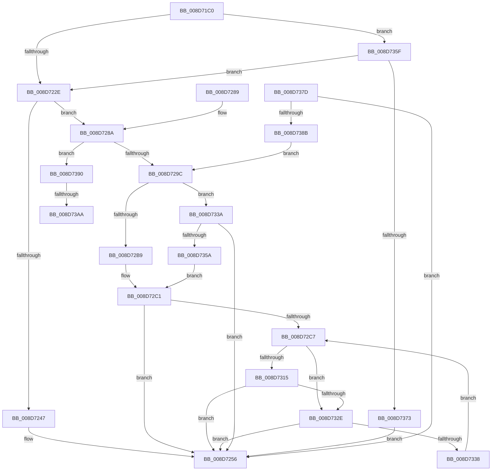

# EtwpCovSampCaptureBufferProcess

- RVA: `0x008D71C0`–`0x008D73B6` (길이 `502` bytes)
- VA: `0x00000001408D71C0`
- 실행 섹션: `PAGE`
- PDB 이름 있음: `예`; PDB Function 태그: `예`
- unwind 정보 RVA: `0x0008547C`
- 디코드: `117`개 명령, `502/502` bytes 표시
- 미해석 바이트: `0` (있으면 어셈블리에 `.byte`로 보존)

> 이 문서는 커널 이미지의 기계어와 PDB 기호를 분석해 생성했습니다. 4번과 5번은 함수 원형과 자료형을 바이너리 사용 방식에서 추정한 C 해석이며 원본 소스 복구 결과는 아닙니다.

## 1. Dependencies

- 직접 호출 지점: **7**; 고유 호출 대상: **6**
- 직접 호출자로 확인된 함수: **1**
- RIP 상대 이미지 참조: **3**

### Outgoing calls
- `0x008D7251` → [EtwpCovSampContextAddSamples](EtwpCovSampContextAddSamples_function_008D7C9C.md) (function, `0x008D7C9C`)
- `0x008D7259` → [EtwpCovSampReleaseSamplerRundown](EtwpCovSampReleaseSamplerRundown_function_008D7850.md) (function, `0x008D7850`)
- `0x008D7269` → [_security_check_cookie](../../text/6A/_security_check_cookie_function_006AC640.md) (function, `0x006AC640`)
- `0x008D7306` → [EtwpCovSampProcessMapAddresses](EtwpCovSampProcessMapAddresses_function_008D7A38.md) (function, `0x008D7A38`)
- `0x008D7320` → [EtwpCovSampContextAddSamples](EtwpCovSampContextAddSamples_function_008D7C9C.md) (function, `0x008D7C9C`)
- `0x008D7366` → [ExfAcquireRundownProtection](../../text/34/ExfAcquireRundownProtection_function_0034C050.md) (function, `0x0034C050`)
- `0x008D7373` → [KeLeaveCriticalRegion](../../text/25/KeLeaveCriticalRegion_function_0025D8B0.md) (function, `0x0025D8B0`)

### Direct callers
- [EtwpCovSampCaptureWorkerThread](../7C/EtwpCovSampCaptureWorkerThread_function_007C19B0.md) at `0x007C1A89`

### Static image references
- `0x008D71D7` → RVA `0x00E0A740` (`.data`; read)
- `0x008D7209` → RVA `0x00EFF1E0` (`.data`; read)
- `0x008D722E` → RVA `0x00EFF1D8` (`.data`; read)

## 2. Other-region calls and transfers

- 다른 실행 섹션으로 향하는 call: **3**
  - `0x008D7269` → [_security_check_cookie](../../text/6A/_security_check_cookie_function_006AC640.md) (`PAGE` → `.text`)
  - `0x008D7366` → [ExfAcquireRundownProtection](../../text/34/ExfAcquireRundownProtection_function_0034C050.md) (`PAGE` → `.text`)
  - `0x008D7373` → [KeLeaveCriticalRegion](../../text/25/KeLeaveCriticalRegion_function_0025D8B0.md) (`PAGE` → `.text`)
- call이 아닌 외부 분기/꼬리 이동: **2**
  - `0x008D73A4` → [sub_00B1BC18](../B1/Unknown_function_00B1BC18.md) (`tail-transfer`)
  - `0x008D73B1` → [sub_00B1BC18](../B1/Unknown_function_00B1BC18.md) (`tail-transfer`)

## 3. Assembly (complete function range)

```asm
008D71C0  48 89 5C 24 18                  mov qword ptr [rsp + 0x18], rbx
008D71C5  55                              push rbp
008D71C6  56                              push rsi
008D71C7  57                              push rdi
008D71C8  41 54                           push r12
008D71CA  41 55                           push r13
008D71CC  41 56                           push r14
008D71CE  41 57                           push r15
008D71D0  48 81 EC 70 02 00 00            sub rsp, 0x270
008D71D7  48 8B 05 62 35 53 00            mov rax, qword ptr [rip + 0x533562]
008D71DE  48 33 C4                        xor rax, rsp
008D71E1  48 89 84 24 60 02 00 00         mov qword ptr [rsp + 0x260], rax
008D71E9  65 48 8B 04 25 88 01 00 00      mov rax, qword ptr gs:[0x188]
008D71F2  33 ED                           xor ebp, ebp
008D71F4  48 83 CB FF                     or rbx, 0xffffffffffffffff
008D71F8  4C 8B FA                        mov r15, rdx
008D71FB  4C 8B F1                        mov r14, rcx
008D71FE  44 8B E5                        mov r12d, ebp
008D7201  66 01 98 E4 01 00 00            add word ptr [rax + 0x1e4], bx
008D7208  90                              nop
008D7209  0F 0D 0D D0 7F 62 00            prefetchw byte ptr [rip + 0x627fd0]
008D7210  48 8B 05 C9 7F 62 00            mov rax, qword ptr [rip + 0x627fc9]
008D7217  48 83 E0 FE                     and rax, 0xfffffffffffffffe
008D721B  48 8D 48 02                     lea rcx, [rax + 2]
008D721F  F0 48 0F B1 0D B8 7F 62 00      lock cmpxchg qword ptr [rip + 0x627fb8], rcx
008D7228  0F 85 31 01 00 00               jne 0x1408d735f
008D722E  4C 8B 25 A3 7F 62 00            mov r12, qword ptr [rip + 0x627fa3]
008D7235  41 8B 47 38                     mov eax, dword ptr [r15 + 0x38]
008D7239  41 0F B7 4F 3E                  movzx ecx, word ptr [r15 + 0x3e]
008D723E  4C 89 64 24 50                  mov qword ptr [rsp + 0x50], r12
008D7243  A8 04                           test al, 4
008D7245  74 43                           je 0x1408d728a
008D7247  44 8B C1                        mov r8d, ecx
008D724A  49 8D 57 40                     lea rdx, [r15 + 0x40]
008D724E  49 8B CC                        mov rcx, r12
008D7251  E8 46 0A 00 00                  call 0x1408d7c9c
008D7256  49 8B CC                        mov rcx, r12
008D7259  E8 F2 05 00 00                  call 0x1408d7850
008D725E  48 8B 8C 24 60 02 00 00         mov rcx, qword ptr [rsp + 0x260]
008D7266  48 33 CC                        xor rcx, rsp
008D7269  E8 D2 53 DD FF                  call 0x1406ac640
008D726E  48 8B 9C 24 C0 02 00 00         mov rbx, qword ptr [rsp + 0x2c0]
008D7276  48 81 C4 70 02 00 00            add rsp, 0x270
008D727D  41 5F                           pop r15
008D727F  41 5E                           pop r14
008D7281  41 5D                           pop r13
008D7283  41 5C                           pop r12
008D7285  5F                              pop rdi
008D7286  5E                              pop rsi
008D7287  5D                              pop rbp
008D7288  C3                              ret
008D7289  CC                              int3
008D728A  48 89 6C 24 48                  mov qword ptr [rsp + 0x48], rbp
008D728F  49 39 AE 20 05 00 00            cmp qword ptr [r14 + 0x520], rbp
008D7296  0F 85 F4 00 00 00               jne 0x1408d7390
008D729C  41 0F B7 77 3E                  movzx esi, word ptr [r15 + 0x3e]
008D72A1  48 B8 00 00 00 00 00 80 FF FF   movabs rax, 0xffff800000000000
008D72AB  89 6C 24 44                     mov dword ptr [rsp + 0x44], ebp
008D72AF  49 39 47 40                     cmp qword ptr [r15 + 0x40], rax
008D72B3  0F 82 81 00 00 00               jb 0x1408d733a
008D72B9  49 8D BC 24 F0 04 00 00         lea rdi, [r12 + 0x4f0]
008D72C1  8B DD                           mov ebx, ebp
008D72C3  85 F6                           test esi, esi
008D72C5  74 8F                           je 0x1408d7256
008D72C7  8B C6                           mov eax, esi
008D72C9  49 8D 54 24 10                  lea rdx, [r12 + 0x10]
008D72CE  2B C3                           sub eax, ebx
008D72D0  BD 40 00 00 00                  mov ebp, 0x40
008D72D5  3B C5                           cmp eax, ebp
008D72D7  48 8B CF                        mov rcx, rdi
008D72DA  0F 42 E8                        cmovb ebp, eax
008D72DD  8B C3                           mov eax, ebx
008D72DF  48 83 C0 08                     add rax, 8
008D72E3  44 8B CD                        mov r9d, ebp
008D72E6  4D 8D 04 C7                     lea r8, [r15 + rax*8]
008D72EA  48 8D 44 24 44                  lea rax, [rsp + 0x44]
008D72EF  48 89 44 24 30                  mov qword ptr [rsp + 0x30], rax
008D72F4  48 8D 44 24 60                  lea rax, [rsp + 0x60]
008D72F9  C7 44 24 28 40 00 00 00         mov dword ptr [rsp + 0x28], 0x40
008D7301  48 89 44 24 20                  mov qword ptr [rsp + 0x20], rax
008D7306  E8 2D 07 00 00                  call 0x1408d7a38
008D730B  44 8B 74 24 44                  mov r14d, dword ptr [rsp + 0x44]
008D7310  45 85 F6                        test r14d, r14d
008D7313  74 19                           je 0x1408d732e
008D7315  45 8B C6                        mov r8d, r14d
008D7318  48 8D 54 24 60                  lea rdx, [rsp + 0x60]
008D731D  49 8B CC                        mov rcx, r12
008D7320  E8 77 09 00 00                  call 0x1408d7c9c
008D7325  41 3B C6                        cmp eax, r14d
008D7328  0F 85 28 FF FF FF               jne 0x1408d7256
008D732E  03 DD                           add ebx, ebp
008D7330  3B DE                           cmp ebx, esi
008D7332  0F 83 1E FF FF FF               jae 0x1408d7256
008D7338  EB 8D                           jmp 0x1408d72c7
008D733A  65 48 8B 04 25 88 01 00 00      mov rax, qword ptr gs:[0x188]
008D7343  48 8B 88 B8 00 00 00            mov rcx, qword ptr [rax + 0xb8]
008D734A  48 8B B9 70 07 00 00            mov rdi, qword ptr [rcx + 0x770]
008D7351  48 85 FF                        test rdi, rdi
008D7354  0F 84 FC FE FF FF               je 0x1408d7256
008D735A  E9 62 FF FF FF                  jmp 0x1408d72c1
008D735F  48 8D 0D 7A 7E 62 00            lea rcx, [rip + 0x627e7a]
008D7366  E8 E5 4C A7 FF                  call 0x14034c050
008D736B  84 C0                           test al, al
008D736D  0F 85 BB FE FF FF               jne 0x1408d722e
008D7373  E8 38 65 98 FF                  call 0x14025d8b0
008D7378  E9 D9 FE FF FF                  jmp 0x1408d7256
008D737D  45 85 E4                        test r12d, r12d
008D7380  4C 8B 64 24 50                  mov r12, qword ptr [rsp + 0x50]
008D7385  0F 85 CB FE FF FF               jne 0x1408d7256
008D738B  E9 0C FF FF FF                  jmp 0x1408d729c
008D7390  44 8B E5                        mov r12d, ebp
008D7393  49 8B AE 20 05 00 00            mov rbp, qword ptr [r14 + 0x520]
008D739A  49 8B B6 28 05 00 00            mov rsi, qword ptr [r14 + 0x528]
008D73A1  48 3B EE                        cmp rbp, rsi
008D73A4  0F 85 6E 48 24 00               jne 0x140b1bc18
008D73AA  49 8B B6 30 05 00 00            mov rsi, qword ptr [r14 + 0x530]
008D73B1  E9 62 48 24 00                  jmp 0x140b1bc18
```

## 4. C-style interpretation (structured pseudocode)

```c
__int64 __fastcall EtwpCovSampCaptureBufferProcess(__int64 a1, __int64 a2)
{
    __int64 result;
    __int64 v_rbp;
    __int64 v_rbx;
    __int64 v_rsp;
    unsigned __int64 v_stack_m258;
    unsigned __int64 v_stack_m48;
    unsigned __int64 v_stack_p18;
    unsigned __int64 v_stack_p20;
    unsigned int v_stack_p28;
    unsigned __int64 v_stack_p30;
    unsigned int v_stack_p44;
    unsigned __int64 v_stack_p48;
    unsigned __int64 v_stack_p50;
    unsigned __int64 v_stack_p60;

    v_stack_p18 = v_rbx;
    v_rsp = (v_rsp) - (624);
    result = (*(unsigned __int64 *)(v_rip + 5453154)) ^ (v_rsp);
    v_stack_m48 = result;
    v_rbp = 0;
    v_rbx = (v_rbx) | (-1);
    result = (*(unsigned __int64 *)(v_rip + 6455241)) & (-2);
    if (condition_is_not_equal) goto loc_008D735F;
loc_008D722E:
    v_stack_m258 = *(unsigned __int64 *)(v_rip + 6455203);
    if ((((unsigned __int8)((unsigned int)(*(unsigned int *)(a2 + 56)))) & (4)) == 0) goto loc_008D728A;
    result = EtwpCovSampContextAddSamples(*(unsigned __int64 *)(v_rip + 6455203), a2 + 64, (unsigned int)((unsigned int)(*(unsigned __int16 *)(a2 + 62))), a4);
loc_008D7256:
    result = EtwpCovSampReleaseSamplerRundown(*(unsigned __int64 *)(v_rip + 6455203), a2 + 64, (unsigned int)((unsigned int)(*(unsigned __int16 *)(a2 + 62))), a4);
    a1 = (v_stack_m48) ^ (v_rsp);
    result = _security_check_cookie(a1, a2 + 64, (unsigned int)((unsigned int)(*(unsigned __int16 *)(a2 + 62))), a4);
    v_rsp = (v_rsp) + (624);
    return result;
loc_008D728A:
    v_stack_p48 = 0;
    if ((*(unsigned __int64 *)(a1 + 1312)) != 0) goto loc_008D7390;
loc_008D729C:
    v_stack_p44 = 0;
    if ((*(unsigned __int64 *)(a2 + 64)) < result) goto loc_008D733A;
loc_008D72C1:
    if ((unsigned int)(*(unsigned __int16 *)(a2 + 62)) == 0) goto loc_008D7256;
loc_008D72C7:
    result = (unsigned int)(((unsigned int)((unsigned int)(*(unsigned __int16 *)(a2 + 62)))) - (0));
    v_rbp = 64;
    if (((unsigned int)(result)) < 64) { v_rbp = (unsigned int)(result); }
    result = (0) + (8);
    v_stack_p30 = v_stack_p44;
    v_stack_p28 = 64;
    v_stack_p20 = v_stack_p60;
    result = EtwpCovSampProcessMapAddresses(*(unsigned __int64 *)(v_rip + 6455203) + 1264, *(unsigned __int64 *)(v_rip + 6455203) + 16, a2 + result * 8, (unsigned int)((unsigned int)(v_rbp)));
    if ((unsigned int)((unsigned int)(v_stack_p44)) == 0) goto loc_008D732E;
    result = EtwpCovSampContextAddSamples(*(unsigned __int64 *)(v_rip + 6455203), v_stack_p60, (unsigned int)((unsigned int)((unsigned int)(v_stack_p44))), (unsigned int)((unsigned int)(v_rbp)));
    if (((unsigned int)(result)) != ((unsigned int)((unsigned int)(v_stack_p44)))) goto loc_008D7256;
loc_008D732E:
    v_rbx = (unsigned int)((0) + ((unsigned int)(v_rbp)));
    if (((unsigned int)(v_rbx)) >= ((unsigned int)(*(unsigned __int16 *)(a2 + 62)))) goto loc_008D7256;
    goto loc_008D72C7;
loc_008D733A:
    if (*(unsigned __int64 *)(*(unsigned __int64 *)(*(unsigned __int64 *)(gs_base + (0 + 392)) + 184) + 1904) == 0) goto loc_008D7256;
    goto loc_008D72C1;
loc_008D735F:
    result = ExfAcquireRundownProtection(v_rip + 6454906, v_stack_p60, (unsigned int)((unsigned int)((unsigned int)(v_stack_p44))), (unsigned int)((unsigned int)(v_rbp)));
    if ((unsigned __int8)(result) != 0) goto loc_008D722E;
    result = KeLeaveCriticalRegion(v_rip + 6454906, v_stack_p60, (unsigned int)((unsigned int)((unsigned int)(v_stack_p44))), (unsigned int)((unsigned int)(v_rbp)));
    goto loc_008D7256;
loc_008D7390:
}
```

## 5. (Beta) C Style

```c
int64_t EtwpCovSampCaptureBufferProcess(void *Arg1, void *Arg2)
{
    uint8_t *arg1 = (uint8_t *)Arg1;
    uint8_t *arg2 = (uint8_t *)Arg2;

    int64_t result;
    int64_t local_rbp;
    int64_t local_rbx;
    int64_t local_rsp;
    uint64_t v_stack_m258;
    uint64_t v_stack_m48;
    uint64_t v_stack_p18;
    uint64_t v_stack_p20;
    uint32_t v_stack_p28;
    uint64_t v_stack_p30;
    uint32_t v_stack_p44;
    uint64_t v_stack_p48;
    uint64_t v_stack_p50;
    uint64_t v_stack_p60;

    v_stack_p18 = local_rbx;
    local_rsp = (local_rsp) - (624);
    result = (*(uint64_t *)(v_rip + 0x533562)) ^ (local_rsp);
    v_stack_m48 = result;
    local_rbp = 0;
    local_rbx = (local_rbx) | (-1);
    result = (*(uint64_t *)(v_rip + 0x627FC9)) & (-2);
    if (condition_is_not_equal) goto loc_008D735F;
loc_008D722E:
    v_stack_m258 = *(uint64_t *)(v_rip + 0x627FA3);
    if ((((uint8_t)((uint32_t)(*(uint32_t *)(arg2 + 0x38)))) & (4)) == 0) goto loc_008D728A;
    result = EtwpCovSampContextAddSamples(*(uint64_t *)(v_rip + 0x627FA3), Arg2 + 64, (uint32_t)((uint32_t)(*(uint16_t *)(arg2 + 0x3E))), a4);
loc_008D7256:
    result = EtwpCovSampReleaseSamplerRundown(*(uint64_t *)(v_rip + 0x627FA3), Arg2 + 64, (uint32_t)((uint32_t)(*(uint16_t *)(arg2 + 0x3E))), a4);
    Arg1 = (v_stack_m48) ^ (local_rsp);
    result = _security_check_cookie(Arg1, Arg2 + 64, (uint32_t)((uint32_t)(*(uint16_t *)(arg2 + 0x3E))), a4);
    local_rsp = (local_rsp) + (624);
    return result;
loc_008D728A:
    v_stack_p48 = 0;
    if ((*(uint64_t *)(arg1 + 0x520)) != 0) goto loc_008D7390;
loc_008D729C:
    v_stack_p44 = 0;
    if ((*(uint64_t *)(arg2 + 0x40)) < result) goto loc_008D733A;
loc_008D72C1:
    if ((uint32_t)(*(uint16_t *)(arg2 + 0x3E)) == 0) goto loc_008D7256;
loc_008D72C7:
    result = (uint32_t)(((uint32_t)((uint32_t)(*(uint16_t *)(arg2 + 0x3E)))) - (0));
    local_rbp = 64;
    if (((uint32_t)(result)) < 64) { local_rbp = (uint32_t)(result); }
    result = (0) + (8);
    v_stack_p30 = v_stack_p44;
    v_stack_p28 = 64;
    v_stack_p20 = v_stack_p60;
    result = EtwpCovSampProcessMapAddresses(*(uint64_t *)(v_rip + 0x627FA3) + 1264, *(uint64_t *)(v_rip + 0x627FA3) + 16, Arg2 + result * 8, (uint32_t)((uint32_t)(local_rbp)));
    if ((uint32_t)((uint32_t)(v_stack_p44)) == 0) goto loc_008D732E;
    result = EtwpCovSampContextAddSamples(*(uint64_t *)(v_rip + 0x627FA3), v_stack_p60, (uint32_t)((uint32_t)((uint32_t)(v_stack_p44))), (uint32_t)((uint32_t)(local_rbp)));
    if (((uint32_t)(result)) != ((uint32_t)((uint32_t)(v_stack_p44)))) goto loc_008D7256;
loc_008D732E:
    local_rbx = (uint32_t)((0) + ((uint32_t)(local_rbp)));
    if (((uint32_t)(local_rbx)) >= ((uint32_t)(*(uint16_t *)(arg2 + 0x3E)))) goto loc_008D7256;
    goto loc_008D72C7;
loc_008D733A:
    if (*(uint64_t *)(*(uint64_t *)(*(uint64_t *)(gs_base + (0 + 0x188)) + 0xB8) + 0x770) == 0) goto loc_008D7256;
    goto loc_008D72C1;
loc_008D735F:
    result = ExfAcquireRundownProtection(v_rip + 6454906, v_stack_p60, (uint32_t)((uint32_t)((uint32_t)(v_stack_p44))), (uint32_t)((uint32_t)(local_rbp)));
    if ((uint8_t)(result) != 0) goto loc_008D722E;
    result = KeLeaveCriticalRegion(v_rip + 6454906, v_stack_p60, (uint32_t)((uint32_t)((uint32_t)(v_stack_p44))), (uint32_t)((uint32_t)(local_rbp)));
    goto loc_008D7256;
loc_008D7390:
}
```

### 관측된 메모리 오프셋

구조체 형식이 확인되지 않은 접근은 인자 기준의 오프셋으로만 기록했습니다.

| 기준 인자 | 오프셋 표현 | 폭 (bit) | 접근 |
|---|---:|---:|---|
| `Arg1` | `+ 0x520` | `64` | `R` |
| `Arg1` | `+ 0x528` | `64` | `R` |
| `Arg1` | `+ 0x530` | `64` | `R` |
| `Arg2` | `+ 0x0 + rax*8` | `64` | `R` |
| `Arg2` | `+ 0x38` | `32` | `R` |
| `Arg2` | `+ 0x3E` | `16` | `R` |
| `Arg2` | `+ 0x40` | `64` | `R` |

## 6. Execution-region graph

[열기: 2D/3D 그래프와 함수 탐색 컨트롤 패널](../../../control-panel.html?section=page&rva=0x008D71C0&view=graph)

- 2D 그래프는 위에서 아래로 흐르고, 3D 그래프는 빈 공간을 드래그해 회전합니다. Shift+드래그는 이동, 휠은 확대·축소, 함수 노드 선택은 대상 보고서 이동입니다.

### Static fallback


