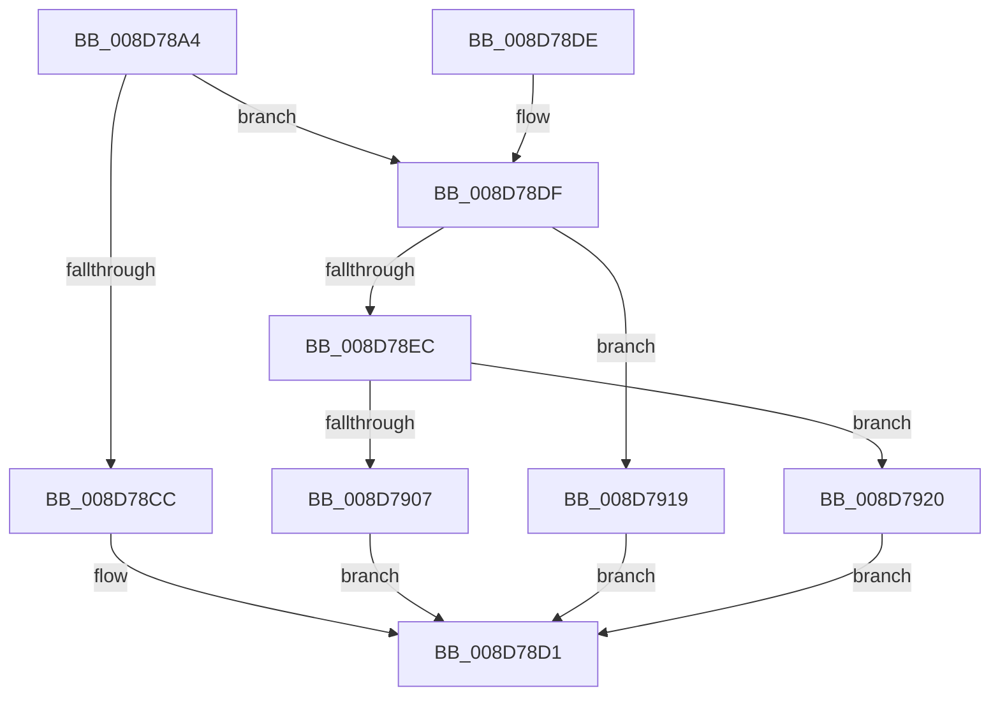

# EtwpCovSampCaptureUserStack

- RVA: `0x008D78A4`–`0x008D7927` (길이 `131` bytes)
- VA: `0x00000001408D78A4`
- 실행 섹션: `PAGE`
- PDB 이름 있음: `예`; PDB Function 태그: `아니요`
- unwind 정보 RVA: `0x000854E0`
- 디코드: `37`개 명령, `131/131` bytes 표시
- 미해석 바이트: `0` (있으면 어셈블리에 `.byte`로 보존)

> 이 문서는 커널 이미지의 기계어와 PDB 기호를 분석해 생성했습니다. 4번과 5번은 함수 원형과 자료형을 바이너리 사용 방식에서 추정한 C 해석이며 원본 소스 복구 결과는 아닙니다.

## 1. Dependencies

- 직접 호출 지점: **2**; 고유 호출 대상: **2**
- 직접 호출자로 확인된 함수: **1**
- RIP 상대 이미지 참조: **0**

### Outgoing calls
- `0x008D78FE` → [RtlWalkFrameChain](../../text/2F/RtlWalkFrameChain_function_002F85E0.md) (function, `0x002F85E0`)
- `0x008D7912` → [EtwpCovSampCaptureBufferOptimizeIP](../../text/46/EtwpCovSampCaptureBufferOptimizeIP_function_00460210.md) (function, `0x00460210`)

### Direct callers
- [EtwpCovSampCaptureUserAddresses](EtwpCovSampCaptureUserAddresses_function_008D73BC.md) at `0x008D73F0`

### Static image references
- 디코드된 RIP-relative 메모리 참조가 없습니다.

## 2. Other-region calls and transfers

- 다른 실행 섹션으로 향하는 call: **2**
  - `0x008D78FE` → [RtlWalkFrameChain](../../text/2F/RtlWalkFrameChain_function_002F85E0.md) (`PAGE` → `.text`)
  - `0x008D7912` → [EtwpCovSampCaptureBufferOptimizeIP](../../text/46/EtwpCovSampCaptureBufferOptimizeIP_function_00460210.md) (`PAGE` → `.text`)
- 별도 외부 분기/꼬리 이동을 확인하지 못했습니다.

## 3. Assembly (complete function range)

```asm
008D78A4  48 89 5C 24 08                  mov qword ptr [rsp + 8], rbx
008D78A9  57                              push rdi
008D78AA  48 83 EC 20                     sub rsp, 0x20
008D78AE  65 48 8B 04 25 88 01 00 00      mov rax, qword ptr gs:[0x188]
008D78B7  33 DB                           xor ebx, ebx
008D78B9  48 8B F9                        mov rdi, rcx
008D78BC  48 8B 90 B8 00 00 00            mov rdx, qword ptr [rax + 0xb8]
008D78C3  48 39 9A 40 06 00 00            cmp qword ptr [rdx + 0x640], rbx
008D78CA  74 13                           je 0x1408d78df
008D78CC  BB BB 00 00 C0                  mov ebx, 0xc00000bb
008D78D1  8B C3                           mov eax, ebx
008D78D3  48 8B 5C 24 30                  mov rbx, qword ptr [rsp + 0x30]
008D78D8  48 83 C4 20                     add rsp, 0x20
008D78DC  5F                              pop rdi
008D78DD  C3                              ret
008D78DE  CC                              int3
008D78DF  0F B7 49 3E                     movzx ecx, word ptr [rcx + 0x3e]
008D78E3  0F B7 47 3C                     movzx eax, word ptr [rdi + 0x3c]
008D78E7  66 3B C1                        cmp ax, cx
008D78EA  72 2D                           jb 0x1408d7919
008D78EC  8B D0                           mov edx, eax
008D78EE  41 B8 01 00 00 00               mov r8d, 1
008D78F4  48 8D 41 08                     lea rax, [rcx + 8]
008D78F8  2B D1                           sub edx, ecx
008D78FA  48 8D 0C C7                     lea rcx, [rdi + rax*8]
008D78FE  E8 DD 0C A2 FF                  call 0x1402f85e0
008D7903  85 C0                           test eax, eax
008D7905  74 19                           je 0x1408d7920
008D7907  66 01 47 3E                     add word ptr [rdi + 0x3e], ax
008D790B  48 8B CF                        mov rcx, rdi
008D790E  83 4F 38 02                     or dword ptr [rdi + 0x38], 2
008D7912  E8 F9 88 B8 FF                  call 0x140460210
008D7917  EB B8                           jmp 0x1408d78d1
008D7919  BB E5 00 00 C0                  mov ebx, 0xc00000e5
008D791E  EB B1                           jmp 0x1408d78d1
008D7920  BB 25 02 00 C0                  mov ebx, 0xc0000225
008D7925  EB AA                           jmp 0x1408d78d1
```

## 4. C-style interpretation (structured pseudocode)

```c
__int64 __fastcall EtwpCovSampCaptureUserStack(__int64 a1)
{
    __int64 result;
    __int64 v_rbx;
    __int64 v_rsp;
    unsigned __int64 v_stack_p8;

    v_stack_p8 = v_rbx;
    v_rsp = (v_rsp) - (32);
    v_rbx = 0;
    if ((*(unsigned __int64 *)(*(unsigned __int64 *)(*(unsigned __int64 *)(gs_base + (0 + 392)) + 184) + 1600)) == 0) goto loc_008D78DF;
loc_008D78D1:
    v_rsp = (v_rsp) + (32);
    return (unsigned int)((unsigned int)((unsigned int)(0xC00000BBULL)));
loc_008D78DF:
    if (((unsigned __int16)(*(unsigned __int16 *)(a1 + 60))) < ((unsigned __int16)(*(unsigned __int16 *)(a1 + 62)))) goto loc_008D7919;
    a2 = (unsigned int)(((unsigned int)((unsigned int)(*(unsigned __int16 *)(a1 + 60)))) - ((unsigned int)(*(unsigned __int16 *)(a1 + 62))));
    result = RtlWalkFrameChain(a1 + *(unsigned __int16 *)(a1 + 62) + 8 * 8, a2, 1, a4);
    if ((unsigned int)(result) == 0) goto loc_008D7920;
    result = EtwpCovSampCaptureBufferOptimizeIP(a1, a2, 1, a4);
    goto loc_008D78D1;
loc_008D7919:
    goto loc_008D78D1;
loc_008D7920:
    goto loc_008D78D1;
}
```

## 5. (Beta) C Style

```c
int64_t EtwpCovSampCaptureUserStack(void *Arg1)
{
    uint8_t *arg1 = (uint8_t *)Arg1;

    int64_t result;
    int64_t local_rbx;
    int64_t local_rsp;
    uint64_t v_stack_p8;

    v_stack_p8 = local_rbx;
    local_rsp = (local_rsp) - (32);
    local_rbx = 0;
    if ((*(uint64_t *)(*(uint64_t *)(*(uint64_t *)(gs_base + (0 + 0x188)) + 0xB8) + 0x640)) == 0) goto loc_008D78DF;
loc_008D78D1:
    local_rsp = (local_rsp) + (32);
    return (uint32_t)((uint32_t)((uint32_t)(0xC00000BBULL)));
loc_008D78DF:
    if (((uint16_t)(*(uint16_t *)(arg1 + 0x3C))) < ((uint16_t)(*(uint16_t *)(arg1 + 0x3E)))) goto loc_008D7919;
    a2 = (uint32_t)(((uint32_t)((uint32_t)(*(uint16_t *)(arg1 + 0x3C)))) - ((uint32_t)(*(uint16_t *)(arg1 + 0x3E))));
    result = RtlWalkFrameChain(Arg1 + *(uint16_t *)(arg1 + 0x3E) + 8 * 8, a2, 1, a4);
    if ((uint32_t)(result) == 0) goto loc_008D7920;
    result = EtwpCovSampCaptureBufferOptimizeIP(Arg1, a2, 1, a4);
    goto loc_008D78D1;
loc_008D7919:
    goto loc_008D78D1;
loc_008D7920:
    goto loc_008D78D1;
}
```

### 관측된 메모리 오프셋

구조체 형식이 확인되지 않은 접근은 인자 기준의 오프셋으로만 기록했습니다.

| 기준 인자 | 오프셋 표현 | 폭 (bit) | 접근 |
|---|---:|---:|---|
| `Arg1` | `+ 0x0 + rax*8` | `64` | `R` |
| `Arg1` | `+ 0x38` | `32` | `R/W` |
| `Arg1` | `+ 0x3C` | `16` | `R` |
| `Arg1` | `+ 0x3E` | `16` | `R` |
| `Arg1` | `+ 0x3E` | `16` | `R/W` |

## 6. Execution-region graph

[열기: 2D/3D 그래프와 함수 탐색 컨트롤 패널](../../../control-panel.html?section=page&rva=0x008D78A4&view=graph)

- 2D 그래프는 위에서 아래로 흐르고, 3D 그래프는 빈 공간을 드래그해 회전합니다. Shift+드래그는 이동, 휠은 확대·축소, 함수 노드 선택은 대상 보고서 이동입니다.

### Static fallback


