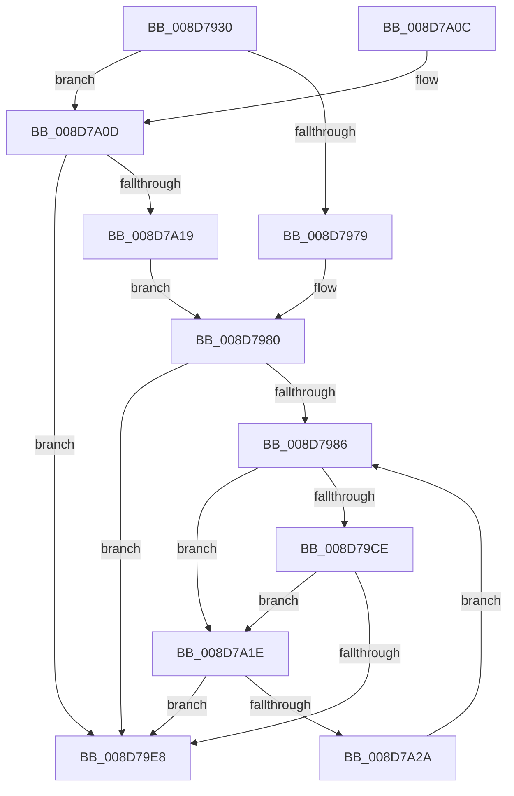

# EtwpCovSampContextAddAddresses

- RVA: `0x008D7930`–`0x008D7A2F` (길이 `255` bytes)
- VA: `0x00000001408D7930`
- 실행 섹션: `PAGE`
- PDB 이름 있음: `예`; PDB Function 태그: `아니요`
- unwind 정보 RVA: `0x000854F0`
- 디코드: `70`개 명령, `255/255` bytes 표시
- 미해석 바이트: `0` (있으면 어셈블리에 `.byte`로 보존)

> 이 문서는 커널 이미지의 기계어와 PDB 기호를 분석해 생성했습니다. 4번과 5번은 함수 원형과 자료형을 바이너리 사용 방식에서 추정한 C 해석이며 원본 소스 복구 결과는 아닙니다.

## 1. Dependencies

- 직접 호출 지점: **3**; 고유 호출 대상: **3**
- 직접 호출자로 확인된 함수: **1**
- RIP 상대 이미지 참조: **1**

### Outgoing calls
- `0x008D79C2` → [EtwpCovSampProcessMapAddresses](EtwpCovSampProcessMapAddresses_function_008D7A38.md) (function, `0x008D7A38`)
- `0x008D79DB` → [EtwpCovSampContextAddSamples](EtwpCovSampContextAddSamples_function_008D7C9C.md) (function, `0x008D7C9C`)
- `0x008D79F5` → [_security_check_cookie](../../text/6A/_security_check_cookie_function_006AC640.md) (function, `0x006AC640`)

### Direct callers
- [EtwpCovSampSampleBufferProcess](EtwpCovSampSampleBufferProcess_function_008D96EC.md) at `0x008D97C5`

### Static image references
- `0x008D7942` → RVA `0x00E0A740` (`.data`; read)

## 2. Other-region calls and transfers

- 다른 실행 섹션으로 향하는 call: **1**
  - `0x008D79F5` → [_security_check_cookie](../../text/6A/_security_check_cookie_function_006AC640.md) (`PAGE` → `.text`)
- 별도 외부 분기/꼬리 이동을 확인하지 못했습니다.

## 3. Assembly (complete function range)

```asm
008D7930  40 53                           push rbx
008D7932  55                              push rbp
008D7933  56                              push rsi
008D7934  57                              push rdi
008D7935  41 54                           push r12
008D7937  41 55                           push r13
008D7939  41 56                           push r14
008D793B  48 81 EC 60 02 00 00            sub rsp, 0x260
008D7942  48 8B 05 F7 2D 53 00            mov rax, qword ptr [rip + 0x532df7]
008D7949  48 33 C4                        xor rax, rsp
008D794C  48 89 84 24 50 02 00 00         mov qword ptr [rsp + 0x250], rax
008D7954  83 64 24 40 00                  and dword ptr [rsp + 0x40], 0
008D7959  33 F6                           xor esi, esi
008D795B  48 B8 00 00 00 00 00 80 FF FF   movabs rax, 0xffff800000000000
008D7965  4C 89 44 24 48                  mov qword ptr [rsp + 0x48], r8
008D796A  41 8B E9                        mov ebp, r9d
008D796D  4C 8B E1                        mov r12, rcx
008D7970  49 39 00                        cmp qword ptr [r8], rax
008D7973  0F 82 94 00 00 00               jb 0x1408d7a0d
008D7979  48 8D B9 F0 04 00 00            lea rdi, [rcx + 0x4f0]
008D7980  33 DB                           xor ebx, ebx
008D7982  85 ED                           test ebp, ebp
008D7984  74 62                           je 0x1408d79e8
008D7986  8B C5                           mov eax, ebp
008D7988  4D 8D 04 D8                     lea r8, [r8 + rbx*8]
008D798C  2B C3                           sub eax, ebx
008D798E  49 8D 54 24 10                  lea rdx, [r12 + 0x10]
008D7993  41 BE 40 00 00 00               mov r14d, 0x40
008D7999  48 8B CF                        mov rcx, rdi
008D799C  41 3B C6                        cmp eax, r14d
008D799F  44 0F 42 F0                     cmovb r14d, eax
008D79A3  48 8D 44 24 40                  lea rax, [rsp + 0x40]
008D79A8  48 89 44 24 30                  mov qword ptr [rsp + 0x30], rax
008D79AD  45 8B CE                        mov r9d, r14d
008D79B0  48 8D 44 24 50                  lea rax, [rsp + 0x50]
008D79B5  C7 44 24 28 40 00 00 00         mov dword ptr [rsp + 0x28], 0x40
008D79BD  48 89 44 24 20                  mov qword ptr [rsp + 0x20], rax
008D79C2  E8 71 00 00 00                  call 0x1408d7a38
008D79C7  83 7C 24 40 00                  cmp dword ptr [rsp + 0x40], 0
008D79CC  74 50                           je 0x1408d7a1e
008D79CE  44 8B 44 24 40                  mov r8d, dword ptr [rsp + 0x40]
008D79D3  48 8D 54 24 50                  lea rdx, [rsp + 0x50]
008D79D8  49 8B CC                        mov rcx, r12
008D79DB  E8 BC 02 00 00                  call 0x1408d7c9c
008D79E0  03 F0                           add esi, eax
008D79E2  3B 44 24 40                     cmp eax, dword ptr [rsp + 0x40]
008D79E6  74 36                           je 0x1408d7a1e
008D79E8  8B C6                           mov eax, esi
008D79EA  48 8B 8C 24 50 02 00 00         mov rcx, qword ptr [rsp + 0x250]
008D79F2  48 33 CC                        xor rcx, rsp
008D79F5  E8 46 4C DD FF                  call 0x1406ac640
008D79FA  48 81 C4 60 02 00 00            add rsp, 0x260
008D7A01  41 5E                           pop r14
008D7A03  41 5D                           pop r13
008D7A05  41 5C                           pop r12
008D7A07  5F                              pop rdi
008D7A08  5E                              pop rsi
008D7A09  5D                              pop rbp
008D7A0A  5B                              pop rbx
008D7A0B  C3                              ret
008D7A0C  CC                              int3
008D7A0D  48 8B BA 70 07 00 00            mov rdi, qword ptr [rdx + 0x770]
008D7A14  48 85 FF                        test rdi, rdi
008D7A17  74 CF                           je 0x1408d79e8
008D7A19  E9 62 FF FF FF                  jmp 0x1408d7980
008D7A1E  4C 8B 44 24 48                  mov r8, qword ptr [rsp + 0x48]
008D7A23  41 03 DE                        add ebx, r14d
008D7A26  3B DD                           cmp ebx, ebp
008D7A28  73 BE                           jae 0x1408d79e8
008D7A2A  E9 57 FF FF FF                  jmp 0x1408d7986
```

## 4. C-style interpretation (structured pseudocode)

```c
__int64 __fastcall EtwpCovSampContextAddAddresses(__int64 a1, __int64 a2, __int64 a3, int a4)
{
    __int64 result;
    __int64 v_r14;
    __int64 v_rbx;
    __int64 v_rsi;
    __int64 v_rsp;
    unsigned __int64 v_stack_m248;
    unsigned __int64 v_stack_m250;
    unsigned int v_stack_m258;
    unsigned __int64 v_stack_m268;
    unsigned int v_stack_m270;
    unsigned __int64 v_stack_m278;
    unsigned __int64 v_stack_m48;
    unsigned __int64 v_stack_p48;

    v_rsp = (v_rsp) - (608);
    result = (*(unsigned __int64 *)(v_rip + 5451255)) ^ (v_rsp);
    v_stack_m48 = result;
    v_rsi = 0;
    v_stack_m250 = a3;
    if ((*(unsigned __int64 *)(a3)) < result) goto loc_008D7A0D;
loc_008D7980:
    v_rbx = 0;
    if ((unsigned int)((unsigned int)(a4)) == 0) goto loc_008D79E8;
loc_008D7986:
    result = (unsigned int)(((unsigned int)((unsigned int)((unsigned int)(a4)))) - (0));
    v_r14 = 64;
    if (((unsigned int)(result)) < 64) { v_r14 = (unsigned int)(result); }
    v_stack_m268 = v_stack_m258;
    v_stack_m270 = 64;
    v_stack_m278 = v_stack_m248;
    result = EtwpCovSampProcessMapAddresses(a1 + 1264, a1 + 16, a3 + v_rbx * 8, (unsigned int)((unsigned int)(v_r14)));
    if (v_stack_m258 == 0) goto loc_008D7A1E;
    result = EtwpCovSampContextAddSamples(a1, v_stack_m248, (unsigned int)(v_stack_m258), (unsigned int)((unsigned int)(v_r14)));
    v_rsi = (unsigned int)((v_rsi) + ((unsigned int)(result)));
    if (((unsigned int)(result)) == v_stack_m258) goto loc_008D7A1E;
loc_008D79E8:
    a1 = (v_stack_m48) ^ (v_rsp);
    result = _security_check_cookie(a1, v_stack_m248, (unsigned int)(v_stack_m258), (unsigned int)((unsigned int)(v_r14)));
    v_rsp = (v_rsp) + (608);
    return result;
loc_008D7A0D:
    if (*(unsigned __int64 *)(v_stack_m248 + 1904) == 0) goto loc_008D79E8;
    goto loc_008D7980;
loc_008D7A1E:
    v_rbx = (unsigned int)((v_rbx) + ((unsigned int)(v_r14)));
    if (((unsigned int)(v_rbx)) >= ((unsigned int)((unsigned int)(a4)))) goto loc_008D79E8;
    goto loc_008D7986;
}
```

## 5. (Beta) C Style

```c
int64_t EtwpCovSampContextAddAddresses(void *Arg1, void *Arg2, void *Arg3, int32_t Arg4)
{
    uint8_t *arg1 = (uint8_t *)Arg1;
    uint8_t *arg2 = (uint8_t *)Arg2;
    uint8_t *arg3 = (uint8_t *)Arg3;

    int64_t result;
    int64_t local_r14;
    int64_t local_rbx;
    int64_t local_rsi;
    int64_t local_rsp;
    uint64_t v_stack_m248;
    uint64_t v_stack_m250;
    uint32_t v_stack_m258;
    uint64_t v_stack_m268;
    uint32_t v_stack_m270;
    uint64_t v_stack_m278;
    uint64_t v_stack_m48;
    uint64_t v_stack_p48;

    local_rsp = (local_rsp) - (608);
    result = (*(uint64_t *)(v_rip + 0x532DF7)) ^ (local_rsp);
    v_stack_m48 = result;
    local_rsi = 0;
    v_stack_m250 = Arg3;
    if ((*(uint64_t *)(arg3)) < result) goto loc_008D7A0D;
loc_008D7980:
    local_rbx = 0;
    if ((uint32_t)((uint32_t)(Arg4)) == 0) goto loc_008D79E8;
loc_008D7986:
    result = (uint32_t)(((uint32_t)((uint32_t)((uint32_t)(Arg4)))) - (0));
    local_r14 = 64;
    if (((uint32_t)(result)) < 64) { local_r14 = (uint32_t)(result); }
    v_stack_m268 = v_stack_m258;
    v_stack_m270 = 64;
    v_stack_m278 = v_stack_m248;
    result = EtwpCovSampProcessMapAddresses(Arg1 + 1264, Arg1 + 16, Arg3 + local_rbx * 8, (uint32_t)((uint32_t)(local_r14)));
    if (v_stack_m258 == 0) goto loc_008D7A1E;
    result = EtwpCovSampContextAddSamples(Arg1, v_stack_m248, (uint32_t)(v_stack_m258), (uint32_t)((uint32_t)(local_r14)));
    local_rsi = (uint32_t)((local_rsi) + ((uint32_t)(result)));
    if (((uint32_t)(result)) == v_stack_m258) goto loc_008D7A1E;
loc_008D79E8:
    Arg1 = (v_stack_m48) ^ (local_rsp);
    result = _security_check_cookie(Arg1, v_stack_m248, (uint32_t)(v_stack_m258), (uint32_t)((uint32_t)(local_r14)));
    local_rsp = (local_rsp) + (608);
    return result;
loc_008D7A0D:
    if (*(uint64_t *)(v_stack_m248 + 0x770) == 0) goto loc_008D79E8;
    goto loc_008D7980;
loc_008D7A1E:
    local_rbx = (uint32_t)((local_rbx) + ((uint32_t)(local_r14)));
    if (((uint32_t)(local_rbx)) >= ((uint32_t)((uint32_t)(Arg4)))) goto loc_008D79E8;
    goto loc_008D7986;
}
```

### 관측된 메모리 오프셋

구조체 형식이 확인되지 않은 접근은 인자 기준의 오프셋으로만 기록했습니다.

| 기준 인자 | 오프셋 표현 | 폭 (bit) | 접근 |
|---|---:|---:|---|
| `Arg1` | `+ 0x10` | `64` | `R` |
| `Arg1` | `+ 0x4F0` | `64` | `R` |
| `Arg2` | `+ 0x770` | `64` | `R` |
| `Arg3` | `+ 0x0` | `64` | `R` |

## 6. Execution-region graph

[열기: 2D/3D 그래프와 함수 탐색 컨트롤 패널](../../../control-panel.html?section=page&rva=0x008D7930&view=graph)

- 2D 그래프는 위에서 아래로 흐르고, 3D 그래프는 빈 공간을 드래그해 회전합니다. Shift+드래그는 이동, 휠은 확대·축소, 함수 노드 선택은 대상 보고서 이동입니다.

### Static fallback


