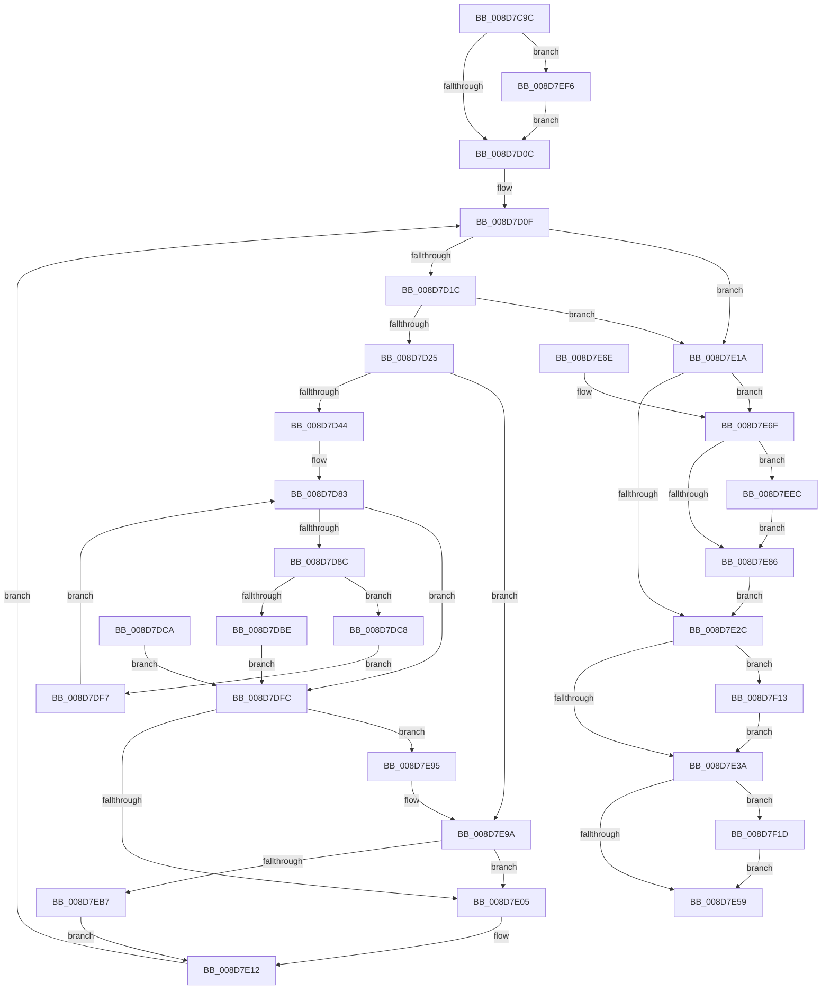

# EtwpCovSampContextAddSamples

- RVA: `0x008D7C9C`–`0x008D7F31` (길이 `661` bytes)
- VA: `0x00000001408D7C9C`
- 실행 섹션: `PAGE`
- PDB 이름 있음: `예`; PDB Function 태그: `아니요`
- unwind 정보 RVA: `0x00085530`
- 디코드: `161`개 명령, `661/661` bytes 표시
- 미해석 바이트: `0` (있으면 어셈블리에 `.byte`로 보존)

> 이 문서는 커널 이미지의 기계어와 PDB 기호를 분석해 생성했습니다. 4번과 5번은 함수 원형과 자료형을 바이너리 사용 방식에서 추정한 C 해석이며 원본 소스 복구 결과는 아닙니다.

## 1. Dependencies

- 직접 호출 지점: **8**; 고유 호출 대상: **8**
- 직접 호출자로 확인된 함수: **3**
- RIP 상대 이미지 참조: **1**

### Outgoing calls
- `0x008D7CF7` → [EtwpCovSampHashMakeRoomAndAcquireLock](EtwpCovSampHashMakeRoomAndAcquireLock_function_008D91F8.md) (function, `0x008D91F8`)
- `0x008D7D6B` → [EtwCovSampHash](../../text/41/EtwCovSampHash_function_0041FBA0.md) (function, `0x0041FBA0`)
- `0x008D7E89` → [KeAbPostRelease](../../text/2E/KeAbPostRelease_function_002E1600.md) (function, `0x002E1600`)
- `0x008D7E8E` → [KeLeaveCriticalRegion](../../text/25/KeLeaveCriticalRegion_function_0025D8B0.md) (function, `0x0025D8B0`)
- `0x008D7EAA` → [EtwpCovSampHashLookup](EtwpCovSampHashLookup_function_008D9544.md) (function, `0x008D9544`)
- `0x008D7EEF` → [ExfTryToWakePushLock](../../text/26/ExfTryToWakePushLock_function_00265DD0.md) (function, `0x00265DD0`)
- `0x008D7F02` → [EtwpCovSampCaptureContextSetPaused](../A8/EtwpCovSampCaptureContextSetPaused_function_00A8FAC0.md) (function, `0x00A8FAC0`)
- `0x008D7F13` → [EtwpCoverageSamplerFreeTable](../A8/EtwpCoverageSamplerFreeTable_function_00A878A4.md) (function, `0x00A878A4`)

### Direct callers
- [EtwpCovSampCaptureBufferProcess](EtwpCovSampCaptureBufferProcess_function_008D71C0.md) at `0x008D7251`
- [EtwpCovSampCaptureBufferProcess](EtwpCovSampCaptureBufferProcess_function_008D71C0.md) at `0x008D7320`
- [EtwpCovSampContextAddAddresses](EtwpCovSampContextAddAddresses_function_008D7930.md) at `0x008D79DB`
- [EtwpCovSampSampleBufferProcess](EtwpCovSampSampleBufferProcess_function_008D96EC.md) at `0x008D9788`

### Static image references
- `0x008D7CE9` → RVA `0x00EFF1E8` (`.data`; read)

## 2. Other-region calls and transfers

- 다른 실행 섹션으로 향하는 call: **4**
  - `0x008D7D6B` → [EtwCovSampHash](../../text/41/EtwCovSampHash_function_0041FBA0.md) (`PAGE` → `.text`)
  - `0x008D7E89` → [KeAbPostRelease](../../text/2E/KeAbPostRelease_function_002E1600.md) (`PAGE` → `.text`)
  - `0x008D7E8E` → [KeLeaveCriticalRegion](../../text/25/KeLeaveCriticalRegion_function_0025D8B0.md) (`PAGE` → `.text`)
  - `0x008D7EEF` → [ExfTryToWakePushLock](../../text/26/ExfTryToWakePushLock_function_00265DD0.md) (`PAGE` → `.text`)
- 별도 외부 분기/꼬리 이동을 확인하지 못했습니다.

## 3. Assembly (complete function range)

```asm
008D7C9C  48 8B C4                        mov rax, rsp
008D7C9F  44 89 40 18                     mov dword ptr [rax + 0x18], r8d
008D7CA3  48 89 50 10                     mov qword ptr [rax + 0x10], rdx
008D7CA7  48 89 48 08                     mov qword ptr [rax + 8], rcx
008D7CAB  53                              push rbx
008D7CAC  56                              push rsi
008D7CAD  41 54                           push r12
008D7CAF  41 55                           push r13
008D7CB1  41 56                           push r14
008D7CB3  41 57                           push r15
008D7CB5  48 81 EC 88 00 00 00            sub rsp, 0x88
008D7CBC  45 8B F0                        mov r14d, r8d
008D7CBF  48 8B D9                        mov rbx, rcx
008D7CC2  48 89 4C 24 60                  mov qword ptr [rsp + 0x60], rcx
008D7CC7  4C 8B E1                        mov r12, rcx
008D7CCA  48 89 4C 24 70                  mov qword ptr [rsp + 0x70], rcx
008D7CCF  45 33 FF                        xor r15d, r15d
008D7CD2  44 89 7C 24 28                  mov dword ptr [rsp + 0x28], r15d
008D7CD7  4C 21 78 90                     and qword ptr [rax - 0x70], r15
008D7CDB  33 F6                           xor esi, esi
008D7CDD  89 74 24 20                     mov dword ptr [rsp + 0x20], esi
008D7CE1  48 21 70 A0                     and qword ptr [rax - 0x60], rsi
008D7CE5  48 21 70 98                     and qword ptr [rax - 0x68], rsi
008D7CE9  4C 8B 2D F8 74 62 00            mov r13, qword ptr [rip + 0x6274f8]
008D7CF0  4C 8D 40 A0                     lea r8, [rax - 0x60]
008D7CF4  41 8B D6                        mov edx, r14d
008D7CF7  E8 FC 14 00 00                  call 0x1408d91f8
008D7CFC  89 84 24 D8 00 00 00            mov dword ptr [rsp + 0xd8], eax
008D7D03  41 3B C6                        cmp eax, r14d
008D7D06  0F 82 EA 01 00 00               jb 0x1408d7ef6
008D7D0C  45 33 ED                        xor r13d, r13d
008D7D0F  44 89 6C 24 2C                  mov dword ptr [rsp + 0x2c], r13d
008D7D14  85 C0                           test eax, eax
008D7D16  0F 84 FE 00 00 00               je 0x1408d7e1a
008D7D1C  45 3B EE                        cmp r13d, r14d
008D7D1F  0F 83 F5 00 00 00               jae 0x1408d7e1a
008D7D25  48 8B 8C 24 C8 00 00 00         mov rcx, qword ptr [rsp + 0xc8]
008D7D2D  4A 8D 04 E9                     lea rax, [rcx + r13*8]
008D7D31  48 89 44 24 40                  mov qword ptr [rsp + 0x40], rax
008D7D36  48 83 BB A8 06 00 00 00         cmp qword ptr [rbx + 0x6a8], 0
008D7D3E  0F 84 56 01 00 00               je 0x1408d7e9a
008D7D44  8B 10                           mov edx, dword ptr [rax]
008D7D46  8B 48 04                        mov ecx, dword ptr [rax + 4]
008D7D49  48 8B 44 24 60                  mov rax, qword ptr [rsp + 0x60]
008D7D4E  8B 40 1C                        mov eax, dword ptr [rax + 0x1c]
008D7D51  89 44 24 30                     mov dword ptr [rsp + 0x30], eax
008D7D55  89 44 24 34                     mov dword ptr [rsp + 0x34], eax
008D7D59  89 4C 24 38                     mov dword ptr [rsp + 0x38], ecx
008D7D5D  89 54 24 3C                     mov dword ptr [rsp + 0x3c], edx
008D7D61  48 8B 54 24 30                  mov rdx, qword ptr [rsp + 0x30]
008D7D66  48 8B 4C 24 38                  mov rcx, qword ptr [rsp + 0x38]
008D7D6B  E8 30 7E B4 FF                  call 0x14041fba0
008D7D70  48 89 44 24 68                  mov qword ptr [rsp + 0x68], rax
008D7D75  41 BA 01 00 00 00               mov r10d, 1
008D7D7B  44 89 54 24 24                  mov dword ptr [rsp + 0x24], r10d
008D7D80  45 33 DB                        xor r11d, r11d
008D7D83  44 3B 9B B8 06 00 00            cmp r11d, dword ptr [rbx + 0x6b8]
008D7D8A  73 70                           jae 0x1408d7dfc
008D7D8C  8B 4C 24 6C                     mov ecx, dword ptr [rsp + 0x6c]
008D7D90  41 0F AF CB                     imul ecx, r11d
008D7D94  03 C8                           add ecx, eax
008D7D96  23 8B B4 06 00 00               and ecx, dword ptr [rbx + 0x6b4]
008D7D9C  8B D1                           mov edx, ecx
008D7D9E  C1 EA 03                        shr edx, 3
008D7DA1  83 E1 07                        and ecx, 7
008D7DA4  44 8B C2                        mov r8d, edx
008D7DA7  48 8B 93 A8 06 00 00            mov rdx, qword ptr [rbx + 0x6a8]
008D7DAE  45 8A 0C 10                     mov r9b, byte ptr [r8 + rdx]
008D7DB2  BA 01 00 00 00                  mov edx, 1
008D7DB7  D3 E2                           shl edx, cl
008D7DB9  44 84 CA                        test dl, r9b
008D7DBC  75 0A                           jne 0x1408d7dc8
008D7DBE  45 33 D2                        xor r10d, r10d
008D7DC1  44 89 54 24 24                  mov dword ptr [rsp + 0x24], r10d
008D7DC6  EB 34                           jmp 0x1408d7dfc
008D7DC8  EB 2D                           jmp 0x1408d7df7
008D7DCA  45 33 D2                        xor r10d, r10d
008D7DCD  44 89 54 24 24                  mov dword ptr [rsp + 0x24], r10d
008D7DD2  44 8B B4 24 D0 00 00 00         mov r14d, dword ptr [rsp + 0xd0]
008D7DDA  48 8B 9C 24 C0 00 00 00         mov rbx, qword ptr [rsp + 0xc0]
008D7DE2  44 8B 7C 24 28                  mov r15d, dword ptr [rsp + 0x28]
008D7DE7  8B 74 24 20                     mov esi, dword ptr [rsp + 0x20]
008D7DEB  44 8B 6C 24 2C                  mov r13d, dword ptr [rsp + 0x2c]
008D7DF0  4C 8B 64 24 70                  mov r12, qword ptr [rsp + 0x70]
008D7DF5  EB 05                           jmp 0x1408d7dfc
008D7DF7  41 FF C3                        inc r11d
008D7DFA  EB 87                           jmp 0x1408d7d83
008D7DFC  45 85 D2                        test r10d, r10d
008D7DFF  0F 84 90 00 00 00               je 0x1408d7e95
008D7E05  FF C6                           inc esi
008D7E07  8B 84 24 D8 00 00 00            mov eax, dword ptr [rsp + 0xd8]
008D7E0E  89 74 24 20                     mov dword ptr [rsp + 0x20], esi
008D7E12  41 FF C5                        inc r13d
008D7E15  E9 F5 FE FF FF                  jmp 0x1408d7d0f
008D7E1A  48 8B 4B 08                     mov rcx, qword ptr [rbx + 8]
008D7E1E  65 48 8B 04 25 88 01 00 00      mov rax, qword ptr gs:[0x188]
008D7E27  48 3B C8                        cmp rcx, rax
008D7E2A  74 43                           je 0x1408d7e6f
008D7E2C  48 8B 4C 24 58                  mov rcx, qword ptr [rsp + 0x58]
008D7E31  48 85 C9                        test rcx, rcx
008D7E34  0F 85 D9 00 00 00               jne 0x1408d7f13
008D7E3A  F0 45 01 BC 24 6C 04 00 00      lock add dword ptr [r12 + 0x46c], r15d
008D7E43  F0 41 01 B4 24 70 04 00 00      lock add dword ptr [r12 + 0x470], esi
008D7E4C  42 8D 0C 3E                     lea ecx, [rsi + r15]
008D7E50  44 3B F1                        cmp r14d, ecx
008D7E53  0F 87 C4 00 00 00               ja 0x1408d7f1d
008D7E59  41 8B C7                        mov eax, r15d
008D7E5C  48 81 C4 88 00 00 00            add rsp, 0x88
008D7E63  41 5F                           pop r15
008D7E65  41 5E                           pop r14
008D7E67  41 5D                           pop r13
008D7E69  41 5C                           pop r12
008D7E6B  5E                              pop rsi
008D7E6C  5B                              pop rbx
008D7E6D  C3                              ret
008D7E6E  CC                              int3
008D7E6F  48 C7 43 08 00 00 00 00         mov qword ptr [rbx + 8], 0
008D7E77  48 83 C8 FF                     or rax, 0xffffffffffffffff
008D7E7B  F0 48 0F C1 03                  lock xadd qword ptr [rbx], rax
008D7E80  24 06                           and al, 6
008D7E82  3C 02                           cmp al, 2
008D7E84  74 66                           je 0x1408d7eec
008D7E86  48 8B CB                        mov rcx, rbx
008D7E89  E8 72 97 A0 FF                  call 0x1402e1600
008D7E8E  E8 1D 5A 98 FF                  call 0x14025d8b0
008D7E93  EB 97                           jmp 0x1408d7e2c
008D7E95  48 8B 44 24 40                  mov rax, qword ptr [rsp + 0x40]
008D7E9A  4C 8D 4C 24 48                  lea r9, [rsp + 0x48]
008D7E9F  4C 8D 44 24 50                  lea r8, [rsp + 0x50]
008D7EA4  48 8B D0                        mov rdx, rax
008D7EA7  48 8B CB                        mov rcx, rbx
008D7EAA  E8 95 16 00 00                  call 0x1408d9544
008D7EAF  85 C0                           test eax, eax
008D7EB1  0F 85 4E FF FF FF               jne 0x1408d7e05
008D7EB7  48 8B 4C 24 40                  mov rcx, qword ptr [rsp + 0x40]
008D7EBC  48 8B 09                        mov rcx, qword ptr [rcx]
008D7EBF  48 8B 44 24 48                  mov rax, qword ptr [rsp + 0x48]
008D7EC4  48 89 08                        mov qword ptr [rax], rcx
008D7EC7  48 8B 44 24 50                  mov rax, qword ptr [rsp + 0x50]
008D7ECC  FF 40 10                        inc dword ptr [rax + 0x10]
008D7ECF  41 FF C7                        inc r15d
008D7ED2  44 89 7C 24 28                  mov dword ptr [rsp + 0x28], r15d
008D7ED7  8B 84 24 D8 00 00 00            mov eax, dword ptr [rsp + 0xd8]
008D7EDE  FF C8                           dec eax
008D7EE0  89 84 24 D8 00 00 00            mov dword ptr [rsp + 0xd8], eax
008D7EE7  E9 26 FF FF FF                  jmp 0x1408d7e12
008D7EEC  48 8B CB                        mov rcx, rbx
008D7EEF  E8 DC DE 98 FF                  call 0x140265dd0
008D7EF4  EB 90                           jmp 0x1408d7e86
008D7EF6  41 B8 01 00 00 00               mov r8d, 1
008D7EFC  49 8B D5                        mov rdx, r13
008D7EFF  48 8B CB                        mov rcx, rbx
008D7F02  E8 B9 7B 1B 00                  call 0x140a8fac0
008D7F07  8B 84 24 D8 00 00 00            mov eax, dword ptr [rsp + 0xd8]
008D7F0E  E9 F9 FD FF FF                  jmp 0x1408d7d0c
008D7F13  E8 8C F9 1A 00                  call 0x140a878a4
008D7F18  E9 1D FF FF FF                  jmp 0x1408d7e3a
008D7F1D  44 2B F6                        sub r14d, esi
008D7F20  45 2B F7                        sub r14d, r15d
008D7F23  F0 45 01 B4 24 74 04 00 00      lock add dword ptr [r12 + 0x474], r14d
008D7F2C  E9 28 FF FF FF                  jmp 0x1408d7e59
```

## 4. C-style interpretation (structured pseudocode)

```c
__int64 __fastcall EtwpCovSampContextAddSamples(__int64 a1, __int64 a2, int a3)
{
    __int64 result;
    __int64 v_r10;
    __int64 v_r11;
    __int64 v_r13;
    __int64 v_r14;
    __int64 v_r15;
    __int64 v_rsi;
    __int64 v_rsp;
    unsigned __int64 v_stack_m48;
    unsigned int v_stack_m4C;
    unsigned __int64 v_stack_m50;
    unsigned __int64 v_stack_m58;
    unsigned __int64 v_stack_m60;
    unsigned __int64 v_stack_m78;
    unsigned int v_stack_m7C;
    unsigned int v_stack_m80;
    unsigned int v_stack_m84;
    unsigned int v_stack_m88;
    unsigned int v_stack_m8C;
    unsigned int v_stack_m90;
    unsigned int v_stack_m94;
    unsigned int v_stack_m98;
    unsigned __int64 v_stack_p10;
    unsigned int v_stack_p18;
    unsigned int v_stack_p20;
    unsigned int v_stack_p28;
    unsigned __int64 v_stack_p40;
    unsigned __int64 v_stack_p48;
    unsigned __int64 v_stack_p50;
    unsigned __int64 v_stack_p8;
    unsigned int v_stack_pD8;

    *(unsigned int *)(v_rsp + 24) = a3;
    *(unsigned __int64 *)(v_rsp + 16) = a2;
    *(unsigned __int64 *)(v_rsp + 8) = a1;
    v_rsp = (v_rsp) - (136);
    v_stack_m58 = a1;
    v_stack_m48 = a1;
    v_r15 = 0;
    v_stack_m90 = 0;
    v_rsi = 0;
    v_stack_m98 = 0;
    result = EtwpCovSampHashMakeRoomAndAcquireLock(a1, (unsigned int)((unsigned int)((unsigned int)(a3))), v_rsp - 96, a4);
    v_stack_p20 = (unsigned int)(result);
    if (((unsigned int)(result)) < ((unsigned int)((unsigned int)(a3)))) goto loc_008D7EF6;
loc_008D7D0C:
    v_r13 = 0;
loc_008D7D0F:
    v_stack_m8C = 0;
    if ((unsigned int)(result) == 0) goto loc_008D7E1A;
    if (0 >= ((unsigned int)((unsigned int)(a3)))) goto loc_008D7E1A;
    v_stack_m78 = v_stack_p10 + v_r13 * 8;
    if ((*(unsigned __int64 *)(a1 + 1704)) == 0) goto loc_008D7E9A;
    v_stack_m88 = (unsigned int)((unsigned int)(*(unsigned int *)(v_stack_m58 + 28)));
    v_stack_m84 = (unsigned int)((unsigned int)(*(unsigned int *)(v_stack_m58 + 28)));
    v_stack_m80 = (unsigned int)((unsigned int)(*(unsigned int *)(v_stack_p10 + v_r13 * 8 + 4)));
    v_stack_m7C = (unsigned int)((unsigned int)(*(unsigned int *)(v_stack_p10 + v_r13 * 8)));
    result = EtwCovSampHash(v_stack_m80, v_stack_m88, v_rsp - 96, a4);
    v_stack_m50 = result;
    v_stack_m94 = 1;
    v_r11 = 0;
loc_008D7D83:
    if (0 >= (*(unsigned int *)(a1 + 1720))) goto loc_008D7DFC;
    a1 = (unsigned int)(((unsigned int)(v_stack_m4C)) * (0));
    a1 = (unsigned int)((a1) + ((unsigned int)(result)));
    a1 = (unsigned int)((a1) & (*(unsigned int *)(a1 + 1716)));
    a2 = (unsigned int)(((unsigned int)((unsigned int)(a1))) >> (3));
    a1 = (unsigned int)((a1) & (7));
    a2 = (unsigned int)((1) << ((unsigned __int8)(a1)));
    if ((((unsigned __int8)(a2)) & ((unsigned __int8)(*(unsigned __int8 *)((unsigned int)((unsigned int)(a2)) + *(unsigned __int64 *)(a1 + 1704) * 1)))) != 0) goto loc_008D7DC8;
    v_r10 = 0;
    v_stack_m94 = 0;
    goto loc_008D7DFC;
loc_008D7DC8:
    goto loc_008D7DF7;
loc_008D7DF7:
    v_r11 = (unsigned int)((v_r11) + 1);
    goto loc_008D7D83;
loc_008D7DFC:
    if (0 == 0) goto loc_008D7E95;
loc_008D7E05:
    v_rsi = (unsigned int)((v_rsi) + 1);
    v_stack_m98 = (unsigned int)(v_rsi);
loc_008D7E12:
    v_r13 = (unsigned int)((v_r13) + 1);
    goto loc_008D7D0F;
loc_008D7E1A:
    if ((*(unsigned __int64 *)(a1 + 8)) == (*(unsigned __int64 *)(gs_base + (0 + 392)))) goto loc_008D7E6F;
loc_008D7E2C:
    if (v_stack_m60 != 0) goto loc_008D7F13;
loc_008D7E3A:
    if (((unsigned int)((unsigned int)(a3))) > ((unsigned int)(v_rsi + v_r15 * 1))) goto loc_008D7F1D;
loc_008D7E59:
    v_rsp = (v_rsp) + (136);
    return 0;
loc_008D7E6F:
    *(unsigned __int64 *)(a1 + 8) = 0;
    result = (0) | (-1);
    result = (unsigned __int8)((result) & (6));
    if (((unsigned __int8)(result)) == 2) goto loc_008D7EEC;
loc_008D7E86:
    result = KeAbPostRelease(a1, a2, (unsigned int)((unsigned int)(a2)), *(unsigned __int8 *)((unsigned int)((unsigned int)(a2)) + *(unsigned __int64 *)(a1 + 1704) * 1));
    result = KeLeaveCriticalRegion(a1, a2, (unsigned int)((unsigned int)(a2)), *(unsigned __int8 *)((unsigned int)((unsigned int)(a2)) + *(unsigned __int64 *)(a1 + 1704) * 1));
    goto loc_008D7E2C;
loc_008D7E95:
loc_008D7E9A:
    result = EtwpCovSampHashLookup(a1, v_stack_p40, v_stack_p50, v_stack_p48);
    if ((unsigned int)(result) != 0) goto loc_008D7E05;
    *(unsigned __int64 *)(v_stack_p48) = *(unsigned __int64 *)(v_stack_p40);
    v_r15 = (unsigned int)((v_r15) + 1);
    v_stack_p28 = (unsigned int)(v_r15);
    result = (unsigned int)(((unsigned int)(v_stack_pD8)) - 1);
    v_stack_pD8 = (unsigned int)(result);
    goto loc_008D7E12;
loc_008D7EEC:
    result = ExfTryToWakePushLock(a1, v_stack_p40, v_stack_p50, v_stack_p48);
    goto loc_008D7E86;
loc_008D7EF6:
    result = EtwpCovSampCaptureContextSetPaused(a1, v_r13, 1, v_stack_p48);
    goto loc_008D7D0C;
loc_008D7F13:
    result = EtwpCoverageSamplerFreeTable(a1, v_r13, 1, v_stack_p48);
    goto loc_008D7E3A;
loc_008D7F1D:
    v_r14 = (unsigned int)(((unsigned int)(a3)) - ((unsigned int)(v_rsi)));
    v_r14 = (unsigned int)((v_r14) - ((unsigned int)(v_r15)));
    goto loc_008D7E59;
}
```

## 5. (Beta) C Style

```c
int64_t EtwpCovSampContextAddSamples(void *Arg1, int64_t Arg2, int32_t Arg3)
{
    uint8_t *arg1 = (uint8_t *)Arg1;

    int64_t result;
    int64_t local_r10;
    int64_t local_r11;
    int64_t local_r13;
    int64_t local_r14;
    int64_t local_r15;
    int64_t local_rsi;
    int64_t local_rsp;
    uint64_t v_stack_m48;
    uint32_t v_stack_m4C;
    uint64_t v_stack_m50;
    uint64_t v_stack_m58;
    uint64_t v_stack_m60;
    uint64_t v_stack_m78;
    uint32_t v_stack_m7C;
    uint32_t v_stack_m80;
    uint32_t v_stack_m84;
    uint32_t v_stack_m88;
    uint32_t v_stack_m8C;
    uint32_t v_stack_m90;
    uint32_t v_stack_m94;
    uint32_t v_stack_m98;
    uint64_t v_stack_p10;
    uint32_t v_stack_p18;
    uint32_t v_stack_p20;
    uint32_t v_stack_p28;
    uint64_t v_stack_p40;
    uint64_t v_stack_p48;
    uint64_t v_stack_p50;
    uint64_t v_stack_p8;
    uint32_t v_stack_pD8;

    *(uint32_t *)(local_rsp + 0x18) = Arg3;
    *(uint64_t *)(local_rsp + 0x10) = Arg2;
    *(void **)(local_rsp + 0x8) = Arg1;
    local_rsp = (local_rsp) - (136);
    v_stack_m58 = Arg1;
    v_stack_m48 = Arg1;
    local_r15 = 0;
    v_stack_m90 = 0;
    local_rsi = 0;
    v_stack_m98 = 0;
    result = EtwpCovSampHashMakeRoomAndAcquireLock(Arg1, (uint32_t)((uint32_t)((uint32_t)(Arg3))), local_rsp - 96, a4);
    v_stack_p20 = (uint32_t)(result);
    if (((uint32_t)(result)) < ((uint32_t)((uint32_t)(Arg3)))) goto loc_008D7EF6;
loc_008D7D0C:
    local_r13 = 0;
loc_008D7D0F:
    v_stack_m8C = 0;
    if ((uint32_t)(result) == 0) goto loc_008D7E1A;
    if (0 >= ((uint32_t)((uint32_t)(Arg3)))) goto loc_008D7E1A;
    v_stack_m78 = v_stack_p10 + local_r13 * 8;
    if ((*(uint64_t *)(arg1 + 0x6A8)) == 0) goto loc_008D7E9A;
    v_stack_m88 = (uint32_t)((uint32_t)(*(uint32_t *)(v_stack_m58 + 0x1C)));
    v_stack_m84 = (uint32_t)((uint32_t)(*(uint32_t *)(v_stack_m58 + 0x1C)));
    v_stack_m80 = (uint32_t)((uint32_t)(*(uint32_t *)(v_stack_p10 + local_r13 * 8 + 0x4)));
    v_stack_m7C = (uint32_t)((uint32_t)(*(uint32_t *)(v_stack_p10 + local_r13 * 8)));
    result = EtwCovSampHash(v_stack_m80, v_stack_m88, local_rsp - 96, a4);
    v_stack_m50 = result;
    v_stack_m94 = 1;
    local_r11 = 0;
loc_008D7D83:
    if (0 >= (*(uint32_t *)(arg1 + 0x6B8))) goto loc_008D7DFC;
    Arg1 = (uint32_t)(((uint32_t)(v_stack_m4C)) * (0));
    Arg1 = (uint32_t)((Arg1) + ((uint32_t)(result)));
    Arg1 = (uint32_t)((Arg1) & (*(uint32_t *)(arg1 + 0x6B4)));
    Arg2 = (uint32_t)(((uint32_t)((uint32_t)(Arg1))) >> (3));
    Arg1 = (uint32_t)((Arg1) & (7));
    Arg2 = (uint32_t)((1) << ((uint8_t)(Arg1)));
    if ((((uint8_t)(Arg2)) & ((uint8_t)(*(uint8_t *)((uint32_t)((uint32_t)(Arg2)) + *(uint64_t *)(arg1 + 0x6A8) * 1)))) != 0) goto loc_008D7DC8;
    local_r10 = 0;
    v_stack_m94 = 0;
    goto loc_008D7DFC;
loc_008D7DC8:
    goto loc_008D7DF7;
loc_008D7DF7:
    local_r11 = (uint32_t)((local_r11) + 1);
    goto loc_008D7D83;
loc_008D7DFC:
    if (0 == 0) goto loc_008D7E95;
loc_008D7E05:
    local_rsi = (uint32_t)((local_rsi) + 1);
    v_stack_m98 = (uint32_t)(local_rsi);
loc_008D7E12:
    local_r13 = (uint32_t)((local_r13) + 1);
    goto loc_008D7D0F;
loc_008D7E1A:
    if ((*(uint64_t *)(arg1 + 0x8)) == (*(uint64_t *)(gs_base + (0 + 0x188)))) goto loc_008D7E6F;
loc_008D7E2C:
    if (v_stack_m60 != 0) goto loc_008D7F13;
loc_008D7E3A:
    if (((uint32_t)((uint32_t)(Arg3))) > ((uint32_t)(local_rsi + local_r15 * 1))) goto loc_008D7F1D;
loc_008D7E59:
    local_rsp = (local_rsp) + (136);
    return 0;
loc_008D7E6F:
    *(uint64_t *)(arg1 + 0x8) = 0;
    result = (0) | (-1);
    result = (uint8_t)((result) & (6));
    if (((uint8_t)(result)) == 2) goto loc_008D7EEC;
loc_008D7E86:
    result = KeAbPostRelease(Arg1, Arg2, (uint32_t)((uint32_t)(Arg2)), *(uint8_t *)((uint32_t)((uint32_t)(Arg2)) + *(uint64_t *)(arg1 + 0x6A8) * 1));
    result = KeLeaveCriticalRegion(Arg1, Arg2, (uint32_t)((uint32_t)(Arg2)), *(uint8_t *)((uint32_t)((uint32_t)(Arg2)) + *(uint64_t *)(arg1 + 0x6A8) * 1));
    goto loc_008D7E2C;
loc_008D7E95:
loc_008D7E9A:
    result = EtwpCovSampHashLookup(Arg1, v_stack_p40, v_stack_p50, v_stack_p48);
    if ((uint32_t)(result) != 0) goto loc_008D7E05;
    *(uint64_t *)(v_stack_p48) = *(uint64_t *)(v_stack_p40);
    local_r15 = (uint32_t)((local_r15) + 1);
    v_stack_p28 = (uint32_t)(local_r15);
    result = (uint32_t)(((uint32_t)(v_stack_pD8)) - 1);
    v_stack_pD8 = (uint32_t)(result);
    goto loc_008D7E12;
loc_008D7EEC:
    result = ExfTryToWakePushLock(Arg1, v_stack_p40, v_stack_p50, v_stack_p48);
    goto loc_008D7E86;
loc_008D7EF6:
    result = EtwpCovSampCaptureContextSetPaused(Arg1, local_r13, 1, v_stack_p48);
    goto loc_008D7D0C;
loc_008D7F13:
    result = EtwpCoverageSamplerFreeTable(Arg1, local_r13, 1, v_stack_p48);
    goto loc_008D7E3A;
loc_008D7F1D:
    local_r14 = (uint32_t)(((uint32_t)(Arg3)) - ((uint32_t)(local_rsi)));
    local_r14 = (uint32_t)((local_r14) - ((uint32_t)(local_r15)));
    goto loc_008D7E59;
}
```

### 관측된 메모리 오프셋

구조체 형식이 확인되지 않은 접근은 인자 기준의 오프셋으로만 기록했습니다.

| 기준 인자 | 오프셋 표현 | 폭 (bit) | 접근 |
|---|---:|---:|---|
| `Arg1` | `+ 0x0` | `64` | `R/W` |
| `Arg1` | `+ 0x8` | `64` | `R` |
| `Arg1` | `+ 0x8` | `64` | `W` |
| `Arg1` | `+ 0x46C` | `32` | `R/W` |
| `Arg1` | `+ 0x470` | `32` | `R/W` |
| `Arg1` | `+ 0x474` | `32` | `R/W` |
| `Arg1` | `+ 0x6A8` | `64` | `R` |
| `Arg1` | `+ 0x6B4` | `32` | `R` |
| `Arg1` | `+ 0x6B8` | `32` | `R` |

## 6. Execution-region graph

[열기: 2D/3D 그래프와 함수 탐색 컨트롤 패널](../../../control-panel.html?section=page&rva=0x008D7C9C&view=graph)

- 2D 그래프는 위에서 아래로 흐르고, 3D 그래프는 빈 공간을 드래그해 회전합니다. Shift+드래그는 이동, 휠은 확대·축소, 함수 노드 선택은 대상 보고서 이동입니다.

### Static fallback


