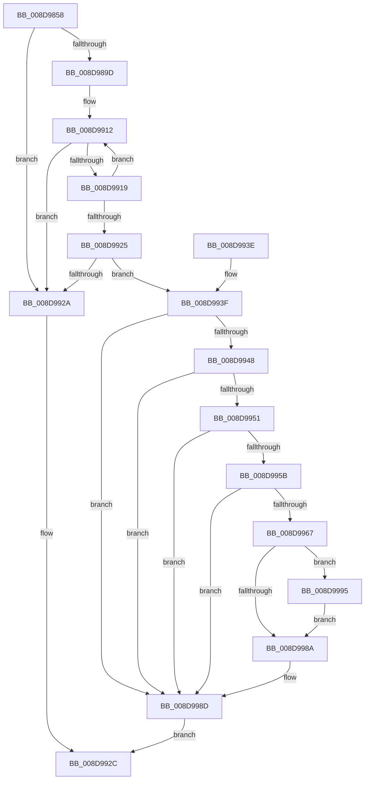

# EtwpCovSampContextFastFindModule

- RVA: `0x008D9858`–`0x008D999E` (길이 `326` bytes)
- VA: `0x00000001408D9858`
- 실행 섹션: `PAGE`
- PDB 이름 있음: `예`; PDB Function 태그: `아니요`
- unwind 정보 RVA: `0x00085640`
- 디코드: `91`개 명령, `326/326` bytes 표시
- 미해석 바이트: `0` (있으면 어셈블리에 `.byte`로 보존)

> 이 문서는 커널 이미지의 기계어와 PDB 기호를 분석해 생성했습니다. 4번과 5번은 함수 원형과 자료형을 바이너리 사용 방식에서 추정한 C 해석이며 원본 소스 복구 결과는 아닙니다.

## 1. Dependencies

- 직접 호출 지점: **0**; 고유 호출 대상: **0**
- 직접 호출자로 확인된 함수: **1**
- RIP 상대 이미지 참조: **0**

### Outgoing calls
- 직접 디코드된 call 명령이 없습니다.

### Direct callers
- [EtwpCovSampContextGetModule](EtwpCovSampContextGetModule_function_008D7FEC.md) at `0x008D8172`
- [EtwpCovSampContextGetModule](EtwpCovSampContextGetModule_function_008D7FEC.md) at `0x008D884E`

### Static image references
- 디코드된 RIP-relative 메모리 참조가 없습니다.

## 2. Other-region calls and transfers

- 다른 실행 섹션으로 향하는 call: **0**
- 별도 외부 분기/꼬리 이동을 확인하지 못했습니다.

## 3. Assembly (complete function range)

```asm
008D9858  48 89 5C 24 10                  mov qword ptr [rsp + 0x10], rbx
008D985D  48 89 74 24 18                  mov qword ptr [rsp + 0x18], rsi
008D9862  48 89 7C 24 20                  mov qword ptr [rsp + 0x20], rdi
008D9867  41 56                           push r14
008D9869  8B 99 AC 04 00 00               mov ebx, dword ptr [rcx + 0x4ac]
008D986F  48 8B F1                        mov rsi, rcx
008D9872  4C 8B 1A                        mov r11, qword ptr [rdx]
008D9875  8B CB                           mov ecx, ebx
008D9877  83 E1 1F                        and ecx, 0x1f
008D987A  C1 EB 05                        shr ebx, 5
008D987D  48 83 CF FF                     or rdi, 0xffffffffffffffff
008D9881  45 33 D2                        xor r10d, r10d
008D9884  48 D3 E7                        shl rdi, cl
008D9887  4D 8B F0                        mov r14, r8
008D988A  4C 23 DF                        and r11, rdi
008D988D  4C 8B CA                        mov r9, rdx
008D9890  4C 89 5C 24 10                  mov qword ptr [rsp + 0x10], r11
008D9895  85 DB                           test ebx, ebx
008D9897  0F 84 8D 00 00 00               je 0x1408d992a
008D989D  41 0F B6 C3                     movzx eax, r11b
008D98A1  48 05 CB 5D B1 00               add rax, 0xb15dcb
008D98A7  48 6B C8 25                     imul rcx, rax, 0x25
008D98AB  0F B6 44 24 11                  movzx eax, byte ptr [rsp + 0x11]
008D98B0  48 03 C8                        add rcx, rax
008D98B3  0F B6 44 24 12                  movzx eax, byte ptr [rsp + 0x12]
008D98B8  48 6B D1 25                     imul rdx, rcx, 0x25
008D98BC  48 03 D0                        add rdx, rax
008D98BF  0F B6 44 24 13                  movzx eax, byte ptr [rsp + 0x13]
008D98C4  48 6B CA 25                     imul rcx, rdx, 0x25
008D98C8  48 03 C8                        add rcx, rax
008D98CB  0F B6 44 24 14                  movzx eax, byte ptr [rsp + 0x14]
008D98D0  48 6B D1 25                     imul rdx, rcx, 0x25
008D98D4  48 03 D0                        add rdx, rax
008D98D7  0F B6 44 24 15                  movzx eax, byte ptr [rsp + 0x15]
008D98DC  48 6B CA 25                     imul rcx, rdx, 0x25
008D98E0  48 03 C8                        add rcx, rax
008D98E3  0F B6 44 24 16                  movzx eax, byte ptr [rsp + 0x16]
008D98E8  48 6B D1 25                     imul rdx, rcx, 0x25
008D98EC  8D 4B FF                        lea ecx, [rbx - 1]
008D98EF  48 03 D0                        add rdx, rax
008D98F2  0F B6 44 24 17                  movzx eax, byte ptr [rsp + 0x17]
008D98F7  4C 6B C2 25                     imul r8, rdx, 0x25
008D98FB  49 03 C0                        add rax, r8
008D98FE  8B C0                           mov eax, eax
008D9900  48 23 C8                        and rcx, rax
008D9903  48 8B 86 B0 04 00 00            mov rax, qword ptr [rsi + 0x4b0]
008D990A  48 8D 14 C8                     lea rdx, [rax + rcx*8]
008D990E  41 8D 4A 01                     lea ecx, [r10 + 1]
008D9912  48 8B 12                        mov rdx, qword ptr [rdx]
008D9915  84 D1                           test cl, dl
008D9917  75 11                           jne 0x1408d992a
008D9919  48 8B 42 08                     mov rax, qword ptr [rdx + 8]
008D991D  48 23 C7                        and rax, rdi
008D9920  4C 3B D8                        cmp r11, rax
008D9923  75 ED                           jne 0x1408d9912
008D9925  48 85 D2                        test rdx, rdx
008D9928  75 15                           jne 0x1408d993f
008D992A  33 C0                           xor eax, eax
008D992C  48 8B 5C 24 18                  mov rbx, qword ptr [rsp + 0x18]
008D9931  48 8B 74 24 20                  mov rsi, qword ptr [rsp + 0x20]
008D9936  48 8B 7C 24 28                  mov rdi, qword ptr [rsp + 0x28]
008D993B  41 5E                           pop r14
008D993D  C3                              ret
008D993E  CC                              int3
008D993F  41 8B 41 10                     mov eax, dword ptr [r9 + 0x10]
008D9943  39 42 20                        cmp dword ptr [rdx + 0x20], eax
008D9946  75 45                           jne 0x1408d998d
008D9948  41 8B 41 14                     mov eax, dword ptr [r9 + 0x14]
008D994C  39 42 24                        cmp dword ptr [rdx + 0x24], eax
008D994F  75 3C                           jne 0x1408d998d
008D9951  49 8B 41 08                     mov rax, qword ptr [r9 + 8]
008D9955  48 39 42 28                     cmp qword ptr [rdx + 0x28], rax
008D9959  75 32                           jne 0x1408d998d
008D995B  41 8B 41 18                     mov eax, dword ptr [r9 + 0x18]
008D995F  39 82 A0 00 00 00               cmp dword ptr [rdx + 0xa0], eax
008D9965  75 26                           jne 0x1408d998d
008D9967  48 B8 20 03 00 00 80 F7 FF FF   movabs rax, 0xfffff78000000320
008D9971  8B 00                           mov eax, dword ptr [rax]
008D9973  89 82 88 00 00 00               mov dword ptr [rdx + 0x88], eax
008D9979  48 8B C1                        mov rax, rcx
008D997C  F0 48 0F C1 42 40               lock xadd qword ptr [rdx + 0x40], rax
008D9982  48 03 C1                        add rax, rcx
008D9985  48 3B C1                        cmp rax, rcx
008D9988  7E 0B                           jle 0x1408d9995
008D998A  4C 8B D2                        mov r10, rdx
008D998D  4D 89 16                        mov qword ptr [r14], r10
008D9990  48 8B C2                        mov rax, rdx
008D9993  EB 97                           jmp 0x1408d992c
008D9995  B9 0E 00 00 00                  mov ecx, 0xe
008D999A  CD 29                           int 0x29
008D999C  EB EC                           jmp 0x1408d998a
```

## 4. C-style interpretation (structured pseudocode)

```c
__int64 __fastcall EtwpCovSampContextFastFindModule(__int64 a1, __int64 a2, __int64 a3)
{
    __int64 result;
    __int64 v_r10;
    __int64 v_r11;
    __int64 v_rbx;
    __int64 v_rdi;
    unsigned __int64 v_stack_p10;
    unsigned __int64 v_stack_p18;
    unsigned __int64 v_stack_p20;
    unsigned __int64 v_stack_p8;
    unsigned __int8 v_stack_p9;
    unsigned __int8 v_stack_pA;
    unsigned __int8 v_stack_pB;
    unsigned __int8 v_stack_pC;
    unsigned __int8 v_stack_pD;
    unsigned __int8 v_stack_pE;
    unsigned __int8 v_stack_pF;

    v_stack_p10 = v_rbx;
    v_stack_p18 = v_rsi;
    v_stack_p20 = v_rdi;
    a1 = (unsigned int)(((unsigned int)((unsigned int)((unsigned int)(*(unsigned int *)(a1 + 1196))))) & (31));
    v_rbx = (unsigned int)(((unsigned int)(*(unsigned int *)(a1 + 1196))) >> (5));
    v_rdi = (v_rdi) | (-1);
    v_r10 = 0;
    v_rdi = (v_rdi) << ((unsigned __int8)(a1));
    v_r11 = (*(unsigned __int64 *)(a2)) & (v_rdi);
    v_stack_p8 = v_r11;
    if ((unsigned int)(v_rbx) == 0) goto loc_008D992A;
    result = ((unsigned __int8)(v_r11)) + (0xB15DCBULL);
    a1 = (a1) * (result);
    a1 = (a1) + (v_stack_p9);
    a2 = (a2) * (a1);
    a2 = (a2) + (v_stack_pA);
    a1 = (a1) * (a2);
    a1 = (a1) + (v_stack_pB);
    a2 = (a2) * (a1);
    a2 = (a2) + (v_stack_pC);
    a1 = (a1) * (a2);
    a1 = (a1) + (v_stack_pD);
    a2 = (a2) * (a1);
    a2 = (a2) + (v_stack_pE);
    a3 = (a3) * (a2);
    result = (v_stack_pF) + (a3);
    a1 = (v_rbx - 1) & ((unsigned int)((unsigned int)(result)));
loc_008D9912:
    if ((((unsigned __int8)(v_r10 + 1)) & ((unsigned __int8)(*(unsigned __int64 *)(*(unsigned __int64 *)(a1 + 1200) + a1 * 8)))) != 0) goto loc_008D992A;
    result = (*(unsigned __int64 *)(*(unsigned __int64 *)(*(unsigned __int64 *)(a1 + 1200) + a1 * 8) + 8)) & (v_rdi);
    if (v_r11 != result) goto loc_008D9912;
    if (*(unsigned __int64 *)(*(unsigned __int64 *)(a1 + 1200) + a1 * 8) != 0) goto loc_008D993F;
loc_008D992A:
    result = 0;
loc_008D992C:
    return result;
loc_008D993F:
    if ((*(unsigned int *)(*(unsigned __int64 *)(*(unsigned __int64 *)(a1 + 1200) + a1 * 8) + 32)) != ((unsigned int)((unsigned int)(*(unsigned int *)(a2 + 16))))) goto loc_008D998D;
    if ((*(unsigned int *)(*(unsigned __int64 *)(*(unsigned __int64 *)(a1 + 1200) + a1 * 8) + 36)) != ((unsigned int)((unsigned int)(*(unsigned int *)(a2 + 20))))) goto loc_008D998D;
    if ((*(unsigned __int64 *)(*(unsigned __int64 *)(*(unsigned __int64 *)(a1 + 1200) + a1 * 8) + 40)) != (*(unsigned __int64 *)(a2 + 8))) goto loc_008D998D;
    if ((*(unsigned int *)(*(unsigned __int64 *)(*(unsigned __int64 *)(a1 + 1200) + a1 * 8) + 160)) != ((unsigned int)((unsigned int)(*(unsigned int *)(a2 + 24))))) goto loc_008D998D;
    *(unsigned int *)(*(unsigned __int64 *)(*(unsigned __int64 *)(a1 + 1200) + a1 * 8) + 136) = (unsigned int)((unsigned int)(*(unsigned int *)((unsigned int)(*(unsigned int *)(a2 + 24)))));
    result = (v_r10 + 1) + (v_r10 + 1);
    if (result <= (v_r10 + 1)) goto loc_008D9995;
loc_008D998A:
loc_008D998D:
    *(unsigned __int64 *)(a3) = *(unsigned __int64 *)(*(unsigned __int64 *)(a1 + 1200) + a1 * 8);
    goto loc_008D992C;
loc_008D9995:
    goto loc_008D998A;
}
```

## 5. (Beta) C Style

```c
int64_t EtwpCovSampContextFastFindModule(void *Arg1, void *Arg2, void *Arg3)
{
    uint8_t *arg1 = (uint8_t *)Arg1;
    uint8_t *arg2 = (uint8_t *)Arg2;
    uint8_t *arg3 = (uint8_t *)Arg3;

    int64_t result;
    int64_t local_r10;
    int64_t local_r11;
    int64_t local_rbx;
    int64_t local_rdi;
    uint64_t v_stack_p10;
    uint64_t v_stack_p18;
    uint64_t v_stack_p20;
    uint64_t v_stack_p8;
    uint8_t v_stack_p9;
    uint8_t v_stack_pA;
    uint8_t v_stack_pB;
    uint8_t v_stack_pC;
    uint8_t v_stack_pD;
    uint8_t v_stack_pE;
    uint8_t v_stack_pF;

    v_stack_p10 = local_rbx;
    v_stack_p18 = local_rsi;
    v_stack_p20 = local_rdi;
    Arg1 = (uint32_t)(((uint32_t)((uint32_t)((uint32_t)(*(uint32_t *)(arg1 + 0x4AC))))) & (31));
    local_rbx = (uint32_t)(((uint32_t)(*(uint32_t *)(arg1 + 0x4AC))) >> (5));
    local_rdi = (local_rdi) | (-1);
    local_r10 = 0;
    local_rdi = (local_rdi) << ((uint8_t)(Arg1));
    local_r11 = (*(uint64_t *)(arg2)) & (local_rdi);
    v_stack_p8 = local_r11;
    if ((uint32_t)(local_rbx) == 0) goto loc_008D992A;
    result = ((uint8_t)(local_r11)) + (0xB15DCBULL);
    Arg1 = (Arg1) * (result);
    Arg1 = (Arg1) + (v_stack_p9);
    Arg2 = (Arg2) * (Arg1);
    Arg2 = (Arg2) + (v_stack_pA);
    Arg1 = (Arg1) * (Arg2);
    Arg1 = (Arg1) + (v_stack_pB);
    Arg2 = (Arg2) * (Arg1);
    Arg2 = (Arg2) + (v_stack_pC);
    Arg1 = (Arg1) * (Arg2);
    Arg1 = (Arg1) + (v_stack_pD);
    Arg2 = (Arg2) * (Arg1);
    Arg2 = (Arg2) + (v_stack_pE);
    Arg3 = (Arg3) * (Arg2);
    result = (v_stack_pF) + (Arg3);
    Arg1 = (local_rbx - 1) & ((uint32_t)((uint32_t)(result)));
loc_008D9912:
    if ((((uint8_t)(local_r10 + 1)) & ((uint8_t)(*(uint64_t *)(*(uint64_t *)(arg1 + 0x4B0) + arg1 * 8)))) != 0) goto loc_008D992A;
    result = (*(uint64_t *)(*(uint64_t *)(*(uint64_t *)(arg1 + 0x4B0) + arg1 * 8) + 0x8)) & (local_rdi);
    if (local_r11 != result) goto loc_008D9912;
    if (*(uint64_t *)(*(uint64_t *)(arg1 + 0x4B0) + arg1 * 8) != 0) goto loc_008D993F;
loc_008D992A:
    result = 0;
loc_008D992C:
    return result;
loc_008D993F:
    if ((*(uint32_t *)(*(uint64_t *)(*(uint64_t *)(arg1 + 0x4B0) + arg1 * 8) + 0x20)) != ((uint32_t)((uint32_t)(*(uint32_t *)(arg2 + 0x10))))) goto loc_008D998D;
    if ((*(uint32_t *)(*(uint64_t *)(*(uint64_t *)(arg1 + 0x4B0) + arg1 * 8) + 0x24)) != ((uint32_t)((uint32_t)(*(uint32_t *)(arg2 + 0x14))))) goto loc_008D998D;
    if ((*(uint64_t *)(*(uint64_t *)(*(uint64_t *)(arg1 + 0x4B0) + arg1 * 8) + 0x28)) != (*(uint64_t *)(arg2 + 0x8))) goto loc_008D998D;
    if ((*(uint32_t *)(*(uint64_t *)(*(uint64_t *)(arg1 + 0x4B0) + arg1 * 8) + 0xA0)) != ((uint32_t)((uint32_t)(*(uint32_t *)(arg2 + 0x18))))) goto loc_008D998D;
    *(uint32_t *)(*(uint64_t *)(*(uint64_t *)(arg1 + 0x4B0) + arg1 * 8) + 0x88) = (uint32_t)((uint32_t)(*(uint32_t *)((uint32_t)(*(uint32_t *)(arg2 + 0x18)))));
    result = (local_r10 + 1) + (local_r10 + 1);
    if (result <= (local_r10 + 1)) goto loc_008D9995;
loc_008D998A:
loc_008D998D:
    *(uint64_t *)(arg3) = *(uint64_t *)(*(uint64_t *)(arg1 + 0x4B0) + arg1 * 8);
    goto loc_008D992C;
loc_008D9995:
    goto loc_008D998A;
}
```

### 관측된 메모리 오프셋

구조체 형식이 확인되지 않은 접근은 인자 기준의 오프셋으로만 기록했습니다.

| 기준 인자 | 오프셋 표현 | 폭 (bit) | 접근 |
|---|---:|---:|---|
| `Arg1` | `+ 0x4AC` | `32` | `R` |
| `Arg1` | `+ 0x4B0` | `64` | `R` |
| `Arg2` | `+ 0x0` | `64` | `R` |
| `Arg2` | `+ 0x8` | `64` | `R` |
| `Arg2` | `+ 0x10` | `32` | `R` |
| `Arg2` | `+ 0x14` | `32` | `R` |
| `Arg2` | `+ 0x18` | `32` | `R` |
| `Arg3` | `+ 0x0` | `64` | `W` |

## 6. Execution-region graph

[열기: 2D/3D 그래프와 함수 탐색 컨트롤 패널](../../../control-panel.html?section=page&rva=0x008D9858&view=graph)

- 2D 그래프는 위에서 아래로 흐르고, 3D 그래프는 빈 공간을 드래그해 회전합니다. Shift+드래그는 이동, 휠은 확대·축소, 함수 노드 선택은 대상 보고서 이동입니다.

### Static fallback


