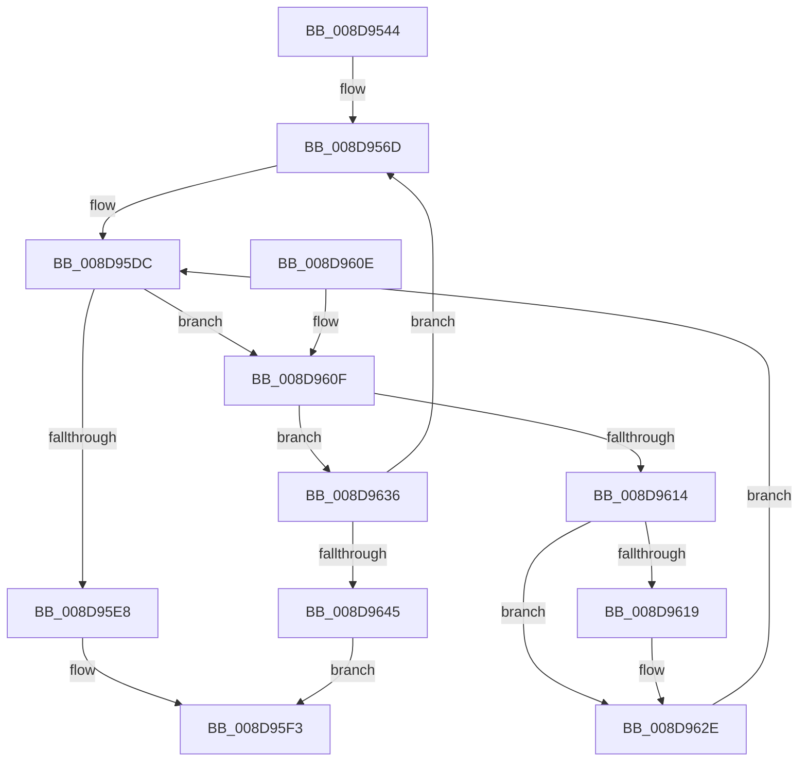

# EtwpCovSampHashLookup

- RVA: `0x008D9544`–`0x008D964C` (길이 `264` bytes)
- VA: `0x00000001408D9544`
- 실행 섹션: `PAGE`
- PDB 이름 있음: `예`; PDB Function 태그: `아니요`
- unwind 정보 RVA: `0x00085604`
- 디코드: `79`개 명령, `264/264` bytes 표시
- 미해석 바이트: `0` (있으면 어셈블리에 `.byte`로 보존)

> 이 문서는 커널 이미지의 기계어와 PDB 기호를 분석해 생성했습니다. 4번과 5번은 함수 원형과 자료형을 바이너리 사용 방식에서 추정한 C 해석이며 원본 소스 복구 결과는 아닙니다.

## 1. Dependencies

- 직접 호출 지점: **0**; 고유 호출 대상: **0**
- 직접 호출자로 확인된 함수: **1**
- RIP 상대 이미지 참조: **0**

### Outgoing calls
- 직접 디코드된 call 명령이 없습니다.

### Direct callers
- [EtwpCovSampContextAddSamples](EtwpCovSampContextAddSamples_function_008D7C9C.md) at `0x008D7EAA`

### Static image references
- 디코드된 RIP-relative 메모리 참조가 없습니다.

## 2. Other-region calls and transfers

- 다른 실행 섹션으로 향하는 call: **0**
- 별도 외부 분기/꼬리 이동을 확인하지 못했습니다.

## 3. Assembly (complete function range)

```asm
008D9544  48 8B C4                        mov rax, rsp
008D9547  48 89 58 08                     mov qword ptr [rax + 8], rbx
008D954B  48 89 68 10                     mov qword ptr [rax + 0x10], rbp
008D954F  48 89 70 18                     mov qword ptr [rax + 0x18], rsi
008D9553  48 89 78 20                     mov qword ptr [rax + 0x20], rdi
008D9557  41 54                           push r12
008D9559  41 56                           push r14
008D955B  41 57                           push r15
008D955D  48 8D 99 90 06 00 00            lea rbx, [rcx + 0x690]
008D9564  4D 8B D8                        mov r11, r8
008D9567  4C 8B 13                        mov r10, qword ptr [rbx]
008D956A  48 8B FA                        mov rdi, rdx
008D956D  0F B6 07                        movzx eax, byte ptr [rdi]
008D9570  45 33 C0                        xor r8d, r8d
008D9573  45 8B 72 14                     mov r14d, dword ptr [r10 + 0x14]
008D9577  48 05 CB 5D B1 00               add rax, 0xb15dcb
008D957D  4D 8B 7A 18                     mov r15, qword ptr [r10 + 0x18]
008D9581  41 FF CE                        dec r14d
008D9584  4C 8B 27                        mov r12, qword ptr [rdi]
008D9587  49 8B F2                        mov rsi, r10
008D958A  48 6B C8 25                     imul rcx, rax, 0x25
008D958E  0F B6 47 01                     movzx eax, byte ptr [rdi + 1]
008D9592  48 03 C8                        add rcx, rax
008D9595  0F B6 47 02                     movzx eax, byte ptr [rdi + 2]
008D9599  48 6B D1 25                     imul rdx, rcx, 0x25
008D959D  48 03 D0                        add rdx, rax
008D95A0  0F B6 47 03                     movzx eax, byte ptr [rdi + 3]
008D95A4  48 6B CA 25                     imul rcx, rdx, 0x25
008D95A8  48 03 C8                        add rcx, rax
008D95AB  0F B6 47 04                     movzx eax, byte ptr [rdi + 4]
008D95AF  48 6B D1 25                     imul rdx, rcx, 0x25
008D95B3  48 03 D0                        add rdx, rax
008D95B6  0F B6 47 05                     movzx eax, byte ptr [rdi + 5]
008D95BA  48 6B CA 25                     imul rcx, rdx, 0x25
008D95BE  48 03 C8                        add rcx, rax
008D95C1  0F B6 47 06                     movzx eax, byte ptr [rdi + 6]
008D95C5  48 6B D1 25                     imul rdx, rcx, 0x25
008D95C9  41 8B CE                        mov ecx, r14d
008D95CC  48 03 D0                        add rdx, rax
008D95CF  0F B6 47 07                     movzx eax, byte ptr [rdi + 7]
008D95D3  48 6B EA 25                     imul rbp, rdx, 0x25
008D95D7  48 03 E8                        add rbp, rax
008D95DA  23 CD                           and ecx, ebp
008D95DC  49 8D 14 CF                     lea rdx, [r15 + rcx*8]
008D95E0  48 8B 02                        mov rax, qword ptr [rdx]
008D95E3  49 3B C4                        cmp rax, r12
008D95E6  75 27                           jne 0x1408d960f
008D95E8  49 89 11                        mov qword ptr [r9], rdx
008D95EB  B8 01 00 00 00                  mov eax, 1
008D95F0  4D 89 13                        mov qword ptr [r11], r10
008D95F3  48 8B 5C 24 20                  mov rbx, qword ptr [rsp + 0x20]
008D95F8  48 8B 6C 24 28                  mov rbp, qword ptr [rsp + 0x28]
008D95FD  48 8B 74 24 30                  mov rsi, qword ptr [rsp + 0x30]
008D9602  48 8B 7C 24 38                  mov rdi, qword ptr [rsp + 0x38]
008D9607  41 5F                           pop r15
008D9609  41 5E                           pop r14
008D960B  41 5C                           pop r12
008D960D  C3                              ret
008D960E  CC                              int3
008D960F  48 85 C0                        test rax, rax
008D9612  74 22                           je 0x1408d9636
008D9614  45 85 C0                        test r8d, r8d
008D9617  75 15                           jne 0x1408d962e
008D9619  8B C5                           mov eax, ebp
008D961B  BA B1 79 37 9E                  mov edx, 0x9e3779b1
008D9620  48 0F AF C2                     imul rax, rdx
008D9624  A8 01                           test al, 1
008D9626  44 8D 40 01                     lea r8d, [rax + 1]
008D962A  44 0F 45 C0                     cmovne r8d, eax
008D962E  41 03 C8                        add ecx, r8d
008D9631  41 23 CE                        and ecx, r14d
008D9634  EB A6                           jmp 0x1408d95dc
008D9636  49 89 11                        mov qword ptr [r9], rdx
008D9639  4D 8B 12                        mov r10, qword ptr [r10]
008D963C  4C 3B D3                        cmp r10, rbx
008D963F  0F 85 28 FF FF FF               jne 0x1408d956d
008D9645  49 89 33                        mov qword ptr [r11], rsi
008D9648  33 C0                           xor eax, eax
008D964A  EB A7                           jmp 0x1408d95f3
```

## 4. C-style interpretation (structured pseudocode)

```c
__int64 __fastcall EtwpCovSampHashLookup(__int64 a1, __int64 a2, __int64 a3, __int64 a4)
{
    __int64 result;
    __int64 v_r14;
    __int64 v_rbp;
    unsigned __int64 v_stack_p10;
    unsigned __int64 v_stack_p18;
    unsigned __int64 v_stack_p20;
    unsigned __int64 v_stack_p8;

    *(unsigned __int64 *)(v_rsp + 8) = v_rbx;
    *(unsigned __int64 *)(v_rsp + 16) = v_rbp;
    *(unsigned __int64 *)(v_rsp + 24) = v_rsi;
    *(unsigned __int64 *)(v_rsp + 32) = v_rdi;
loc_008D956D:
    a3 = 0;
    result = (*(unsigned __int8 *)(a2)) + (0xB15DCBULL);
    v_r14 = (unsigned int)(((unsigned int)(*(unsigned int *)(*(unsigned __int64 *)(a1 + 1680) + 20))) - 1);
    a1 = (a1) * (result);
    a1 = (a1) + (*(unsigned __int8 *)(a2 + 1));
    a2 = (a2) * (a1);
    a2 = (a2) + (*(unsigned __int8 *)(a2 + 2));
    a1 = (a1) * (a2);
    a1 = (a1) + (*(unsigned __int8 *)(a2 + 3));
    a2 = (a2) * (a1);
    a2 = (a2) + (*(unsigned __int8 *)(a2 + 4));
    a1 = (a1) * (a2);
    a1 = (a1) + (*(unsigned __int8 *)(a2 + 5));
    a2 = (a2) * (a1);
    a2 = (a2) + (*(unsigned __int8 *)(a2 + 6));
    v_rbp = (v_rbp) * (a2);
    v_rbp = (v_rbp) + (*(unsigned __int8 *)(a2 + 7));
    a1 = (unsigned int)(((unsigned int)((unsigned int)(v_r14))) & ((unsigned int)(v_rbp)));
loc_008D95DC:
    if ((*(unsigned __int64 *)(*(unsigned __int64 *)(*(unsigned __int64 *)(a1 + 1680) + 24) + a1 * 8)) != (*(unsigned __int64 *)(a2))) goto loc_008D960F;
    *(unsigned __int64 *)(a4) = *(unsigned __int64 *)(*(unsigned __int64 *)(a1 + 1680) + 24) + a1 * 8;
    *(unsigned __int64 *)(a3) = *(unsigned __int64 *)(a1 + 1680);
loc_008D95F3:
    return 1;
loc_008D960F:
    if (1 == 0) goto loc_008D9636;
    result = 1;
    if (0 == 0) {
        result = (unsigned int)(v_stack_p10);
        a2 = 0x9E3779B1ULL;
        result = (result) * (a2);
        a3 = result + 1;
        if ((((unsigned __int8)(result)) & (1)) != 0) { a3 = (unsigned int)(result); }
    }
    a1 = (unsigned int)((a1) + ((unsigned int)(a3)));
    a1 = (unsigned int)((a1) & ((unsigned int)(v_r14)));
    goto loc_008D95DC;
loc_008D9636:
    *(unsigned __int64 *)(a4) = a2;
    if ((*(unsigned __int64 *)(*(unsigned __int64 *)(a1 + 1680))) != v_stack_p8) goto loc_008D956D;
    *(unsigned __int64 *)(a3) = v_stack_p18;
    result = 0;
    goto loc_008D95F3;
}
```

## 5. (Beta) C Style

```c
int64_t EtwpCovSampHashLookup(void *Arg1, void *Arg2, void *Arg3, void *Arg4)
{
    uint8_t *arg1 = (uint8_t *)Arg1;
    uint8_t *arg2 = (uint8_t *)Arg2;
    uint8_t *arg3 = (uint8_t *)Arg3;
    uint8_t *arg4 = (uint8_t *)Arg4;

    int64_t result;
    int64_t local_r14;
    int64_t local_rbp;
    uint64_t v_stack_p10;
    uint64_t v_stack_p18;
    uint64_t v_stack_p20;
    uint64_t v_stack_p8;

    *(uint64_t *)(local_rsp + 0x8) = local_rbx;
    *(uint64_t *)(local_rsp + 0x10) = local_rbp;
    *(uint64_t *)(local_rsp + 0x18) = local_rsi;
    *(uint64_t *)(local_rsp + 0x20) = local_rdi;
loc_008D956D:
    Arg3 = 0;
    result = (*(uint8_t *)(arg2)) + (0xB15DCBULL);
    local_r14 = (uint32_t)(((uint32_t)(*(uint32_t *)(*(uint64_t *)(arg1 + 0x690) + 0x14))) - 1);
    Arg1 = (Arg1) * (result);
    Arg1 = (Arg1) + (*(uint8_t *)(arg2 + 0x1));
    Arg2 = (Arg2) * (Arg1);
    Arg2 = (Arg2) + (*(uint8_t *)(arg2 + 0x2));
    Arg1 = (Arg1) * (Arg2);
    Arg1 = (Arg1) + (*(uint8_t *)(arg2 + 0x3));
    Arg2 = (Arg2) * (Arg1);
    Arg2 = (Arg2) + (*(uint8_t *)(arg2 + 0x4));
    Arg1 = (Arg1) * (Arg2);
    Arg1 = (Arg1) + (*(uint8_t *)(arg2 + 0x5));
    Arg2 = (Arg2) * (Arg1);
    Arg2 = (Arg2) + (*(uint8_t *)(arg2 + 0x6));
    local_rbp = (local_rbp) * (Arg2);
    local_rbp = (local_rbp) + (*(uint8_t *)(arg2 + 0x7));
    Arg1 = (uint32_t)(((uint32_t)((uint32_t)(local_r14))) & ((uint32_t)(local_rbp)));
loc_008D95DC:
    if ((*(uint64_t *)(*(uint64_t *)(*(uint64_t *)(arg1 + 0x690) + 0x18) + arg1 * 8)) != (*(uint64_t *)(arg2))) goto loc_008D960F;
    *(uint64_t *)(arg4) = *(uint64_t *)(*(uint64_t *)(arg1 + 0x690) + 0x18) + Arg1 * 8;
    *(uint64_t *)(arg3) = *(uint64_t *)(arg1 + 0x690);
loc_008D95F3:
    return 1;
loc_008D960F:
    if (1 == 0) goto loc_008D9636;
    result = 1;
    if (0 == 0) {
        result = (uint32_t)(v_stack_p10);
        Arg2 = 0x9E3779B1ULL;
        result = (result) * (Arg2);
        Arg3 = result + 1;
        if ((((uint8_t)(result)) & (1)) != 0) { Arg3 = (uint32_t)(result); }
    }
    Arg1 = (uint32_t)((Arg1) + ((uint32_t)(Arg3)));
    Arg1 = (uint32_t)((Arg1) & ((uint32_t)(local_r14)));
    goto loc_008D95DC;
loc_008D9636:
    *(void **)(arg4) = Arg2;
    if ((*(uint64_t *)(*(uint64_t *)(arg1 + 0x690))) != v_stack_p8) goto loc_008D956D;
    *(uint64_t *)(arg3) = v_stack_p18;
    result = 0;
    goto loc_008D95F3;
}
```

### 관측된 메모리 오프셋

구조체 형식이 확인되지 않은 접근은 인자 기준의 오프셋으로만 기록했습니다.

| 기준 인자 | 오프셋 표현 | 폭 (bit) | 접근 |
|---|---:|---:|---|
| `Arg1` | `+ 0x0` | `64` | `R` |
| `Arg1` | `+ 0x690` | `64` | `R` |
| `Arg2` | `+ 0x0` | `8` | `R` |
| `Arg2` | `+ 0x0` | `64` | `R` |
| `Arg2` | `+ 0x1` | `8` | `R` |
| `Arg2` | `+ 0x2` | `8` | `R` |
| `Arg2` | `+ 0x3` | `8` | `R` |
| `Arg2` | `+ 0x4` | `8` | `R` |
| `Arg2` | `+ 0x5` | `8` | `R` |
| `Arg2` | `+ 0x6` | `8` | `R` |
| `Arg2` | `+ 0x7` | `8` | `R` |
| `Arg3` | `+ 0x0` | `64` | `W` |
| `Arg4` | `+ 0x0` | `64` | `W` |

## 6. Execution-region graph

[열기: 2D/3D 그래프와 함수 탐색 컨트롤 패널](../../../control-panel.html?section=page&rva=0x008D9544&view=graph)

- 2D 그래프는 위에서 아래로 흐르고, 3D 그래프는 빈 공간을 드래그해 회전합니다. Shift+드래그는 이동, 휠은 확대·축소, 함수 노드 선택은 대상 보고서 이동입니다.

### Static fallback


