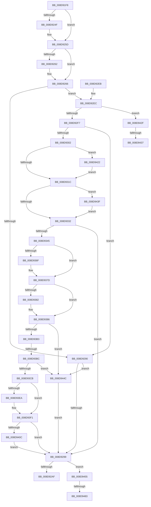

# EtwpCovSampHashMakeRoomAndAcquireLock

- RVA: `0x008D91F8`–`0x008D9497` (길이 `671` bytes)
- VA: `0x00000001408D91F8`
- 실행 섹션: `PAGE`
- PDB 이름 있음: `예`; PDB Function 태그: `예`
- unwind 정보 RVA: `0x000855D4`
- 디코드: `171`개 명령, `671/671` bytes 표시
- 미해석 바이트: `0` (있으면 어셈블리에 `.byte`로 보존)

> 이 문서는 커널 이미지의 기계어와 PDB 기호를 분석해 생성했습니다. 4번과 5번은 함수 원형과 자료형을 바이너리 사용 방식에서 추정한 C 해석이며 원본 소스 복구 결과는 아닙니다.

## 1. Dependencies

- 직접 호출 지점: **12**; 고유 호출 대상: **8**
- 직접 호출자로 확인된 함수: **1**
- RIP 상대 이미지 참조: **0**

### Outgoing calls
- `0x008D923F` → [KeAbPreAcquire](../../text/21/KeAbPreAcquire_function_00210230.md) (function, `0x00210230`)
- `0x008D9258` → [ExfAcquirePushLockExclusiveEx](../../text/20/ExfAcquirePushLockExclusiveEx_function_0020FC90.md) (function, `0x0020FC90`)
- `0x008D931F` → [KeAbPostRelease](../../text/2E/KeAbPostRelease_function_002E1600.md) (function, `0x002E1600`)
- `0x008D9324` → [KeLeaveCriticalRegion](../../text/25/KeLeaveCriticalRegion_function_0025D8B0.md) (function, `0x0025D8B0`)
- `0x008D9334` → [EtwpCoverageSamplerAllocateTable](EtwpCoverageSamplerAllocateTable_function_008D9654.md) (function, `0x008D9654`)
- `0x008D935F` → [KeAbPreAcquire](../../text/21/KeAbPreAcquire_function_00210230.md) (function, `0x00210230`)
- `0x008D9378` → [ExfAcquirePushLockExclusiveEx](../../text/20/ExfAcquirePushLockExclusiveEx_function_0020FC90.md) (function, `0x0020FC90`)
- `0x008D9418` → [KeSetEvent](../../text/33/KeSetEvent_function_0033F310.md) (function, `0x0033F310`)
- `0x008D9425` → [ExfTryToWakePushLock](../../text/26/ExfTryToWakePushLock_function_00265DD0.md) (function, `0x00265DD0`)
- `0x008D9442` → [EtwpCoverageSamplerFreeTable](../A8/EtwpCoverageSamplerFreeTable_function_00A878A4.md) (function, `0x00A878A4`)
- `0x008D946F` → [KeAbPreAcquire](../../text/21/KeAbPreAcquire_function_00210230.md) (function, `0x00210230`)
- `0x008D948C` → [ExfAcquirePushLockExclusiveEx](../../text/20/ExfAcquirePushLockExclusiveEx_function_0020FC90.md) (function, `0x0020FC90`)

### Direct callers
- [EtwpCovSampContextAddSamples](EtwpCovSampContextAddSamples_function_008D7C9C.md) at `0x008D7CF7`

### Static image references
- 디코드된 RIP-relative 메모리 참조가 없습니다.

## 2. Other-region calls and transfers

- 다른 실행 섹션으로 향하는 call: **10**
  - `0x008D923F` → [KeAbPreAcquire](../../text/21/KeAbPreAcquire_function_00210230.md) (`PAGE` → `.text`)
  - `0x008D9258` → [ExfAcquirePushLockExclusiveEx](../../text/20/ExfAcquirePushLockExclusiveEx_function_0020FC90.md) (`PAGE` → `.text`)
  - `0x008D931F` → [KeAbPostRelease](../../text/2E/KeAbPostRelease_function_002E1600.md) (`PAGE` → `.text`)
  - `0x008D9324` → [KeLeaveCriticalRegion](../../text/25/KeLeaveCriticalRegion_function_0025D8B0.md) (`PAGE` → `.text`)
  - `0x008D935F` → [KeAbPreAcquire](../../text/21/KeAbPreAcquire_function_00210230.md) (`PAGE` → `.text`)
  - `0x008D9378` → [ExfAcquirePushLockExclusiveEx](../../text/20/ExfAcquirePushLockExclusiveEx_function_0020FC90.md) (`PAGE` → `.text`)
  - `0x008D9418` → [KeSetEvent](../../text/33/KeSetEvent_function_0033F310.md) (`PAGE` → `.text`)
  - `0x008D9425` → [ExfTryToWakePushLock](../../text/26/ExfTryToWakePushLock_function_00265DD0.md) (`PAGE` → `.text`)
  - `0x008D946F` → [KeAbPreAcquire](../../text/21/KeAbPreAcquire_function_00210230.md) (`PAGE` → `.text`)
  - `0x008D948C` → [ExfAcquirePushLockExclusiveEx](../../text/20/ExfAcquirePushLockExclusiveEx_function_0020FC90.md) (`PAGE` → `.text`)
- call이 아닌 외부 분기/꼬리 이동: **5**
  - `0x008D93B6` → [sub_00B1C2E2 + 0x18](../B1/Unknown_function_00B1C2E2.md) (`tail-transfer`)
  - `0x008D9431` → [sub_00B1C2E2](../B1/Unknown_function_00B1C2E2.md) (`tail-transfer`)
  - `0x008D943A` → [sub_00B1C2E2 + 0x2](../B1/Unknown_function_00B1C2E2.md) (`tail-transfer`)
  - `0x008D947D` → [sub_00B1C2E2 + 0xD0](../B1/Unknown_function_00B1C2E2.md) (`tail-transfer`)
  - `0x008D9492` → [sub_00B1C2E2 + 0xD0](../B1/Unknown_function_00B1C2E2.md) (`tail-transfer`)

## 3. Assembly (complete function range)

```asm
008D91F8  48 8B C4                        mov rax, rsp
008D91FB  48 89 58 10                     mov qword ptr [rax + 0x10], rbx
008D91FF  48 89 68 18                     mov qword ptr [rax + 0x18], rbp
008D9203  48 89 70 20                     mov qword ptr [rax + 0x20], rsi
008D9207  57                              push rdi
008D9208  41 54                           push r12
008D920A  41 55                           push r13
008D920C  41 56                           push r14
008D920E  41 57                           push r15
008D9210  48 83 EC 20                     sub rsp, 0x20
008D9214  48 83 60 08 00                  and qword ptr [rax + 8], 0
008D9219  4D 8B E8                        mov r13, r8
008D921C  65 48 8B 04 25 88 01 00 00      mov rax, qword ptr gs:[0x188]
008D9225  44 8B E2                        mov r12d, edx
008D9228  49 83 CE FF                     or r14, 0xffffffffffffffff
008D922C  45 33 C0                        xor r8d, r8d
008D922F  33 D2                           xor edx, edx
008D9231  48 8B D9                        mov rbx, rcx
008D9234  33 FF                           xor edi, edi
008D9236  66 44 01 B0 E4 01 00 00         add word ptr [rax + 0x1e4], r14w
008D923E  90                              nop
008D923F  E8 EC 6F 93 FF                  call 0x140210230
008D9244  F0 48 0F BA 2B 00               lock bts qword ptr [rbx], 0
008D924A  48 8B F0                        mov rsi, rax
008D924D  73 0E                           jae 0x1408d925d
008D924F  4C 8B C3                        mov r8, rbx
008D9252  48 8B D0                        mov rdx, rax
008D9255  48 8B CB                        mov rcx, rbx
008D9258  E8 33 6A 93 FF                  call 0x14020fc90
008D925D  48 85 F6                        test rsi, rsi
008D9260  74 04                           je 0x1408d9266
008D9262  C6 46 0A 01                     mov byte ptr [rsi + 0xa], 1
008D9266  65 48 8B 04 25 88 01 00 00      mov rax, qword ptr gs:[0x188]
008D926F  45 33 FF                        xor r15d, r15d
008D9272  48 89 43 08                     mov qword ptr [rbx + 8], rax
008D9276  48 8B 8B 80 06 00 00            mov rcx, qword ptr [rbx + 0x680]
008D927D  8B 51 10                        mov edx, dword ptr [rcx + 0x10]
008D9280  8B 49 14                        mov ecx, dword ptr [rcx + 0x14]
008D9283  41 03 D4                        add edx, r12d
008D9286  6B C1 07                        imul eax, ecx, 7
008D9289  C1 E8 03                        shr eax, 3
008D928C  3B D0                           cmp edx, eax
008D928E  73 5C                           jae 0x1408d92ec
008D9290  48 85 FF                        test rdi, rdi
008D9293  0F 85 B3 01 00 00               jne 0x1408d944c
008D9299  48 8B 4B 08                     mov rcx, qword ptr [rbx + 8]
008D929D  65 48 8B 04 25 88 01 00 00      mov rax, qword ptr gs:[0x188]
008D92A6  48 3B C8                        cmp rcx, rax
008D92A9  0F 85 A6 01 00 00               jne 0x1408d9455
008D92AF  48 8B 83 80 06 00 00            mov rax, qword ptr [rbx + 0x680]
008D92B6  48 8B 5C 24 58                  mov rbx, qword ptr [rsp + 0x58]
008D92BB  48 8B 6C 24 60                  mov rbp, qword ptr [rsp + 0x60]
008D92C0  48 8B 74 24 68                  mov rsi, qword ptr [rsp + 0x68]
008D92C5  44 6B 40 14 07                  imul r8d, dword ptr [rax + 0x14], 7
008D92CA  8B 50 10                        mov edx, dword ptr [rax + 0x10]
008D92CD  41 C1 E8 03                     shr r8d, 3
008D92D1  41 8B C8                        mov ecx, r8d
008D92D4  2B CA                           sub ecx, edx
008D92D6  41 3B D0                        cmp edx, r8d
008D92D9  1B C0                           sbb eax, eax
008D92DB  23 C1                           and eax, ecx
008D92DD  48 83 C4 20                     add rsp, 0x20
008D92E1  41 5F                           pop r15
008D92E3  41 5E                           pop r14
008D92E5  41 5D                           pop r13
008D92E7  41 5C                           pop r12
008D92E9  5F                              pop rdi
008D92EA  C3                              ret
008D92EB  CC                              int3
008D92EC  8B 6B 28                        mov ebp, dword ptr [rbx + 0x28]
008D92EF  3B CD                           cmp ecx, ebp
008D92F1  0F 82 38 01 00 00               jb 0x1408d942f
008D92F7  8B 43 2C                        mov eax, dword ptr [rbx + 0x2c]
008D92FA  39 83 A0 06 00 00               cmp dword ptr [rbx + 0x6a0], eax
008D9300  73 8E                           jae 0x1408d9290
008D9302  48 C7 43 08 00 00 00 00         mov qword ptr [rbx + 8], 0
008D930A  49 8B C6                        mov rax, r14
008D930D  F0 48 0F C1 03                  lock xadd qword ptr [rbx], rax
008D9312  24 06                           and al, 6
008D9314  3C 02                           cmp al, 2
008D9316  0F 84 06 01 00 00               je 0x1408d9422
008D931C  48 8B CB                        mov rcx, rbx
008D931F  E8 DC 82 A0 FF                  call 0x1402e1600
008D9324  E8 87 45 98 FF                  call 0x14025d8b0
008D9329  48 85 FF                        test rdi, rdi
008D932C  0F 85 0D 01 00 00               jne 0x1408d943f
008D9332  8B CD                           mov ecx, ebp
008D9334  E8 1B 03 00 00                  call 0x1408d9654
008D9339  48 8B F8                        mov rdi, rax
008D933C  48 85 C0                        test rax, rax
008D933F  0F 84 54 FF FF FF               je 0x1408d9299
008D9345  65 48 8B 04 25 88 01 00 00      mov rax, qword ptr gs:[0x188]
008D934E  45 33 C0                        xor r8d, r8d
008D9351  33 D2                           xor edx, edx
008D9353  48 8B CB                        mov rcx, rbx
008D9356  66 44 01 B0 E4 01 00 00         add word ptr [rax + 0x1e4], r14w
008D935E  90                              nop
008D935F  E8 CC 6E 93 FF                  call 0x140210230
008D9364  F0 48 0F BA 2B 00               lock bts qword ptr [rbx], 0
008D936A  48 8B F0                        mov rsi, rax
008D936D  73 0E                           jae 0x1408d937d
008D936F  4C 8B C3                        mov r8, rbx
008D9372  48 8B D0                        mov rdx, rax
008D9375  48 8B CB                        mov rcx, rbx
008D9378  E8 13 69 93 FF                  call 0x14020fc90
008D937D  48 85 F6                        test rsi, rsi
008D9380  74 04                           je 0x1408d9386
008D9382  C6 46 0A 01                     mov byte ptr [rsi + 0xa], 1
008D9386  65 48 8B 04 25 88 01 00 00      mov rax, qword ptr gs:[0x188]
008D938F  48 89 43 08                     mov qword ptr [rbx + 8], rax
008D9393  48 8B B3 80 06 00 00            mov rsi, qword ptr [rbx + 0x680]
008D939A  44 8B 46 14                     mov r8d, dword ptr [rsi + 0x14]
008D939E  8B 4E 10                        mov ecx, dword ptr [rsi + 0x10]
008D93A1  41 6B D0 07                     imul edx, r8d, 7
008D93A5  41 03 CC                        add ecx, r12d
008D93A8  C1 EA 03                        shr edx, 3
008D93AB  3B CA                           cmp ecx, edx
008D93AD  0F 82 99 00 00 00               jb 0x1408d944c
008D93B3  44 3B C5                        cmp r8d, ebp
008D93B6  0F 82 3E 2F 24 00               jb 0x140b1c2fa
008D93BC  8B 83 A0 06 00 00               mov eax, dword ptr [rbx + 0x6a0]
008D93C2  3B 43 2C                        cmp eax, dword ptr [rbx + 0x2c]
008D93C5  0F 83 81 00 00 00               jae 0x1408d944c
008D93CB  FF C0                           inc eax
008D93CD  48 89 BB 80 06 00 00            mov qword ptr [rbx + 0x680], rdi
008D93D4  89 83 A0 06 00 00               mov dword ptr [rbx + 0x6a0], eax
008D93DA  48 8D 83 90 06 00 00            lea rax, [rbx + 0x690]
008D93E1  48 8B 48 08                     mov rcx, qword ptr [rax + 8]
008D93E5  48 39 01                        cmp qword ptr [rcx], rax
008D93E8  74 07                           je 0x1408d93f1
008D93EA  B9 03 00 00 00                  mov ecx, 3
008D93EF  CD 29                           int 0x29
008D93F1  48 89 07                        mov qword ptr [rdi], rax
008D93F4  48 89 4F 08                     mov qword ptr [rdi + 8], rcx
008D93F8  48 89 39                        mov qword ptr [rcx], rdi
008D93FB  48 89 78 08                     mov qword ptr [rax + 8], rdi
008D93FF  83 BB A0 06 00 00 02            cmp dword ptr [rbx + 0x6a0], 2
008D9406  0F 85 8D FE FF FF               jne 0x1408d9299
008D940C  48 8B 8B 88 06 00 00            mov rcx, qword ptr [rbx + 0x688]
008D9413  45 33 C0                        xor r8d, r8d
008D9416  33 D2                           xor edx, edx
008D9418  E8 F3 5E A6 FF                  call 0x14033f310
008D941D  E9 77 FE FF FF                  jmp 0x1408d9299
008D9422  48 8B CB                        mov rcx, rbx
008D9425  E8 A6 C9 98 FF                  call 0x140265dd0
008D942A  E9 ED FE FF FF                  jmp 0x1408d931c
008D942F  85 C9                           test ecx, ecx
008D9431  0F 85 AB 2E 24 00               jne 0x140b1c2e2
008D9437  8B 4B 24                        mov ecx, dword ptr [rbx + 0x24]
008D943A  E9 A5 2E 24 00                  jmp 0x140b1c2e4
008D943F  48 8B CF                        mov rcx, rdi
008D9442  E8 5D E4 1A 00                  call 0x140a878a4
008D9447  E9 E6 FE FF FF                  jmp 0x1408d9332
008D944C  49 89 7D 00                     mov qword ptr [r13], rdi
008D9450  E9 44 FE FF FF                  jmp 0x1408d9299
008D9455  65 48 8B 04 25 88 01 00 00      mov rax, qword ptr gs:[0x188]
008D945E  45 33 C0                        xor r8d, r8d
008D9461  33 D2                           xor edx, edx
008D9463  48 8B CB                        mov rcx, rbx
008D9466  66 44 01 B0 E4 01 00 00         add word ptr [rax + 0x1e4], r14w
008D946E  90                              nop
008D946F  E8 BC 6D 93 FF                  call 0x140210230
008D9474  F0 48 0F BA 2B 00               lock bts qword ptr [rbx], 0
008D947A  48 8B F8                        mov rdi, rax
008D947D  0F 83 2F 2F 24 00               jae 0x140b1c3b2
008D9483  4C 8B C3                        mov r8, rbx
008D9486  48 8B D0                        mov rdx, rax
008D9489  48 8B CB                        mov rcx, rbx
008D948C  E8 FF 67 93 FF                  call 0x14020fc90
008D9491  90                              nop
008D9492  E9 1B 2F 24 00                  jmp 0x140b1c3b2
```

## 4. C-style interpretation (structured pseudocode)

```c
__int64 __fastcall EtwpCovSampHashMakeRoomAndAcquireLock(__int64 a1, int a2, __int64 a3)
{
    __int64 result;
    __int64 v_r14;
    __int64 v_r15;
    __int64 v_rdi;
    __int64 v_rsp;
    unsigned __int64 v_stack_p10;
    unsigned __int64 v_stack_p18;
    unsigned __int64 v_stack_p20;

    *(unsigned __int64 *)(v_rsp + 16) = v_rbx;
    *(unsigned __int64 *)(v_rsp + 24) = v_rbp;
    *(unsigned __int64 *)(v_rsp + 32) = v_rsi;
    v_rsp = (v_rsp) - (32);
    v_r14 = (v_r14) | (-1);
    a3 = 0;
    a2 = 0;
    v_rdi = 0;
    result = KeAbPreAcquire(a1, a2, a3, a4);
    if (!(condition_is_above_or_equal)) {
        a3 = a1;
        a2 = result;
        a1 = a1;
        result = ExfAcquirePushLockExclusiveEx(a1, a2, a3, a4);
    }
    if (result != 0) {
        *(unsigned __int8 *)(result + 10) = 1;
    }
    v_r15 = 0;
    *(unsigned __int64 *)(a1 + 8) = *(unsigned __int64 *)(gs_base + (0 + 392));
    a2 = (unsigned int)(((unsigned int)(*(unsigned int *)(*(unsigned __int64 *)(a1 + 1664) + 16))) + ((unsigned int)((unsigned int)(a2))));
    result = (unsigned int)((*(unsigned __int64 *)(gs_base + (0 + 392))) * ((unsigned int)((unsigned int)(*(unsigned int *)(*(unsigned __int64 *)(a1 + 1664) + 20)))));
    result = (unsigned int)((result) >> (3));
    if (a2 >= ((unsigned int)(result))) goto loc_008D92EC;
loc_008D9290:
    if (0 != 0) goto loc_008D944C;
loc_008D9299:
    if ((*(unsigned __int64 *)(a1 + 8)) != (*(unsigned __int64 *)(gs_base + (0 + 392)))) goto loc_008D9455;
    a3 = (unsigned int)((a3) * (*(unsigned int *)(*(unsigned __int64 *)(a1 + 1664) + 20)));
    a3 = (unsigned int)((a3) >> (3));
    a1 = (unsigned int)(((unsigned int)((unsigned int)(a3))) - ((unsigned int)((unsigned int)(*(unsigned int *)(*(unsigned __int64 *)(a1 + 1664) + 16)))));
    result = (unsigned int)((*(unsigned __int64 *)(a1 + 1664)) & ((unsigned int)(a1)));
    v_rsp = (v_rsp) + (32);
    return result;
loc_008D92EC:
    if (((unsigned int)(a1)) < ((unsigned int)((unsigned int)(*(unsigned int *)(v_stack_p10 + 40))))) goto loc_008D942F;
    if ((*(unsigned int *)(v_stack_p10 + 1696)) >= ((unsigned int)((unsigned int)(*(unsigned int *)(v_stack_p10 + 44))))) goto loc_008D9290;
    *(unsigned __int64 *)(v_stack_p10 + 8) = 0;
    result = (unsigned __int8)((v_r14) & (6));
    if (((unsigned __int8)(result)) == 2) goto loc_008D9422;
loc_008D931C:
    result = KeAbPostRelease(v_stack_p10, (unsigned int)(*(unsigned int *)(*(unsigned __int64 *)(a1 + 1664) + 16)), a3, a4);
    result = KeLeaveCriticalRegion(v_stack_p10, (unsigned int)(*(unsigned int *)(*(unsigned __int64 *)(a1 + 1664) + 16)), a3, a4);
    if (0 != 0) goto loc_008D943F;
loc_008D9332:
    result = EtwpCoverageSamplerAllocateTable((unsigned int)((unsigned int)((unsigned int)(*(unsigned int *)(v_stack_p10 + 40)))), (unsigned int)(*(unsigned int *)(*(unsigned __int64 *)(a1 + 1664) + 16)), a3, a4);
    if (result == 0) goto loc_008D9299;
    a3 = 0;
    a2 = 0;
    result = KeAbPreAcquire(v_stack_p10, a2, a3, a4);
    if (!(condition_is_above_or_equal)) {
        a3 = v_stack_p10;
        a2 = result;
        a1 = v_stack_p10;
        result = ExfAcquirePushLockExclusiveEx(a1, a2, a3, a4);
    }
    if (result != 0) {
        *(unsigned __int8 *)(result + 10) = 1;
    }
    *(unsigned __int64 *)(v_stack_p10 + 8) = *(unsigned __int64 *)(gs_base + (0 + 392));
    a2 = (unsigned int)((a2) * ((unsigned int)((unsigned int)(*(unsigned int *)(*(unsigned __int64 *)(v_stack_p10 + 1664) + 20)))));
    a1 = (unsigned int)(((unsigned int)(*(unsigned int *)(*(unsigned __int64 *)(v_stack_p10 + 1664) + 16))) + ((unsigned int)((unsigned int)(a2))));
    a2 = (unsigned int)((a2) >> (3));
    if (((unsigned int)(a1)) < a2) goto loc_008D944C;
    if (((unsigned int)((unsigned int)(*(unsigned int *)(v_stack_p10 + 1696)))) >= (*(unsigned int *)(v_stack_p10 + 44))) goto loc_008D944C;
    result = (unsigned int)(((unsigned int)(*(unsigned int *)(v_stack_p10 + 1696))) + 1);
    *(unsigned __int64 *)(v_stack_p10 + 1664) = result;
    *(unsigned int *)(v_stack_p10 + 1696) = (unsigned int)(result);
    if ((*(unsigned __int64 *)(*(unsigned __int64 *)(v_stack_p10 + 1680 + 8))) != (v_stack_p10 + 1680)) {
        a1 = 3;
    }
    *(unsigned __int64 *)(result) = v_stack_p10 + 1680;
    *(unsigned __int64 *)(result + 8) = a1;
    *(unsigned __int64 *)(a1) = result;
    *(unsigned __int64 *)(v_stack_p10 + 1680 + 8) = result;
    if ((*(unsigned int *)(v_stack_p10 + 1696)) != 2) goto loc_008D9299;
    a3 = 0;
    a2 = 0;
    result = KeSetEvent(*(unsigned __int64 *)(v_stack_p10 + 1672), a2, a3, a4);
    goto loc_008D9299;
loc_008D9422:
    result = ExfTryToWakePushLock(v_stack_p10, a2, a3, a4);
    goto loc_008D931C;
loc_008D942F:
loc_008D943F:
    result = EtwpCoverageSamplerFreeTable(result, a2, a3, a4);
    goto loc_008D9332;
loc_008D944C:
    *(unsigned __int64 *)(a3) = result;
    goto loc_008D9299;
loc_008D9455:
    a3 = 0;
    a2 = 0;
    result = KeAbPreAcquire(v_stack_p10, a2, a3, a4);
    result = ExfAcquirePushLockExclusiveEx(v_stack_p10, result, v_stack_p10, a4);
}
```

## 5. (Beta) C Style

```c
int64_t EtwpCovSampHashMakeRoomAndAcquireLock(void *Arg1, int32_t Arg2, void *Arg3)
{
    uint8_t *arg1 = (uint8_t *)Arg1;
    uint8_t *arg3 = (uint8_t *)Arg3;

    int64_t result;
    int64_t local_r14;
    int64_t local_r15;
    int64_t local_rdi;
    int64_t local_rsp;
    uint64_t v_stack_p10;
    uint64_t v_stack_p18;
    uint64_t v_stack_p20;

    *(uint64_t *)(local_rsp + 0x10) = local_rbx;
    *(uint64_t *)(local_rsp + 0x18) = local_rbp;
    *(uint64_t *)(local_rsp + 0x20) = local_rsi;
    local_rsp = (local_rsp) - (32);
    local_r14 = (local_r14) | (-1);
    Arg3 = 0;
    Arg2 = 0;
    local_rdi = 0;
    result = KeAbPreAcquire(Arg1, Arg2, Arg3, a4);
    if (!(condition_is_above_or_equal)) {
        Arg3 = Arg1;
        Arg2 = result;
        Arg1 = Arg1;
        result = ExfAcquirePushLockExclusiveEx(Arg1, Arg2, Arg3, a4);
    }
    if (result != 0) {
        *(uint8_t *)(result + 0xA) = 1;
    }
    local_r15 = 0;
    *(uint64_t *)(arg1 + 0x8) = *(uint64_t *)(gs_base + (0 + 0x188));
    Arg2 = (uint32_t)(((uint32_t)(*(uint32_t *)(*(uint64_t *)(arg1 + 0x680) + 0x10))) + ((uint32_t)((uint32_t)(Arg2))));
    result = (uint32_t)((*(uint64_t *)(gs_base + (0 + 0x188))) * ((uint32_t)((uint32_t)(*(uint32_t *)(*(uint64_t *)(arg1 + 0x680) + 0x14)))));
    result = (uint32_t)((result) >> (3));
    if (Arg2 >= ((uint32_t)(result))) goto loc_008D92EC;
loc_008D9290:
    if (0 != 0) goto loc_008D944C;
loc_008D9299:
    if ((*(uint64_t *)(arg1 + 0x8)) != (*(uint64_t *)(gs_base + (0 + 0x188)))) goto loc_008D9455;
    Arg3 = (uint32_t)((Arg3) * (*(uint32_t *)(*(uint64_t *)(arg1 + 0x680) + 0x14)));
    Arg3 = (uint32_t)((Arg3) >> (3));
    Arg1 = (uint32_t)(((uint32_t)((uint32_t)(Arg3))) - ((uint32_t)((uint32_t)(*(uint32_t *)(*(uint64_t *)(arg1 + 0x680) + 0x10)))));
    result = (uint32_t)((*(uint64_t *)(arg1 + 0x680)) & ((uint32_t)(Arg1)));
    local_rsp = (local_rsp) + (32);
    return result;
loc_008D92EC:
    if (((uint32_t)(Arg1)) < ((uint32_t)((uint32_t)(*(uint32_t *)(v_stack_p10 + 0x28))))) goto loc_008D942F;
    if ((*(uint32_t *)(v_stack_p10 + 0x6A0)) >= ((uint32_t)((uint32_t)(*(uint32_t *)(v_stack_p10 + 0x2C))))) goto loc_008D9290;
    *(uint64_t *)(v_stack_p10 + 0x8) = 0;
    result = (uint8_t)((local_r14) & (6));
    if (((uint8_t)(result)) == 2) goto loc_008D9422;
loc_008D931C:
    result = KeAbPostRelease(v_stack_p10, (uint32_t)(*(uint32_t *)(*(uint64_t *)(arg1 + 0x680) + 0x10)), Arg3, a4);
    result = KeLeaveCriticalRegion(v_stack_p10, (uint32_t)(*(uint32_t *)(*(uint64_t *)(arg1 + 0x680) + 0x10)), Arg3, a4);
    if (0 != 0) goto loc_008D943F;
loc_008D9332:
    result = EtwpCoverageSamplerAllocateTable((uint32_t)((uint32_t)((uint32_t)(*(uint32_t *)(v_stack_p10 + 0x28)))), (uint32_t)(*(uint32_t *)(*(uint64_t *)(arg1 + 0x680) + 0x10)), Arg3, a4);
    if (result == 0) goto loc_008D9299;
    Arg3 = 0;
    Arg2 = 0;
    result = KeAbPreAcquire(v_stack_p10, Arg2, Arg3, a4);
    if (!(condition_is_above_or_equal)) {
        Arg3 = v_stack_p10;
        Arg2 = result;
        Arg1 = v_stack_p10;
        result = ExfAcquirePushLockExclusiveEx(Arg1, Arg2, Arg3, a4);
    }
    if (result != 0) {
        *(uint8_t *)(result + 0xA) = 1;
    }
    *(uint64_t *)(v_stack_p10 + 0x8) = *(uint64_t *)(gs_base + (0 + 0x188));
    Arg2 = (uint32_t)((Arg2) * ((uint32_t)((uint32_t)(*(uint32_t *)(*(uint64_t *)(v_stack_p10 + 0x680) + 0x14)))));
    Arg1 = (uint32_t)(((uint32_t)(*(uint32_t *)(*(uint64_t *)(v_stack_p10 + 0x680) + 0x10))) + ((uint32_t)((uint32_t)(Arg2))));
    Arg2 = (uint32_t)((Arg2) >> (3));
    if (((uint32_t)(Arg1)) < Arg2) goto loc_008D944C;
    if (((uint32_t)((uint32_t)(*(uint32_t *)(v_stack_p10 + 0x6A0)))) >= (*(uint32_t *)(v_stack_p10 + 0x2C))) goto loc_008D944C;
    result = (uint32_t)(((uint32_t)(*(uint32_t *)(v_stack_p10 + 0x6A0))) + 1);
    *(uint64_t *)(v_stack_p10 + 0x680) = result;
    *(uint32_t *)(v_stack_p10 + 0x6A0) = (uint32_t)(result);
    if ((*(uint64_t *)(*(uint64_t *)(v_stack_p10 + 0x690 + 0x8))) != (v_stack_p10 + 1680)) {
        Arg1 = 3;
    }
    *(uint64_t *)(result) = v_stack_p10 + 1680;
    *(void **)(result + 0x8) = Arg1;
    *(uint64_t *)(arg1) = result;
    *(uint64_t *)(v_stack_p10 + 0x690 + 0x8) = result;
    if ((*(uint32_t *)(v_stack_p10 + 0x6A0)) != 2) goto loc_008D9299;
    Arg3 = 0;
    Arg2 = 0;
    result = KeSetEvent(*(uint64_t *)(v_stack_p10 + 0x688), Arg2, Arg3, a4);
    goto loc_008D9299;
loc_008D9422:
    result = ExfTryToWakePushLock(v_stack_p10, Arg2, Arg3, a4);
    goto loc_008D931C;
loc_008D942F:
loc_008D943F:
    result = EtwpCoverageSamplerFreeTable(result, Arg2, Arg3, a4);
    goto loc_008D9332;
loc_008D944C:
    *(uint64_t *)(arg3) = result;
    goto loc_008D9299;
loc_008D9455:
    Arg3 = 0;
    Arg2 = 0;
    result = KeAbPreAcquire(v_stack_p10, Arg2, Arg3, a4);
    result = ExfAcquirePushLockExclusiveEx(v_stack_p10, result, v_stack_p10, a4);
}
```

### 관측된 메모리 오프셋

구조체 형식이 확인되지 않은 접근은 인자 기준의 오프셋으로만 기록했습니다.

| 기준 인자 | 오프셋 표현 | 폭 (bit) | 접근 |
|---|---:|---:|---|
| `Arg1` | `+ 0x0` | `64` | `R/W` |
| `Arg1` | `+ 0x8` | `64` | `R` |
| `Arg1` | `+ 0x8` | `64` | `W` |
| `Arg1` | `+ 0x24` | `32` | `R` |
| `Arg1` | `+ 0x28` | `32` | `R` |
| `Arg1` | `+ 0x2C` | `32` | `R` |
| `Arg1` | `+ 0x680` | `64` | `R` |
| `Arg1` | `+ 0x680` | `64` | `W` |
| `Arg1` | `+ 0x688` | `64` | `R` |
| `Arg1` | `+ 0x690` | `64` | `R` |
| `Arg1` | `+ 0x6A0` | `32` | `R` |
| `Arg1` | `+ 0x6A0` | `32` | `W` |
| `Arg3` | `+ 0x0` | `64` | `W` |

## 6. Execution-region graph

[열기: 2D/3D 그래프와 함수 탐색 컨트롤 패널](../../../control-panel.html?section=page&rva=0x008D91F8&view=graph)

- 2D 그래프는 위에서 아래로 흐르고, 3D 그래프는 빈 공간을 드래그해 회전합니다. Shift+드래그는 이동, 휠은 확대·축소, 함수 노드 선택은 대상 보고서 이동입니다.

### Static fallback


