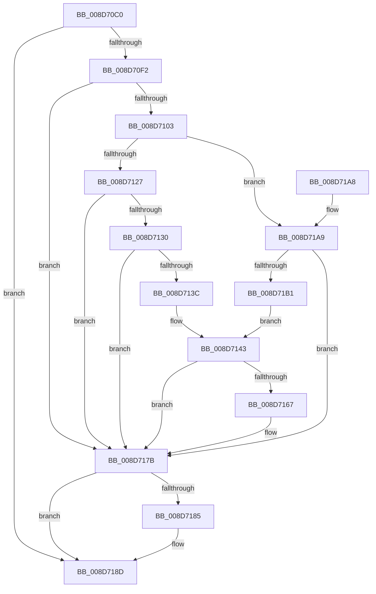

# EtwpCovSampImageNotify

- RVA: `0x008D70C0`–`0x008D71BA` (길이 `250` bytes)
- VA: `0x00000001408D70C0`
- 실행 섹션: `PAGE`
- PDB 이름 있음: `예`; PDB Function 태그: `아니요`
- unwind 정보 RVA: `0x00085464`
- 디코드: `69`개 명령, `250/250` bytes 표시
- 미해석 바이트: `0` (있으면 어셈블리에 `.byte`로 보존)

> 이 문서는 커널 이미지의 기계어와 PDB 기호를 분석해 생성했습니다. 4번과 5번은 함수 원형과 자료형을 바이너리 사용 방식에서 추정한 C 해석이며 원본 소스 복구 결과는 아닙니다.

## 1. Dependencies

- 직접 호출 지점: **6**; 고유 호출 대상: **6**
- 직접 호출자로 확인된 함수: **3**
- RIP 상대 이미지 참조: **1**

### Outgoing calls
- `0x008D70FA` → [EtwpCovSampAcquireSamplerRundown](EtwpCovSampAcquireSamplerRundown_function_008D7F7C.md) (function, `0x008D7F7C`)
- `0x008D7133` → [EtwpCovSampProcessEnsureContext](EtwpCovSampProcessEnsureContext_function_008D8EB4.md) (function, `0x008D8EB4`)
- `0x008D715E` → [EtwpCovSampContextGetModule](EtwpCovSampContextGetModule_function_008D7FEC.md) (function, `0x008D7FEC`)
- `0x008D7176` → [EtwpCovSampProcessAddModule](EtwpCovSampProcessAddModule_function_008D8F58.md) (function, `0x008D8F58`)
- `0x008D7188` → [EtwpCovSampModuleDereference](EtwpCovSampModuleDereference_function_008D7F38.md) (function, `0x008D7F38`)
- `0x008D7192` → [EtwpCovSampReleaseSamplerRundown](EtwpCovSampReleaseSamplerRundown_function_008D7850.md) (function, `0x008D7850`)

### Direct callers
- [sub_008D6D7D](Unknown_function_008D6D7D.md) at `0x008D6DB2`
- [EtwpCovSampEnumerateProcess](../97/EtwpCovSampEnumerateProcess_function_0097D9B0.md) at `0x0097DAD5`
- [EtwpCovSampEnumerateDriver](../AB/EtwpCovSampEnumerateDriver_function_00ABB340.md) at `0x00ABB384`

### Static image references
- `0x008D7103` → RVA `0x00EFF1D8` (`.data`; read)

## 2. Other-region calls and transfers

- 다른 실행 섹션으로 향하는 call: **0**
- 별도 외부 분기/꼬리 이동을 확인하지 못했습니다.

## 3. Assembly (complete function range)

```asm
008D70C0  48 8B C4                        mov rax, rsp
008D70C3  48 89 58 08                     mov qword ptr [rax + 8], rbx
008D70C7  55                              push rbp
008D70C8  56                              push rsi
008D70C9  57                              push rdi
008D70CA  41 56                           push r14
008D70CC  41 57                           push r15
008D70CE  48 83 EC 30                     sub rsp, 0x30
008D70D2  33 DB                           xor ebx, ebx
008D70D4  49 8B F0                        mov rsi, r8
008D70D7  48 21 58 18                     and qword ptr [rax + 0x18], rbx
008D70DB  48 8B EA                        mov rbp, rdx
008D70DE  48 21 58 20                     and qword ptr [rax + 0x20], rbx
008D70E2  4C 8B F9                        mov r15, rcx
008D70E5  41 F7 00 00 04 00 00            test dword ptr [r8], 0x400
008D70EC  0F 84 9B 00 00 00               je 0x1408d718d
008D70F2  48 8D 48 20                     lea rcx, [rax + 0x20]
008D70F6  4D 8D 70 F8                     lea r14, [r8 - 8]
008D70FA  E8 7D 0E 00 00                  call 0x1408d7f7c
008D70FF  85 C0                           test eax, eax
008D7101  78 78                           js 0x1408d717b
008D7103  48 8B 1D CE 80 62 00            mov rbx, qword ptr [rip + 0x6280ce]
008D710A  65 48 8B 04 25 88 01 00 00      mov rax, qword ptr gs:[0x188]
008D7113  48 83 C3 10                     add rbx, 0x10
008D7117  48 8B B8 B8 00 00 00            mov rdi, qword ptr [rax + 0xb8]
008D711E  48 85 ED                        test rbp, rbp
008D7121  0F 84 82 00 00 00               je 0x1408d71a9
008D7127  48 3B AF D0 01 00 00            cmp rbp, qword ptr [rdi + 0x1d0]
008D712E  75 4B                           jne 0x1408d717b
008D7130  48 8B CF                        mov rcx, rdi
008D7133  E8 7C 1D 00 00                  call 0x1408d8eb4
008D7138  85 C0                           test eax, eax
008D713A  78 3F                           js 0x1408d717b
008D713C  48 8B AF 70 07 00 00            mov rbp, qword ptr [rdi + 0x770]
008D7143  48 8D 44 24 70                  lea rax, [rsp + 0x70]
008D7148  4D 8B CF                        mov r9, r15
008D714B  48 89 44 24 28                  mov qword ptr [rsp + 0x28], rax
008D7150  4C 8B C5                        mov r8, rbp
008D7153  48 8B D7                        mov rdx, rdi
008D7156  4C 89 74 24 20                  mov qword ptr [rsp + 0x20], r14
008D715B  48 8B CB                        mov rcx, rbx
008D715E  E8 89 0E 00 00                  call 0x1408d7fec
008D7163  85 C0                           test eax, eax
008D7165  78 14                           js 0x1408d717b
008D7167  4C 8B 4E 08                     mov r9, qword ptr [rsi + 8]
008D716B  48 8B D3                        mov rdx, rbx
008D716E  4C 8B 44 24 70                  mov r8, qword ptr [rsp + 0x70]
008D7173  48 8B CD                        mov rcx, rbp
008D7176  E8 DD 1D 00 00                  call 0x1408d8f58
008D717B  48 8B 54 24 70                  mov rdx, qword ptr [rsp + 0x70]
008D7180  48 85 D2                        test rdx, rdx
008D7183  74 08                           je 0x1408d718d
008D7185  48 8B CB                        mov rcx, rbx
008D7188  E8 AB 0D 00 00                  call 0x1408d7f38
008D718D  48 8B 4C 24 78                  mov rcx, qword ptr [rsp + 0x78]
008D7192  E8 B9 06 00 00                  call 0x1408d7850
008D7197  48 8B 5C 24 60                  mov rbx, qword ptr [rsp + 0x60]
008D719C  48 83 C4 30                     add rsp, 0x30
008D71A0  41 5F                           pop r15
008D71A2  41 5E                           pop r14
008D71A4  5F                              pop rdi
008D71A5  5E                              pop rsi
008D71A6  5D                              pop rbp
008D71A7  C3                              ret
008D71A8  CC                              int3
008D71A9  F7 06 00 01 00 00               test dword ptr [rsi], 0x100
008D71AF  74 CA                           je 0x1408d717b
008D71B1  48 8D AB E0 04 00 00            lea rbp, [rbx + 0x4e0]
008D71B8  EB 89                           jmp 0x1408d7143
```

## 4. C-style interpretation (structured pseudocode)

```c
__int64 __fastcall EtwpCovSampImageNotify(__int64 a1, __int64 a2, __int64 a3)
{
    __int64 result;
    __int64 v_rbx;
    __int64 v_rsp;
    unsigned __int64 v_stack_m30;
    unsigned __int64 v_stack_m38;
    unsigned __int64 v_stack_p18;
    unsigned __int64 v_stack_p20;
    unsigned __int64 v_stack_p8;

    *(unsigned __int64 *)(v_rsp + 8) = v_rbx;
    v_rsp = (v_rsp) - (48);
    v_rbx = 0;
    if (((*(unsigned int *)(a3)) & (0x400ULL)) == 0) goto loc_008D718D;
    result = EtwpCovSampAcquireSamplerRundown(v_rsp + 32, a2, a3, a4);
    if (sign_flag) goto loc_008D717B;
    v_rbx = (*(unsigned __int64 *)(v_rip + 6455502)) + (16);
    if (a2 == 0) goto loc_008D71A9;
    if (a2 != (*(unsigned __int64 *)(*(unsigned __int64 *)(*(unsigned __int64 *)(gs_base + (0 + 392)) + 184) + 464))) goto loc_008D717B;
    result = EtwpCovSampProcessEnsureContext(*(unsigned __int64 *)(*(unsigned __int64 *)(gs_base + (0 + 392)) + 184), a2, a3, a4);
    if (sign_flag) goto loc_008D717B;
loc_008D7143:
    v_stack_m30 = v_stack_p18;
    v_stack_m38 = a3 - 8;
    result = EtwpCovSampContextGetModule(v_rbx, *(unsigned __int64 *)(*(unsigned __int64 *)(gs_base + (0 + 392)) + 184), *(unsigned __int64 *)(*(unsigned __int64 *)(*(unsigned __int64 *)(gs_base + (0 + 392)) + 184) + 1904), a1);
    if (!(sign_flag)) {
        a4 = *(unsigned __int64 *)(a3 + 8);
        a2 = v_rbx;
        a3 = v_stack_p18;
        a1 = *(unsigned __int64 *)(*(unsigned __int64 *)(*(unsigned __int64 *)(gs_base + (0 + 392)) + 184) + 1904);
        result = EtwpCovSampProcessAddModule(a1, a2, a3, a4);
    }
    if (v_stack_p18 != 0) {
        a1 = v_rbx;
        result = EtwpCovSampModuleDereference(a1, v_stack_p18, a3, a4);
    }
    result = EtwpCovSampReleaseSamplerRundown(v_stack_p20, v_stack_p18, a3, a4);
    v_rsp = (v_rsp) + (48);
    return result;
loc_008D71A9:
    if (((*(unsigned int *)(a3)) & (256)) == 0) goto loc_008D717B;
    goto loc_008D7143;
}
```

## 5. (Beta) C Style

```c
int64_t EtwpCovSampImageNotify(int64_t Arg1, int64_t Arg2, void *Arg3)
{
    uint8_t *arg3 = (uint8_t *)Arg3;

    int64_t result;
    int64_t local_rbx;
    int64_t local_rsp;
    uint64_t v_stack_m30;
    uint64_t v_stack_m38;
    uint64_t v_stack_p18;
    uint64_t v_stack_p20;
    uint64_t v_stack_p8;

    *(uint64_t *)(local_rsp + 0x8) = local_rbx;
    local_rsp = (local_rsp) - (48);
    local_rbx = 0;
    if (((*(uint32_t *)(arg3)) & (0x400ULL)) == 0) goto loc_008D718D;
    result = EtwpCovSampAcquireSamplerRundown(local_rsp + 32, Arg2, Arg3, a4);
    if (sign_flag) goto loc_008D717B;
    local_rbx = (*(uint64_t *)(v_rip + 0x6280CE)) + (16);
    if (Arg2 == 0) goto loc_008D71A9;
    if (Arg2 != (*(uint64_t *)(*(uint64_t *)(*(uint64_t *)(gs_base + (0 + 0x188)) + 0xB8) + 0x1D0))) goto loc_008D717B;
    result = EtwpCovSampProcessEnsureContext(*(uint64_t *)(*(uint64_t *)(gs_base + (0 + 0x188)) + 0xB8), Arg2, Arg3, a4);
    if (sign_flag) goto loc_008D717B;
loc_008D7143:
    v_stack_m30 = v_stack_p18;
    v_stack_m38 = Arg3 - 8;
    result = EtwpCovSampContextGetModule(local_rbx, *(uint64_t *)(*(uint64_t *)(gs_base + (0 + 0x188)) + 0xB8), *(uint64_t *)(*(uint64_t *)(*(uint64_t *)(gs_base + (0 + 0x188)) + 0xB8) + 0x770), Arg1);
    if (!(sign_flag)) {
        a4 = *(uint64_t *)(arg3 + 0x8);
        Arg2 = local_rbx;
        Arg3 = v_stack_p18;
        Arg1 = *(uint64_t *)(*(uint64_t *)(*(uint64_t *)(gs_base + (0 + 0x188)) + 0xB8) + 0x770);
        result = EtwpCovSampProcessAddModule(Arg1, Arg2, Arg3, a4);
    }
    if (v_stack_p18 != 0) {
        Arg1 = local_rbx;
        result = EtwpCovSampModuleDereference(Arg1, v_stack_p18, Arg3, a4);
    }
    result = EtwpCovSampReleaseSamplerRundown(v_stack_p20, v_stack_p18, Arg3, a4);
    local_rsp = (local_rsp) + (48);
    return result;
loc_008D71A9:
    if (((*(uint32_t *)(arg3)) & (256)) == 0) goto loc_008D717B;
    goto loc_008D7143;
}
```

### 관측된 메모리 오프셋

구조체 형식이 확인되지 않은 접근은 인자 기준의 오프셋으로만 기록했습니다.

| 기준 인자 | 오프셋 표현 | 폭 (bit) | 접근 |
|---|---:|---:|---|
| `Arg3` | `- 0x8` | `64` | `R` |
| `Arg3` | `+ 0x0` | `32` | `R` |
| `Arg3` | `+ 0x8` | `64` | `R` |

## 6. Execution-region graph

[열기: 2D/3D 그래프와 함수 탐색 컨트롤 패널](../../../control-panel.html?section=page&rva=0x008D70C0&view=graph)

- 2D 그래프는 위에서 아래로 흐르고, 3D 그래프는 빈 공간을 드래그해 회전합니다. Shift+드래그는 이동, 휠은 확대·축소, 함수 노드 선택은 대상 보고서 이동입니다.

### Static fallback


