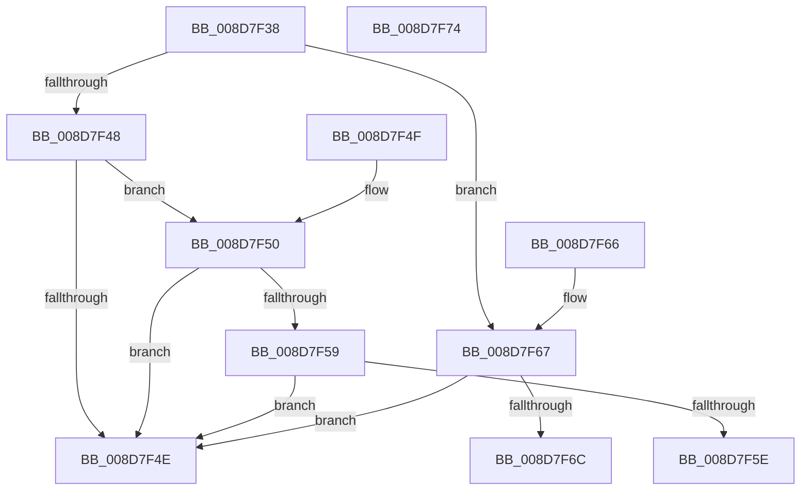

# EtwpCovSampModuleDereference

- RVA: `0x008D7F38`–`0x008D7F75` (길이 `61` bytes)
- VA: `0x00000001408D7F38`
- 실행 섹션: `PAGE`
- PDB 이름 있음: `예`; PDB Function 태그: `아니요`
- unwind 정보 RVA: `0x000DB714`
- 디코드: `21`개 명령, `61/61` bytes 표시
- 미해석 바이트: `0` (있으면 어셈블리에 `.byte`로 보존)

> 이 문서는 커널 이미지의 기계어와 PDB 기호를 분석해 생성했습니다. 4번과 5번은 함수 원형과 자료형을 바이너리 사용 방식에서 추정한 C 해석이며 원본 소스 복구 결과는 아닙니다.

## 1. Dependencies

- 직접 호출 지점: **0**; 고유 호출 대상: **0**
- 직접 호출자로 확인된 함수: **3**
- RIP 상대 이미지 참조: **0**

### Outgoing calls
- 직접 디코드된 call 명령이 없습니다.

### Direct callers
- [EtwpCovSampProcessRemoveModule](EtwpCovSampProcessRemoveModule_function_008D6B78.md) at `0x008D6BE7`
- [EtwpCovSampImageNotify](EtwpCovSampImageNotify_function_008D70C0.md) at `0x008D7188`
- [EtwpCovSampProcessCleanup](EtwpCovSampProcessCleanup_function_008D94A0.md) at `0x008D94C3`
- [EtwpCovSampProcessCleanup](EtwpCovSampProcessCleanup_function_008D94A0.md) at `0x008D950D`

### Static image references
- 디코드된 RIP-relative 메모리 참조가 없습니다.

## 2. Other-region calls and transfers

- 다른 실행 섹션으로 향하는 call: **0**
- 별도 외부 분기/꼬리 이동을 확인하지 못했습니다.

## 3. Assembly (complete function range)

```asm
008D7F38  48 83 C8 FF                     or rax, 0xffffffffffffffff
008D7F3C  F0 48 0F C1 42 40               lock xadd qword ptr [rdx + 0x40], rax
008D7F42  48 83 E8 01                     sub rax, 1
008D7F46  7E 1F                           jle 0x1408d7f67
008D7F48  48 83 F8 01                     cmp rax, 1
008D7F4C  74 02                           je 0x1408d7f50
008D7F4E  C3                              ret
008D7F4F  CC                              int3
008D7F50  83 BA 84 00 00 00 00            cmp dword ptr [rdx + 0x84], 0
008D7F57  75 F5                           jne 0x1408d7f4e
008D7F59  48 85 C9                        test rcx, rcx
008D7F5C  74 F0                           je 0x1408d7f4e
008D7F5E  F0 FF 81 64 06 00 00            lock inc dword ptr [rcx + 0x664]
008D7F65  C3                              ret
008D7F66  CC                              int3
008D7F67  48 85 C0                        test rax, rax
008D7F6A  74 E2                           je 0x1408d7f4e
008D7F6C  B9 0E 00 00 00                  mov ecx, 0xe
008D7F71  CD 29                           int 0x29
008D7F73  C3                              ret
008D7F74  CC                              int3
```

## 4. C-style interpretation (structured pseudocode)

```c
__int64 __fastcall EtwpCovSampModuleDereference(__int64 a1, __int64 a2)
{
    __int64 result;

    result = (result) | (-1);
    result = (result) - (1);
    if (condition_is_less_or_equal) goto loc_008D7F67;
    if (result == 1) goto loc_008D7F50;
loc_008D7F4E:
    return result;
loc_008D7F50:
    if ((*(unsigned int *)(a2 + 132)) != 0) goto loc_008D7F4E;
    if (a1 == 0) goto loc_008D7F4E;
    return result;
loc_008D7F67:
    if (result == 0) goto loc_008D7F4E;
    return result;
}
```

## 5. (Beta) C Style

```c
int64_t EtwpCovSampModuleDereference(int64_t Arg1, void *Arg2)
{
    uint8_t *arg2 = (uint8_t *)Arg2;

    int64_t result;

    result = (result) | (-1);
    result = (result) - (1);
    if (condition_is_less_or_equal) goto loc_008D7F67;
    if (result == 1) goto loc_008D7F50;
loc_008D7F4E:
    return result;
loc_008D7F50:
    if ((*(uint32_t *)(arg2 + 0x84)) != 0) goto loc_008D7F4E;
    if (Arg1 == 0) goto loc_008D7F4E;
    return result;
loc_008D7F67:
    if (result == 0) goto loc_008D7F4E;
    return result;
}
```

### 관측된 메모리 오프셋

구조체 형식이 확인되지 않은 접근은 인자 기준의 오프셋으로만 기록했습니다.

| 기준 인자 | 오프셋 표현 | 폭 (bit) | 접근 |
|---|---:|---:|---|
| `Arg2` | `+ 0x40` | `64` | `R/W` |
| `Arg2` | `+ 0x84` | `32` | `R` |

## 6. Execution-region graph

[열기: 2D/3D 그래프와 함수 탐색 컨트롤 패널](../../../control-panel.html?section=page&rva=0x008D7F38&view=graph)

- 2D 그래프는 위에서 아래로 흐르고, 3D 그래프는 빈 공간을 드래그해 회전합니다. Shift+드래그는 이동, 휠은 확대·축소, 함수 노드 선택은 대상 보고서 이동입니다.

### Static fallback


