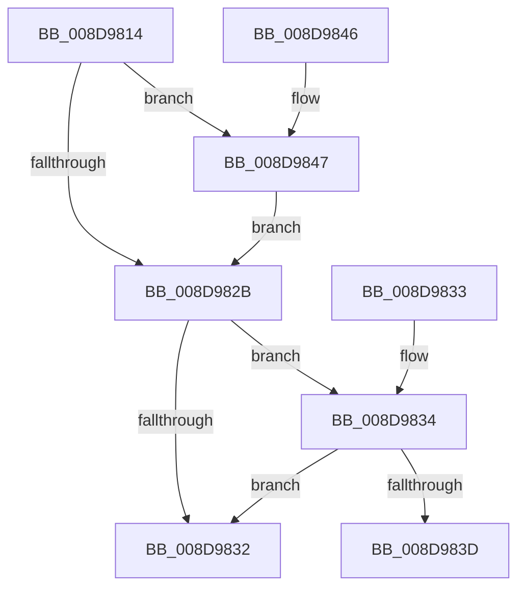

# EtwpCovSampModuleReference

- RVA: `0x008D9814`–`0x008D9850` (길이 `60` bytes)
- VA: `0x00000001408D9814`
- 실행 섹션: `PAGE`
- PDB 이름 있음: `예`; PDB Function 태그: `아니요`
- unwind 정보 RVA: `0x000DB714`
- 디코드: `18`개 명령, `60/60` bytes 표시
- 미해석 바이트: `0` (있으면 어셈블리에 `.byte`로 보존)

> 이 문서는 커널 이미지의 기계어와 PDB 기호를 분석해 생성했습니다. 4번과 5번은 함수 원형과 자료형을 바이너리 사용 방식에서 추정한 C 해석이며 원본 소스 복구 결과는 아닙니다.

## 1. Dependencies

- 직접 호출 지점: **0**; 고유 호출 대상: **0**
- 직접 호출자로 확인된 함수: **2**
- RIP 상대 이미지 참조: **0**

### Outgoing calls
- 직접 디코드된 call 명령이 없습니다.

### Direct callers
- [ProcessForExeModule](../../text/49/ProcessForExeModule_function_0049572C.md) at `0x00495756`
- [EtwpCovSampProcessAddModule](EtwpCovSampProcessAddModule_function_008D8F58.md) at `0x008D916E`

### Static image references
- 디코드된 RIP-relative 메모리 참조가 없습니다.

## 2. Other-region calls and transfers

- 다른 실행 섹션으로 향하는 call: **0**
- 별도 외부 분기/꼬리 이동을 확인하지 못했습니다.

## 3. Assembly (complete function range)

```asm
008D9814  4C 8B C1                        mov r8, rcx
008D9817  B8 01 00 00 00                  mov eax, 1
008D981C  F0 48 0F C1 42 40               lock xadd qword ptr [rdx + 0x40], rax
008D9822  48 FF C0                        inc rax
008D9825  48 83 F8 01                     cmp rax, 1
008D9829  7E 1C                           jle 0x1408d9847
008D982B  48 83 7A 40 02                  cmp qword ptr [rdx + 0x40], 2
008D9830  74 02                           je 0x1408d9834
008D9832  C3                              ret
008D9833  CC                              int3
008D9834  83 BA 84 00 00 00 00            cmp dword ptr [rdx + 0x84], 0
008D983B  75 F5                           jne 0x1408d9832
008D983D  F0 41 FF 88 64 06 00 00         lock dec dword ptr [r8 + 0x664]
008D9845  C3                              ret
008D9846  CC                              int3
008D9847  B9 0E 00 00 00                  mov ecx, 0xe
008D984C  CD 29                           int 0x29
008D984E  EB DB                           jmp 0x1408d982b
```

## 4. C-style interpretation (structured pseudocode)

```c
__int64 __fastcall EtwpCovSampModuleReference(__int64 a1, __int64 a2)
{
    __int64 result;

    result = (1) + 1;
    if (result <= 1) goto loc_008D9847;
loc_008D982B:
    if ((*(unsigned __int64 *)(a2 + 64)) == 2) goto loc_008D9834;
loc_008D9832:
    return result;
loc_008D9834:
    if ((*(unsigned int *)(a2 + 132)) != 0) goto loc_008D9832;
    return result;
loc_008D9847:
    goto loc_008D982B;
}
```

## 5. (Beta) C Style

```c
int64_t EtwpCovSampModuleReference(void *Arg1, void *Arg2)
{
    uint8_t *arg1 = (uint8_t *)Arg1;
    uint8_t *arg2 = (uint8_t *)Arg2;

    int64_t result;

    result = (1) + 1;
    if (result <= 1) goto loc_008D9847;
loc_008D982B:
    if ((*(uint64_t *)(arg2 + 0x40)) == 2) goto loc_008D9834;
loc_008D9832:
    return result;
loc_008D9834:
    if ((*(uint32_t *)(arg2 + 0x84)) != 0) goto loc_008D9832;
    return result;
loc_008D9847:
    goto loc_008D982B;
}
```

### 관측된 메모리 오프셋

구조체 형식이 확인되지 않은 접근은 인자 기준의 오프셋으로만 기록했습니다.

| 기준 인자 | 오프셋 표현 | 폭 (bit) | 접근 |
|---|---:|---:|---|
| `Arg1` | `+ 0x664` | `32` | `R/W` |
| `Arg2` | `+ 0x40` | `64` | `R` |
| `Arg2` | `+ 0x40` | `64` | `R/W` |
| `Arg2` | `+ 0x84` | `32` | `R` |

## 6. Execution-region graph

[열기: 2D/3D 그래프와 함수 탐색 컨트롤 패널](../../../control-panel.html?section=page&rva=0x008D9814&view=graph)

- 2D 그래프는 위에서 아래로 흐르고, 3D 그래프는 빈 공간을 드래그해 회전합니다. Shift+드래그는 이동, 휠은 확대·축소, 함수 노드 선택은 대상 보고서 이동입니다.

### Static fallback


