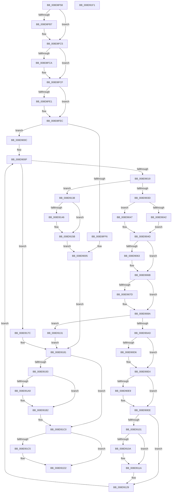

# EtwpCovSampProcessAddModule

- RVA: `0x008D8F58`–`0x008D91F2` (길이 `666` bytes)
- VA: `0x00000001408D8F58`
- 실행 섹션: `PAGE`
- PDB 이름 있음: `예`; PDB Function 태그: `아니요`
- unwind 정보 RVA: `0x000855B4`
- 디코드: `179`개 명령, `666/666` bytes 표시
- 미해석 바이트: `0` (있으면 어셈블리에 `.byte`로 보존)

> 이 문서는 커널 이미지의 기계어와 PDB 기호를 분석해 생성했습니다. 4번과 5번은 함수 원형과 자료형을 바이너리 사용 방식에서 추정한 C 해석이며 원본 소스 복구 결과는 아닙니다.

## 1. Dependencies

- 직접 호출 지점: **19**; 고유 호출 대상: **11**
- 직접 호출자로 확인된 함수: **1**
- RIP 상대 이미지 참조: **0**

### Outgoing calls
- `0x008D8FA7` → [KeAbPreAcquire](../../text/21/KeAbPreAcquire_function_00210230.md) (function, `0x00210230`)
- `0x008D8FC0` → [ExfAcquirePushLockExclusiveEx](../../text/20/ExfAcquirePushLockExclusiveEx_function_0020FC90.md) (function, `0x0020FC90`)
- `0x008D8FE4` → [ObfReferenceObject](../../text/20/ObfReferenceObject_function_0020FA20.md) (function, `0x0020FA20`)
- `0x008D9000` → [EtwpCovSampProcessRemoveModule](EtwpCovSampProcessRemoveModule_function_008D6B78.md) (function, `0x008D6B78`)
- `0x008D9028` → [EtwpCovSampProcessRemoveModule](EtwpCovSampProcessRemoveModule_function_008D6B78.md) (function, `0x008D6B78`)
- `0x008D9066` → [ExfTryToWakePushLock](../../text/26/ExfTryToWakePushLock_function_00265DD0.md) (function, `0x00265DD0`)
- `0x008D906E` → [KeAbPostRelease](../../text/2E/KeAbPostRelease_function_002E1600.md) (function, `0x002E1600`)
- `0x008D9073` → [KeLeaveCriticalRegion](../../text/25/KeLeaveCriticalRegion_function_0025D8B0.md) (function, `0x0025D8B0`)
- `0x008D9085` → [ExFreePoolWithTag](../../poolcode/B8/ExFreePoolWithTag_function_00B82870.md) (function, `0x00B82870`)
- `0x008D909C` → [ExAllocatePool2](../../poolcode/B8/ExAllocatePool2_function_00B820F0.md) (function, `0x00B820F0`)
- `0x008D90C6` → [KeAbPreAcquire](../../text/21/KeAbPreAcquire_function_00210230.md) (function, `0x00210230`)
- `0x008D90DF` → [ExfAcquirePushLockExclusiveEx](../../text/20/ExfAcquirePushLockExclusiveEx_function_0020FC90.md) (function, `0x0020FC90`)
- `0x008D9115` → [memcpy](../../text/6C/memcpy_function_006C6840.md) (function, `0x006C6840`)
- `0x008D9156` → [memcpy](../../text/6C/memcpy_function_006C6840.md) (function, `0x006C6840`)
- `0x008D916E` → [EtwpCovSampModuleReference](EtwpCovSampModuleReference_function_008D9814.md) (function, `0x008D9814`)
- `0x008D91AD` → [ExfTryToWakePushLock](../../text/26/ExfTryToWakePushLock_function_00265DD0.md) (function, `0x00265DD0`)
- `0x008D91B6` → [KeAbPostRelease](../../text/2E/KeAbPostRelease_function_002E1600.md) (function, `0x002E1600`)
- `0x008D91BB` → [KeLeaveCriticalRegion](../../text/25/KeLeaveCriticalRegion_function_0025D8B0.md) (function, `0x0025D8B0`)
- `0x008D91CD` → [ExFreePoolWithTag](../../poolcode/B8/ExFreePoolWithTag_function_00B82870.md) (function, `0x00B82870`)

### Direct callers
- [EtwpCovSampImageNotify](EtwpCovSampImageNotify_function_008D70C0.md) at `0x008D7176`

### Static image references
- 디코드된 RIP-relative 메모리 참조가 없습니다.

## 2. Other-region calls and transfers

- 다른 실행 섹션으로 향하는 call: **16**
  - `0x008D8FA7` → [KeAbPreAcquire](../../text/21/KeAbPreAcquire_function_00210230.md) (`PAGE` → `.text`)
  - `0x008D8FC0` → [ExfAcquirePushLockExclusiveEx](../../text/20/ExfAcquirePushLockExclusiveEx_function_0020FC90.md) (`PAGE` → `.text`)
  - `0x008D8FE4` → [ObfReferenceObject](../../text/20/ObfReferenceObject_function_0020FA20.md) (`PAGE` → `.text`)
  - `0x008D9066` → [ExfTryToWakePushLock](../../text/26/ExfTryToWakePushLock_function_00265DD0.md) (`PAGE` → `.text`)
  - `0x008D906E` → [KeAbPostRelease](../../text/2E/KeAbPostRelease_function_002E1600.md) (`PAGE` → `.text`)
  - `0x008D9073` → [KeLeaveCriticalRegion](../../text/25/KeLeaveCriticalRegion_function_0025D8B0.md) (`PAGE` → `.text`)
  - `0x008D9085` → [ExFreePoolWithTag](../../poolcode/B8/ExFreePoolWithTag_function_00B82870.md) (`PAGE` → `POOLCODE`)
  - `0x008D909C` → [ExAllocatePool2](../../poolcode/B8/ExAllocatePool2_function_00B820F0.md) (`PAGE` → `POOLCODE`)
  - `0x008D90C6` → [KeAbPreAcquire](../../text/21/KeAbPreAcquire_function_00210230.md) (`PAGE` → `.text`)
  - `0x008D90DF` → [ExfAcquirePushLockExclusiveEx](../../text/20/ExfAcquirePushLockExclusiveEx_function_0020FC90.md) (`PAGE` → `.text`)
  - `0x008D9115` → [memcpy](../../text/6C/memcpy_function_006C6840.md) (`PAGE` → `.text`)
  - `0x008D9156` → [memcpy](../../text/6C/memcpy_function_006C6840.md) (`PAGE` → `.text`)
  - `0x008D91AD` → [ExfTryToWakePushLock](../../text/26/ExfTryToWakePushLock_function_00265DD0.md) (`PAGE` → `.text`)
  - `0x008D91B6` → [KeAbPostRelease](../../text/2E/KeAbPostRelease_function_002E1600.md) (`PAGE` → `.text`)
  - `0x008D91BB` → [KeLeaveCriticalRegion](../../text/25/KeLeaveCriticalRegion_function_0025D8B0.md) (`PAGE` → `.text`)
  - `0x008D91CD` → [ExFreePoolWithTag](../../poolcode/B8/ExFreePoolWithTag_function_00B82870.md) (`PAGE` → `POOLCODE`)
- 별도 외부 분기/꼬리 이동을 확인하지 못했습니다.

## 3. Assembly (complete function range)

```asm
008D8F58  48 8B C4                        mov rax, rsp
008D8F5B  48 89 58 08                     mov qword ptr [rax + 8], rbx
008D8F5F  48 89 68 10                     mov qword ptr [rax + 0x10], rbp
008D8F63  48 89 70 18                     mov qword ptr [rax + 0x18], rsi
008D8F67  4C 89 48 20                     mov qword ptr [rax + 0x20], r9
008D8F6B  57                              push rdi
008D8F6C  41 54                           push r12
008D8F6E  41 55                           push r13
008D8F70  41 56                           push r14
008D8F72  41 57                           push r15
008D8F74  48 83 EC 20                     sub rsp, 0x20
008D8F78  65 48 8B 04 25 88 01 00 00      mov rax, qword ptr gs:[0x188]
008D8F81  48 8D 71 08                     lea rsi, [rcx + 8]
008D8F85  4D 8B E8                        mov r13, r8
008D8F88  4C 8B FA                        mov r15, rdx
008D8F8B  48 8B F9                        mov rdi, rcx
008D8F8E  48 83 CB FF                     or rbx, 0xffffffffffffffff
008D8F92  45 33 C0                        xor r8d, r8d
008D8F95  33 D2                           xor edx, edx
008D8F97  66 01 98 E4 01 00 00            add word ptr [rax + 0x1e4], bx
008D8F9E  48 8B CE                        mov rcx, rsi
008D8FA1  90                              nop
008D8FA2  4D 8B E1                        mov r12, r9
008D8FA5  33 ED                           xor ebp, ebp
008D8FA7  E8 84 72 93 FF                  call 0x140210230
008D8FAC  F0 48 0F BA 2E 00               lock bts qword ptr [rsi], 0
008D8FB2  4C 8B F0                        mov r14, rax
008D8FB5  73 0E                           jae 0x1408d8fc5
008D8FB7  4C 8B C6                        mov r8, rsi
008D8FBA  48 8B D0                        mov rdx, rax
008D8FBD  48 8B CE                        mov rcx, rsi
008D8FC0  E8 CB 6C 93 FF                  call 0x14020fc90
008D8FC5  4D 85 F6                        test r14, r14
008D8FC8  74 05                           je 0x1408d8fcf
008D8FCA  41 C6 46 0A 01                  mov byte ptr [r14 + 0xa], 1
008D8FCF  65 48 8B 04 25 88 01 00 00      mov rax, qword ptr gs:[0x188]
008D8FD8  48 89 47 10                     mov qword ptr [rdi + 0x10], rax
008D8FDC  48 39 2F                        cmp qword ptr [rdi], rbp
008D8FDF  75 0B                           jne 0x1408d8fec
008D8FE1  49 8B 0F                        mov rcx, qword ptr [r15]
008D8FE4  E8 37 6A 93 FF                  call 0x14020fa20
008D8FE9  4C 89 3F                        mov qword ptr [rdi], r15
008D8FEC  41 F7 45 78 00 00 11 00         test dword ptr [r13 + 0x78], 0x110000
008D8FF4  75 16                           jne 0x1408d900c
008D8FF6  4D 8B 45 28                     mov r8, qword ptr [r13 + 0x28]
008D8FFA  49 8B D4                        mov rdx, r12
008D8FFD  48 8B CF                        mov rcx, rdi
008D9000  E8 73 DB FF FF                  call 0x1408d6b78
008D9005  33 F6                           xor esi, esi
008D9007  E9 75 01 00 00                  jmp 0x1408d9181
008D900C  45 33 E4                        xor r12d, r12d
008D900F  41 83 FC 14                     cmp r12d, 0x14
008D9013  0F 83 63 01 00 00               jae 0x1408d917c
008D9019  4C 8B 74 24 68                  mov r14, qword ptr [rsp + 0x68]
008D901E  48 8B CF                        mov rcx, rdi
008D9021  4D 8B 45 28                     mov r8, qword ptr [r13 + 0x28]
008D9025  49 8B D6                        mov rdx, r14
008D9028  E8 4B DB FF FF                  call 0x1408d6b78
008D902D  8B 4F 20                        mov ecx, dword ptr [rdi + 0x20]
008D9030  44 8B 7F 24                     mov r15d, dword ptr [rdi + 0x24]
008D9034  41 3B CF                        cmp ecx, r15d
008D9037  0F 82 FB 00 00 00               jb 0x1408d9138
008D903D  45 85 FF                        test r15d, r15d
008D9040  74 05                           je 0x1408d9047
008D9042  45 03 FF                        add r15d, r15d
008D9045  EB 06                           jmp 0x1408d904d
008D9047  41 BF 10 00 00 00               mov r15d, 0x10
008D904D  48 C7 47 10 00 00 00 00         mov qword ptr [rdi + 0x10], 0
008D9055  48 8B C3                        mov rax, rbx
008D9058  F0 48 0F C1 06                  lock xadd qword ptr [rsi], rax
008D905D  24 06                           and al, 6
008D905F  3C 02                           cmp al, 2
008D9061  75 08                           jne 0x1408d906b
008D9063  48 8B CE                        mov rcx, rsi
008D9066  E8 65 CD 98 FF                  call 0x140265dd0
008D906B  48 8B CE                        mov rcx, rsi
008D906E  E8 8D 85 A0 FF                  call 0x1402e1600
008D9073  E8 38 48 98 FF                  call 0x14025d8b0
008D9078  48 85 ED                        test rbp, rbp
008D907B  74 0D                           je 0x1408d908a
008D907D  BA 45 74 77 56                  mov edx, 0x56777445
008D9082  48 8B CD                        mov rcx, rbp
008D9085  E8 E6 97 2A 00                  call 0x140b82870
008D908A  41 8B D7                        mov edx, r15d
008D908D  B9 00 01 00 00                  mov ecx, 0x100
008D9092  48 C1 E2 04                     shl rdx, 4
008D9096  41 B8 45 74 77 56               mov r8d, 0x56777445
008D909C  E8 4F 90 2A 00                  call 0x140b820f0
008D90A1  48 8B E8                        mov rbp, rax
008D90A4  48 85 C0                        test rax, rax
008D90A7  0F 84 84 00 00 00               je 0x1408d9131
008D90AD  65 48 8B 04 25 88 01 00 00      mov rax, qword ptr gs:[0x188]
008D90B6  45 33 C0                        xor r8d, r8d
008D90B9  33 D2                           xor edx, edx
008D90BB  48 8B CE                        mov rcx, rsi
008D90BE  66 01 98 E4 01 00 00            add word ptr [rax + 0x1e4], bx
008D90C5  90                              nop
008D90C6  E8 65 71 93 FF                  call 0x140210230
008D90CB  F0 48 0F BA 2E 00               lock bts qword ptr [rsi], 0
008D90D1  4C 8B F0                        mov r14, rax
008D90D4  73 0E                           jae 0x1408d90e4
008D90D6  4C 8B C6                        mov r8, rsi
008D90D9  48 8B D0                        mov rdx, rax
008D90DC  48 8B CE                        mov rcx, rsi
008D90DF  E8 AC 6B 93 FF                  call 0x14020fc90
008D90E4  4D 85 F6                        test r14, r14
008D90E7  74 05                           je 0x1408d90ee
008D90E9  41 C6 46 0A 01                  mov byte ptr [r14 + 0xa], 1
008D90EE  65 48 8B 04 25 88 01 00 00      mov rax, qword ptr gs:[0x188]
008D90F7  48 89 47 10                     mov qword ptr [rdi + 0x10], rax
008D90FB  44 3B 7F 24                     cmp r15d, dword ptr [rdi + 0x24]
008D90FF  76 28                           jbe 0x1408d9129
008D9101  48 8B 57 18                     mov rdx, qword ptr [rdi + 0x18]
008D9105  48 85 D2                        test rdx, rdx
008D9108  74 10                           je 0x1408d911a
008D910A  44 8B 47 20                     mov r8d, dword ptr [rdi + 0x20]
008D910E  48 8B CD                        mov rcx, rbp
008D9111  49 C1 E0 04                     shl r8, 4
008D9115  E8 26 D7 DE FF                  call 0x1406c6840
008D911A  48 8B 47 18                     mov rax, qword ptr [rdi + 0x18]
008D911E  48 89 6F 18                     mov qword ptr [rdi + 0x18], rbp
008D9122  48 8B E8                        mov rbp, rax
008D9125  44 89 7F 24                     mov dword ptr [rdi + 0x24], r15d
008D9129  41 FF C4                        inc r12d
008D912C  E9 DE FE FF FF                  jmp 0x1408d900f
008D9131  BE 9A 00 00 C0                  mov esi, 0xc000009a
008D9136  EB 49                           jmp 0x1408d9181
008D9138  8B F0                           mov esi, eax
008D913A  48 C1 E6 04                     shl rsi, 4
008D913E  48 03 77 18                     add rsi, qword ptr [rdi + 0x18]
008D9142  3B C8                           cmp ecx, eax
008D9144  76 15                           jbe 0x1408d915b
008D9146  2B C8                           sub ecx, eax
008D9148  48 8B D6                        mov rdx, rsi
008D914B  44 8B C1                        mov r8d, ecx
008D914E  48 8D 4E 10                     lea rcx, [rsi + 0x10]
008D9152  49 C1 E0 04                     shl r8, 4
008D9156  E8 E5 D6 DE FF                  call 0x1406c6840
008D915B  FF 47 20                        inc dword ptr [rdi + 0x20]
008D915E  49 8B D5                        mov rdx, r13
008D9161  49 8B 4D 28                     mov rcx, qword ptr [r13 + 0x28]
008D9165  49 03 CE                        add rcx, r14
008D9168  48 89 0E                        mov qword ptr [rsi], rcx
008D916B  48 8B 0F                        mov rcx, qword ptr [rdi]
008D916E  E8 A1 06 00 00                  call 0x1408d9814
008D9173  4C 89 6E 08                     mov qword ptr [rsi + 8], r13
008D9177  E9 89 FE FF FF                  jmp 0x1408d9005
008D917C  BE 01 00 00 C0                  mov esi, 0xc0000001
008D9181  48 8B 4F 10                     mov rcx, qword ptr [rdi + 0x10]
008D9185  65 48 8B 04 25 88 01 00 00      mov rax, qword ptr gs:[0x188]
008D918E  48 3B C8                        cmp rcx, rax
008D9191  75 2D                           jne 0x1408d91c0
008D9193  48 C7 47 10 00 00 00 00         mov qword ptr [rdi + 0x10], 0
008D919B  F0 48 0F C1 5F 08               lock xadd qword ptr [rdi + 8], rbx
008D91A1  80 E3 06                        and bl, 6
008D91A4  80 FB 02                        cmp bl, 2
008D91A7  75 09                           jne 0x1408d91b2
008D91A9  48 8D 4F 08                     lea rcx, [rdi + 8]
008D91AD  E8 1E CC 98 FF                  call 0x140265dd0
008D91B2  48 8D 4F 08                     lea rcx, [rdi + 8]
008D91B6  E8 45 84 A0 FF                  call 0x1402e1600
008D91BB  E8 F0 46 98 FF                  call 0x14025d8b0
008D91C0  48 85 ED                        test rbp, rbp
008D91C3  74 0D                           je 0x1408d91d2
008D91C5  BA 45 74 77 56                  mov edx, 0x56777445
008D91CA  48 8B CD                        mov rcx, rbp
008D91CD  E8 9E 96 2A 00                  call 0x140b82870
008D91D2  48 8B 5C 24 50                  mov rbx, qword ptr [rsp + 0x50]
008D91D7  8B C6                           mov eax, esi
008D91D9  48 8B 74 24 60                  mov rsi, qword ptr [rsp + 0x60]
008D91DE  48 8B 6C 24 58                  mov rbp, qword ptr [rsp + 0x58]
008D91E3  48 83 C4 20                     add rsp, 0x20
008D91E7  41 5F                           pop r15
008D91E9  41 5E                           pop r14
008D91EB  41 5D                           pop r13
008D91ED  41 5C                           pop r12
008D91EF  5F                              pop rdi
008D91F0  C3                              ret
008D91F1  CC                              int3
```

## 4. C-style interpretation (structured pseudocode)

```c
__int64 __fastcall EtwpCovSampProcessAddModule(__int64 a1, __int64 a2, __int64 a3, __int64 a4)
{
    __int64 result;
    __int64 v_r12;
    __int64 v_r15;
    __int64 v_rbp;
    __int64 v_rbx;
    __int64 v_rsi;
    __int64 v_rsp;
    unsigned __int64 v_stack_p10;
    unsigned __int64 v_stack_p18;
    unsigned __int64 v_stack_p20;
    unsigned __int64 v_stack_p8;

    *(unsigned __int64 *)(v_rsp + 8) = v_rbx;
    *(unsigned __int64 *)(v_rsp + 16) = v_rbp;
    *(unsigned __int64 *)(v_rsp + 24) = v_rsi;
    *(unsigned __int64 *)(v_rsp + 32) = a4;
    v_rsp = (v_rsp) - (32);
    v_rbx = (v_rbx) | (-1);
    a3 = 0;
    a2 = 0;
    v_rbp = 0;
    result = KeAbPreAcquire(a1 + 8, a2, a3, a4);
    if (!(condition_is_above_or_equal)) {
        a3 = a1 + 8;
        a2 = result;
        a1 = a1 + 8;
        result = ExfAcquirePushLockExclusiveEx(a1, a2, a3, a4);
    }
    if (result != 0) {
        *(unsigned __int8 *)(result + 10) = 1;
    }
    *(unsigned __int64 *)(a1 + 16) = *(unsigned __int64 *)(gs_base + (0 + 392));
    result = *(unsigned __int64 *)(gs_base + (0 + 392));
    if ((*(unsigned __int64 *)(a1)) == 0) {
        a1 = *(unsigned __int64 *)(a2);
        result = ObfReferenceObject(a1, a2, a3, a4);
        *(unsigned __int64 *)(a1) = a2;
    }
    if (((*(unsigned int *)(a3 + 120)) & (0x110000ULL)) != 0) goto loc_008D900C;
    result = EtwpCovSampProcessRemoveModule(a1, a4, *(unsigned __int64 *)(a3 + 40), a4);
loc_008D9005:
    v_rsi = 0;
    goto loc_008D9181;
loc_008D900C:
    v_r12 = 0;
loc_008D900F:
    if (0 >= 20) goto loc_008D917C;
    result = EtwpCovSampProcessRemoveModule(a1, v_stack_p20, *(unsigned __int64 *)(a3 + 40), a4);
    if (((unsigned int)((unsigned int)(*(unsigned int *)(a1 + 32)))) < ((unsigned int)((unsigned int)(*(unsigned int *)(a1 + 36))))) goto loc_008D9138;
    if ((unsigned int)((unsigned int)(*(unsigned int *)(a1 + 36))) == 0) goto loc_008D9047;
    v_r15 = (unsigned int)(((unsigned int)(*(unsigned int *)(a1 + 36))) + ((unsigned int)((unsigned int)(*(unsigned int *)(a1 + 36)))));
    goto loc_008D904D;
loc_008D9047:
loc_008D904D:
    *(unsigned __int64 *)(a1 + 16) = 0;
    result = (unsigned __int8)((v_rbx) & (6));
    if (((unsigned __int8)(result)) == 2) {
        a1 = 0;
        result = ExfTryToWakePushLock(a1, v_stack_p20, *(unsigned __int64 *)(a3 + 40), a4);
    }
    result = KeAbPostRelease(0, v_stack_p20, *(unsigned __int64 *)(a3 + 40), a4);
    result = KeLeaveCriticalRegion(0, v_stack_p20, *(unsigned __int64 *)(a3 + 40), a4);
    if (0 != 0) {
        a2 = 0x56777445ULL;
        a1 = 0;
        result = ExFreePoolWithTag(a1, a2, *(unsigned __int64 *)(a3 + 40), a4);
    }
    a2 = (16) << (4);
    result = ExAllocatePool2(256, a2, (unsigned int)(0x56777445ULL), a4);
    if (result == 0) goto loc_008D9131;
    a3 = 0;
    a2 = 0;
    result = KeAbPreAcquire(0, a2, a3, a4);
    if (!(condition_is_above_or_equal)) {
        a3 = 0;
        a2 = result;
        a1 = 0;
        result = ExfAcquirePushLockExclusiveEx(a1, a2, a3, a4);
    }
    if (result != 0) {
        *(unsigned __int8 *)(result + 10) = 1;
    }
    *(unsigned __int64 *)(a1 + 16) = *(unsigned __int64 *)(gs_base + (0 + 392));
    if (16 <= (*(unsigned int *)(a1 + 36))) goto loc_008D9129;
    result = *(unsigned __int64 *)(gs_base + (0 + 392));
    if (*(unsigned __int64 *)(a1 + 24) != 0) {
        a3 = *(unsigned int *)(a1 + 32);
        a1 = result;
        a3 = (a3) << (4);
        result = memcpy(a1, *(unsigned __int64 *)(a1 + 24), a3, a4);
    }
    *(unsigned __int64 *)(a1 + 24) = result;
    *(unsigned int *)(a1 + 36) = 16;
loc_008D9129:
    v_r12 = (unsigned int)((v_r12) + 1);
    goto loc_008D900F;
loc_008D9131:
    goto loc_008D9181;
loc_008D9138:
    v_rsi = ((unsigned int)((unsigned int)(*(unsigned __int64 *)(a1 + 24)))) << (4);
    v_rsi = (v_rsi) + (*(unsigned __int64 *)(a1 + 24));
    result = *(unsigned __int64 *)(a1 + 24);
    if (((unsigned int)(a1)) >= = ((unsigned int)(*(unsigned __int64 *)(a1 + 24)))) {
        a1 = (unsigned int)((a1) - ((unsigned int)(*(unsigned __int64 *)(a1 + 24))));
        a2 = v_rsi;
        a3 = (unsigned int)(a1);
        a1 = v_rsi + 16;
        a3 = (a3) << (4);
        result = memcpy(a1, a2, a3, a4);
    }
    a1 = (*(unsigned __int64 *)(a3 + 40)) + (result);
    *(unsigned __int64 *)(v_rsi) = a1;
    result = EtwpCovSampModuleReference(*(unsigned __int64 *)(a1), a3, a3, a4);
    *(unsigned __int64 *)(v_rsi + 8) = a3;
    goto loc_008D9005;
loc_008D917C:
loc_008D9181:
    if ((*(unsigned __int64 *)(a1 + 16)) != (*(unsigned __int64 *)(gs_base + (0 + 392)))) goto loc_008D91C0;
    *(unsigned __int64 *)(a1 + 16) = 0;
    v_rbx = (unsigned __int8)((v_rbx) & (6));
    result = *(unsigned __int64 *)(gs_base + (0 + 392));
    if (((unsigned __int8)(v_rbx)) == 2) {
        a1 = a1 + 8;
        result = ExfTryToWakePushLock(a1, a3, a3, a4);
    }
    result = KeAbPostRelease(a1 + 8, a3, a3, a4);
    result = KeLeaveCriticalRegion(a1 + 8, a3, a3, a4);
loc_008D91C0:
    if (*(unsigned __int64 *)(a1 + 24) != 0) {
        a2 = 0x56777445ULL;
        a1 = *(unsigned __int64 *)(a1 + 24);
        result = ExFreePoolWithTag(a1, a2, a3, a4);
    }
    v_rsp = (v_rsp) + (32);
    return (unsigned int)((unsigned int)((unsigned int)(0xC0000001ULL)));
}
```

## 5. (Beta) C Style

```c
int64_t EtwpCovSampProcessAddModule(void *Arg1, void *Arg2, void *Arg3, int64_t Arg4)
{
    uint8_t *arg1 = (uint8_t *)Arg1;
    uint8_t *arg2 = (uint8_t *)Arg2;
    uint8_t *arg3 = (uint8_t *)Arg3;

    int64_t result;
    int64_t local_r12;
    int64_t local_r15;
    int64_t local_rbp;
    int64_t local_rbx;
    int64_t local_rsi;
    int64_t local_rsp;
    uint64_t v_stack_p10;
    uint64_t v_stack_p18;
    uint64_t v_stack_p20;
    uint64_t v_stack_p8;

    *(uint64_t *)(local_rsp + 0x8) = local_rbx;
    *(uint64_t *)(local_rsp + 0x10) = local_rbp;
    *(uint64_t *)(local_rsp + 0x18) = local_rsi;
    *(uint64_t *)(local_rsp + 0x20) = Arg4;
    local_rsp = (local_rsp) - (32);
    local_rbx = (local_rbx) | (-1);
    Arg3 = 0;
    Arg2 = 0;
    local_rbp = 0;
    result = KeAbPreAcquire(Arg1 + 8, Arg2, Arg3, Arg4);
    if (!(condition_is_above_or_equal)) {
        Arg3 = Arg1 + 8;
        Arg2 = result;
        Arg1 = Arg1 + 8;
        result = ExfAcquirePushLockExclusiveEx(Arg1, Arg2, Arg3, Arg4);
    }
    if (result != 0) {
        *(uint8_t *)(result + 0xA) = 1;
    }
    *(uint64_t *)(arg1 + 0x10) = *(uint64_t *)(gs_base + (0 + 0x188));
    result = *(uint64_t *)(gs_base + (0 + 0x188));
    if ((*(uint64_t *)(arg1)) == 0) {
        Arg1 = *(uint64_t *)(arg2);
        result = ObfReferenceObject(Arg1, Arg2, Arg3, Arg4);
        *(void **)(arg1) = Arg2;
    }
    if (((*(uint32_t *)(arg3 + 0x78)) & (0x110000ULL)) != 0) goto loc_008D900C;
    result = EtwpCovSampProcessRemoveModule(Arg1, Arg4, *(uint64_t *)(arg3 + 0x28), Arg4);
loc_008D9005:
    local_rsi = 0;
    goto loc_008D9181;
loc_008D900C:
    local_r12 = 0;
loc_008D900F:
    if (0 >= 20) goto loc_008D917C;
    result = EtwpCovSampProcessRemoveModule(Arg1, v_stack_p20, *(uint64_t *)(arg3 + 0x28), Arg4);
    if (((uint32_t)((uint32_t)(*(uint32_t *)(arg1 + 0x20)))) < ((uint32_t)((uint32_t)(*(uint32_t *)(arg1 + 0x24))))) goto loc_008D9138;
    if ((uint32_t)((uint32_t)(*(uint32_t *)(arg1 + 0x24))) == 0) goto loc_008D9047;
    local_r15 = (uint32_t)(((uint32_t)(*(uint32_t *)(arg1 + 0x24))) + ((uint32_t)((uint32_t)(*(uint32_t *)(arg1 + 0x24)))));
    goto loc_008D904D;
loc_008D9047:
loc_008D904D:
    *(uint64_t *)(arg1 + 0x10) = 0;
    result = (uint8_t)((local_rbx) & (6));
    if (((uint8_t)(result)) == 2) {
        Arg1 = 0;
        result = ExfTryToWakePushLock(Arg1, v_stack_p20, *(uint64_t *)(arg3 + 0x28), Arg4);
    }
    result = KeAbPostRelease(0, v_stack_p20, *(uint64_t *)(arg3 + 0x28), Arg4);
    result = KeLeaveCriticalRegion(0, v_stack_p20, *(uint64_t *)(arg3 + 0x28), Arg4);
    if (0 != 0) {
        Arg2 = 0x56777445ULL;
        Arg1 = 0;
        result = ExFreePoolWithTag(Arg1, Arg2, *(uint64_t *)(arg3 + 0x28), Arg4);
    }
    Arg2 = (16) << (4);
    result = ExAllocatePool2(256, Arg2, (uint32_t)(0x56777445ULL), Arg4);
    if (result == 0) goto loc_008D9131;
    Arg3 = 0;
    Arg2 = 0;
    result = KeAbPreAcquire(0, Arg2, Arg3, Arg4);
    if (!(condition_is_above_or_equal)) {
        Arg3 = 0;
        Arg2 = result;
        Arg1 = 0;
        result = ExfAcquirePushLockExclusiveEx(Arg1, Arg2, Arg3, Arg4);
    }
    if (result != 0) {
        *(uint8_t *)(result + 0xA) = 1;
    }
    *(uint64_t *)(arg1 + 0x10) = *(uint64_t *)(gs_base + (0 + 0x188));
    if (16 <= (*(uint32_t *)(arg1 + 0x24))) goto loc_008D9129;
    result = *(uint64_t *)(gs_base + (0 + 0x188));
    if (*(uint64_t *)(arg1 + 0x18) != 0) {
        Arg3 = *(uint32_t *)(arg1 + 0x20);
        Arg1 = result;
        Arg3 = (Arg3) << (4);
        result = memcpy(Arg1, *(uint64_t *)(arg1 + 0x18), Arg3, Arg4);
    }
    *(uint64_t *)(arg1 + 0x18) = result;
    *(uint32_t *)(arg1 + 0x24) = 16;
loc_008D9129:
    local_r12 = (uint32_t)((local_r12) + 1);
    goto loc_008D900F;
loc_008D9131:
    goto loc_008D9181;
loc_008D9138:
    local_rsi = ((uint32_t)((uint32_t)(*(uint64_t *)(arg1 + 0x18)))) << (4);
    local_rsi = (local_rsi) + (*(uint64_t *)(arg1 + 0x18));
    result = *(uint64_t *)(arg1 + 0x18);
    if (((uint32_t)(Arg1)) >= = ((uint32_t)(*(uint64_t *)(arg1 + 0x18)))) {
        Arg1 = (uint32_t)((Arg1) - ((uint32_t)(*(uint64_t *)(arg1 + 0x18))));
        Arg2 = local_rsi;
        Arg3 = (uint32_t)(Arg1);
        Arg1 = local_rsi + 16;
        Arg3 = (Arg3) << (4);
        result = memcpy(Arg1, Arg2, Arg3, Arg4);
    }
    Arg1 = (*(uint64_t *)(arg3 + 0x28)) + (result);
    *(void **)(local_rsi) = Arg1;
    result = EtwpCovSampModuleReference(*(uint64_t *)(arg1), Arg3, Arg3, Arg4);
    *(void **)(local_rsi + 0x8) = Arg3;
    goto loc_008D9005;
loc_008D917C:
loc_008D9181:
    if ((*(uint64_t *)(arg1 + 0x10)) != (*(uint64_t *)(gs_base + (0 + 0x188)))) goto loc_008D91C0;
    *(uint64_t *)(arg1 + 0x10) = 0;
    local_rbx = (uint8_t)((local_rbx) & (6));
    result = *(uint64_t *)(gs_base + (0 + 0x188));
    if (((uint8_t)(local_rbx)) == 2) {
        Arg1 = Arg1 + 8;
        result = ExfTryToWakePushLock(Arg1, Arg3, Arg3, Arg4);
    }
    result = KeAbPostRelease(Arg1 + 8, Arg3, Arg3, Arg4);
    result = KeLeaveCriticalRegion(Arg1 + 8, Arg3, Arg3, Arg4);
loc_008D91C0:
    if (*(uint64_t *)(arg1 + 0x18) != 0) {
        Arg2 = 0x56777445ULL;
        Arg1 = *(uint64_t *)(arg1 + 0x18);
        result = ExFreePoolWithTag(Arg1, Arg2, Arg3, Arg4);
    }
    local_rsp = (local_rsp) + (32);
    return (uint32_t)((uint32_t)((uint32_t)(0xC0000001ULL)));
}
```

### 관측된 메모리 오프셋

구조체 형식이 확인되지 않은 접근은 인자 기준의 오프셋으로만 기록했습니다.

| 기준 인자 | 오프셋 표현 | 폭 (bit) | 접근 |
|---|---:|---:|---|
| `Arg1` | `+ 0x0` | `64` | `R` |
| `Arg1` | `+ 0x0` | `64` | `R/W` |
| `Arg1` | `+ 0x0` | `64` | `W` |
| `Arg1` | `+ 0x8` | `64` | `R` |
| `Arg1` | `+ 0x8` | `64` | `R/W` |
| `Arg1` | `+ 0x10` | `64` | `R` |
| `Arg1` | `+ 0x10` | `64` | `W` |
| `Arg1` | `+ 0x18` | `64` | `R` |
| `Arg1` | `+ 0x18` | `64` | `W` |
| `Arg1` | `+ 0x20` | `32` | `R` |
| `Arg1` | `+ 0x20` | `32` | `R/W` |
| `Arg1` | `+ 0x24` | `32` | `R` |
| `Arg1` | `+ 0x24` | `32` | `W` |
| `Arg2` | `+ 0x0` | `64` | `R` |
| `Arg3` | `+ 0x28` | `64` | `R` |
| `Arg3` | `+ 0x78` | `32` | `R` |

## 6. Execution-region graph

[열기: 2D/3D 그래프와 함수 탐색 컨트롤 패널](../../../control-panel.html?section=page&rva=0x008D8F58&view=graph)

- 2D 그래프는 위에서 아래로 흐르고, 3D 그래프는 빈 공간을 드래그해 회전합니다. Shift+드래그는 이동, 휠은 확대·축소, 함수 노드 선택은 대상 보고서 이동입니다.

### Static fallback


