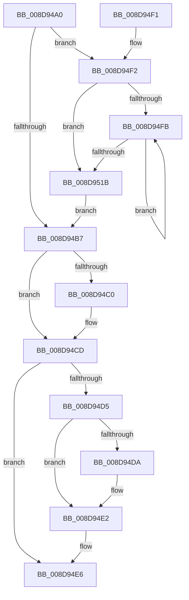

# EtwpCovSampProcessCleanup

- RVA: `0x008D94A0`–`0x008D953B` (길이 `155` bytes)
- VA: `0x00000001408D94A0`
- 실행 섹션: `PAGE`
- PDB 이름 있음: `예`; PDB Function 태그: `아니요`
- unwind 정보 RVA: `0x00080A00`
- 디코드: `45`개 명령, `155/155` bytes 표시
- 미해석 바이트: `0` (있으면 어셈블리에 `.byte`로 보존)

> 이 문서는 커널 이미지의 기계어와 PDB 기호를 분석해 생성했습니다. 4번과 5번은 함수 원형과 자료형을 바이너리 사용 방식에서 추정한 C 해석이며 원본 소스 복구 결과는 아닙니다.

## 1. Dependencies

- 직접 호출 지점: **4**; 고유 호출 대상: **3**
- 직접 호출자로 확인된 함수: **4**
- RIP 상대 이미지 참조: **0**

### Outgoing calls
- `0x008D94C3` → [EtwpCovSampModuleDereference](EtwpCovSampModuleDereference_function_008D7F38.md) (function, `0x008D7F38`)
- `0x008D94DD` → [ObfDereferenceObject](../../text/2F/ObfDereferenceObject_function_002F9350.md) (function, `0x002F9350`)
- `0x008D950D` → [EtwpCovSampModuleDereference](EtwpCovSampModuleDereference_function_008D7F38.md) (function, `0x008D7F38`)
- `0x008D9524` → [ExFreePoolWithTag](../../poolcode/B8/ExFreePoolWithTag_function_00B82870.md) (function, `0x00B82870`)

### Direct callers
- [EtwpCovSampContextCleanup](../6F/EtwpCovSampContextCleanup_function_006FDF84.md) at `0x006FDFB6`
- [EtwpCoverageSamplerStop](../7C/EtwpCoverageSamplerStop_function_007C2564.md) at `0x007C27A5`
- [EtwpCovSampProcessEnsureContext](EtwpCovSampProcessEnsureContext_function_008D8EB4.md) at `0x008D8F2F`
- [EtwExitProcess](../90/EtwExitProcess_function_00907600.md) at `0x0090766B`

### Static image references
- 디코드된 RIP-relative 메모리 참조가 없습니다.

## 2. Other-region calls and transfers

- 다른 실행 섹션으로 향하는 call: **2**
  - `0x008D94DD` → [ObfDereferenceObject](../../text/2F/ObfDereferenceObject_function_002F9350.md) (`PAGE` → `.text`)
  - `0x008D9524` → [ExFreePoolWithTag](../../poolcode/B8/ExFreePoolWithTag_function_00B82870.md) (`PAGE` → `POOLCODE`)
- 별도 외부 분기/꼬리 이동을 확인하지 못했습니다.

## 3. Assembly (complete function range)

```asm
008D94A0  48 89 5C 24 08                  mov qword ptr [rsp + 8], rbx
008D94A5  57                              push rdi
008D94A6  48 83 EC 20                     sub rsp, 0x20
008D94AA  48 83 79 18 00                  cmp qword ptr [rcx + 0x18], 0
008D94AF  40 8A FA                        mov dil, dl
008D94B2  48 8B D9                        mov rbx, rcx
008D94B5  75 3B                           jne 0x1408d94f2
008D94B7  48 8B 53 30                     mov rdx, qword ptr [rbx + 0x30]
008D94BB  48 85 D2                        test rdx, rdx
008D94BE  74 0D                           je 0x1408d94cd
008D94C0  48 8B 0B                        mov rcx, qword ptr [rbx]
008D94C3  E8 70 EA FF FF                  call 0x1408d7f38
008D94C8  48 83 63 30 00                  and qword ptr [rbx + 0x30], 0
008D94CD  48 8B 0B                        mov rcx, qword ptr [rbx]
008D94D0  48 85 C9                        test rcx, rcx
008D94D3  74 11                           je 0x1408d94e6
008D94D5  40 84 FF                        test dil, dil
008D94D8  74 08                           je 0x1408d94e2
008D94DA  48 8B 09                        mov rcx, qword ptr [rcx]
008D94DD  E8 6E FE A1 FF                  call 0x1402f9350
008D94E2  48 83 23 00                     and qword ptr [rbx], 0
008D94E6  48 8B 5C 24 30                  mov rbx, qword ptr [rsp + 0x30]
008D94EB  48 83 C4 20                     add rsp, 0x20
008D94EF  5F                              pop rdi
008D94F0  C3                              ret
008D94F1  CC                              int3
008D94F2  45 33 C0                        xor r8d, r8d
008D94F5  44 39 41 20                     cmp dword ptr [rcx + 0x20], r8d
008D94F9  76 20                           jbe 0x1408d951b
008D94FB  48 8B 53 18                     mov rdx, qword ptr [rbx + 0x18]
008D94FF  48 8B 0B                        mov rcx, qword ptr [rbx]
008D9502  41 8B C0                        mov eax, r8d
008D9505  48 03 C0                        add rax, rax
008D9508  48 8B 54 C2 08                  mov rdx, qword ptr [rdx + rax*8 + 8]
008D950D  E8 26 EA FF FF                  call 0x1408d7f38
008D9512  41 FF C0                        inc r8d
008D9515  44 3B 43 20                     cmp r8d, dword ptr [rbx + 0x20]
008D9519  72 E0                           jb 0x1408d94fb
008D951B  48 8B 4B 18                     mov rcx, qword ptr [rbx + 0x18]
008D951F  BA 45 74 77 56                  mov edx, 0x56777445
008D9524  E8 47 93 2A 00                  call 0x140b82870
008D9529  48 83 63 18 00                  and qword ptr [rbx + 0x18], 0
008D952E  83 63 20 00                     and dword ptr [rbx + 0x20], 0
008D9532  83 63 24 00                     and dword ptr [rbx + 0x24], 0
008D9536  E9 7C FF FF FF                  jmp 0x1408d94b7
```

## 4. C-style interpretation (structured pseudocode)

```c
__int64 __fastcall EtwpCovSampProcessCleanup(__int64 a1, unsigned __int8 a2, int a3)
{
    __int64 result;
    __int64 v_rsp;
    unsigned __int64 v_stack_p8;

    v_stack_p8 = v_rbx;
    v_rsp = (v_rsp) - (32);
    if ((*(unsigned __int64 *)(a1 + 24)) != 0) goto loc_008D94F2;
loc_008D94B7:
    if (*(unsigned __int64 *)(a1 + 48) != 0) {
        a1 = *(unsigned __int64 *)(a1);
        result = EtwpCovSampModuleDereference(a1, *(unsigned __int64 *)(a1 + 48), a3, a4);
    }
    if (*(unsigned __int64 *)(a1) == 0) goto loc_008D94E6;
    if (a2 != 0) {
        a1 = *(unsigned __int64 *)(*(unsigned __int64 *)(a1));
        result = ObfDereferenceObject(a1, *(unsigned __int64 *)(a1 + 48), a3, a4);
    }
loc_008D94E6:
    v_rsp = (v_rsp) + (32);
    return result;
loc_008D94F2:
    a3 = 0;
    if ((*(unsigned int *)(a1 + 32)) <= 0) goto loc_008D951B;
loc_008D94FB:
    result = (0) + (0);
    result = EtwpCovSampModuleDereference(*(unsigned __int64 *)(v_stack_p8), *(unsigned __int64 *)(*(unsigned __int64 *)(v_stack_p8 + 24) + result * 8 + 8), a3, a4);
    a3 = (unsigned int)((a3) + 1);
    if (a3 < (*(unsigned int *)(v_stack_p8 + 32))) goto loc_008D94FB;
loc_008D951B:
    result = ExFreePoolWithTag(*(unsigned __int64 *)(v_stack_p8 + 24), (unsigned int)(0x56777445ULL), a3, a4);
    goto loc_008D94B7;
}
```

## 5. (Beta) C Style

```c
int64_t EtwpCovSampProcessCleanup(void *Arg1, uint8_t Arg2, int32_t Arg3)
{
    uint8_t *arg1 = (uint8_t *)Arg1;

    int64_t result;
    int64_t local_rsp;
    uint64_t v_stack_p8;

    v_stack_p8 = local_rbx;
    local_rsp = (local_rsp) - (32);
    if ((*(uint64_t *)(arg1 + 0x18)) != 0) goto loc_008D94F2;
loc_008D94B7:
    if (*(uint64_t *)(arg1 + 0x30) != 0) {
        Arg1 = *(uint64_t *)(arg1);
        result = EtwpCovSampModuleDereference(Arg1, *(uint64_t *)(arg1 + 0x30), Arg3, a4);
    }
    if (*(uint64_t *)(arg1) == 0) goto loc_008D94E6;
    if (Arg2 != 0) {
        Arg1 = *(uint64_t *)(*(uint64_t *)(arg1));
        result = ObfDereferenceObject(Arg1, *(uint64_t *)(arg1 + 0x30), Arg3, a4);
    }
loc_008D94E6:
    local_rsp = (local_rsp) + (32);
    return result;
loc_008D94F2:
    Arg3 = 0;
    if ((*(uint32_t *)(arg1 + 0x20)) <= 0) goto loc_008D951B;
loc_008D94FB:
    result = (0) + (0);
    result = EtwpCovSampModuleDereference(*(uint64_t *)(v_stack_p8), *(uint64_t *)(*(uint64_t *)(v_stack_p8 + 0x18) + result * 8 + 0x8), Arg3, a4);
    Arg3 = (uint32_t)((Arg3) + 1);
    if (Arg3 < (*(uint32_t *)(v_stack_p8 + 0x20))) goto loc_008D94FB;
loc_008D951B:
    result = ExFreePoolWithTag(*(uint64_t *)(v_stack_p8 + 0x18), (uint32_t)(0x56777445ULL), Arg3, a4);
    goto loc_008D94B7;
}
```

### 관측된 메모리 오프셋

구조체 형식이 확인되지 않은 접근은 인자 기준의 오프셋으로만 기록했습니다.

| 기준 인자 | 오프셋 표현 | 폭 (bit) | 접근 |
|---|---:|---:|---|
| `Arg1` | `+ 0x0` | `64` | `R` |
| `Arg1` | `+ 0x0` | `64` | `R/W` |
| `Arg1` | `+ 0x18` | `64` | `R` |
| `Arg1` | `+ 0x18` | `64` | `R/W` |
| `Arg1` | `+ 0x20` | `32` | `R` |
| `Arg1` | `+ 0x20` | `32` | `R/W` |
| `Arg1` | `+ 0x24` | `32` | `R/W` |
| `Arg1` | `+ 0x30` | `64` | `R` |
| `Arg1` | `+ 0x30` | `64` | `R/W` |

## 6. Execution-region graph

[열기: 2D/3D 그래프와 함수 탐색 컨트롤 패널](../../../control-panel.html?section=page&rva=0x008D94A0&view=graph)

- 2D 그래프는 위에서 아래로 흐르고, 3D 그래프는 빈 공간을 드래그해 회전합니다. Shift+드래그는 이동, 휠은 확대·축소, 함수 노드 선택은 대상 보고서 이동입니다.

### Static fallback


