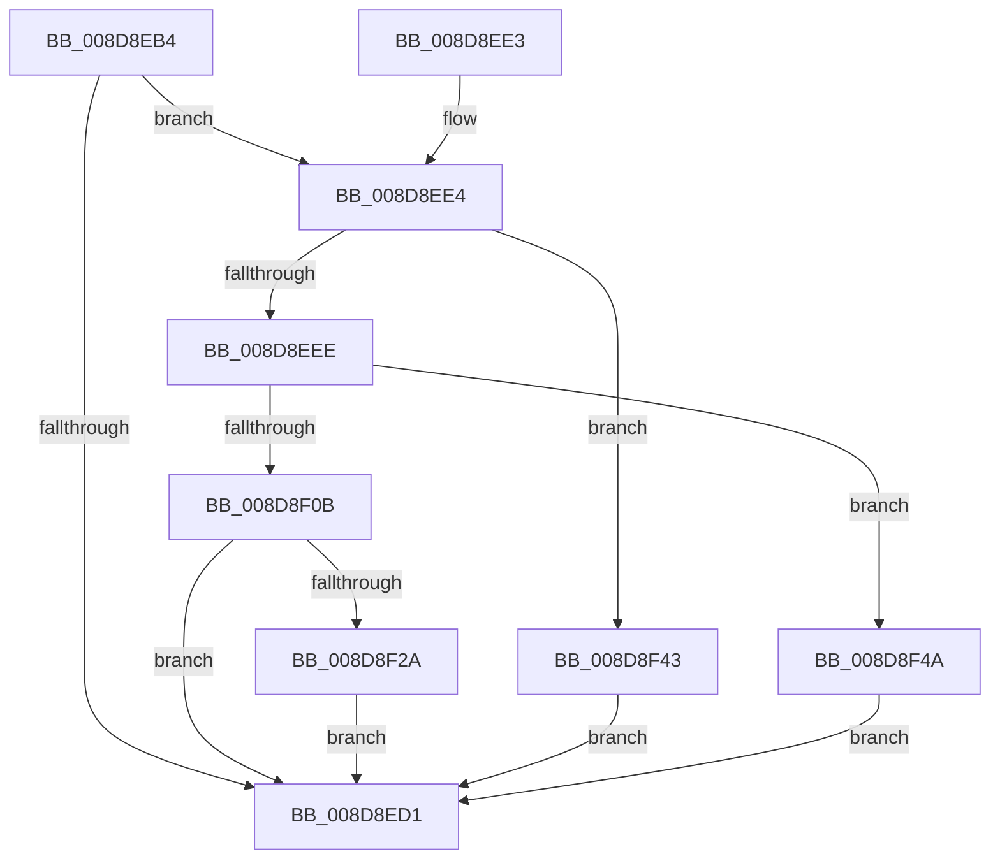

# EtwpCovSampProcessEnsureContext

- RVA: `0x008D8EB4`–`0x008D8F51` (길이 `157` bytes)
- VA: `0x00000001408D8EB4`
- 실행 섹션: `PAGE`
- PDB 이름 있음: `예`; PDB Function 태그: `아니요`
- unwind 정보 RVA: `0x000855A0`
- 디코드: `44`개 명령, `157/157` bytes 표시
- 미해석 바이트: `0` (있으면 어셈블리에 `.byte`로 보존)

> 이 문서는 커널 이미지의 기계어와 PDB 기호를 분석해 생성했습니다. 4번과 5번은 함수 원형과 자료형을 바이너리 사용 방식에서 추정한 C 해석이며 원본 소스 복구 결과는 아닙니다.

## 1. Dependencies

- 직접 호출 지점: **3**; 고유 호출 대상: **3**
- 직접 호출자로 확인된 함수: **1**
- RIP 상대 이미지 참조: **0**

### Outgoing calls
- `0x008D8EFE` → [ExAllocatePool2](../../poolcode/B8/ExAllocatePool2_function_00B820F0.md) (function, `0x00B820F0`)
- `0x008D8F2F` → [EtwpCovSampProcessCleanup](EtwpCovSampProcessCleanup_function_008D94A0.md) (function, `0x008D94A0`)
- `0x008D8F3C` → [ExFreePoolWithTag](../../poolcode/B8/ExFreePoolWithTag_function_00B82870.md) (function, `0x00B82870`)

### Direct callers
- [EtwpCovSampImageNotify](EtwpCovSampImageNotify_function_008D70C0.md) at `0x008D7133`

### Static image references
- 디코드된 RIP-relative 메모리 참조가 없습니다.

## 2. Other-region calls and transfers

- 다른 실행 섹션으로 향하는 call: **2**
  - `0x008D8EFE` → [ExAllocatePool2](../../poolcode/B8/ExAllocatePool2_function_00B820F0.md) (`PAGE` → `POOLCODE`)
  - `0x008D8F3C` → [ExFreePoolWithTag](../../poolcode/B8/ExFreePoolWithTag_function_00B82870.md) (`PAGE` → `POOLCODE`)
- 별도 외부 분기/꼬리 이동을 확인하지 못했습니다.

## 3. Assembly (complete function range)

```asm
008D8EB4  48 89 5C 24 10                  mov qword ptr [rsp + 0x10], rbx
008D8EB9  48 89 74 24 18                  mov qword ptr [rsp + 0x18], rsi
008D8EBE  57                              push rdi
008D8EBF  48 83 EC 20                     sub rsp, 0x20
008D8EC3  33 DB                           xor ebx, ebx
008D8EC5  48 8B F1                        mov rsi, rcx
008D8EC8  48 39 99 70 07 00 00            cmp qword ptr [rcx + 0x770], rbx
008D8ECF  74 13                           je 0x1408d8ee4
008D8ED1  48 8B 74 24 40                  mov rsi, qword ptr [rsp + 0x40]
008D8ED6  8B C3                           mov eax, ebx
008D8ED8  48 8B 5C 24 38                  mov rbx, qword ptr [rsp + 0x38]
008D8EDD  48 83 C4 20                     add rsp, 0x20
008D8EE1  5F                              pop rdi
008D8EE2  C3                              ret
008D8EE3  CC                              int3
008D8EE4  8B 81 FC 05 00 00               mov eax, dword ptr [rcx + 0x5fc]
008D8EEA  A8 01                           test al, 1
008D8EEC  75 55                           jne 0x1408d8f43
008D8EEE  BA 38 00 00 00                  mov edx, 0x38
008D8EF3  B9 00 01 00 00                  mov ecx, 0x100
008D8EF8  41 B8 45 74 77 56               mov r8d, 0x56777445
008D8EFE  E8 ED 91 2A 00                  call 0x140b820f0
008D8F03  48 8B F8                        mov rdi, rax
008D8F06  48 85 C0                        test rax, rax
008D8F09  74 3F                           je 0x1408d8f4a
008D8F0B  0F 57 C0                        xorps xmm0, xmm0
008D8F0E  33 C0                           xor eax, eax
008D8F10  0F 11 07                        movups xmmword ptr [rdi], xmm0
008D8F13  0F 11 47 10                     movups xmmword ptr [rdi + 0x10], xmm0
008D8F17  0F 11 47 20                     movups xmmword ptr [rdi + 0x20], xmm0
008D8F1B  48 89 47 30                     mov qword ptr [rdi + 0x30], rax
008D8F1F  F0 48 0F B1 BE 70 07 00 00      lock cmpxchg qword ptr [rsi + 0x770], rdi
008D8F28  74 A7                           je 0x1408d8ed1
008D8F2A  B2 01                           mov dl, 1
008D8F2C  48 8B CF                        mov rcx, rdi
008D8F2F  E8 6C 05 00 00                  call 0x1408d94a0
008D8F34  BA 45 74 77 56                  mov edx, 0x56777445
008D8F39  48 8B CF                        mov rcx, rdi
008D8F3C  E8 2F 99 2A 00                  call 0x140b82870
008D8F41  EB 8E                           jmp 0x1408d8ed1
008D8F43  BB BB 00 00 C0                  mov ebx, 0xc00000bb
008D8F48  EB 87                           jmp 0x1408d8ed1
008D8F4A  BB 9A 00 00 C0                  mov ebx, 0xc000009a
008D8F4F  EB 80                           jmp 0x1408d8ed1
```

## 4. C-style interpretation (structured pseudocode)

```c
__int64 __fastcall EtwpCovSampProcessEnsureContext(__int64 a1)
{
    __int64 result;
    __int64 v_rbx;
    __int64 v_rsp;
    unsigned __int64 v_stack_p10;
    unsigned __int64 v_stack_p18;

    v_stack_p10 = v_rbx;
    v_stack_p18 = v_rsi;
    v_rsp = (v_rsp) - (32);
    v_rbx = 0;
    if ((*(unsigned __int64 *)(a1 + 1904)) == 0) goto loc_008D8EE4;
loc_008D8ED1:
    v_rsp = (v_rsp) + (32);
    return 0;
loc_008D8EE4:
    if ((((unsigned __int8)((unsigned int)(*(unsigned int *)(a1 + 1532)))) & (1)) != 0) goto loc_008D8F43;
    result = ExAllocatePool2(256, 56, (unsigned int)(0x56777445ULL), a4);
    if (result == 0) goto loc_008D8F4A;
    result = 0;
    *(unsigned __int64 *)(result) = v_xmm0;
    *(unsigned __int64 *)(result + 16) = v_xmm0;
    *(unsigned __int64 *)(result + 32) = v_xmm0;
    *(unsigned __int64 *)(result + 48) = 0;
    if (condition_is_equal) goto loc_008D8ED1;
    result = EtwpCovSampProcessCleanup(0, 1, (unsigned int)(0x56777445ULL), a4);
    result = ExFreePoolWithTag(result, (unsigned int)(0x56777445ULL), (unsigned int)(0x56777445ULL), a4);
    goto loc_008D8ED1;
loc_008D8F43:
    goto loc_008D8ED1;
loc_008D8F4A:
    goto loc_008D8ED1;
}
```

## 5. (Beta) C Style

```c
int64_t EtwpCovSampProcessEnsureContext(void *Arg1)
{
    uint8_t *arg1 = (uint8_t *)Arg1;

    int64_t result;
    int64_t local_rbx;
    int64_t local_rsp;
    uint64_t v_stack_p10;
    uint64_t v_stack_p18;

    v_stack_p10 = local_rbx;
    v_stack_p18 = local_rsi;
    local_rsp = (local_rsp) - (32);
    local_rbx = 0;
    if ((*(uint64_t *)(arg1 + 0x770)) == 0) goto loc_008D8EE4;
loc_008D8ED1:
    local_rsp = (local_rsp) + (32);
    return 0;
loc_008D8EE4:
    if ((((uint8_t)((uint32_t)(*(uint32_t *)(arg1 + 0x5FC)))) & (1)) != 0) goto loc_008D8F43;
    result = ExAllocatePool2(256, 56, (uint32_t)(0x56777445ULL), a4);
    if (result == 0) goto loc_008D8F4A;
    result = 0;
    *(uint64_t *)(result) = v_xmm0;
    *(uint64_t *)(result + 0x10) = v_xmm0;
    *(uint64_t *)(result + 0x20) = v_xmm0;
    *(uint64_t *)(result + 0x30) = 0;
    if (condition_is_equal) goto loc_008D8ED1;
    result = EtwpCovSampProcessCleanup(0, 1, (uint32_t)(0x56777445ULL), a4);
    result = ExFreePoolWithTag(result, (uint32_t)(0x56777445ULL), (uint32_t)(0x56777445ULL), a4);
    goto loc_008D8ED1;
loc_008D8F43:
    goto loc_008D8ED1;
loc_008D8F4A:
    goto loc_008D8ED1;
}
```

### 관측된 메모리 오프셋

구조체 형식이 확인되지 않은 접근은 인자 기준의 오프셋으로만 기록했습니다.

| 기준 인자 | 오프셋 표현 | 폭 (bit) | 접근 |
|---|---:|---:|---|
| `Arg1` | `+ 0x5FC` | `32` | `R` |
| `Arg1` | `+ 0x770` | `64` | `R` |

## 6. Execution-region graph

[열기: 2D/3D 그래프와 함수 탐색 컨트롤 패널](../../../control-panel.html?section=page&rva=0x008D8EB4&view=graph)

- 2D 그래프는 위에서 아래로 흐르고, 3D 그래프는 빈 공간을 드래그해 회전합니다. Shift+드래그는 이동, 휠은 확대·축소, 함수 노드 선택은 대상 보고서 이동입니다.

### Static fallback


