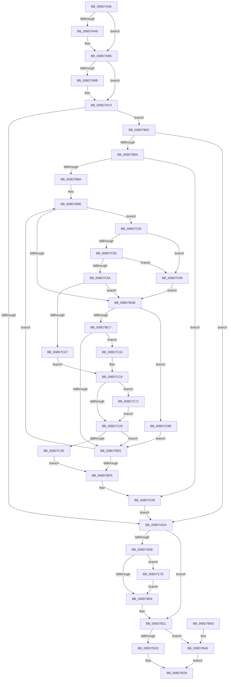

# EtwpCovSampProcessMapAddresses

- RVA: `0x008D7A38`–`0x008D7C95` (길이 `605` bytes)
- VA: `0x00000001408D7A38`
- 실행 섹션: `PAGE`
- PDB 이름 있음: `예`; PDB Function 태그: `아니요`
- unwind 정보 RVA: `0x00085514`
- 디코드: `151`개 명령, `605/605` bytes 표시
- 미해석 바이트: `0` (있으면 어셈블리에 `.byte`로 보존)

> 이 문서는 커널 이미지의 기계어와 PDB 기호를 분석해 생성했습니다. 4번과 5번은 함수 원형과 자료형을 바이너리 사용 방식에서 추정한 C 해석이며 원본 소스 복구 결과는 아닙니다.

## 1. Dependencies

- 직접 호출 지점: **6**; 고유 호출 대상: **6**
- 직접 호출자로 확인된 함수: **2**
- RIP 상대 이미지 참조: **0**

### Outgoing calls
- `0x008D7A98` → [KeAbPreAcquire](../../text/21/KeAbPreAcquire_function_00210230.md) (function, `0x00210230`)
- `0x008D7AB1` → [ExfAcquirePushLockExclusiveEx](../../text/20/ExfAcquirePushLockExclusiveEx_function_0020FC90.md) (function, `0x0020FC90`)
- `0x008D7B07` → [KeAbPostRelease](../../text/2E/KeAbPostRelease_function_002E1600.md) (function, `0x002E1600`)
- `0x008D7B0C` → [KeLeaveCriticalRegion](../../text/25/KeLeaveCriticalRegion_function_0025D8B0.md) (function, `0x0025D8B0`)
- `0x008D7BB1` → [EtwpCovSampProcessUpperBoundModule](EtwpCovSampProcessUpperBoundModule_function_008D7800.md) (function, `0x008D7800`)
- `0x008D7C81` → [ExfTryToWakePushLock](../../text/26/ExfTryToWakePushLock_function_00265DD0.md) (function, `0x00265DD0`)

### Direct callers
- [EtwpCovSampCaptureBufferProcess](EtwpCovSampCaptureBufferProcess_function_008D71C0.md) at `0x008D7306`
- [EtwpCovSampContextAddAddresses](EtwpCovSampContextAddAddresses_function_008D7930.md) at `0x008D79C2`

### Static image references
- 디코드된 RIP-relative 메모리 참조가 없습니다.

## 2. Other-region calls and transfers

- 다른 실행 섹션으로 향하는 call: **5**
  - `0x008D7A98` → [KeAbPreAcquire](../../text/21/KeAbPreAcquire_function_00210230.md) (`PAGE` → `.text`)
  - `0x008D7AB1` → [ExfAcquirePushLockExclusiveEx](../../text/20/ExfAcquirePushLockExclusiveEx_function_0020FC90.md) (`PAGE` → `.text`)
  - `0x008D7B07` → [KeAbPostRelease](../../text/2E/KeAbPostRelease_function_002E1600.md) (`PAGE` → `.text`)
  - `0x008D7B0C` → [KeLeaveCriticalRegion](../../text/25/KeLeaveCriticalRegion_function_0025D8B0.md) (`PAGE` → `.text`)
  - `0x008D7C81` → [ExfTryToWakePushLock](../../text/26/ExfTryToWakePushLock_function_00265DD0.md) (`PAGE` → `.text`)
- 별도 외부 분기/꼬리 이동을 확인하지 못했습니다.

## 3. Assembly (complete function range)

```asm
008D7A38  48 89 5C 24 10                  mov qword ptr [rsp + 0x10], rbx
008D7A3D  4C 89 44 24 18                  mov qword ptr [rsp + 0x18], r8
008D7A42  55                              push rbp
008D7A43  56                              push rsi
008D7A44  57                              push rdi
008D7A45  41 54                           push r12
008D7A47  41 55                           push r13
008D7A49  41 56                           push r14
008D7A4B  41 57                           push r15
008D7A4D  48 83 EC 40                     sub rsp, 0x40
008D7A51  4C 8B AC 24 B0 00 00 00         mov r13, qword ptr [rsp + 0xb0]
008D7A59  48 8D 71 08                     lea rsi, [rcx + 8]
008D7A5D  48 B8 20 03 00 00 80 F7 FF FF   movabs rax, 0xfffff78000000320
008D7A67  48 8B FA                        mov rdi, rdx
008D7A6A  48 8B E9                        mov rbp, rcx
008D7A6D  48 83 CB FF                     or rbx, 0xffffffffffffffff
008D7A71  45 33 C0                        xor r8d, r8d
008D7A74  33 D2                           xor edx, edx
008D7A76  41 83 65 00 00                  and dword ptr [r13], 0
008D7A7B  48 8B CE                        mov rcx, rsi
008D7A7E  8B 00                           mov eax, dword ptr [rax]
008D7A80  45 8B E1                        mov r12d, r9d
008D7A83  89 44 24 28                     mov dword ptr [rsp + 0x28], eax
008D7A87  65 48 8B 04 25 88 01 00 00      mov rax, qword ptr gs:[0x188]
008D7A90  66 01 98 E4 01 00 00            add word ptr [rax + 0x1e4], bx
008D7A97  90                              nop
008D7A98  E8 93 87 93 FF                  call 0x140210230
008D7A9D  F0 48 0F BA 2E 00               lock bts qword ptr [rsi], 0
008D7AA3  4C 8B F0                        mov r14, rax
008D7AA6  73 0E                           jae 0x1408d7ab6
008D7AA8  4C 8B C6                        mov r8, rsi
008D7AAB  48 8B D0                        mov rdx, rax
008D7AAE  48 8B CE                        mov rcx, rsi
008D7AB1  E8 DA 81 93 FF                  call 0x14020fc90
008D7AB6  4D 85 F6                        test r14, r14
008D7AB9  74 05                           je 0x1408d7ac0
008D7ABB  41 C6 46 0A 01                  mov byte ptr [r14 + 0xa], 1
008D7AC0  65 48 8B 04 25 88 01 00 00      mov rax, qword ptr gs:[0x188]
008D7AC9  48 8D 4D 10                     lea rcx, [rbp + 0x10]
008D7ACD  48 89 01                        mov qword ptr [rcx], rax
008D7AD0  48 3B 7D 00                     cmp rdi, qword ptr [rbp]
008D7AD4  0F 84 82 00 00 00               je 0x1408d7b5c
008D7ADA  48 8B 09                        mov rcx, qword ptr [rcx]
008D7ADD  65 48 8B 04 25 88 01 00 00      mov rax, qword ptr gs:[0x188]
008D7AE6  48 3B C8                        cmp rcx, rax
008D7AE9  75 26                           jne 0x1408d7b11
008D7AEB  48 C7 45 10 00 00 00 00         mov qword ptr [rbp + 0x10], 0
008D7AF3  F0 48 0F C1 1E                  lock xadd qword ptr [rsi], rbx
008D7AF8  80 E3 06                        and bl, 6
008D7AFB  80 FB 02                        cmp bl, 2
008D7AFE  0F 84 7A 01 00 00               je 0x1408d7c7e
008D7B04  48 8B CE                        mov rcx, rsi
008D7B07  E8 F4 9A A0 FF                  call 0x1402e1600
008D7B0C  E8 9F 5D 98 FF                  call 0x14025d8b0
008D7B11  48 8D 87 E0 04 00 00            lea rax, [rdi + 0x4e0]
008D7B18  48 3B E8                        cmp rbp, rax
008D7B1B  74 31                           je 0x1408d7b4e
008D7B1D  B9 6C 04 00 00                  mov ecx, 0x46c
008D7B22  48 8D 87 68 04 00 00            lea rax, [rdi + 0x468]
008D7B29  F0 44 01 20                     lock add dword ptr [rax], r12d
008D7B2D  41 8B 45 00                     mov eax, dword ptr [r13]
008D7B31  F0 01 04 0F                     lock add dword ptr [rdi + rcx], eax
008D7B35  48 8B 9C 24 88 00 00 00         mov rbx, qword ptr [rsp + 0x88]
008D7B3D  48 83 C4 40                     add rsp, 0x40
008D7B41  41 5F                           pop r15
008D7B43  41 5E                           pop r14
008D7B45  41 5D                           pop r13
008D7B47  41 5C                           pop r12
008D7B49  5F                              pop rdi
008D7B4A  5E                              pop rsi
008D7B4B  5D                              pop rbp
008D7B4C  C3                              ret
008D7B4D  CC                              int3
008D7B4E  B9 74 04 00 00                  mov ecx, 0x474
008D7B53  48 8D 87 70 04 00 00            lea rax, [rdi + 0x470]
008D7B5A  EB CD                           jmp 0x1408d7b29
008D7B5C  83 BC 24 A8 00 00 00 00         cmp dword ptr [rsp + 0xa8], 0
008D7B64  0F 84 70 FF FF FF               je 0x1408d7ada
008D7B6A  45 33 C0                        xor r8d, r8d
008D7B6D  45 33 C9                        xor r9d, r9d
008D7B70  44 21 44 24 20                  and dword ptr [rsp + 0x20], r8d
008D7B75  45 33 F6                        xor r14d, r14d
008D7B78  44 89 84 24 80 00 00 00         mov dword ptr [rsp + 0x80], r8d
008D7B80  4C 89 4C 24 30                  mov qword ptr [rsp + 0x30], r9
008D7B85  45 85 E4                        test r12d, r12d
008D7B88  74 7F                           je 0x1408d7c09
008D7B8A  4C 8B AC 24 90 00 00 00         mov r13, qword ptr [rsp + 0x90]
008D7B92  48 8B B4 24 A0 00 00 00         mov rsi, qword ptr [rsp + 0xa0]
008D7B9A  8B 5C 24 28                     mov ebx, dword ptr [rsp + 0x28]
008D7B9E  4D 8B 7D 00                     mov r15, qword ptr [r13]
008D7BA2  4D 85 F6                        test r14, r14
008D7BA5  0F 85 A5 00 00 00               jne 0x1408d7c50
008D7BAB  49 8B D7                        mov rdx, r15
008D7BAE  48 8B CD                        mov rcx, rbp
008D7BB1  E8 4A FC FF FF                  call 0x1408d7800
008D7BB6  44 8B 84 24 80 00 00 00         mov r8d, dword ptr [rsp + 0x80]
008D7BBE  3B 45 20                        cmp eax, dword ptr [rbp + 0x20]
008D7BC1  0F 83 C4 00 00 00               jae 0x1408d7c8b
008D7BC7  8B C8                           mov ecx, eax
008D7BC9  48 C1 E1 04                     shl rcx, 4
008D7BCD  48 03 4D 18                     add rcx, qword ptr [rbp + 0x18]
008D7BD1  48 8B 51 08                     mov rdx, qword ptr [rcx + 8]
008D7BD5  4C 8B 09                        mov r9, qword ptr [rcx]
008D7BD8  4C 2B 4A 28                     sub r9, qword ptr [rdx + 0x28]
008D7BDC  4C 89 4C 24 30                  mov qword ptr [rsp + 0x30], r9
008D7BE1  4D 3B F9                        cmp r15, r9
008D7BE4  73 30                           jae 0x1408d7c16
008D7BE6  8B 44 24 20                     mov eax, dword ptr [rsp + 0x20]
008D7BEA  49 83 C5 08                     add r13, 8
008D7BEE  FF C0                           inc eax
008D7BF0  89 44 24 20                     mov dword ptr [rsp + 0x20], eax
008D7BF4  41 3B C4                        cmp eax, r12d
008D7BF7  72 A5                           jb 0x1408d7b9e
008D7BF9  4C 8B AC 24 B0 00 00 00         mov r13, qword ptr [rsp + 0xb0]
008D7C01  48 8D 75 08                     lea rsi, [rbp + 8]
008D7C05  48 83 CB FF                     or rbx, 0xffffffffffffffff
008D7C09  45 89 45 00                     mov dword ptr [r13], r8d
008D7C0D  48 8D 4D 10                     lea rcx, [rbp + 0x10]
008D7C11  E9 C4 FE FF FF                  jmp 0x1408d7ada
008D7C16  4C 8B F1                        mov r14, rcx
008D7C19  83 BA 84 00 00 00 00            cmp dword ptr [rdx + 0x84], 0
008D7C20  89 9A 88 00 00 00               mov dword ptr [rdx + 0x88], ebx
008D7C26  74 49                           je 0x1408d7c71
008D7C28  8B 42 7C                        mov eax, dword ptr [rdx + 0x7c]
008D7C2B  45 2B F9                        sub r15d, r9d
008D7C2E  41 8B C8                        mov ecx, r8d
008D7C31  41 FF C0                        inc r8d
008D7C34  44 89 84 24 80 00 00 00         mov dword ptr [rsp + 0x80], r8d
008D7C3C  89 04 CE                        mov dword ptr [rsi + rcx*8], eax
008D7C3F  44 89 7C CE 04                  mov dword ptr [rsi + rcx*8 + 4], r15d
008D7C44  44 3B 84 24 A8 00 00 00         cmp r8d, dword ptr [rsp + 0xa8]
008D7C4C  72 98                           jb 0x1408d7be6
008D7C4E  EB A9                           jmp 0x1408d7bf9
008D7C50  4D 3B F9                        cmp r15, r9
008D7C53  72 14                           jb 0x1408d7c69
008D7C55  4D 3B 3E                        cmp r15, qword ptr [r14]
008D7C58  73 0F                           jae 0x1408d7c69
008D7C5A  49 8B 56 08                     mov rdx, qword ptr [r14 + 8]
008D7C5E  48 85 D2                        test rdx, rdx
008D7C61  0F 84 44 FF FF FF               je 0x1408d7bab
008D7C67  EB B0                           jmp 0x1408d7c19
008D7C69  45 33 F6                        xor r14d, r14d
008D7C6C  E9 3A FF FF FF                  jmp 0x1408d7bab
008D7C71  B8 01 00 00 00                  mov eax, 1
008D7C76  87 82 84 00 00 00               xchg dword ptr [rdx + 0x84], eax
008D7C7C  EB AA                           jmp 0x1408d7c28
008D7C7E  48 8B CE                        mov rcx, rsi
008D7C81  E8 4A E1 98 FF                  call 0x140265dd0
008D7C86  E9 79 FE FF FF                  jmp 0x1408d7b04
008D7C8B  4C 8B 4C 24 30                  mov r9, qword ptr [rsp + 0x30]
008D7C90  E9 51 FF FF FF                  jmp 0x1408d7be6
```

## 4. C-style interpretation (structured pseudocode)

```c
__int64 __fastcall EtwpCovSampProcessMapAddresses(__int64 a1, __int64 a2, __int64 a3, int a4, __int64 a5, unsigned int a6, __int64 a7)
{
    __int64 result;
    __int64 v_r13;
    __int64 v_r14;
    __int64 v_r15;
    __int64 v_rbx;
    __int64 v_rsp;
    unsigned int v_stack_m50;
    unsigned __int64 v_stack_p10;
    unsigned __int64 v_stack_p18;
    unsigned int v_stack_p20;
    unsigned int v_stack_p28;
    unsigned __int64 v_stack_p30;
    unsigned int v_stack_p80;
    unsigned __int64 v_stack_p90;

    v_stack_p10 = v_rbx;
    v_stack_p18 = a3;
    v_rsp = (v_rsp) - (64);
    v_rbx = (v_rbx) | (-1);
    a3 = 0;
    a2 = 0;
    v_stack_m50 = (unsigned int)((unsigned int)(*(unsigned int *)(result)));
    result = KeAbPreAcquire(a1 + 8, a2, a3, a4);
    if (!(condition_is_above_or_equal)) {
        a3 = a1 + 8;
        a2 = result;
        a1 = a1 + 8;
        result = ExfAcquirePushLockExclusiveEx(a1, a2, a3, a4);
    }
    if (result != 0) {
        *(unsigned __int8 *)(result + 10) = 1;
    }
    *(unsigned __int64 *)(a1 + 16) = *(unsigned __int64 *)(gs_base + (0 + 392));
    if (a2 == (*(unsigned __int64 *)(a1))) goto loc_008D7B5C;
loc_008D7ADA:
    if ((*(unsigned __int64 *)(a1 + 16)) != (*(unsigned __int64 *)(gs_base + (0 + 392)))) goto loc_008D7B11;
    *(unsigned __int64 *)(a1 + 16) = 0;
    v_rbx = (unsigned __int8)((v_rbx) & (6));
    if (((unsigned __int8)(v_rbx)) == 2) goto loc_008D7C7E;
loc_008D7B04:
    result = KeAbPostRelease(a1 + 8, a2, a3, a4);
    result = KeLeaveCriticalRegion(a1 + 8, a2, a3, a4);
loc_008D7B11:
    if (a1 == (a2 + 1248)) goto loc_008D7B4E;
loc_008D7B29:
    v_rsp = (v_rsp) + (64);
    return (unsigned int)(*(unsigned int *)(a7));
loc_008D7B4E:
    goto loc_008D7B29;
loc_008D7B5C:
    if (a6 == 0) goto loc_008D7ADA;
    a3 = 0;
    a4 = 0;
    v_r14 = 0;
    v_stack_p80 = 0;
    v_stack_p30 = 0;
    if ((unsigned int)((unsigned int)(a4)) == 0) goto loc_008D7C09;
loc_008D7B9E:
    if (0 != 0) goto loc_008D7C50;
loc_008D7BAB:
    result = EtwpCovSampProcessUpperBoundModule(a1, *(unsigned __int64 *)(v_stack_p90), a3, a4);
    if (((unsigned int)(result)) >= (*(unsigned int *)(a1 + 32))) goto loc_008D7C8B;
    a1 = ((unsigned int)((unsigned int)(result))) << (4);
    a1 = (a1) + (*(unsigned __int64 *)(a1 + 24));
    a4 = (*(unsigned __int64 *)(a1)) - (*(unsigned __int64 *)(*(unsigned __int64 *)(a1 + 8) + 40));
    v_stack_p30 = a4;
    if ((*(unsigned __int64 *)(v_stack_p90)) >= a4) goto loc_008D7C16;
loc_008D7BE6:
    v_r13 = (v_stack_p90) + (8);
    result = (unsigned int)(((unsigned int)(v_stack_p20)) + 1);
    v_stack_p20 = (unsigned int)(result);
    if (((unsigned int)(result)) < ((unsigned int)((unsigned int)(a4)))) goto loc_008D7B9E;
loc_008D7BF9:
    v_rbx = ((unsigned int)(v_stack_p28)) | (-1);
loc_008D7C09:
    *(unsigned int *)(a7) = (unsigned int)((unsigned int)(v_stack_p80));
    goto loc_008D7ADA;
loc_008D7C16:
loc_008D7C19:
    *(unsigned int *)(*(unsigned __int64 *)(a1 + 8) + 136) = (unsigned int)(v_rbx);
    if ((*(unsigned int *)(*(unsigned __int64 *)(a1 + 8) + 132)) == 0) goto loc_008D7C71;
loc_008D7C28:
    v_r15 = (unsigned int)((*(unsigned __int64 *)(v_stack_p90)) - (a4));
    a3 = (unsigned int)(((unsigned int)(v_stack_p80)) + 1);
    v_stack_p80 = (unsigned int)(a3);
    *(unsigned int *)(a1 + 8 + (unsigned int)((unsigned int)((unsigned int)(v_stack_p80))) * 8) = (unsigned int)((unsigned int)(*(unsigned int *)(*(unsigned __int64 *)(a1 + 8) + 124)));
    *(unsigned int *)(a1 + 8 + (unsigned int)((unsigned int)((unsigned int)(v_stack_p80))) * 8 + 4) = (unsigned int)(v_r15);
    if (((unsigned int)(a3)) < a6) goto loc_008D7BE6;
    goto loc_008D7BF9;
loc_008D7C50:
    if (v_r15 < a4) goto loc_008D7C69;
    if (v_r15 >= (*(unsigned __int64 *)(a1 + 16))) goto loc_008D7C69;
    if (*(unsigned __int64 *)(a1 + 16 + 8) == 0) goto loc_008D7BAB;
    goto loc_008D7C19;
loc_008D7C69:
    v_r14 = 0;
    goto loc_008D7BAB;
loc_008D7C71:
    goto loc_008D7C28;
loc_008D7C7E:
    result = ExfTryToWakePushLock(a1 + 8, *(unsigned __int64 *)(a1 + 16 + 8), a3, a4);
    goto loc_008D7B04;
loc_008D7C8B:
    goto loc_008D7BE6;
}
```

## 5. (Beta) C Style

```c
int64_t EtwpCovSampProcessMapAddresses(void *Arg1, int64_t Arg2, int64_t Arg3, int32_t Arg4, void *Arg5, uint32_t Arg6, void *Arg7)
{
    uint8_t *arg1 = (uint8_t *)Arg1;
    uint8_t *arg5 = (uint8_t *)Arg5;
    uint8_t *arg7 = (uint8_t *)Arg7;

    int64_t result;
    int64_t local_r13;
    int64_t local_r14;
    int64_t local_r15;
    int64_t local_rbx;
    int64_t local_rsp;
    uint32_t v_stack_m50;
    uint64_t v_stack_p10;
    uint64_t v_stack_p18;
    uint32_t v_stack_p20;
    uint32_t v_stack_p28;
    uint64_t v_stack_p30;
    uint32_t v_stack_p80;
    uint64_t v_stack_p90;

    v_stack_p10 = local_rbx;
    v_stack_p18 = Arg3;
    local_rsp = (local_rsp) - (64);
    local_rbx = (local_rbx) | (-1);
    Arg3 = 0;
    Arg2 = 0;
    v_stack_m50 = (uint32_t)((uint32_t)(*(uint32_t *)(result)));
    result = KeAbPreAcquire(Arg1 + 8, Arg2, Arg3, Arg4);
    if (!(condition_is_above_or_equal)) {
        Arg3 = Arg1 + 8;
        Arg2 = result;
        Arg1 = Arg1 + 8;
        result = ExfAcquirePushLockExclusiveEx(Arg1, Arg2, Arg3, Arg4);
    }
    if (result != 0) {
        *(uint8_t *)(result + 0xA) = 1;
    }
    *(uint64_t *)(arg1 + 0x10) = *(uint64_t *)(gs_base + (0 + 0x188));
    if (Arg2 == (*(uint64_t *)(arg1))) goto loc_008D7B5C;
loc_008D7ADA:
    if ((*(uint64_t *)(arg1 + 0x10)) != (*(uint64_t *)(gs_base + (0 + 0x188)))) goto loc_008D7B11;
    *(uint64_t *)(arg1 + 0x10) = 0;
    local_rbx = (uint8_t)((local_rbx) & (6));
    if (((uint8_t)(local_rbx)) == 2) goto loc_008D7C7E;
loc_008D7B04:
    result = KeAbPostRelease(Arg1 + 8, Arg2, Arg3, Arg4);
    result = KeLeaveCriticalRegion(Arg1 + 8, Arg2, Arg3, Arg4);
loc_008D7B11:
    if (Arg1 == (Arg2 + 1248)) goto loc_008D7B4E;
loc_008D7B29:
    local_rsp = (local_rsp) + (64);
    return (uint32_t)(*(uint32_t *)(arg7));
loc_008D7B4E:
    goto loc_008D7B29;
loc_008D7B5C:
    if (Arg6 == 0) goto loc_008D7ADA;
    Arg3 = 0;
    Arg4 = 0;
    local_r14 = 0;
    v_stack_p80 = 0;
    v_stack_p30 = 0;
    if ((uint32_t)((uint32_t)(Arg4)) == 0) goto loc_008D7C09;
loc_008D7B9E:
    if (0 != 0) goto loc_008D7C50;
loc_008D7BAB:
    result = EtwpCovSampProcessUpperBoundModule(Arg1, *(uint64_t *)(v_stack_p90), Arg3, Arg4);
    if (((uint32_t)(result)) >= (*(uint32_t *)(arg1 + 0x20))) goto loc_008D7C8B;
    Arg1 = ((uint32_t)((uint32_t)(result))) << (4);
    Arg1 = (Arg1) + (*(uint64_t *)(arg1 + 0x18));
    Arg4 = (*(uint64_t *)(arg1)) - (*(uint64_t *)(*(uint64_t *)(arg1 + 0x8) + 0x28));
    v_stack_p30 = Arg4;
    if ((*(uint64_t *)(v_stack_p90)) >= Arg4) goto loc_008D7C16;
loc_008D7BE6:
    local_r13 = (v_stack_p90) + (8);
    result = (uint32_t)(((uint32_t)(v_stack_p20)) + 1);
    v_stack_p20 = (uint32_t)(result);
    if (((uint32_t)(result)) < ((uint32_t)((uint32_t)(Arg4)))) goto loc_008D7B9E;
loc_008D7BF9:
    local_rbx = ((uint32_t)(v_stack_p28)) | (-1);
loc_008D7C09:
    *(uint32_t *)(arg7) = (uint32_t)((uint32_t)(v_stack_p80));
    goto loc_008D7ADA;
loc_008D7C16:
loc_008D7C19:
    *(uint32_t *)(*(uint64_t *)(arg1 + 0x8) + 0x88) = (uint32_t)(local_rbx);
    if ((*(uint32_t *)(*(uint64_t *)(arg1 + 0x8) + 0x84)) == 0) goto loc_008D7C71;
loc_008D7C28:
    local_r15 = (uint32_t)((*(uint64_t *)(v_stack_p90)) - (Arg4));
    Arg3 = (uint32_t)(((uint32_t)(v_stack_p80)) + 1);
    v_stack_p80 = (uint32_t)(Arg3);
    *(uint32_t *)(arg1 + 0x8 + (uint32_t)((uint32_t)((uint32_t)(v_stack_p80))) * 8) = (uint32_t)((uint32_t)(*(uint32_t *)(*(uint64_t *)(arg1 + 0x8) + 0x7C)));
    *(uint32_t *)(arg1 + 0x8 + (uint32_t)((uint32_t)((uint32_t)(v_stack_p80))) * 8 + 0x4) = (uint32_t)(local_r15);
    if (((uint32_t)(Arg3)) < Arg6) goto loc_008D7BE6;
    goto loc_008D7BF9;
loc_008D7C50:
    if (local_r15 < Arg4) goto loc_008D7C69;
    if (local_r15 >= (*(uint64_t *)(arg1 + 0x10))) goto loc_008D7C69;
    if (*(uint64_t *)(arg1 + 0x10 + 0x8) == 0) goto loc_008D7BAB;
    goto loc_008D7C19;
loc_008D7C69:
    local_r14 = 0;
    goto loc_008D7BAB;
loc_008D7C71:
    goto loc_008D7C28;
loc_008D7C7E:
    result = ExfTryToWakePushLock(Arg1 + 8, *(uint64_t *)(arg1 + 0x10 + 0x8), Arg3, Arg4);
    goto loc_008D7B04;
loc_008D7C8B:
    goto loc_008D7BE6;
}
```

### 관측된 메모리 오프셋

구조체 형식이 확인되지 않은 접근은 인자 기준의 오프셋으로만 기록했습니다.

| 기준 인자 | 오프셋 표현 | 폭 (bit) | 접근 |
|---|---:|---:|---|
| `Arg1` | `+ 0x0` | `64` | `R` |
| `Arg1` | `+ 0x0` | `64` | `R/W` |
| `Arg1` | `+ 0x0` | `64` | `W` |
| `Arg1` | `+ 0x8` | `64` | `R` |
| `Arg1` | `+ 0x10` | `64` | `R` |
| `Arg1` | `+ 0x10` | `64` | `W` |
| `Arg1` | `+ 0x18` | `64` | `R` |
| `Arg1` | `+ 0x20` | `32` | `R` |
| `Arg5` | `+ 0x0 + rcx*8` | `32` | `W` |
| `Arg5` | `+ 0x4 + rcx*8` | `32` | `W` |
| `Arg7` | `+ 0x0` | `32` | `R` |
| `Arg7` | `+ 0x0` | `32` | `R/W` |
| `Arg7` | `+ 0x0` | `32` | `W` |

## 6. Execution-region graph

[열기: 2D/3D 그래프와 함수 탐색 컨트롤 패널](../../../control-panel.html?section=page&rva=0x008D7A38&view=graph)

- 2D 그래프는 위에서 아래로 흐르고, 3D 그래프는 빈 공간을 드래그해 회전합니다. Shift+드래그는 이동, 휠은 확대·축소, 함수 노드 선택은 대상 보고서 이동입니다.

### Static fallback


